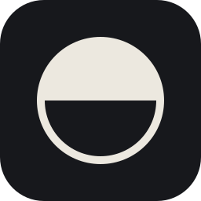
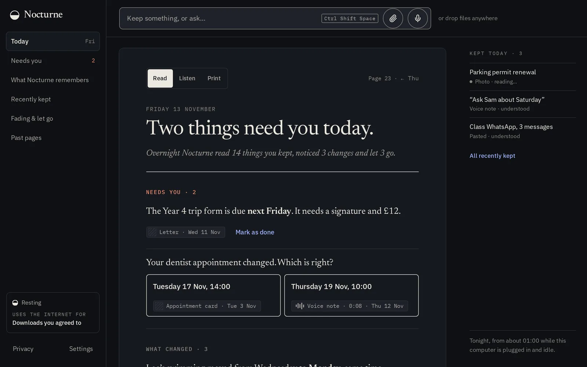

<p align="center">
  
</p>

<h1 align="center">Nocturne</h1>

<p align="center">
  A private desktop app that remembers your day, forgets what does not matter, and hands you one
  page each morning.
</p>

<p align="center">
  <a href="https://github.com/agync/nocturne/actions/workflows/ci.yml"></a>
</p>



Drop in a photo of a letter, a voice note, a screenshot or a line of text. While your computer is
idle, Nocturne reads it, links it to what it already holds, notices what changed and lets go of what
you no longer use. In the morning you get one page: what changed, what needs you, what it let go of,
and one question. Ask it anything and it answers with the original photo or recording as proof.

Website: [nocturne.is](https://nocturne.is)

## What is different

- **Private and local.** Everything runs on your computer through an embedded
  [Lemonade](https://github.com/lemonade-sdk/lemonade) server. No account, no telemetry. The only
  traffic is the model and app downloads you agree to. `make netcheck` runs the built app in a
  loopback-only namespace and fails on any outbound connection.
- **Receipts for every answer.** Each answer and each line of the morning page links to the original
  it came from.
- **Forgetting is reversible.** Things fade when unused and can be brought back. Deleting is a
  separate, explicit, confirmed action.
- **Runs on an 8 GB computer.** Nocturne picks the largest set of models your memory and free disk
  allow, down to a small one for 8 GB machines. No graphics card is needed: Macs with Apple silicon
  and computers with AMD or Intel graphics built in run it on the chip and share the computer's
  memory, an NVIDIA graphics card with 6 GB or more works too, and other computers run it on the
  processor.
- **No jargon.** The interface avoids words like model and token outside an advanced view.

## Install

Packages and checksums are on the [releases page](https://github.com/agync/nocturne/releases). The
[install guide](docs/guide/install.md) covers each package and removal.

| Platform | Packages |
|---|---|
| Linux x86_64 | AppImage, deb, rpm, Flatpak |
| Linux aarch64 | AppImage, deb, rpm, Flatpak |
| macOS, Apple Silicon | dmg |
| Windows x64 | Setup program, msi |

The first release is unsigned, so macOS and Windows may warn before opening it.

## How it works

Nocturne is a [Tauri 2](https://tauri.app) app: a Rust core and a web view interface. The core keeps
everything in one SQLite file and starts and supervises a private Lemonade `lemond` that listens on
loopback only, with a key made at every launch. On first run it reads the computer's memory and
chooses a tier (Tiny, Small, Standard or Large) of models for reading, speech and recall. Models
download only with your agreement.

See [Architecture](docs/architecture/index.md), starting with the
[runtime](docs/architecture/runtime.md).

## Optional features

Both are off until you turn them on.

- **Away from home** pairs your own phone so you can ask, keep and read your page while out. What
  travels is sealed between your phone and your computer, through a connection you choose. That
  connection's company still sees that traffic exists. See the
  [guide](docs/guide/away-from-home.md).
- **Online answers** lets one service you choose write answers. It receives the question and the few
  remembered sentences it needs, never anything marked private. See the
  [guide](docs/guide/online-answers.md).

## Development

Needs Rust 1.90 or newer, Node.js 22 or newer and [pre-commit](https://pre-commit.com). The
`okf` tool validates the docs, and the Go version pinned in
`helpers/tailnet/go.mod` runs that helper's tests.

```bash
make setup        # git hooks and interface dependencies
make dev          # the app with a scripted mind and a scratch data folder
make check        # lint, drift checks and every test: the gate for every change
make package      # Linux packages with the private engine
make help         # every target
```

[Building and packaging](docs/contribution/building.md) has the rest: the real-engine preview, the
package checks and the Windows and macOS builds.

## Documentation

The [docs](docs/index.md) are a wiki kept in the repository.

| Section | What is in it |
|---|---|
| [Overview](docs/overview.md) | What Nocturne is, who it is for, scope |
| [Using Nocturne](docs/guide/index.md) | Install, desktop behaviour, your data |
| [Design](docs/design/index.md) | The concept, forgetting policy, experience principles, data model |
| [Architecture](docs/architecture/index.md) | Shell, engine, Lemonade runtime, remote access |
| [Decisions](docs/adr/index.md) | One decision record per page |
| [Contribution](docs/contribution/index.md) | Procedure, building, the Flatpak, releasing |

## Contributing

Read [CONTRIBUTING.md](CONTRIBUTING.md). AI agents also follow [AGENTS.md](AGENTS.md).

## Security

Report vulnerabilities privately. See [SECURITY.md](SECURITY.md).

## License

Apache-2.0. See [LICENSE](LICENSE).
