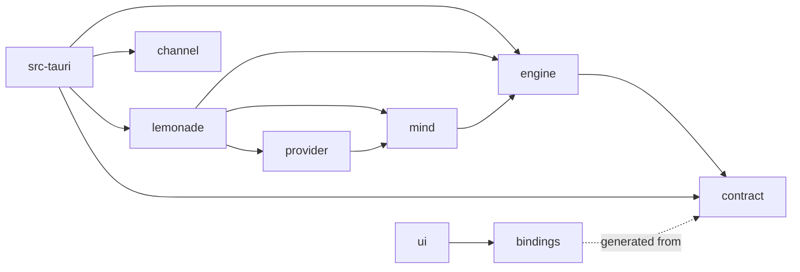

# Repository layout

| Path | Crate or package | Responsibility |
|---|---|---|
| `crates/channel/` | `nocturne-channel` | The sealed channel's pure steps: constants, keys, pairing, session and frames; shared by the computer and the phone app |
| `crates/contract/` | `nocturne-contract` | Types that cross the boundary between engine, app shell and interface; exported to TypeScript |
| `crates/engine/` | `nocturne-engine` | Store, capture, memories, forgetting policy, the page, retrieval, export; the `Mind` trait |
| `crates/intelligence/` | `nocturne-intelligence` | Reading what was kept, the overnight tidy and the scheduler that runs them; builds for the phone |
| `crates/lemonade/` | `nocturne-lemonade` | The private `lemond`: supervision, setup downloads, and the `Mind` implementation over it |
| `crates/mind/` | `nocturne-mind` | The mind's words and judgement apart from any engine: prompts, the reading loop, reading a reply into memories, the guards, receipts, the question asked online, and each job's temperature and token ceiling; builds for the phone |
| `crates/provider/` | `nocturne-provider` | An online provider the person chose: its address rules, one client that reaches only its one host, and the `Mind` a phone alone reads, writes and answers with; builds for the phone |
| `src-tauri/` | `nocturne-app` | Commands, events, windows and the runtime that wires the engine to the shell |
| `src-tauri/src/os/` | part of `nocturne-app` | The desktop: tray, quick keep shortcut, quick capture window, notification, start with the computer, watched folder |
| `src-tauri/src/editions/` | part of `nocturne-app` | The spoken and printed editions of the page |
| `src-tauri/bundle/` | configuration | Packaging overlays merged over `tauri.conf.json` at bundle time (`linux.json`, `windows.json`) |
| `scripts/` | scripts | Fetching the engine, building and checking packages, the launch smoke test, the outbound check, the third-party notices, and their unit tests |
| `ui/` | `nocturne-ui` | The interface; talks only to an `EngineClient` |
| `ui/src/engine/bindings/` | generated | TypeScript types from `crates/contract`; regenerate with `make contract/ts` |

## Contract rules

- The engine returns data, never interface copy. Every user-facing word lives in the interface
  copy deck, except content that came from what the person kept.
- JSON is camelCase; tagged enums carry a `type` field; sizes are bytes as numbers.
- `make contract/check` fails when the committed bindings are stale.
