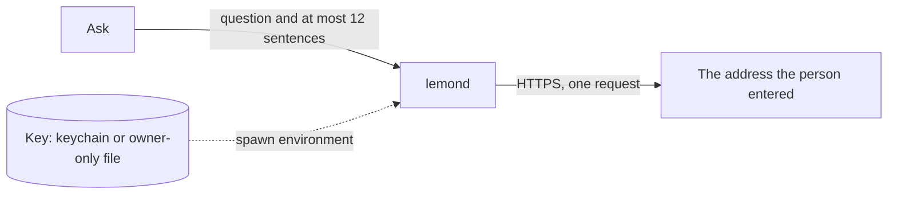

# Online answers

Online answers lets a provider the person entered write the last step of an answer. It is off until
the person turns it on, and it changes nothing about reading, the overnight tidy or the page. The
reasons are in [decision 0011](/adr/0011-online-answers.md).

## The route

- The provider entry is one record in the engine's `config.json` (provider `nocturne_online`, the
  entered address, no plain HTTP) and one fixed model row in its user models, `nocturne-online`,
  whose model name is the one the person entered. Both are written at every launch by one function in
  the supervisor, from the same optional route. Nothing else writes either.
- Off is the default and the state at every launch while off: `cloud_providers` is an empty list, the
  row is removed and the spawn environment holds only the two per-launch keys.
- The key reaches `lemond` only through its spawn environment, as
  `LEMONADE_NOCTURNE_ONLINE_API_KEY`. It is not in argv, in `config.json` or in any request.
- `offline` stays on whatever Online answers is set to, so the engine never asks the provider for its
  list of AIs. It reaches the provider only for a question or for the one connection check.
- A launch for a download the person agreed to leaves the provider out: no entry, no row, no key.
  Questions are answered on this computer, with the reason "downloading", until the window closes and
  the relaunch restores the route.
- Turning on, turning off, a new key or address and each check relaunch the engine. The relaunch waits
  for requests in flight (at most 2 minutes when turning off, 30 seconds otherwise). Turning off first
  closes the gate in the app, so no new online request starts and one in flight is dropped and
  answered on this computer.
- There is no HTTPS client to a provider in the app. Redirects are not followed.

## Addresses

Release builds accept only `https://` addresses with a host. They refuse user names, query strings,
fragments, whitespace, `localhost`, loopback, link-local (including the metadata address
169.254.169.254), unspecified, private network (10/8, 172.16/12, 192.168/16), unique-local IPv6, the
IPv4-mapped forms of these, and names ending `.local`. Nocturne does not resolve names, so a public
name that resolves to a private address passes; that is a stated residual risk. Test builds with the
`online-stand-in` feature also accept one loopback stand-in. The package check fails a package that
carries the feature's marker.

## The choice per question

Ask picks the place for each question. A question goes online only when all of these hold:

- Online answers is on, a key is loaded, and it is not paused or in a problem state;
- no download window is open;
- the person has not chosen "answer on this computer" for this question (the choice resets after
  each question);
- the question came from the desktop, or from a phone while the person has turned on phones for
  online answers with Away from home on;
- at least one memory is left to send after the filters below.

Otherwise the question is answered on this computer, and the answer says why.

## What is sent

Only the question and the memories needed to answer it, at most 12, as plain sentences. The
originals, transcripts, pages and everything else stay here. Before the request is built:

- memories marked private, in any version, and memories being forgotten or let go, are dropped;
- memories about health, money or ID are dropped unless the person turned that on (off by default);
- the exact set to be sent is checked again against the store, and any memory that fails is dropped.

When something was left out, the answer says so. When nothing is left to send, the question is
answered here and nothing is logged as sent. Reading, the overnight tidy and the page have no way
to reach the route: only Ask holds it.

Request: one non-streaming chat request per question with a short reply limit. No tools, no retry.
The reply is checked on this computer like a local one: the same fences around memories, the same
check that every cited memory was sent, and "I am not sure" when the reply does not hold up. An
answer that came back not sure is never sent again automatically.

## Fallback and limits

| What happens | Result |
|---|---|
| No connection, or the provider is unreachable or busy, or it returns a server error | Answered on this computer, with the reason |
| No reply in 6 seconds | A waiting note with "Answer on this computer instead"; at 20 seconds the request is cancelled and answered here |
| The provider refuses the key | Online answers pauses, the person is told once, and a passed check lifts the pause |
| The provider reports no credit | Online answers pauses and the person is told |
| The model name is not found | A problem state; the person fixes the form |
| The monthly limit is reached | Answered here, one notice a month; the count resets on the 1st |
| The reply is "not sure" | Shown as it is, with "Ask on this computer" |

Local failure never goes online. A question counts toward the limit when its request reached the
route, whatever came back. The default limit is 200 questions a month. Money appears only when the
provider reports a cost on its replies.

## The connection check

The check relaunches the engine with a provisional route and sends one fixed question ("Reply with
the word ready.", no memories). Outcomes: works, unreachable, key refused, no credit, model not found,
no internet, not secure, address not allowed, busy, server error, empty reply, cancelled. The
provisional route and the key stay only until the person consents. Leaving the setup, closing the
window or quitting drops them with a relaunch. Turning on needs a passed check and then consent.

## The sent log

Every attempt, question or check, is recorded with the time, the host, the size sent and received
and the result. The text is stored as a template: each memory sentence is replaced by its id plus a
hash of the exact line sent, so the log never holds the memory words twice. The screen shows a line
again only while the memory still hashes the same; otherwise it says the memory was changed or
deleted. The question is stored as typed. Rows are kept 90 days (pruned at launch and daily), are
written to the export as a readable `online/sent.md` without the key, and are cleared by Delete
everything.

## The key

The key is kept in the system keychain (service `Nocturne`). Where there is no keychain, or it is
locked and refuses, it is kept in an owner-only file in the data folder and the advanced view says
so. The file is left out of the export, and "Forget the key" and Delete everything remove it. A key
that cannot be read at launch leaves Online answers in a problem state and answers on this computer.
It never appears in a view, event, notice, log or export.

## Logs and core files

The engine's output goes to Nocturne's own pipe and then to `lemond.log` (owner-only, rotated at
8 MB, 3 files). The pipe withholds text after a provider error body marker, and every following line
until one that starts with the engine's own log prefix, so a multi-line body is withheld whole. Any
occurrence of the key becomes `[key]`, and lines are capped at 1 KB. The engine's log level stays at
`info`, so reply text is never produced. The whole app sets `RLIMIT_CORE` to 0 at start and on Linux is
made undumpable; the engine and its children inherit the limit.

## What the route does not protect

- Anything holding the engine's per-launch key can add a provider or change an address, so that key is
  an admin credential held only by the app and the engine.
- The engine's model servers inherit its environment, key included.
- A public name that resolves to a private address passes the address check.
- The engine's trace streams on loopback need no key; telemetry is off, so they carry nothing.
- System proxy settings are not used, and TLS trust is the engine's bundled default.
- Nocturne cannot check what the provider keeps.

## Verification

Tests use a stand-in provider on loopback and never a real one. The release check has an `online`
network mode ([releasing](/contribution/release.md)), and the privacy targets are in
[evaluation](/design/evaluation.md).
