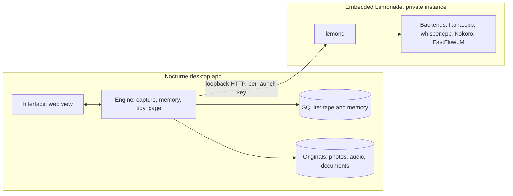

# Runtime

## Components

| Component | Responsibility |
|---|---|
| Interface | Every screen; talks only to the engine, never to Lemonade directly |
| Engine | Capture, understanding queue, extraction, retrieval, the overnight tidy, the page, export |
| SQLite | The tape and the memory in one file the person can copy or delete |
| Originals | Captured files stored by content hash beside the database |
| Embedded Lemonade | A private `lemond` the app starts, supervises and stops |

## Embedded Lemonade lifecycle

Nocturne ships the Lemonade embeddable artifact and runs its own `lemond` as a subprocess, so
people never install or see a separate server.

| Step | Mechanism |
|---|---|
| Find the bundle | `NOCTURNE_LEMOND` (a folder, or the `lemond` file in it), then `lemonade/` among the app's own resources, then, in a debug build only, `vendor/lemonade/<platform>` in the checkout |
| Launch | `lemond` with a scrubbed environment, a random loopback port and a random key per launch; the log says `the private engine <version> is ready on 127.0.0.1:<port>` |
| Isolation | Every working folder (`cache`, `config`, `models`, `logs`, an owner-only `run`) is under `engine/` in the data folder, never beside the program, so a read-only install works; no discovery beacon |
| First run | `GET /v1/system-info` picks the hardware tier and backends; `POST /v1/install` and `POST /v1/pull` download with progress |
| Steady state | `POST /v1/load` and `/v1/unload` on demand; models unload when idle so games and other apps get the memory back |
| Understanding | `/v1/audio/transcriptions`, vision chat for images, `/v1/chat/completions` for extraction and answers, `/v1/embeddings` for recall |
| Voice | `/v1/audio/speech` reads the page aloud |
| Health | `GET /live` and `/v1/health`; the supervisor restarts `lemond` on failure with backoff |
| Shutdown | `POST /internal/shutdown`, then SIGTERM, then SIGKILL, then confirm no process of the group remains (about twelve seconds in all). A process that exits without running its destructors is covered by the engine's own watchdog, which ends it in about six seconds. The app logs `quit: everything stopped` |

## Hardware tiers

The tier is the largest one the memory and the free disk both allow (the disk must hold the
download plus 2 GiB). The source of truth is `crates/lemonade/src/tier.rs`.

| Tier | Needs memory | Mind | Speech | Voice | Recall | Download |
|---|---|---|---|---|---|---|
| Large | 60 GiB | `Qwen3.6-35B-A3B-MTP-GGUF` | `Whisper-Large-v3-Turbo` | `kokoro-v1` | `Qwen3-Embedding-0.6B-GGUF` | about 26.4 GB |
| Standard | 28 GiB | `Qwen3.5-9B-GGUF` | `Whisper-Small` | `kokoro-v1` | `Qwen3-Embedding-0.6B-GGUF` | about 8.4 GB |
| Small | 14 GiB | `Qwen3.5-4B-MTP-GGUF` | `Whisper-Base` | `kokoro-v1` | `Qwen3-Embedding-0.6B-GGUF` | about 4.8 GB |

Below the Small tier, or without the free disk, setup stops before downloading anything and says
why. The backend follows the hardware: Vulkan on an integrated GPU, ROCm on a discrete AMD GPU,
otherwise the CPU. When the machine runs short of memory later, the app offers the next smaller
tier rather than failing, and keeps the working one until the smaller one is ready. The tier is
shown in plain words; model names appear only in the advanced details view.

## Packaged layout

A package carries the program and the engine's bundle as one resource folder.

| Package | Program | Resource folder |
|---|---|---|
| deb, rpm | `/usr/bin/nocturne` | `/usr/lib/Nocturne/` (`lemonade/`, `notices/`, `LICENSE`) |
| AppImage | `usr/bin/nocturne` in the image | `usr/lib/Nocturne/`, with the system libraries it needs in `usr/lib/` |
| Windows | the install folder | `lemonade/`, `notices/`, `LICENSE` |

`lemond` binds loopback only, so nothing is exposed to other computers. See
[Building and packaging](/contribution/building.md) and
[decision 0009](/adr/0009-packaging.md).

## Desktop integration

The shell meets the desktop in `src-tauri/src/os`, started once the app is ready and never from
setup:

| Part | Behaviour |
|---|---|
| Tray | Shown only when the desktop has a notification area (a status notifier host is registered). It shows the state (resting, reading, tidying, needs you, paused), keeps, asks, opens the page, pauses and quits. Without it, closing the window quits the app and a start at login opens the window |
| Quick keep shortcut | `CommandOrControl+Shift+Space` by default. Not grabbed on a Wayland session, where a grab only fires with an X11 window focused; Settings offers a command for a desktop shortcut instead. A change registers the new one before dropping the old |
| Quick capture | A small always-on-top window, made when asked and destroyed when closed. It may call only a short list of commands |
| Notification | One quiet note when the page is ready, at most once per page date, never carrying anything the person kept |
| Start with this computer | On Linux the app writes its own autostart entry (the plugin would start the running executable, which is a temporary mount in an AppImage); it passes `--hidden` |
| Watched folder | Files that appear in a chosen folder are kept once, after they stop changing. The folder is only read. Links are never followed |
| Editions | The spoken page (`src-tauri/src/editions`) and the print view of the page |

## Device placement

| Work | Device | Why |
|---|---|---|
| Answers and extraction | GPU | The large model needs the bandwidth and the KV cache |
| Salience | NPU when idle, otherwise GPU | Low power; optional because the NPU stack is not stable enough to depend on |
| Embeddings | GPU or CPU | NPU embeddings on Linux are not usable in current FastFlowLM releases |
| Store and scheduling | CPU | SQLite and the scheduler are cheap |

The NPU and GPU run sequentially by default; concurrent use is an experiment
([decision 0006](/adr/0006-npu-optional.md)).

## Failure modes

| Failure | Symptom | Response |
|---|---|---|
| `lemond` exits | Requests fail | Restart with backoff; keep capturing; queue understanding |
| A model download stalls | Progress stops | Resume; capture keeps working; explain in one sentence |
| The machine lacks memory for a tier | Load fails | Offer one tier down, keep the working one until it is ready, and say so plainly |
| Extraction is noisy | Many low-confidence facts | Raise the threshold, ask the person, shrink the schema |
| A pasted page injects a false fact | Poisoned memory | Quarantine untrusted sources; require confirmation |
| The laptop sleeps overnight | No tidy ran | Catch up on wake or first open before showing the page |

## Staying local

The engine listens on 127.0.0.1 with a per-launch key, the app makes no other network connection,
and the only downloads are the engine's models and app updates the person allowed, listed in the
download ledger. Because a live count of what a program sends needs privileges the app does not
have, the proof is a release-time check: the app and the engine run in a private network
namespace under `strace` and any attempt to reach beyond the computer fails the release
([decision 0009](/adr/0009-packaging.md)).
