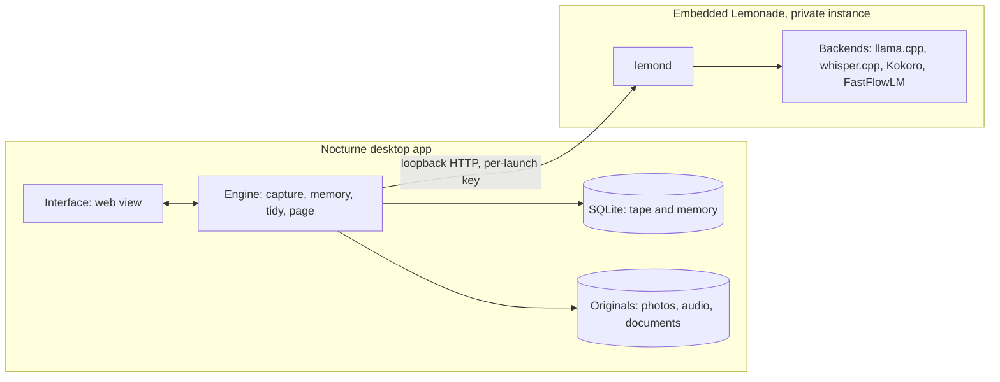

# Runtime

> [!NOTE]
> Target architecture for the rewrite. The interface design comes first; component boundaries are
> confirmed in the implementation plan that follows it.

## Components

| Component | Responsibility |
|---|---|
| Interface | Every screen; talks only to the engine, never to Lemonade directly |
| Engine | Capture, understanding queue, extraction, retrieval, the overnight tidy, the page, export |
| SQLite | The tape and the memory in one file the person can copy or delete |
| Originals | Captured files stored by content hash beside the database |
| Embedded Lemonade | A private `lemond` the app starts, supervises and stops |

## Embedded Lemonade lifecycle

Nocturne ships the Lemonade embeddable artifact and runs its own `lemond` as a subprocess, so
people never install or see a separate server.

| Step | Mechanism |
|---|---|
| Launch | `lemond <app-data-dir>` with a random loopback port and a random `LEMONADE_API_KEY` per launch |
| Isolation | `models_dir` inside app data, so other apps cannot change Nocturne's models; no discovery beacon |
| First run | `GET /v1/system-info` picks the hardware tier and backends; `POST /v1/install` and `POST /v1/pull` download with progress |
| Steady state | `POST /v1/load` and `/v1/unload` on demand; models unload when idle so games and other apps get the memory back |
| Understanding | `/v1/audio/transcriptions`, vision chat for images, `/v1/chat/completions` for extraction and answers, `/v1/embeddings` for recall |
| Voice | `/v1/audio/speech` reads the page aloud |
| Health | `GET /live` and `/v1/health`; the supervisor restarts `lemond` on failure with backoff |
| Shutdown | `POST /internal/shutdown`, then terminate, then confirm no backend children remain |

## Hardware tiers

| Tier | Example | Bundle |
|---|---|---|
| Large | Ryzen AI Max with 64 GB or more | `LMX-Omni-52B-Halo` components |
| Standard | 32 GB laptop or desktop | `LMX-Omni-5.5B-Lite` components |
| Small | 16 GB, integrated graphics | A smaller text model; slower tidy, same features |

The tier is chosen automatically and shown in plain words. Model names appear only in an advanced
details view.

## Device placement

| Work | Device | Why |
|---|---|---|
| Answers and extraction | GPU | The large model needs the bandwidth and the KV cache |
| Salience | NPU when idle, otherwise GPU | Low power; optional because the NPU stack is not stable enough to depend on |
| Embeddings | GPU or CPU | NPU embeddings on Linux are not usable in current FastFlowLM releases |
| Store and scheduling | CPU | SQLite and the scheduler are cheap |

The NPU and GPU run sequentially by default; concurrent use is an experiment
([decision 0006](/adr/0006-npu-optional.md)).

## Failure modes

| Failure | Symptom | Response |
|---|---|---|
| `lemond` exits | Requests fail | Restart with backoff; keep capturing; queue understanding |
| A model download stalls | Progress stops | Resume; capture keeps working; explain in one sentence |
| The machine lacks memory for a tier | Load fails | Drop one tier and say so plainly |
| Extraction is noisy | Many low-confidence facts | Raise the threshold, ask the person, shrink the schema |
| A pasted page injects a false fact | Poisoned memory | Quarantine untrusted sources; require confirmation |
| The laptop sleeps overnight | No tidy ran | Catch up on wake or first open before showing the page |
