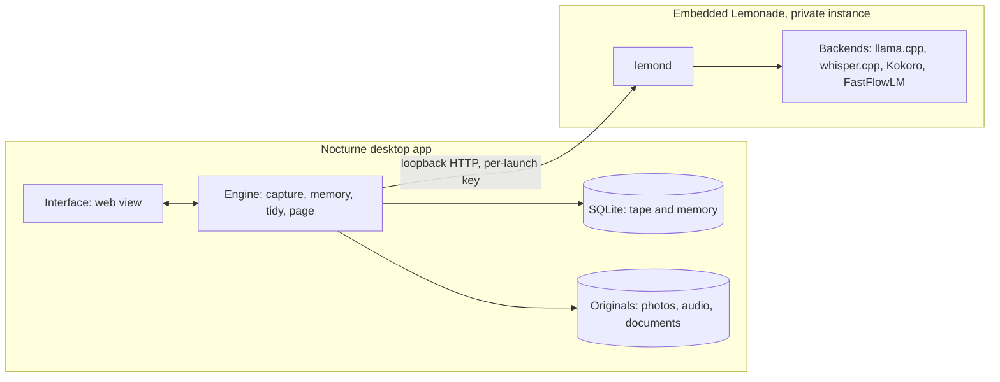

# Runtime

## Components

| Component | Responsibility |
|---|---|
| Interface | Every screen; talks only to the engine, never to Lemonade directly |
| Engine | Capture, understanding queue, extraction, retrieval, the overnight tidy, the page, export |
| SQLite | The tape and the memory in one file the person can copy or delete |
| Originals | Captured files stored by content hash beside the database |
| Embedded Lemonade | A private `lemond` the app starts, supervises and stops |

## Embedded Lemonade lifecycle

Nocturne ships the Lemonade embeddable artifact and runs its own `lemond` as a subprocess, so
people never install or see a separate server.

| Step | Mechanism |
|---|---|
| Find the bundle | `NOCTURNE_LEMOND` (a folder, or the `lemond` file in it), then `lemonade/` among the app's own resources, then, in a debug build only, `vendor/lemonade/<platform>` in the checkout |
| Launch | `lemond` with a scrubbed environment, a random loopback port and a random key per launch; the port is drawn from below the ports systems lend to outgoing connections, so by default no connection is given it while the engine starts; the log says `the private engine <version> is ready on 127.0.0.1:<port>`. On Windows the environment also passes on what Windows sets for every program (`SystemRoot`, `ComSpec`, `PATHEXT` and the like) and `PATH` is the system's own folders. Before it listens the engine reads what the computer has, which on some laptops with two graphics takes over a minute at every start, so a start may take up to five minutes; a minute in, the log says it is still starting. A start that times out logs whether the engine ever listened, the processor time it used and the names of the programs it started that still run |
| Isolation | Every working folder (`cache`, `config`, `models`, an owner-only `run`) is under `engine/` in the data folder, never beside the program, so a read-only install works; no discovery beacon. The engine's log, `lemond.log`, is in the app's `logs/` folder, which "Open logs" opens |
| First run | `GET /v1/system-info` picks the hardware tier and backends; `POST /v1/install` and `POST /v1/pull` download with progress, the NPU runtime and its speech model only when they will be used |
| Steady state | `POST /v1/load` and `/v1/unload` on demand; models unload when idle so games and other apps get the memory back (see [Running on 8 GB](#running-on-8-gb)) |
| Understanding | `/v1/audio/transcriptions`, vision chat for images, `/v1/chat/completions` for extraction and answers, `/v1/embeddings` for recall |
| Voice | `/v1/audio/speech` reads the page aloud |
| Health | `GET /live` and `/v1/health`; the supervisor restarts `lemond` on failure with backoff |
| Shutdown | `POST /internal/shutdown`, then SIGTERM, then SIGKILL, then confirm no process of the group remains (about twelve seconds in all). A process that exits without running its destructors is covered by the engine's own watchdog, which ends it in about six seconds. The app logs `quit: everything stopped` |

## Hardware tiers

The tier is the largest one the memory and the free disk both allow (the disk must hold the
download plus 2 GiB). The source of truth is `crates/lemonade/src/tier.rs`.

| Tier | Needs memory | Mind | Speech | Voice | Recall | Download |
|---|---|---|---|---|---|---|
| Large | 60 GiB | `Qwen3.6-35B-A3B-MTP-GGUF` | `Whisper-Large-v3-Turbo` | `kokoro-v1` | `Qwen3-Embedding-0.6B-GGUF` | about 27.0 GB |
| Standard | 28 GiB | `Qwen3.5-9B-GGUF` | `Whisper-Small` | `kokoro-v1` | `Qwen3-Embedding-0.6B-GGUF` | about 9.0 GB |
| Small | 14 GiB | `Qwen3.5-4B-MTP-GGUF` | `Whisper-Base` | `kokoro-v1` | `Qwen3-Embedding-0.6B-GGUF` | about 4.8 GB |
| Tiny | 6 GiB | `Qwen3.5-2B-GGUF` | `Whisper-Base` | `kokoro-v1` | `Qwen3-Embedding-0.6B-GGUF` | about 3.2 GB |

Large and Standard also fetch the reranking model `bge-reranker-v2-m3-GGUF` (0.64 GB, counted in
the download above), which orders what a search found before the mind answers. It is an extra:
the tier is installed without it, so an install from before it existed keeps working and uses
it once a later setup has fetched it.

The detected tier is the one offered first; the person may choose any smaller one that fits, and
Tiny fits every computer that can run Nocturne at all. Tiny is for 8 GB computers, which report a
little under 8 GiB (an 8 GB Mac reports exactly 8 GiB); it starts at 6 GiB so an 8 GB computer
that reports well under 8 GiB still gets it. Its answers are simpler and it may miss
details, and the setup screen says so. Below the Tiny tier, or without the free disk, setup stops
before downloading anything and says why.

Tiny's mind is told less than the others. Small, Standard and Large share one set of answer
instructions, kept byte for byte (a test pins them). Tiny gets a shorter set with no worked
example, because a two-billion-parameter mind copies an example or an instruction into its answer.
It is shown at most four facts (and any fact on the other side of a disagreement with one of them)
instead of twelve, not a home that a later fact replaces, and dates only on facts in dispute. When
its answer leaves out a number, date or time of a fact it cites, or gives one side of a
disagreement, it is asked once more and the better answer is kept; an answer still one-sided gives
both facts in their own words. A side counts as given only when it is cited and the answer says
what sets it apart from the other side: the days, months, ordinals, times and numbers the other
side does not share, read alike however they are written ("1st" and "first", "2:30pm" and "14:30"),
or, in a dispute over a place, its place. Every tier has the same guards: a reply that is only
punctuation, the instructions read back, a refusal worded as an answer, or the not-sure word in any
spelling is not shown and ends as not sure; a citation with no words before it is not a receipt.
Talk of the facts holding nothing ("not mentioned") voids an answer only when it cites no fact. A
mind on this computer is told the day's date, by the engine's clock and time zone; an online
question is not.

Reading follows a GBNF grammar rather than a JSON schema: the engine parses a request into a map
that sorts keys, so a schema would make the mind write each memory's confidence first and its quote
last. The grammar has it write the quote first, then the sentence, who or what it is about, what is
said, the dates, and its judgements; every text is at most 300 characters and a reply at most 16
memories. An engine that refuses the grammar is asked again by a JSON schema with the same bounds,
and from then on every reading goes that way. The reply is read as it arrives, because a small mind
can fall into a loop until its token ceiling: writing again a memory it already gave, or copying
out the lines about the item ("Today is ..."). A memory that says again what an earlier valid one
said, from the same words (its quote, sentence, subject, predicate and object), ends the request
there. A memory whose quote is three or more whole words of the instructions, and not the item's,
is left out; a second one ends the request. The token ceiling is about six tokens a character for a
short note, at least 512. A reply that loops, is cut off at its token ceiling, or holds 16 memories
is kept as it is when its whole memories keep every number, name and role in the item (the check
below) and quote every sentence of it, or reach its last sentence; otherwise it is read again in
halves, twice at most. A short note cut off that cannot be split is read once more at the
1024-token ceiling every note had before; after that the whole memories it holds are kept. When an
item says something moved and that it "is now" on a day, the prompt has that day read as the new
value of what moved, not as when someone rang. A day the mind writes in a memory's sentence as
YYYY-MM-DD where the item writes "1 December" is put back in the item's words; the object is left
as it is. A day that neither the quote nor its line (with the heading above it) names, by day of
the month, weekday or a phrase such as tomorrow or in three weeks, is dropped from the memory; a
weekday or month that does not match rules a day out only when no day number does.

On mains, when the memories of an item leave out a number or name it gives, or lose who someone
is to the person ("the plumber"), the reader shows the mind the whole item again with those lines
pointed out, once. A word that opens a sentence or follows a greeting ("Thanks, Sam") counts as a
name only when it is a known one or another name follows it. On battery the first reading
stands. After the page, the tidy marks up to eight items kept in the past day whose memories
still leave something out, none of them already marked for a re-read, replaced by a later item or
with a question open; the reader reads each again on mains when nothing else waits, with the
whole item in view and one missing line at a time, without the re-reading notice. One that fails
stays marked and is tried again like any re-read. How each job picks its words is the same on
every tier (a temperature only); a debug build with the `test-sampling` feature lets
`NOCTURNE_TEST_SAMPLING` change it for evaluation runs. The mind's raw replies are traced at trace
level on their own target, `nocturne::reply`, so a log kept at info never holds them.

The backend follows the hardware, one choice per engine recipe (`tier::choose_backend`): Metal on
a Mac (the engine offers nothing else there), ROCm on a discrete AMD GPU, Vulkan on any other
graphics (AMD integrated, NVIDIA, Intel), otherwise the CPU. A backend the engine reports as
unsupported for the recipe is never chosen; the choice then falls to the CPU, except on a Mac. The
engine's CUDA backend is not used: it serves llama.cpp only (speech and voice would still need
another backend), needs a Turing or newer card and brings a runtime of its own, while Vulkan runs on
every NVIDIA card the engine finds and shares one download with the other graphics.

What the pinned engine reports, from its source and from a real `lemond` on an AMD machine:

| Graphics | `devices` entry | Backends it lists as usable for llama.cpp |
|---|---|---|
| AMD | `amd_gpu`, one per GPU: `available`, `integrated`, `family` (`gfx...`), `vram_gb` | `rocm` (families it supports), `vulkan` |
| NVIDIA | `nvidia_gpu`, one per card: `available`, `name`, `family` (`sm_...`), `compute_capability`, `vram_gb`, `driver_version`; with none, one entry with `available` false and an `error`. Discrete cards only, so no `integrated` field | `cuda` (Turing and newer), `vulkan` |
| Intel | none: the engine has no Intel entry | `vulkan`, because the Vulkan backend lists the CPU as a device it runs on, so it is installable on every x86-64 computer |

Because the engine says nothing about Intel graphics, `graphics::intel_gpus` finds them on the
computer: on Linux a PCI display device from Intel that has a driver and a render node, with
`/dev/dri` in view (so a container without the device stays on the CPU); on Windows a connected
Intel display adapter, from `pnputil`. `Client::use_host_graphics` (turned on by the app, never by tests) adds the result to
`devices.intel_gpu`, which an engine that reports Intel graphics itself fills the same way. The
lookup runs once per launch.

Graphics memory does not enter the memory budget, which is the computer's. The pool of a discrete
card, as the engine reports its `vram_gb`, only lifts the engine's size cap, as the engine's own
memory pools do. The Intel graphics found on the computer carry no size and count as integrated.
A model larger than a card's memory is not refused: Nocturne passes no layer count, so llama.cpp
offloads as many layers as the card has room for (its `--fit` default) and keeps the rest in the
computer's memory, which the budget already counts in full. A card with less room should
therefore be slower rather than fail. When the machine runs short of memory later, the app offers the next smaller tier rather than failing (Large to Standard,
Standard to Small, Small to Tiny; Tiny has nothing smaller), and keeps the working one until the
smaller one is ready. The tier is shown in plain words; model names appear only in the advanced
details view.

## Running on 8 GB

An 8 GB computer, an 8 GB MacBook in particular, must keep about 3.5 GB for the system and the
person's other apps. Nocturne's share, everything included (the app, its web view, the engine and
the models it has loaded), is therefore at most 4.5 GB at its busiest and close to nothing when it
has nothing to do. Tiny's floor is 6 GiB of reported memory; a computer between 6 and 8 GiB gets
the same budget and the same measures below.

| Moment | Budget | What is loaded |
|---|---|---|
| Idle, window open or closed | 0.5 GB, processor near zero | Nothing but the app and the engine |
| Reading what was kept (text, photo, voice) | 4.5 GB | The mind, recall and, for a recording, speech |
| Answering | 4.5 GB | The mind and recall |
| The overnight tidy | 4.5 GB | The mind and recall |
| Reading the page aloud | 3.5 GB | The voice on its own |
| After 30 minutes idle | 0.5 GB | Nothing but the app and the engine |

How Nocturne keeps to it:

| Measure | Where | Effect |
|---|---|---|
| Recall loads with an 8192 context | `tier::RECALL_CONTEXT`, saved in the engine's `recipe_options.json` at each launch (the engine raises anything smaller to 8192) | Left to itself the engine gives the recall model 32768, about 3.7 GB of cache it never uses |
| Small llama.cpp caches on Tiny and Small | `config::llamacpp_args` (`--cache-ram 256 --ctx-checkpoints 4`) in the engine's `config.json`, set at launch from the installed tier and again when the mind is ready | The defaults keep up to 8 GiB of old prompts and 32 snapshots per conversation, which grow with every answer. Standard and Large keep the defaults, which were not measured with these caps |
| Idle models are unloaded by the engine | `auto_evict` in `config.json`, and `evict_idle_timeout` saved per model by `residency::saved_options` (voice 60 seconds, speech 120, the Tiny mind 180; the other minds and recall keep the engine's 300). A load that saves its own options sends these too, so they are not dropped | Memory goes back to the computer between uses; the next request loads the model again with its saved options. The engine never evicts a model that is serving a request. On a Mac the engine has no memory-pressure eviction, so these timers are the only thing that frees memory there |
| Every model's context is saved | `residency::saved_options`, and `ctx_size` 8192 in `config.json` as the default | A model loaded with nothing saved would be sized to fill the free memory |
| One model of each kind at a time | `max_loaded_models` 1 in `config.json`, 2 while the NPU's mind reads beside the GPU mind (`Npu::models_per_kind`) | A second mind loads beside the first only where the budget holds both |
| The voice runs alone on Tiny and Small | `residency::alone`, `Client::set_alone`, and `Mind::ready_to_speak`, called once per page | Before the page is read aloud, every other model that is not busy is unloaded once, so the voice (2 to 3 GB while it speaks) never shares memory with the mind; the engine has no setting for this |
| The page is read aloud one line at a time | `editions::speech::make` asks the voice for one line per request and `wav::Joiner` takes each answer into the file at once | The voice's memory grows with the length of what it is asked to say, so no request is longer than a line, and nothing is held between requests but the samples. Section starts are still written into the file, so skipping between sections works as before |
| No overnight tidy on battery | the scheduler | The night tidy waits for mains power; the one deliberate exception is the catch-up tidy after a sleep or a missed night, which keeps running on battery above 40 per cent (the owner decided this); below 40 it waits for power unless the person asks |

The real end-to-end test (`make e2e-real`, with `NOCTURNE_E2E_TIER=tiny`) samples the memory and
processor use of the app and every process under it in each phase, on Linux from `/proc` (with
the graphics memory each process holds) and on a Mac from `/usr/bin/footprint` and `ps` (the
larger of footprint and resident set, since the footprint leaves out model files the engine
maps), and writes them to its summary.

Measured on the Tiny tier with this branch's final build, without the test's own use of the
voice to make a recording; the idle rows come from the real app with its web view, on an earlier
build of the branch whose idle behaviour is the same:

| Moment | Linux, integrated Radeon (Vulkan) | Mac, Apple M4 Max (Metal) |
|---|---|---|
| Idle, window open | 0.43 GB, 0.4 per cent of one core | 0.1 GB footprint; 0.7 per cent of one core without the window |
| Reading | 5.0 GB | 4.7 GB |
| Answering | 5.2 GB | 4.4 GB |
| Reading the page aloud | 2.5 GB | 3.8 GB |
| Five minutes after the last use | 0.5 GB on average over six minutes | 0.7 GB on average over six minutes |

On a Mac the Tiny tier fits the budget when idle and while answering. It is about 0.2 GB over
while reading a recording, when the speech model is loaded beside the mind and the recall model
(1.7 GB with its cache), and about 0.3 GB over while reading a long page aloud, when the voice
alone grows to 3.7 GB. On Linux with an integrated GPU the model servers hold more graphics
memory, about 0.7 GB more in all; the voice there stays near 2.5 GB.

The same test samples reading the page aloud as a phase of its own (`speak_page`, with each
process's own highest reading). On Linux with an integrated GPU the voice process peaked at 3.46
GB when a section was one request and at 2.9 to 3.3 GB (five runs, 3.07 GB on average) when each
line was; run-to-run spread is about 0.2 GB, so the saving is real but not exact, and the voice
on a Mac was not measured again.

## Packaged layout

A package carries the program and the engine's bundle as one resource folder.

| Package | Program | Resource folder |
|---|---|---|
| deb, rpm | `/usr/bin/nocturne` | `/usr/lib/Nocturne/` (`lemonade/`, `notices/`, `LICENSE`) |
| AppImage | `usr/bin/nocturne` in the image | `usr/lib/Nocturne/`, with the system libraries it needs in `usr/lib/` |
| Windows | the install folder | `lemonade/`, `notices/`, `LICENSE` |

`lemond` binds loopback only, so nothing is exposed to other computers. See
[Building and packaging](/contribution/building.md) and
[decision 0009](/adr/0009-packaging.md).

## Desktop integration

The shell meets the desktop in `src-tauri/src/os`, started once the app is ready and never from
setup:

| Part | Behaviour |
|---|---|
| Tray | Shown only when the desktop has a notification area (a status notifier host is registered). It shows the state (resting, reading, tidying, needs you, paused), keeps, asks, offers "Check in…", opens the page, pauses and quits. Without it, closing the window quits the app and a start at login opens the window |
| Quick keep shortcut | `CommandOrControl+Shift+Space` by default. Not grabbed on a Wayland session, where a grab only fires with an X11 window focused: there the desktop's GlobalShortcuts portal holds it, in a session per shortcut, and may ask the person first and bind other keys. Settings then shows the keys the desktop bound and opens the desktop's own shortcut settings (portal version 2) to change them, or offers Try again when the desktop did not add it. Without that portal Settings offers a command for a desktop shortcut instead. A change registers the new one before dropping the old |
| Quick capture | A small always-on-top window, made when asked and destroyed when closed. It may call only a short list of commands |
| Notification | One quiet note when the page is ready, at most once per page date, never carrying anything the person kept |
| Notification, evening reminder | A second note, off by default, at the time the person picks, with always the same words and never anything kept, so no journal content is ever in a notification |
| Start with this computer | On Linux the app writes its own autostart entry (the plugin would start the running executable, which is a temporary mount in an AppImage); it passes `--hidden`. In a Flatpak the Background portal writes it |
| Watched folder | Files that appear in a chosen folder are kept once, after they stop changing. The folder is only read. Links are never followed |
| Scheduler | The morning page run starts after the day boundary, separate from the overnight tidy. Its first step writes the reflection for the day that ended, then any recap that is due. A missed night runs in the catch-up, newest first, up to seven days back |
| Editions | The spoken page (`src-tauri/src/editions`) and the print view of the page. The spoken page skips any line with `journal` sensitivity and the journal's quiet line and question, and ends with the count of lines left unread |

## Device placement

| Work | Device | Why |
|---|---|---|
| Answers | GPU; NPU (`gemma4-it-e4b-FLM`) where only one mind fits on shared memory | The mind needs the bandwidth and the KV cache; the NPU where the GPU mind does not fit beside it ([decision 0014](/adr/0014-npu-mind.md)) |
| Reading items | NPU (`gemma4-it-e4b-FLM`) when usable and it fits, otherwise the GPU mind | Leaves the GPU to answers ([decision 0014](/adr/0014-npu-mind.md)) |
| Reading recordings | NPU (`whisper-v3-turbo-FLM`) when usable and it fits, otherwise the tier's speech model on the GPU or CPU | Leaves the GPU to answers and reading ([decision 0006](/adr/0006-npu-optional.md)) |
| Finding memories, reranking | GPU or CPU | The NPU embedding model has no GPU twin, so a fallback would mix vectors; no NPU reranker |
| Reading aloud | CPU (Metal on a Mac) | No NPU voice in the catalogue |
| Store and scheduling | CPU | SQLite and the scheduler are cheap |

`crates/lemonade/src/npu.rs` decides. At each mind start it reads `system-info` (`amd_npu` and the
`flm:npu` backend; on Linux an XDNA 2 device on the PCI bus with no driver counts as an NPU whose
driver is missing), whether the person chose a speech model, and whether the tier's busiest moment
with the NPU model (1.0 GB measured, in `fit_table`) still Fits. A failed NPU load or request is read
again by the tier's speech model; when that works the NPU is left alone until the engine restarts,
and the engine's reason (`flm validate`: driver, kernel, firmware, memory lock) is kept for the
advanced details. Setup fetches the runtime and the model as optional steps, only when they will be
used. `npu::placement` decides where the mind's work runs: Split (the NPU's mind reads, the GPU
mind answers, both loaded) where both fit, NPU only (the NPU's mind reads and answers) on shared
memory where only one fits, GPU otherwise. A graphics card that holds the GPU mind keeps it out of
the computer's memory budget. Reading requests to the NPU carry the reading JSON schema, since
FastFlowLM ignores a grammar. The engine counts models per kind across every device, so in Split
`max_loaded_models` is 2. Work the NPU cannot do goes to the GPU mind; three failures in a row
leave it all there until Nocturne restarts. Nothing is placed by how busy the GPU is.

## Failure modes

| Failure | Symptom | Response |
|---|---|---|
| `lemond` exits | Requests fail | Restart with backoff; keep capturing; queue understanding |
| A model download stalls | Progress stops | Resume; capture keeps working; explain in one sentence |
| The machine lacks memory for a tier | Load fails | Offer one tier down, keep the working one until it is ready, and say so plainly |
| Extraction is noisy | Many low-confidence facts | Raise the threshold, ask the person, shrink the schema |
| A pasted page injects a false fact | Poisoned memory | Quarantine untrusted sources; require confirmation |
| The laptop sleeps overnight | No tidy ran | Catch up on wake or first open before showing the page |

## Staying local

The engine listens on 127.0.0.1 with a per-launch key. A second per-launch key, held only by the
supervisor, guards the engine's `/internal/*` endpoints and is never given to the client that
talks to the models. The engine's browser-origin list names an origin that cannot exist, so no
web page is allowed by the list; the engine still admits loopback and desktop-app origins by
rule, and the key is what stops those. The app makes no other network connection,
and the only downloads are the engine's models and app updates the person allowed, listed in the
download ledger. Because a live count of what a program sends needs privileges the app does not
have, the proof is a release-time check: the app and the engine run in a private network
namespace under `strace` and any attempt to reach beyond the computer fails the release
([decision 0009](/adr/0009-packaging.md)).

The one exception is Away from home, which is off until the person turns it on. While it is on,
sealed traffic goes to the person's own paired phones through the connection they chose, and that
connection's helper makes its own upkeep traffic to its company's servers and relays. The
listener for phones is local (an owner-only Unix socket, or loopback on Windows), but the feature
is not: the Tailscale helper binds UDP on every network interface while on, and both helpers talk to
their company. The release check allows that only for helper processes and fails it for the app and
the engine ([remote access](remote.md), [decision 0010](/adr/0010-away-from-home.md)).

The second exception is Online answers, which is also off until the person turns it on, and only
after a passed check and consent. While it is on, the engine, not the app, reaches the one address
the person entered, with a question and the few remembered sentences needed to answer it, never
anything marked private, and for the connection check, which sends one fixed test question and no
memories. The app has no connection to the provider. The key is never in the engine's environment:
after each engine start Nocturne loads the online entry and hands the key over in memory on
loopback, and the engine makes one request to the provider's list of models at that moment. Turning
off, forgetting the key, Delete everything and an abandoned check clear the key from the engine at
once. If the engine refuses the key or loses the route, nothing is sent and questions are answered on
this computer until "Try again" or a check brings it back. While it is off the engine has no provider
and no key. The release check allows a non-loopback connection only from the engine, only to that
address and only for questions, the check and the start-up listing (`make netcheck-online`;
[online answers](online.md), [decision 0011](/adr/0011-online-answers.md)).

## Choosing models

The tier is the preset. Settings ("Choose what runs each job", also linked from the advanced
details) lets the person pick a model for each job: answering, reading recordings, reading aloud and
finding memories. Choices come only from the engine's own
catalogue, never from a pasted address, and a job lists only models that suit it (answering needs a
model that reads pictures and does not think aloud, and every job needs a model that takes the
8192-token context Nocturne loads it with, except reading recordings and reading aloud). Only one
change runs at a time, and none while setup is downloading. A pick that is not on the computer downloads
only after the person says yes, inside the same download window setup uses.

| Part | Behaviour |
|---|---|
| Selection | `selection.json` beside the engine record holds the per-job choice. The supervisor reads it at launch for saved options and the runtime builds its picks from it. When setup moves to another tier the other jobs' choices go with the old tier; the finding choice stays, because its vectors fill the store. "Reset to" the tier sets every job back to the tier's own model when each is on the computer; the finding job goes back through a re-read. A copy is part of the export (as `models.json`), and Delete everything removes it |
| Fit | Each row is marked Fits, Tight, Won't fit or Can't use, with one reason. The budget is the smaller of 0.55 x RAM + 1.7 GiB and RAM - 1.0 GiB. The need is the busiest of three moments: reading (mind, recall and speech together, plus the extra a measured tier preset needed at its busiest), speaking (the voice alone where it runs alone, else beside the mind and recall) and an idle floor of 0.5 GB. Fits is at most 0.85 of the budget and Tight at most the budget. Can't use covers a backend this computer lacks, a model larger than the engine accepts, and not enough free disk. Every tier preset fits at its own minimum, and a test keeps it so. Models not in the shipped table are estimated as their size plus 1.2 GB (0.35 GB more for one that drafts); a model is marked not tested with Nocturne unless the table says it was tested |
| Switching | The current model keeps working until the new one is present, then one step changes it. The old model is kept unless the person removes it; the offer to free its space has "Keep it" first and removes nothing without a click. A change that finds the new model already on the computer switches at once, with no download |
| Finding memories | Changing the finding model re-reads memories in the background into a second table while the old index keeps answering, then swaps in one transaction. Asking and reading go first, memories added meanwhile are caught up in the old index as well, a restart carries on, and cancel drops the second table. A re-read that keeps failing, or cannot read too many memories, is cancelled the same way and the old index stays. Each row records which model made it |
| Ledger | Every finished model download writes a ledger entry with the model name and size. A passed connection check and turning Online answers on or off write ledger entries too |

The memory figures behind the budget are the measured peaks in Running on 8 GB, and the larger tiers
are estimates until measured.
