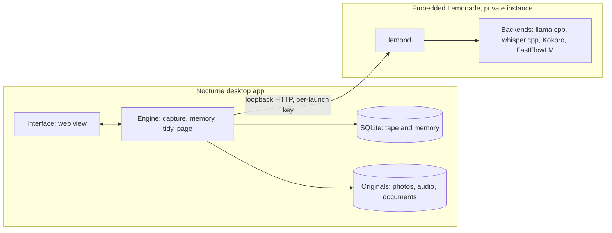

# Runtime

## Components

| Component | Responsibility |
|---|---|
| Interface | Every screen; talks only to the engine, never to Lemonade directly |
| Engine | Capture, understanding queue, extraction, retrieval, the overnight tidy, the page, export |
| SQLite | The tape and the memory in one file the person can copy or delete |
| Originals | Captured files stored by content hash beside the database |
| Embedded Lemonade | A private `lemond` the app starts, supervises and stops |

## Embedded Lemonade lifecycle

Nocturne ships the Lemonade embeddable artifact and runs its own `lemond` as a subprocess, so
people never install or see a separate server.

| Step | Mechanism |
|---|---|
| Find the bundle | `NOCTURNE_LEMOND` (a folder, or the `lemond` file in it), then `lemonade/` among the app's own resources, then, in a debug build only, `vendor/lemonade/<platform>` in the checkout |
| Launch | `lemond` with a scrubbed environment, a random loopback port and a random key per launch; the log says `the private engine <version> is ready on 127.0.0.1:<port>` |
| Isolation | Every working folder (`cache`, `config`, `models`, `logs`, an owner-only `run`) is under `engine/` in the data folder, never beside the program, so a read-only install works; no discovery beacon |
| First run | `GET /v1/system-info` picks the hardware tier and backends; `POST /v1/install` and `POST /v1/pull` download with progress |
| Steady state | `POST /v1/load` and `/v1/unload` on demand; models unload when idle so games and other apps get the memory back (see [Running on 8 GB](#running-on-8-gb)) |
| Understanding | `/v1/audio/transcriptions`, vision chat for images, `/v1/chat/completions` for extraction and answers, `/v1/embeddings` for recall |
| Voice | `/v1/audio/speech` reads the page aloud |
| Health | `GET /live` and `/v1/health`; the supervisor restarts `lemond` on failure with backoff |
| Shutdown | `POST /internal/shutdown`, then SIGTERM, then SIGKILL, then confirm no process of the group remains (about twelve seconds in all). A process that exits without running its destructors is covered by the engine's own watchdog, which ends it in about six seconds. The app logs `quit: everything stopped` |

## Hardware tiers

The tier is the largest one the memory and the free disk both allow (the disk must hold the
download plus 2 GiB). The source of truth is `crates/lemonade/src/tier.rs`.

| Tier | Needs memory | Mind | Speech | Voice | Recall | Download |
|---|---|---|---|---|---|---|
| Large | 60 GiB | `Qwen3.6-35B-A3B-MTP-GGUF` | `Whisper-Large-v3-Turbo` | `kokoro-v1` | `Qwen3-Embedding-0.6B-GGUF` | about 26.4 GB |
| Standard | 28 GiB | `Qwen3.5-9B-GGUF` | `Whisper-Small` | `kokoro-v1` | `Qwen3-Embedding-0.6B-GGUF` | about 8.4 GB |
| Small | 14 GiB | `Qwen3.5-4B-MTP-GGUF` | `Whisper-Base` | `kokoro-v1` | `Qwen3-Embedding-0.6B-GGUF` | about 4.8 GB |
| Tiny | 6 GiB | `Qwen3.5-2B-GGUF` | `Whisper-Base` | `kokoro-v1` | `Qwen3-Embedding-0.6B-GGUF` | about 3.2 GB |

The detected tier is the one offered first; the person may choose any smaller one that fits, and
Tiny fits every computer that can run Nocturne at all. Tiny is for 8 GB computers, which report a
little under 8 GiB (an 8 GB Mac reports exactly 8 GiB); it starts at 6 GiB so an 8 GB computer
that reports well under 8 GiB still gets it. Its answers are simpler and it may miss
details, and the setup screen says so. Below the Tiny tier, or without the free disk, setup stops
before downloading anything and says why.

Tiny's mind is told less than the others. Small, Standard and Large share one set of answer
instructions, kept byte for byte (a test pins them). Tiny gets a shorter set with no worked
example, because a two-billion-parameter mind copies an example or an instruction into its
answer. It is shown at most four facts (and any fact on the other side of a disagreement with
one of them) instead of twelve, not a home that a later fact replaces, and dates only on facts
in dispute. When its answer leaves out a number, date or time of a fact it cites, or gives one
side of a disagreement, it is asked once more and the better answer is kept. Every tier has the
same guards: a reply that is only punctuation, the instructions read back, a refusal worded as an
answer, or the not-sure word in any spelling is not shown and ends as not sure; a citation with
no words before it is not a receipt.

The backend follows the hardware: Metal on a Mac (the engine offers nothing else there), Vulkan on
an integrated GPU, ROCm on a discrete AMD GPU, otherwise the CPU. When the machine runs short of
memory later, the app offers the next smaller tier rather than failing (Large to Standard,
Standard to Small, Small to Tiny; Tiny has nothing smaller), and keeps the working one until the
smaller one is ready. The tier is shown in plain words; model names appear only in the advanced
details view.

## Running on 8 GB

An 8 GB computer, an 8 GB MacBook in particular, must keep about 3.5 GB for the system and the
person's other apps. Nocturne's share, everything included (the app, its web view, the engine and
the models it has loaded), is therefore at most 4.5 GB at its busiest and close to nothing when it
has nothing to do. Tiny's floor is 6 GiB of reported memory; a computer between 6 and 8 GiB gets
the same budget and the same measures below.

| Moment | Budget | What is loaded |
|---|---|---|
| Idle, window open or closed | 0.5 GB, processor near zero | Nothing but the app and the engine |
| Reading what was kept (text, photo, voice) | 4.5 GB | The mind, recall and, for a recording, speech |
| Answering | 4.5 GB | The mind and recall |
| The overnight tidy | 4.5 GB | The mind and recall |
| Reading the page aloud | 3.5 GB | The voice on its own |
| After 30 minutes idle | 0.5 GB | Nothing but the app and the engine |

How Nocturne keeps to it:

| Measure | Where | Effect |
|---|---|---|
| Recall loads with an 8192 context | `tier::RECALL_CONTEXT`, saved in the engine's `recipe_options.json` at each launch (the engine raises anything smaller to 8192) | Left to itself the engine gives the recall model 32768, about 3.7 GB of cache it never uses |
| Small llama.cpp caches on Tiny and Small | `config::llamacpp_args` (`--cache-ram 256 --ctx-checkpoints 4`) in the engine's `config.json`, set at launch from the installed tier and again when the mind is ready | The defaults keep up to 8 GiB of old prompts and 32 snapshots per conversation, which grow with every answer. Standard and Large keep the defaults, which were not measured with these caps |
| Idle models are unloaded by the engine | `auto_evict` in `config.json`, and `evict_idle_timeout` saved per model by `residency::saved_options` (voice 60 seconds, speech 120, the Tiny mind 180; the other minds and recall keep the engine's 300). A load that saves its own options sends these too, so they are not dropped | Memory goes back to the computer between uses; the next request loads the model again with its saved options. The engine never evicts a model that is serving a request. On a Mac the engine has no memory-pressure eviction, so these timers are the only thing that frees memory there |
| Every model's context is saved | `residency::saved_options`, and `ctx_size` 8192 in `config.json` as the default | A model loaded with nothing saved would be sized to fill the free memory |
| One model of each kind at a time | `max_loaded_models` 1 in `config.json` | A second mind never loads beside the first |
| The voice runs alone on Tiny and Small | `residency::alone`, `Client::set_alone`, and `Mind::ready_to_speak`, called once per page | Before the page is read aloud, every other model that is not busy is unloaded once, so the voice (2 to 3 GB while it speaks) never shares memory with the mind; the engine has no setting for this |
| The page is read aloud one line at a time | `editions::speech::make` asks the voice for one line per request and `wav::Joiner` takes each answer into the file at once | The voice's memory grows with the length of what it is asked to say, so no request is longer than a line, and nothing is held between requests but the samples. Section starts are still written into the file, so skipping between sections works as before |
| No overnight tidy on battery | the scheduler | The night tidy waits for mains power; the one deliberate exception is the catch-up tidy after a sleep or a missed night, which keeps running on battery above 40 per cent (the owner decided this); below 40 it waits for power unless the person asks |

The real end-to-end test (`make e2e-real`, with `NOCTURNE_E2E_TIER=tiny`) samples the memory and
processor use of the app and every process under it in each phase, on Linux from `/proc` (with
the graphics memory each process holds) and on a Mac from `/usr/bin/footprint` and `ps` (the
larger of footprint and resident set, since the footprint leaves out model files the engine
maps), and writes them to its summary.

Measured on the Tiny tier with this branch's final build, without the test's own use of the
voice to make a recording; the idle rows come from the real app with its web view, on an earlier
build of the branch whose idle behaviour is the same:

| Moment | Linux, integrated Radeon (Vulkan) | Mac, Apple M4 Max (Metal) |
|---|---|---|
| Idle, window open | 0.43 GB, 0.4 per cent of one core | 0.1 GB footprint; 0.7 per cent of one core without the window |
| Reading | 5.0 GB | 4.7 GB |
| Answering | 5.2 GB | 4.4 GB |
| Reading the page aloud | 2.5 GB | 3.8 GB |
| Five minutes after the last use | 0.5 GB on average over six minutes | 0.7 GB on average over six minutes |

On a Mac the Tiny tier fits the budget when idle and while answering. It is about 0.2 GB over
while reading a recording, when the speech model is loaded beside the mind and the recall model
(1.7 GB with its cache), and about 0.3 GB over while reading a long page aloud, when the voice
alone grows to 3.7 GB. On Linux with an integrated GPU the model servers hold more graphics
memory, about 0.7 GB more in all; the voice there stays near 2.5 GB.

The same test samples reading the page aloud as a phase of its own (`speak_page`, with each
process's own highest reading). On Linux with an integrated GPU the voice process peaked at 3.46
GB when a section was one request and at 2.9 to 3.3 GB (five runs, 3.07 GB on average) when each
line was; run-to-run spread is about 0.2 GB, so the saving is real but not exact, and the voice
on a Mac was not measured again.

## Packaged layout

A package carries the program and the engine's bundle as one resource folder.

| Package | Program | Resource folder |
|---|---|---|
| deb, rpm | `/usr/bin/nocturne` | `/usr/lib/Nocturne/` (`lemonade/`, `notices/`, `LICENSE`) |
| AppImage | `usr/bin/nocturne` in the image | `usr/lib/Nocturne/`, with the system libraries it needs in `usr/lib/` |
| Windows | the install folder | `lemonade/`, `notices/`, `LICENSE` |

`lemond` binds loopback only, so nothing is exposed to other computers. See
[Building and packaging](/contribution/building.md) and
[decision 0009](/adr/0009-packaging.md).

## Desktop integration

The shell meets the desktop in `src-tauri/src/os`, started once the app is ready and never from
setup:

| Part | Behaviour |
|---|---|
| Tray | Shown only when the desktop has a notification area (a status notifier host is registered). It shows the state (resting, reading, tidying, needs you, paused), keeps, asks, opens the page, pauses and quits. Without it, closing the window quits the app and a start at login opens the window |
| Quick keep shortcut | `CommandOrControl+Shift+Space` by default. Not grabbed on a Wayland session, where a grab only fires with an X11 window focused; Settings offers a command for a desktop shortcut instead. A change registers the new one before dropping the old |
| Quick capture | A small always-on-top window, made when asked and destroyed when closed. It may call only a short list of commands |
| Notification | One quiet note when the page is ready, at most once per page date, never carrying anything the person kept |
| Start with this computer | On Linux the app writes its own autostart entry (the plugin would start the running executable, which is a temporary mount in an AppImage); it passes `--hidden` |
| Watched folder | Files that appear in a chosen folder are kept once, after they stop changing. The folder is only read. Links are never followed |
| Editions | The spoken page (`src-tauri/src/editions`) and the print view of the page |

## Device placement

| Work | Device | Why |
|---|---|---|
| Answers and extraction | GPU | The large model needs the bandwidth and the KV cache |
| Salience | NPU when idle, otherwise GPU | Low power; optional because the NPU stack is not stable enough to depend on |
| Embeddings | GPU or CPU | NPU embeddings on Linux are not usable in current FastFlowLM releases |
| Store and scheduling | CPU | SQLite and the scheduler are cheap |

The NPU and GPU run sequentially by default; concurrent use is an experiment
([decision 0006](/adr/0006-npu-optional.md)).

## Failure modes

| Failure | Symptom | Response |
|---|---|---|
| `lemond` exits | Requests fail | Restart with backoff; keep capturing; queue understanding |
| A model download stalls | Progress stops | Resume; capture keeps working; explain in one sentence |
| The machine lacks memory for a tier | Load fails | Offer one tier down, keep the working one until it is ready, and say so plainly |
| Extraction is noisy | Many low-confidence facts | Raise the threshold, ask the person, shrink the schema |
| A pasted page injects a false fact | Poisoned memory | Quarantine untrusted sources; require confirmation |
| The laptop sleeps overnight | No tidy ran | Catch up on wake or first open before showing the page |

## Staying local

The engine listens on 127.0.0.1 with a per-launch key. A second per-launch key, held only by the
supervisor, guards the engine's `/internal/*` endpoints and is never given to the client that
talks to the models. The engine's browser-origin list names an origin that cannot exist, so no
web page is allowed by the list; the engine still admits loopback and desktop-app origins by
rule, and the key is what stops those. The app makes no other network connection,
and the only downloads are the engine's models and app updates the person allowed, listed in the
download ledger. Because a live count of what a program sends needs privileges the app does not
have, the proof is a release-time check: the app and the engine run in a private network
namespace under `strace` and any attempt to reach beyond the computer fails the release
([decision 0009](/adr/0009-packaging.md)).

The one exception is Away from home, which is off until the person turns it on. While it is on,
sealed traffic goes to the person's own paired phones through the connection they chose, and that
connection's helper makes its own upkeep traffic to its company's servers and relays. The
listener for phones is local (an owner-only Unix socket, or loopback on Windows), but the feature
is not: the Tailscale helper binds UDP on every network interface while on, and both helpers talk to
their company. The release check allows that only for helper processes and fails it for the app and
the engine ([remote access](remote.md), [decision 0010](/adr/0010-away-from-home.md)).
