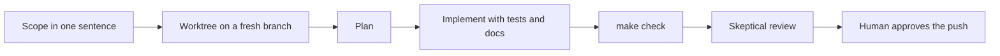

# Contribution guide

## Set up

```bash
.agents/bootstrap.sh   # installs the git hooks and the local scratch area
make check             # the gate every change must pass
```

`make help` lists every target.

## Working procedure



| Step | Rule |
|---|---|
| Scope | One sentence: unit of work, target, outcome. Anything else is a separate change |
| Worktree | One worktree per change; branch `feat/`, `fix/`, `docs/`, `refactor/` or `chore/`, hyphens only, rebased on the latest `main` |
| Commits | Conventional Commits, 50/72, logical units, explicit paths, never `git add -A` |
| Docs | Docs move with the change; a page added or restructured updates its index and adds a log entry |
| Verify | Done only when `make check` passes with real output |
| Review | A skeptical-maintainer review before push; the human decides the push |
