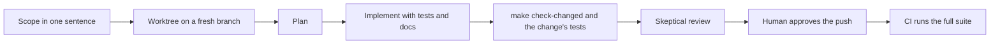

# Contribution guide

## Set up

```bash
.agents/bootstrap.sh   # installs the git hooks and the local scratch area
make check-changed     # the basics for what you changed; CI runs the full suite
```

`make help` lists every target. `make check-changed` picks the lint and drift checks from the paths
that differ from the merge base with `main`, through the same path map CI uses
(`scripts/ci-areas.sh`), and runs the hooks on those files. `make check` is the full gate, which CI
runs; run it locally only when you want it. You need Rust, Node.js and pre-commit; the `okf` tool validates the
docs bundle. [Building and packaging](building.md) has the versions.

## Working procedure



| Step | Rule |
|---|---|
| Scope | One sentence: unit of work, target, outcome. Anything else is a separate change |
| Worktree | One worktree per change; branch `feat/`, `fix/`, `docs/`, `refactor/` or `chore/`, hyphens only, rebased on the latest `main` |
| Commits | Conventional Commits, 50/72, logical units, explicit paths, never `git add -A` |
| Docs | Docs move with the change; a page added or restructured updates its index and adds a log entry |
| Verify | Before a push: `make check-changed`, the tests for what you changed (`TESTS="cargo test -p <crate> <path>::"`) and any manual or visual validation, with real output. CI runs the full suite; done when CI is green |
| Review | A skeptical-maintainer review before push; the human decides the push |

## Rules a first change trips on

- Anything a person sees starts as a design in `docs/design/` (screens or mockups, copy and
  behaviour) and is approved before it is built. Code follows the agreed design.
- Interface text follows the [experience principles](../design/experience-principles.md): no model,
  token, GPU, NPU, embedding or graph outside an advanced details view.
- Every answer and page line cites its original, and nothing leaves the computer except the
  downloads and optional features that `AGENTS.md` at the repository root names.
- A page added, renamed or restructured updates its parent `index.md`, adds an entry under
  `docs/logs/`, and passes `okf validate docs` (`make check-changed` runs it for docs changes).
- Committed files hold no host-specific paths, private hostnames, tokens or internal task ids.
- The git hooks run the checks; never bypass them.

Vulnerabilities are reported privately, not as issues: see `SECURITY.md` at the repository root.
