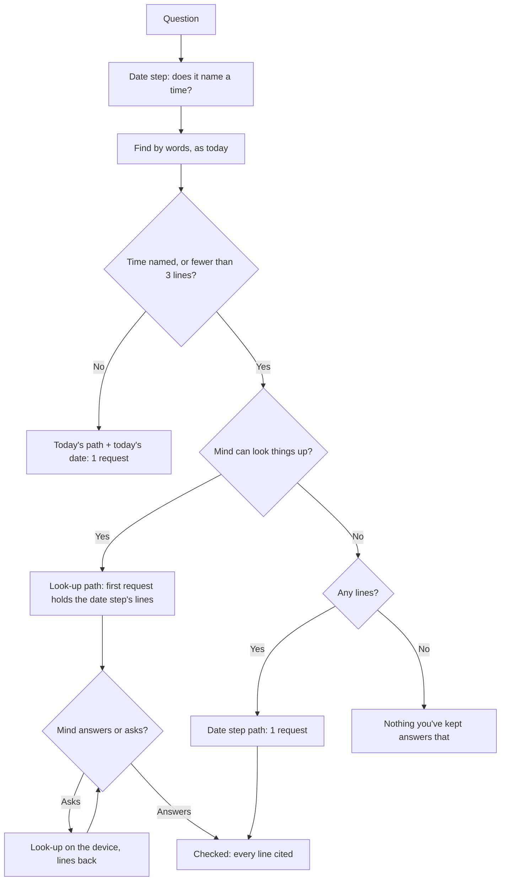

# Ask with tools

A person with a phone of its own and an online mind asked "What's on tomorrow?". Their calendar
was on, and tomorrow's dentist and swimming were kept. Nocturne said "Nothing you've kept answers
that."

This page is the design for Ask answering questions like that one. When the question's own words
are not enough, Ask lets the mind look things up in what the person kept: their calendar, their
journal and check-ins for given days, their health readings, and a search with other words. It is implicit: nothing to turn on and
nothing to set. The mind only reads, and every line it is given is a kept line with its receipt.

Status: approved. The owner decided the flow and answered the five open questions on 2026-11-24
(see Owner decisions). Built on 2026-11-24, with three parts waiting:

- **Look-ups on the computer.** Online answers on the computer uses the date step path until the
  pinned `lemond` is confirmed to pass the look-up descriptions to the provider and its look-up
  requests back ([Checks before it ships](#checks-before-it-ships)); that is not yet tried. The
  computer's own mind uses the date step path until a size passes the look-up check, which no size
  has run yet. Sent online on the computer therefore never has more than one part, and its parts
  view and the "look further" words in its setup wait for the first.
- **The "Tool calls" row.** It waits for a view to hold it: the phone's mind has no advanced
  details view, and the computer never checks look-ups while they wait.
- **The Tiny instructions** do not gain the three new answer rules; Small, Standard, Large and
  every online answer do. Tiny is kept short on purpose, and the rules join it only once the
  look-up check has run on it.

## Mockups

In `docs/design/mockups/ask-with-tools/`, with the kits of the other mockups. Names and data are
fictional, and today is Tuesday 24 November 2026 in every view. Serve the repository root over HTTP
after `make ui/install`. `?theme=light` or `?theme=dark`, `?state=` picks a view, and on the phone
`?text=200` draws the phone's text at 200 per cent. On the computer, the 200 per cent renders are
the window at 200 per cent zoom.

| View | File and state | Renders |
|---|---|---|
| Phone: Ask while the mind looks through the calendar | `phone.html?state=looking` | `phone-looking-light.png`, `phone-looking-dark.png`, `phone-looking-200-light.png` |
| Phone: the answer to "What's on tomorrow?" with its receipts | `phone.html?state=answer` | `phone-answer-light.png`, `phone-answer-dark.png`, `phone-answer-200-light.png` |
| Phone: one question in What was sent, opened, in three parts ("Am I free for a haircut before Gran's lunch?": the words find one line, the mind looks through the calendar, then for other words, which find nothing) | `phone.html?state=sent` | `phone-sent-light.png`, `phone-sent-dark.png`, `phone-sent-200-light.png` |
| Computer with Online answers: Ask while the mind looks through the journal | `desktop.html?state=looking` | `desktop-looking-light.png`, `desktop-looking-dark.png`, `desktop-looking-200-light.png` |
| Computer with Online answers: the answer to "How was Leo's parents' evening?" | `desktop.html?state=answer` | `desktop-answer-light.png`, `desktop-answer-dark.png`, `desktop-answer-200-light.png` |
| Computer: Sent online, one question in two parts | `desktop.html?state=sent` | `desktop-sent-light.png`, `desktop-sent-dark.png`, `desktop-sent-200-light.png` |

A dashed outline marks what is new; it is not part of the design.

## The problem

Verified on `main` on 2026-11-24.

- **Ask finds by the question's words.** `retrieve` (`crates/engine/src/retrieve.rs`) searches
  stemmed words built by `fts_or` (`crates/engine/src/util.rs`). Stop words drop "what" and "on",
  so "What's on tomorrow?" searches for "tomorrow" alone.
- **Calendar entries do not say "tomorrow".** A calendar entry is kept as a memory such as
  "Dentist is on Wednesday 25 November." with its day as `due` and `valid_from`
  (`crates/engine/src/phones/calendar.rs`). No word of the question is in it.
- **Nothing turns "tomorrow" into a day.** Ask has no step that maps a relative day to a date.
- **The online mind does not know today's date.** Local answers end with "Today is Tuesday 24
  November 2026."; online answers leave it out on purpose (`answer_user` in
  `crates/mind/src/prompts.rs`), so even a found line cannot be placed as "tomorrow".
- **A phone alone stops before asking.** With no lines found, the phone answers `Nothing` without
  calling the provider (`phone/src-tauri/src/mind/ask.rs`).
- **The computer has the same gap.** Its search adds meaning to words and reranks
  (`src-tauri/src/ask.rs`), but "tomorrow" means no day to it either, and a companion phone's
  questions go through the same path.

The same holds for "What did I do last Tuesday?", "Anything this weekend?" and every question whose
answer is found by its day rather than its words.

## Owner decisions

Made on 2026-11-24.

| Question | Decision |
|---|---|
| What happens when the words alone are not enough | Ask falls back to the mind with read-only look-ups |
| Does the person turn it on | No. It is implicit and transparent: no switch, no opt-in, nothing to set |
| What may be sent | What a good answer needs. No new "never send" rules |
| What the look-ups may do | Read only. No look-up writes, shares, schedules or deletes anything. Nocturne suggests; it never acts or decides |
| Health readings in Ask | Yes. The `health` look-up and the date step's health lines, on every mind the person chose, in the [health wording](phone-health.md#wording). This changes [H7](phone-health.md#decisions-for-the-owner) |
| Look-ups on the computer's own mind | Only for a size that passes the [look-up check](#checks-before-it-ships). Until then that size uses the date step path |
| How a question counts against the monthly limit | Each request counts. A question in 3 parts counts 3 towards a number limit; an amount limit adds every part's cost. Setup says so in plain words (see [Copy](#copy)) |
| The line while the mind looks | Name the place: "Looking through your calendar…" |
| Check-ins | In the `journal` look-up, sent like any other journal line. Private governs only what comes up on its own: notifications, reminders and the lock screen. This changes [the journal's Ask](journaling.md#11-ask) |

The last five were the open questions of the first draft. The options the owner weighed are kept
under [Considered and not chosen](#considered-and-not-chosen).

## The flow

Every question takes the same first two steps, on the device that answers it.

1. **Read the question for a time.** The [date step](#the-date-step) finds words such as
   "tomorrow", "last Tuesday" or "this weekend" and turns them into days. No mind is involved.
2. **Find by words**, exactly as today: stemmed words on a phone, words and meaning with reranking
   on the computer.

Then one of three paths:

| The question | Words found | Path | Requests to the mind |
|---|---|---|---|
| Names a time | Anything | **Look-up path**, its first request already holding the date step's lines | 1, at most 4 |
| Names no time | 3 lines or more | **Today's path**, with today's date and time zone added | 1 |
| Names no time | Fewer than 3 lines | **Look-up path** | 1, at most 4 |

- **The look-up path** is today's request plus the [look-ups](#the-look-ups) the mind may ask for.
  The mind answers at once when the lines it was given are enough, which is the usual case: the
  date step has already put tomorrow's calendar in front of it. When they are not, it asks for a
  look-up, Nocturne runs it on the device and sends the lines back, and the mind answers.
- **When the mind cannot use look-ups** (see [When the mind cannot look things up](#when-the-mind-cannot-look-things-up)),
  the look-up path becomes the **date step path**: one request, with the date step's lines beside
  the words' lines. This is the whole fallback, and it answers every example below but one.
- **Nothing at all.** No lines from the words, no time named, and a mind that cannot look things
  up: "Nothing you've kept answers that.", with no request, as today.



### Why these thresholds

- **A named time always takes the look-up path**, because a day is what the words miss.
- **Fewer than 3 lines** is where today's answers turn into "Nothing" or "Not sure". At 3 or more,
  the words found the subject, and offering look-ups would only add to each request.
- **Offering look-ups costs nothing extra when they are not used**: the first request is today's,
  with the look-up descriptions added. Extra requests happen only when the mind asks.

## Today's date and time zone, in every answer

Every answer request, on every mind and every path, ends its facts with one line before the
question:

> Today is Tuesday 24 November 2026, 21:40, in the time zone Europe/London. The week starts on
> Monday.

- **Where it comes from.** The answering device's own clock and time zone: the phone's for a phone
  alone, the computer's for the computer and for a companion phone's questions. A day is the
  person's day, by the [day boundary](journaling.md#what-a-day-is), so at 1:30 am "today" is still
  the evening before, as everywhere else in Nocturne.
- **Why the time and the zone.** "Anything this evening?" needs the time. A calendar entry made in
  another zone, or a person travelling, needs the zone to place "tomorrow".
- **Online too.** Online answers and the phone's online mind send it, as a good answer needs it.
  This reverses the choice in `answer_user` to leave the date out of online answers. The setup
  words that say what is sent gain it (see [Copy](#copy)).
- **Local answers** already have the date; they gain the time, the zone and the first day of the
  week. The test that keeps local answers byte for byte changes with them.

## The date step

A small, fixed reading of the question, in English (the only language Nocturne speaks today),
on the answering device. It never guesses: words not in this table are not a time.

| The question says | The days |
|---|---|
| today, tonight, this morning, this afternoon, this evening | Today |
| tomorrow (morning, evening and so on) | Tomorrow |
| the day after tomorrow | Today plus 2 |
| yesterday, last night | Yesterday |
| A weekday alone, or "on Tuesday" | The next one from today, today included. In the past tense (did, was, were, went, had, said, saw, met, slept), the last one before today |
| last Tuesday | The last Tuesday before today |
| next Tuesday | The first Tuesday after today |
| this week | Monday to Sunday of this week; in the past tense Monday to today, in the future tense today to Sunday |
| next week, last week | That Monday to Sunday |
| this weekend, at the weekend | The coming Saturday and Sunday, or this one on a Saturday or Sunday |
| next weekend, last weekend | That Saturday and Sunday |
| this month, next month, last month | That calendar month; this month in the past tense runs to today |
| A date: 25 November, 25th November, November 25, the 25th | That day, the nearest one to today within six months |
| recently, lately, these last few days | The 7 days to today |
| the next few days, the coming days | Today and the 3 days after |

- **The week** starts on the device's own first day of the week, Monday by default.
- **What it fetches** for those days: the calendar look-up, and for days up to today the journal
  look-up, each with its own limit. A question that also names sleep, slept, steps, walked, heart, blood pressure, workout, ran or
  weight fetches that kind of reading for those days too.
- **Its lines join the words' lines**, never replace them: the first request holds the words' lines
  as today (up to 12 on a phone, 8 after the computer reranks) and up to 12 lines from the date
  step, one copy of each. On the computer's smallest size, when a time is named, the first
  request holds at most 12 lines: the words' first 6 and the date step's first 6.
- **With no mind, or a paused one,** a phone alone still runs the date step: its lines join what
  Ask finds by words, so "What's on tomorrow?" lists tomorrow's appointments even then.

## The look-ups

Read-only functions on the answering device. Each returns only lines the person kept, in the same
form as the facts the mind already gets, each with its receipt behind it. Their names are plain
words because they appear in "See what was sent".

| Look-up | Inputs | Returns | Limit |
|---|---|---|---|
| `calendar` | `from`, `to`: days as YYYY-MM-DD, both included, at most 62 days apart | Appointments from the phone's calendar, and anything kept with a day in that range (a letter's appointment, a renewal date, bin day), in order of day and time | 20 lines |
| `journal` | `from`, `to`: days, at most 14 days apart, none after today | What the person kept and wrote on those days: journal entries, good things, check-ins, and what was read from the notes, photos, voice notes and documents kept that day | 20 lines |
| `search` | `words`: 1 to 8 words | Ask's own finding with other words: stemmed words on a phone, words and meaning on the computer | 12 lines |
| `health` | `kind` (sleep, steps, resting heart rate, heart rate, blood pressure, workouts, weight when on), `from`, `to`: at most 31 days | One line per night, day or reading, in the [health wording](phone-health.md#wording), with its source | 31 lines. Offered only for kinds that have readings |

There is no "today" look-up: every request already carries today's date. There is no "recent"
look-up: `journal` with a range answers "lately", and `search` answers "the last thing about".

### What a look-up returns

- **Lines, numbered on from the facts**, in the facts' own form, inside the same fence that marks
  them as data:

  ```
  [m4] Dentist is on Wednesday 25 November at 10:30, at Smile Dental. (on Wednesday 25 November; learned Saturday 21 November)
  [m5] Leo's swimming is on Wednesday 25 November at 17:00, at the leisure centre. (on Wednesday 25 November; learned Saturday 21 November)
  ```

  A check-in is one line in its own words: the feeling the person chose, its part of the field and
  what they wrote, such as "Check-in, Monday 23 November at 21:10: drained (Low). \"Leo up twice
  again.\"". A health line is "Night to Monday 23 November: 6 h 40 min asleep (Health on Pixel 9)."

- **More than the limit:** the first lines in order, then "And 6 more. Ask for fewer days to see
  them."
- **Nothing:** "Nothing kept for these days." or "Nothing kept with these words."
- **A wrong input** (a date that is not one, a range too long, an unknown look-up): one plain line
  saying what is allowed, such as "Give days as YYYY-MM-DD, at most 62 days apart." It counts as a
  look-up.
- **Never returned:** anything the person let go or is forgetting, anything superseded, a health
  reading marked "Removed in Health", and reflections and recaps, which are Nocturne's writing
  rather than what the person kept. Each look-up runs the same checks Ask's lines run today on that
  device: `mind_may_read` on a phone alone, and for a companion phone no lines of an original
  (its check-ins and health readings, which the phone already shows, are given). A line already
  handed in this question is not handed again.
- **Feelings and numbers in answers.** The answer instructions gain two rules: name a feeling only
  in the words of the check-in or entry that says it, and give a health number as the line writes
  it, with no comparison to a norm, no judgement and no advice, as the
  [health wording](phone-health.md#wording) and the journal's "no feeling without support" require.
- **Private** is handled exactly as Ask handles it: a private mark decides what comes up on its own,
  not what answers a question the person asked ([What private means](only-marked-private.md)).

### Limits

| Limit | Value |
|---|---|
| Rounds of look-ups per question | 3 |
| Requests to the mind per question | At most 4. The fourth offers no look-ups and says "Answer now from the lines you have." |
| Look-ups in one round | At most 4; any more are answered "Not looked up: too many at once." |
| Look-ups per question | At most 8 |
| Lines in the first request | At most 24 (12 on the computer's smallest size) |
| Lines in the whole question | At most 60. Past that, a look-up returns "No more lines for this question. Answer from what you have." |
| One look-up on the device | 2 seconds, else "That couldn't be looked up just now." |
| One request | As today: 60 seconds on a phone, 20 seconds for Online answers |
| The whole question | 90 seconds on a phone, 40 seconds for Online answers; then the [fallback](#when-something-fails) |

A round whose look-ups all came back empty, in a question that has no lines at all, ends the
question as "Nothing you've kept answers that." without another request: the mind has nothing it
could cite.

## Receipts

Receipts or it did not happen, unchanged:

1. **Every line the mind is given is a kept line** with its receipt behind it. A look-up's lines
   are no different from the facts found by words.
2. **Every claim cites a line** as `[mN]`. A citation is checked against every line handed in this
   question, in any request, before the answer shows.
3. **An answer that cites nothing is not sure.** The answer is not shown; the nearest 2 lines show
   with their receipts, the date step's lines first, as "Not sure" does today.
4. **A citation of a line that was never handed** fails the check as today; the answer shows as not
   sure.
5. **What a look-up was asked for is never a receipt.** The mind asking for Wednesday's calendar is
   not evidence of anything; only the lines that came back are.
6. **"That's wrong", "Keep forever" and "Delete this…"** act on the memories the answer cited,
   wherever in the question they came from. Cited memories are marked as used, as today.
7. **Relative words with the date.** The answer instructions gain one rule: "When you say today,
   tomorrow or a weekday, also give the date as the fact writes it." So "tomorrow" is always
   checkable against its receipt.

## When the mind cannot look things up

The fallback for a mind that does not take look-ups, or whose look-ups fail, is the
[date step path](#the-flow): one request with the date step's lines. Ask never gets worse than
today: the words' lines are always in the first request, and the date step only adds.

### Found out once, at the check

- **The connection check gains a second request** after the word reply it sends today: a fixed
  question with no personal data, "What is on 1 January 2030?", with the `calendar` look-up offered.
  The mind passes when it asks for `calendar` with both days as 2030-01-01, in the expected form.
- **Remembered** with the address and the name to use: takes look-ups, or does not. It is checked
  again when the address, the key or the name to use changes, and at every "Check again".
- **Not counted** against the monthly limit, like the check itself. It is listed in Sent online as
  part of the "Connection check".
- **Not shown** in the interface. The advanced details view for Online answers and for the phone's
  mind gains one row: "Tool calls: supported" or "Tool calls: not supported", with the day it was
  checked.

### Learned in use

- **For people set up before this ships,** nothing is known until the first look-up question:
  look-ups are offered once. A refusal that names them (a 400 or 422), or a reply that is not a
  well-formed answer or look-up, is answered at once by the date step path with the same lines,
  and the mind is remembered as not taking look-ups until the next check. This is the pattern the
  phone already uses when a provider refuses a reply shape.
- **Two questions in a row with only broken look-ups** (unknown names, inputs that do not read)
  mark the mind as not taking look-ups until the next check.

### When something fails

| What fails | What happens |
|---|---|
| A look-up on the device | The mind gets "That couldn't be looked up just now." and goes on |
| The provider refuses look-ups | The date step path at once, with the lines already found; remembered |
| The provider fails mid-question (no answer, server error, slow) | As today for that provider. Online answers on the computer: answered on this computer, by the date step path, with today's reason. A phone alone: "No answer came this time. Ask again in a moment." |
| The whole question passes its time limit | The same as the provider being slow |
| The monthly limit is reached between parts | No more parts are sent. Online answers on the computer: answered on this computer, by the date step path with the lines already gathered, with today's "monthly limit reached" reason. A phone alone: its paused state, and Ask finds by words with the date step's lines |
| The key is refused, no credit, the limit reached before the question | As today: Online answers pauses, or the phone's state shows and Ask finds by words, now with the date step's lines |

## What the person sees

The Ask states stay as they are: thinking, the answer with its receipts, not sure, nothing found.
Two things change.

### A line while the mind looks

While a look-up round is under way, the line that says Ask is working names where it is looking,
then goes back. It shows from when the mind asks until the next reply begins, which is the wait a
person notices.

| Round asks for | Line |
|---|---|
| The calendar | Looking through your calendar… |
| The journal | Looking through your journal… |
| Other words | Looking for other words… |
| Health readings | Looking through your health readings… |
| More than one of these | Looking in a few places… |

- On the computer it replaces "Reading them…" under "Found 3 things you kept about this"; the count
  grows as lines come back. On a phone it replaces "Answering from what you kept…".
- It is announced to screen readers once per round, politely.
- A companion phone keeps "Answering from what you kept…": the computer answers its question whole
  and sends no steps (see [Parity](#parity)).

### What was sent

Each question is still one entry, however many requests it took. Each request in it is a part.

- **On a phone alone**, the row stays "Answered a question", with "{time} · {host} · {size}" and,
  when there was more than one part, "· {count} parts, counted {count} times". The size is every
  part's, added up. "Exactly what was sent" lists the parts:
  - **Part 1 · {size}**: the words as they left, as today, now with today's date line.
  - **Each later part · {size}**: "Your provider asked to look through your calendar for
    Wednesday 25 November." then "Sent back:" and the lines, as they left.
  - Under the parts: "Each part sent the parts before it again, so your provider could follow on.
    The size counts every part, and each part counts once towards your monthly limit."
- **On the computer**, Sent online's entry for the question keeps its fields; Size sums every part,
  Cost sums every part the provider priced, and a new field "Parts" says "2: your provider looked
  once. Counted 2 times towards your limit." Each part's heading carries its own size. "Exactly
  what was sent" lists the parts as on the phone, each line with where it came from, as today.
- **"Show Nocturne's standard instructions"** now also shows the look-up descriptions, which are the
  same for every question.
- **Forgetting** removes a line's words from every part it was in, as it does today.
- **A question that ended with nothing found** after a look-up shows "Nothing you kept answered it"
  as its result.

## Cost and latency

| Question | Requests, and counts towards a number limit | Wait, roughly |
|---|---|---|
| Names no time, words found 3 or more lines | 1, as today | As today |
| Names a time; the date step's lines answer it (the usual case) | 1 | As today, plus the look-up descriptions to read |
| The mind looks once | 2 | About twice today's |
| Worst case | 4 | Capped at 90 seconds on a phone, 40 for Online answers |

- **Each later part resends the parts before it**, so a question in 4 parts sends about 4 times the
  words of the first. The cap of 60 lines keeps the largest question near 6,000 words in all.
- **The look-up descriptions** add about 300 words to every look-up path request.
- **Each request counts towards the monthly limit.** A limit set as a number counts every part: a
  question that looks once counts 2, and the phone's "things read and answered" counts the same
  way. A limit set as an amount adds the cost of every part, as the provider reports it. The limit
  is checked before each part, so a question never goes past it: when it is reached
  between parts, no more parts go (see [When something fails](#when-something-fails)). The look-up
  check at the connection check is not counted.
- **What a person can expect.** Most questions still count once: those that name no time and find
  enough by words, and those the date step answers. A question that looks further counts up to 4.
  A limit of 200 that was about 200 questions is, for someone who asks many look-up questions,
  somewhat fewer. Setup and This month say so (see [Copy](#copy)).
- **The network check** for Online answers changes from "at most once per question" to "at most 4
  times per question", and the stand-in provider's record must match Sent online part for part.
- **Nothing is looked up for the overnight tidy, reading, the page or reflections.** Only Ask holds
  the look-ups.

## Parity

| Where | Today's date and zone | Date step | Look-ups | Line while looking |
|---|---|---|---|---|
| A phone alone, with an online mind | The phone's, sent with every question | Yes | Yes, when the mind takes them | Yes |
| A phone alone, no mind, or paused, unreachable, out of credit | Nothing is asked | Its lines join what Ask finds by words | No | No |
| A companion phone (the computer answers) | The computer's | The computer's | As the computer | No: "Answering from what you kept…" as today |
| The computer, its own mind | The computer's | Yes | Only for a size that passed the [look-up check](#checks-before-it-ships); otherwise the date step path | Yes, when it looks |
| The computer, Online answers | The computer's, sent | Yes | Yes, when the engine passes look-ups on and the provider takes them | Yes |
| A phone that borrows a household's mind | The phone's | Yes, on the phone | No: the household computer writes from the lines the phone sends and cannot read the phone's memory | No |

The companion phone gets no steps because its question travels to the computer as one call and the
answer comes back whole. A later change could carry the line over Away from home; it is not needed
for the answer to be right.

## Examples

Today is Tuesday 24 November 2026, 21:40, Europe/London. A phone alone with an online mind that
takes look-ups. Bold is the answer's own bold span; each `[mN]` becomes the receipt under it.
"Counts" is how many times the question counts towards a monthly limit set as a number.

### "What's on tomorrow?"

- Date step: tomorrow, Wednesday 25 November. Words: "tomorrow", nothing found.
- Look-up path. The first request holds `calendar` for 25 November: 3 lines.
- One request; the mind answers without looking further. Counts 1.

> Tomorrow, Wednesday 25 November, you have **the dentist at 10:30** at Smile Dental [m1] and
> **Leo's swimming at 17:00** at the leisure centre [m2]. **The bins go out** on Wednesday night [m3].

Receipts: the two calendar entries ("Calendar · Pixel 9"), and the note "Bins Weds night from now
on" kept on 2 November. With a mind that does not take look-ups: the same answer, by the date step
path, in one request.

### "What did I do last Tuesday?"

- Date step: last Tuesday, 17 November. Words: nothing useful.
- Look-up path. The first request holds `journal` and `calendar` for 17 November: 5 lines, a
  check-in among them.
- One request. Counts 1.

> On Tuesday 17 November you **took Gran to the garden centre** [m1] and went to **parents' evening
> at 18:00** [m2]. Your good thing that day: **Leo read a whole chapter on his own** [m3]. That
> evening you checked in as **proud** [m4].

Receipts: the journal entry of 17 November, the calendar entry, the good thing, the check-in.

### "When is the dentist?"

- Date step: no time. Words: "dentist", 2 lines (the calendar entry and a letter's photo).
- Fewer than 3 lines: look-up path, with look-ups offered. The mind answers at once.
- One request. Counts 1.

> That's tomorrow, **Wednesday 25 November at 10:30**, at Smile Dental [m1].

Receipts: the calendar entry, and the photo of the letter if the mind cited it. Today's date is what
lets the mind pick the coming appointment over last spring's.

### "Anything this weekend?"

- Date step: this weekend, Saturday 28 and Sunday 29 November. Words: nothing.
- Look-up path. The first request holds `calendar` for 28 to 29 November: 2 lines.
- One request. Counts 1.

> On Saturday 28 November, **Leo's football at 09:30** [m1]. On Sunday 29 November, **Gran's
> birthday lunch at 13:00** at The Swan [m2].

### "How was Leo's parents' evening?" (the mind looks once)

On the computer with Online answers, in the mockups.

- Date step: no time. Words: "Leo", "parents", "evening", 1 line: the calendar entry for Tuesday
  17 November at 18:00.
- Fewer than 3 lines: look-up path. The mind sees the day in that line and asks `journal` for 17
  November: 2 lines come back. "Looking through your journal…" shows meanwhile.
- Two requests. Counts 2.

> Parents' evening was on **Tuesday 17 November at 18:00** [m1]. That day you wrote that **Mrs
> Patel said Leo's reading has come on a lot** [m2], and your good thing was that **Leo read a whole
> chapter on his own** [m3].

With a mind that cannot look things up, the date step finds no time in the question, so only the
calendar line goes: "Parents' evening was on Tuesday 17 November at 18:00.", as today.

### "How did I sleep this week?"

- Date step: this week, past tense, Monday 23 to today, and "sleep" names a kind of reading.
  Words: "sleep", 1 line from a journal entry.
- The first request holds `health` sleep for 23 to 24 November (2 nights), the journal for those
  days (the entry and a check-in) and the calendar (nothing). One request. Counts 1.

> The night to Monday 23 November, **6 h 40 min asleep** [m1]. The night to Tuesday 24 November,
> **7 h 55 min asleep** [m2]. On Monday you wrote that **Leo had a nightmare** [m3], and checked in
> that evening as **drained** [m4].

The look-up's lines read "Night to Monday 23 November: 6 h 40 min asleep (Health on Pixel 9)."
Receipts: the two nights from Health on the phone, the journal entry and the check-in. No
comparison with a norm, nothing about what the numbers mean and no advice, as the health wording
requires; the feeling is the person's own word.

### "How was I last week?" (check-ins)

- Date step: last week, Monday 16 to Sunday 22 November. Words: nothing useful.
- The first request holds `journal` for 16 to 22 November: 12 lines, check-ins and entries among
  them, and `calendar` for those days. The mind answers from them. One request. Counts 1.

> You checked in as **calm** on Monday 16 November [m1] and **proud** on Tuesday 17 November after
> parents' evening [m2]. On Thursday 19 November you checked in as **wound up**, writing **"deadline
> moved again"** [m3]. Your good thing on Saturday 21 November: **lunch with Priya** [m4].

Each feeling is the word the person chose, cited to its check-in; nothing is added about what the
week meant.

### A question with nothing kept: "When is the car's MOT?"

- Date step: no time. Words: "car", "MOT", nothing found.
- Look-up path with no lines. The mind asks `search` for "MOT garage car service".
- Nothing comes back, and the question has no lines: it ends without another request.
- One request. Counts 1. "Nothing you've kept answers that.", with "Keep a photo now", as today.
  Sent online lists the question in 1 part, with "Nothing you kept answered it".

With a mind that does not take look-ups, nothing is sent at all, as today.

## Copy

New and changed strings for the en-GB copy deck. `{count}`, `{host}`, `{size}`, `{days}` as named.

### Ask

| Key | Words |
|---|---|
| `ask.looking.calendar`, new | Looking through your calendar… |
| `ask.looking.journal`, new | Looking through your journal… |
| `ask.looking.search`, new | Looking for other words… |
| `ask.looking.health`, new | Looking through your health readings… |
| `ask.looking.several`, new | Looking in a few places… |
| `phone.ask.looking.*`, new | The same five, for the phone |

### What was sent, on a phone alone

| Key | Words |
|---|---|
| `phone.mind.sent.parts`, new | {time} · {host} · {size} · {count} parts, counted {count} times |
| `phone.mind.sent.part`, new | Part {n} · {size} |
| `phone.mind.sent.asked.calendar`, new | Your provider asked to look through your calendar for {days}. |
| `phone.mind.sent.asked.journal`, new | Your provider asked to look through your journal for {days}. |
| `phone.mind.sent.asked.search`, new | Your provider asked to look for “{words}”. |
| `phone.mind.sent.asked.health`, new | Your provider asked to look through your {kind} for {days}. |
| `phone.mind.sent.back`, new | Sent back: |
| `phone.mind.sent.backNothing`, new | Sent back: nothing kept. |
| `phone.mind.sent.resent`, new | Each part sent the parts before it again, so your provider could follow on. The size counts every part, and each part counts once towards your monthly limit. |
| `phone.mind.sent.nothing`, new | Nothing you kept answered it |

`{days}` is "Wednesday 25 November", or "Saturday 28 to Sunday 29 November".

### Sent online, on the computer

| Key | Words |
|---|---|
| `sent.field.parts`, new | Parts |
| `sent.parts`, new | {count}: your provider looked {looks, plural, one {once} other {# times}}. Counted {count} times towards your limit. |
| `sent.part`, new | Part {n} · {size} |
| `sent.asked.*`, new | As the phone's `phone.mind.sent.asked.*` |
| `sent.back`, new | Sent back: |
| `sent.back.nothing`, new | Sent back: nothing kept. |
| `sent.resent`, new | Each part sent the parts before it again, so your provider could follow on. Size and cost count every part, and each part counts once towards your monthly limit. |
| `sent.result.nothing`, new | Nothing you kept answered it |
| `sent.row.nothing`, new | {time} · {size} · nothing found |

### What is sent, in setup and settings

| Key | Before | After |
|---|---|---|
| `online.explain.short.sent.body` | Your question, with a few short lines from what you kept that help answer it, your journal entries and good things included. | Your question and today's date, with short lines from what you kept that help answer it, your journal entries, check-ins, good things and health readings included. |
| `online.consent.sent.body` | Your question, and the few things you kept that answer it, as short sentences, lines from your journal entries and good things included. At most 12, each with the day you kept it. For example: | Your question and today's date, and the things you kept that answer it, as short sentences, lines from your journal entries, check-ins, good things and health readings included. Each with the day you kept it. For example: |
| `phone.mind.agree.sent` | …Each question, with the lines that answer it. Each night, the lines your page is written from. For example: | …Each question with today's date, and the lines that answer it. Each night, the lines your page is written from. For example: |
| `phone.mind.what.sent` | …And your questions, with what answers them. | …And your questions, with today's date and what answers them, health readings included. |

If the 2026-11-23 private change lands first, its wording of `online.explain.short.sent.body` is
the "before", and only "and today's date" is added to it. "A few" goes because a question that
looks things up can send more than a few lines, and "At most 12" goes for the same reason.

### What changes, and the limit

Each part counts towards a number limit, so setup says so where it talks about cost and the limit.

| Key | Before | After |
|---|---|---|
| `online.consent.changes.body` | Your questions are answered by {host}, on your account with them, so it may charge for each one. Answers may take a few seconds longer. If it can’t be reached, this computer answers, and says so. | Your questions are answered by {host}, on your account with them, so it may charge for each one. When the lines found aren’t enough, {host} can ask Nocturne to look a little further, and each look is sent and counted like another question, so one question can count up to 4 times. Answers may take a few seconds longer. If it can’t be reached, this computer answers, and says so. |
| `online.consent.mind.limit` | At most {limit} questions a month go online; after that, this computer answers until the 1st. | At most {limit} questions a month go online, each look further counted as one; after that, this computer answers until the 1st. |
| `online.limit.count` | Most services charge a little for each question. The service you chose, {host}, doesn’t tell Nocturne what each one costs, so the limit counts questions. | Most services charge a little for each question. The service you chose, {host}, doesn’t tell Nocturne what each one costs, so the limit counts questions. A question that needs a closer look counts once for each time it goes. |
| `online.month.of` | Of your limit of {limit}. Resets on {day}. | Of your limit of {limit}. A question that looked further counts once for each time it went. Resets on {day}. |
| `phone.mind.agree.changes` | {host} reads what you keep, writes your page each morning and answers your questions, on your account with them, so it may charge for each. … | {host} reads what you keep, writes your page each morning and answers your questions, on your account with them, so it may charge for each. When the lines found aren’t enough to answer, {host} can ask to look a little further, and each look counts as one more thing answered, so one question can count up to 4 times. … (the rest as before) |
| `phone.mind.agree.limit.things` | At most {count, number} things a month are read and answered online; after that, what you keep waits to be read until the 1st. | At most {count, number} things a month are read and answered online, each look further counted as one; after that, what you keep waits to be read until the 1st. |

### Advanced details

| Key | Words |
|---|---|
| `advanced.online.tools`, new | Tool calls |
| `advanced.online.tools.yes`, new | Supported · checked {day} |
| `advanced.online.tools.no`, new | Not supported · checked {day} |
| `advanced.online.tools.unknown`, new | Not checked yet |

These are in the advanced details view, where technical words are allowed.

## Rules

1. **Read only.** A look-up reads the person's own store on the answering device. None writes,
   keeps, corrects, forgets, shares, schedules, reminds or sends anything, and none reaches the
   network.
2. **Only kept lines.** A look-up returns lines the person kept, in the facts' own form, each with
   its receipts. It never returns a summary, a count the mind could cite without a line, or
   anything from outside the store.
3. **No new reach.** A look-up returns nothing Ask could not already return on that device: the same
   filters, the same scope, the same handling of private.
4. **Receipts.** Every claim cites a line handed in this question, and is checked before it shows.
5. **Never worse than today.** The words' lines are in the first request, the date step only adds,
   and every failure ends at today's behaviour for that device.
6. **Implicit.** No switch, no setting, no prompt. The line while looking and Sent online say what
   happened.
7. **Bounded.** At most 4 requests, 8 look-ups and 60 lines per question, within a time cap.
8. **No jargon.** The interface says "looking through your calendar", never tool, function, call or
   model. "Tool calls" appears only in advanced details.

## Checks before it ships

| Check | Pass |
|---|---|
| The examples | Each example above gives its answer and receipts, in the number of requests shown, against the stand-in provider with a scripted mind that takes look-ups, and again with one that does not |
| Never worse | The existing Ask questions (Evaluation, memory quality) answer at least as well, question by question, with look-ups on as off |
| The date step | A table test of every phrase above, at a week's turn, a month's turn, a year's turn, after midnight before the day boundary, and in a zone ahead of and behind the device's |
| Bounded | A scripted mind that always asks for more stops at 4 requests and 8 look-ups, inside the time cap, and the fourth request offers no look-ups |
| Read only | Every look-up runs on a read-only connection to the store; a test asserts the store is byte for byte the same after a question that used every look-up |
| Not given | A look-up never returns a let-go, forgotten or superseded memory, a reading removed in Health, a reflection or a recap, or, for a companion phone, a line of an original |
| Counted | With a number limit of 3, a question in 2 parts counts 2, and the next question that would need 2 more parts stops after its first, answered as the limit says |
| Feelings and numbers | No answer in the look-up check names a feeling that no cited check-in or entry says, or compares a health number with a norm, judges it or advises |
| Sent online | The stand-in's record matches Sent online part for part, on the phone and the computer |
| The engine passes look-ups on | For Online answers on the computer: the pinned `lemond` passes the look-up descriptions to the provider and the provider's look-up requests back. Until it does, Online answers uses the date step path |
| The look-up check, per size | For the computer's own mind, as the [help check](in-app-help.md#blending-on-small-computers-a-gate-for-each-size) does: the examples and 20 more questions, three runs each, on a size's preset models. A size passes when every answer is right and cited, it never asks for more than 2 look-ups where 0 were needed, and the first useful sentence stays under 6 seconds at the 95th percentile. A size that fails uses the date step path |

The look-up check joins [Evaluation](evaluation.md) with the build.

## Not changed

- How the words find lines, how answers are written, marked and cited, and the Ask screens' layout.
- Reflections and recaps stay out of Ask: they are Nocturne's writing, not what the person kept.
- The guide and help answers, which are always written on the computer and never look things up.
- Reading, the overnight tidy, the page and reflections.
- The monthly limit's settings, and how a paused, unreachable or refused provider is shown.
  What one count is changes: each request, as above.

## Considered and not chosen

- **A switch for it.** The owner chose implicit and transparent.
- **Look-ups on every question.** More requests and slower answers where the words already found
  the subject, for no better answer.
- **Only the date step, no look-ups.** It answers the five dated examples, but not "When is the
  physio?" kept as "GP referral for my knee", or a question that needs a second look.
- **Rewriting the question into dates before searching** (for example, searching "Wednesday 25
  November"). It finds calendar memories by their wording only, and misses dated memories whose
  sentence names no date.
- **A "today" look-up.** The date is in every request, so a look-up for it would cost a round.
- **One row per request in Sent online.** Accurate, but a person thinks in questions; one entry
  with its parts says the same and keeps the list readable.

- **Readings out of Ask, as H7 had it.** "How did I sleep this week?" would answer only from
  journal words. The owner chose the `health` look-up on every mind the person chose.
- **Readings only on the computer's own mind.** It would split answers by where they are written,
  which a person cannot see.
- **The date step only on the computer's own mind, or look-ups on every size now.** The owner chose
  look-ups for each size that passes the look-up check, and the date step until then.
- **One count per question.** It matched how the limit is worded today, but the owner chose that
  each request counts, said plainly in setup.
- **One generic line while looking, or none.** Naming the place says why the answer takes longer.
- **Check-ins left out of Ask.** "How was I last week?" could not be answered from the person's
  own check-ins; the owner chose to include them, sent like any other journal line.

## Changes to other pages

These follow from the owner's decisions and are made with the build, each with its own log entry.

| Page | Change |
|---|---|
| [Health from the phone](phone-health.md) | H7 becomes: Ask answers from readings through the `health` look-up, on every mind the person chose, in the health wording. The Privacy table's Online answers row says readings may go with a question they help answer |
| [Journaling](journaling.md#11-ask) | Ask reads check-ins through the `journal` look-up, and Online answers may send them like other journal lines |
| [Online answers](/architecture/online.md) and [decision 0011](/adr/0011-online-answers.md) | Look-ups, up to 4 requests per question, each counted, and today's date sent; a decision record amends 0011 |
| [An online mind on a phone](/adr/0020-an-online-mind-on-a-phone.md) | The same, for the phone |
| [Evaluation](evaluation.md) | The look-up check, and "at most 4 times per question" in the network check |
