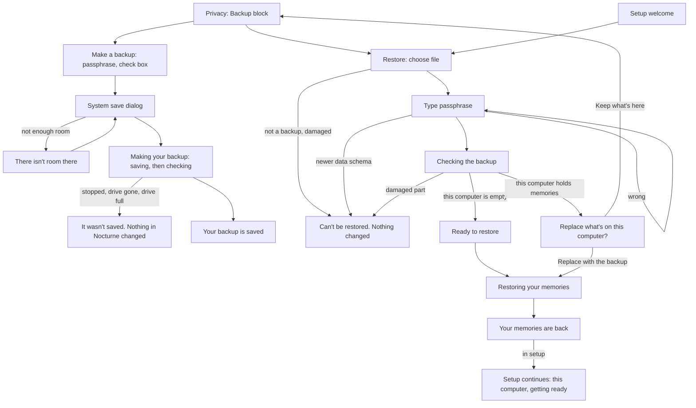

# Back up and restore

A person can put everything Nocturne holds into one file, locked with a passphrase they choose, and
bring it back on this computer or a new one. Export everything stays as it is: a readable folder
for looking at, not for restoring.

This page is the design the screens are built from. Every string is final unless marked as a
proposal; the copy deck uses the typographic apostrophe (’) where this page types a plain one.

Static mockups of every screen and state are in `docs/design/mockups/backup/`. They reuse the
app's tokens and fonts, so serve the repository root over HTTP after `make ui/install` and open
`index.html` there; add `theme=dark` or `theme=light` to any link. Setup is always at night.

## Decisions

| Question | Decision |
|---|---|
| Where it lives | Two screens of their own, `#/privacy/backup` and `#/privacy/restore`, reached from a new Backup block on Privacy. Setup's welcome offers Restore from a backup. A dialog is used only where focus must be protected: quitting mid-way, bringing back, deleting |
| The word for the secret | "Passphrase", everywhere. It tells people a few words are expected, which is what makes it strong. "Password" appears only in "password manager" |
| The word for the protection | "Locked", the word Away from home already uses. "Encrypted" and "hash" appear only in advanced details. "Key" is used only for the online answers key, worded the way Online answers already words it: "the key for your provider" |
| Saving | The person sets the passphrase first, then chooses where to save. The system save dialog is the last step, the way Save as works everywhere |
| Forgotten passphrase | Said once, plainly, before saving, with a box to tick. No recovery exists, and the screen does not pretend otherwise |
| Restoring over existing memories | Never silently. When this computer holds anything, the person sees both sides and confirms. What is here is put aside, not deleted, and can be brought back from Privacy. Nothing is ever replaced without a put-aside copy. Put-aside copies never expire; only the person deletes them, and deleting asks first |
| Checking first | A backup is checked in full before anything on this computer changes, and a new backup is read back before it is called saved |
| Interrupted work | A backup is written under a temporary name and only takes its real name when complete. A restore is unpacked beside the current memories and switched in one step at the end. Either can stop at any moment without leaving anything half done |

No backup decision record existed when this was written. The restore rule above is a proposal for
that record: replace only after explicit confirmation, with what was here put aside first, never
merged.

## What is in a backup

| In the backup | Not in the backup |
|---|---|
| Everything kept: photos, recordings, notes and documents, exactly as kept | Nocturne's mind, the part downloaded at setup. A new computer downloads it again |
| What Nocturne remembers, including what is fading and let go | The key for your provider (online answers). The person pastes it again |
| Every page | Phones added for Away from home. The person adds them again |
| Settings, including the online answers address and model name | Anything put aside by an earlier restore |
| Things marked private, locked like everything else | The log files |
| The Sent online log | |

## Flows

## Privacy: the Backup block

Sits between Export everything and Delete everything, in the same block style.

| Element | Copy |
|---|---|
| Title | Back up to one file |
| Body | Everything in one file, locked with a passphrase you choose. Use it to keep a copy somewhere safe, or to move to a new computer. |
| Last backup line, when known | Last backup {day}, {size}. |
| Button, secondary | Make a backup… |
| Button, quiet | Restore from a backup… |

When an earlier restore put things aside, a row appears under the buttons:

| Element | Copy |
|---|---|
| Label | Put aside before restoring |
| Detail | {day} · {memories} memories · {size} |
| Button, quiet | Bring it back… |
| Button, forget | Delete it… |

Each put-aside copy has its own row. Put-aside copies never expire: each stays until the person
deletes it, and deleting asks first. Nocturne never removes one by itself.

While a backup is being made, the buttons give way to its progress:

| Element | Copy |
|---|---|
| Progress label | Making your backup |
| Progress detail | {done} of {total} · about {eta} left |
| Button, secondary | See progress |

## Make a backup

Route `#/privacy/backup`, window title "Make a backup · Nocturne". Same frame as the Online answers
setup: back link, serif title, a main column and an aside.

### The form

| Element | Copy |
|---|---|
| Back link | Privacy |
| Title | Make a backup |
| Lead | One file with everything Nocturne holds, locked with a passphrase you choose. |
| Field label | Choose a passphrase |
| Field hint | At least 8 characters. A few words that don't go together are strong and easy to remember. |
| Second field label | Type it again |
| Checkbox | Show passphrases |
| Note title | Keep this passphrase safe |
| Note body | Nocturne doesn't keep a copy. If the passphrase is lost, nobody can open this backup, not even Nocturne. Write it down and keep it somewhere safe, or save it in a password manager. |
| Note checkbox | I've written it down or saved it somewhere safe |
| Aside heading | In the backup |
| Aside rows | Everything you kept, exactly as kept · What Nocturne remembers, including what's fading · Every page · Your settings · Things you marked private, locked like everything else |
| Aside heading | Not in the backup |
| Aside rows | Nocturne's mind. A new computer downloads it again during setup. · The key for your provider. You paste it in again when you turn on online answers. · Phones you added. You add them again in Away from home. |
| Primary button | Save backup… |
| Quiet button | Cancel |
| Footer hint, ready | About {size}. Next, choose where to save it. |
| Footer hint, not ready | Choose a passphrase, type it again and tick the box to go on. |

The two online and phone rows show only when they apply. The size is the total of what goes in.

### Passphrase hint

A short meter of three marks and one word, under the first field. It is advice, not a gate, except
for the minimum length. It never turns red: a weak passphrase is not a mistake.

| Strength | Words | Marks |
|---|---|---|
| Under 8 characters | Use at least 8 characters. | none |
| Weak (common, one word, or under 12 characters) | Easy to guess. Three or four words that don't go together are stronger. | one |
| Fair | Good. A little longer is even safer. | two |
| Strong | Strong. | three |

Scoring happens on this computer as the person types, and the passphrase is never stored.

### Validation

| Case | When | Copy |
|---|---|---|
| Second field differs | When the second field loses focus, or on Save | The two passphrases don't match. |
| Too short | On Save | Use at least 8 characters. |

Save backup… stays disabled until the form is complete, and the footer hint says why. Typed passphrases stay in memory on this screen until it closes, so a failed save never asks for
them again.

### Choosing where to save

Save backup… opens the system save dialog. Backups are `.nocturne` files, and the suggested name is
`Nocturne backup 2026-11-15.nocturne`. If the person cancels the dialog, nothing happens.

| Case | Title | Body | Button |
|---|---|---|---|
| Not enough room | There isn't room there | The backup needs about {size}, and {place} has {free} free. Choose another place, or free some space there. | Choose another place… |
| Can't write there | Nocturne can't save there | That folder doesn't let Nocturne save files. Choose another place. | Choose another place… |
| A file with that name exists | (the system dialog asks) | | |

### Making your backup

The form is replaced by progress. The person can leave the screen or close the window; the backup
carries on, and Privacy shows the same progress in the Backup block.

| Element | Copy |
|---|---|
| Title | Making your backup |
| Progress label, phase 1 | Saving |
| Progress label, phase 2 | Checking the backup |
| Progress detail | {done} of {total} · about {eta} left |
| Progress detail, no estimate | {done} of {total} |
| Saving to | Saving to {path} |
| Body | You can keep using Nocturne, or close this window. The backup carries on. Anything you keep from now on goes in your next backup. |
| Drive note | If you're saving to a drive, leave it plugged in until this finishes. |
| Aside heading | Going in |
| Aside rows | {memories} memories · {pages} pages · {originals} originals, with the note "Photos, recordings, notes and documents" · Your settings |
| Button, secondary | Stop |
| Announced at start | Making your backup. |
| Announced on phase change | Checking the backup. |

Stop acts at once, because nothing is lost by stopping. The screen goes back to the form, with
the passphrases still filled in and the box still ticked, and a status box above Save backup…:

| Element | Copy |
|---|---|
| Status title | Stopped. |
| Status body | Nothing was saved, and nothing in Nocturne changed. |

### Your backup is saved

| Element | Copy |
|---|---|
| Title | Your backup is saved. |
| File | {file name} |
| Folder | {folder} |
| Receipt | {size} · {memories} memories, {pages} pages and {originals} originals |
| Checked line | Checked: it opens with your passphrase. |
| Body | To use it on another computer, install Nocturne there and choose Restore from a backup. You'll need the passphrase. |
| Button, secondary | Show in folder |
| Button, primary | Done |
| Announced | Your backup is saved. |

### When a backup does not finish

Every failure leaves Nocturne unchanged and no half-written backup under the real name. The screen
goes back to the form with the passphrases still filled in, and the failure box takes the place of
the footer buttons.

| Case | Title | Body | Button |
|---|---|---|---|
| Drive unplugged or folder gone | The backup stopped | The drive was disconnected before the backup finished, so it wasn't saved. Nothing in Nocturne changed. Plug the drive back in and try again. | Try again, and quiet Choose another place… |
| Drive filled up | The backup stopped | The drive filled up before the backup finished, so it wasn't saved. Nothing in Nocturne changed. Free some space, or choose another place. | Choose another place… |
| Check after saving failed | The backup didn't check out | The file was saved but didn't read back correctly, so Nocturne removed it. Nothing in Nocturne changed. Try again, or choose another place. | Try again |
| Anything else | The backup stopped | It didn't finish, so it wasn't saved. Nothing in Nocturne changed. Try again in a moment. | Try again |

### Quitting during a backup

Closing the window hides Nocturne in the tray, and the backup carries on. The tray menu shows
"Making a backup · {percent}%". Choosing Quit from the tray shows the window with this dialog.

| Element | Copy |
|---|---|
| Title | Stop the backup and quit? |
| Body | Your backup is {percent}% done. If Nocturne quits now, it won't be saved. You can make it again later. |
| Button, secondary, has focus | Keep backing up |
| Button, secondary | Quit anyway |

If the computer loses power or Nocturne stops unexpectedly, the unfinished file is removed on the
next start when the drive is there, and Privacy shows a notice:

| Element | Copy |
|---|---|
| Notice | Your last backup didn't finish, so it wasn't saved. |
| Action | Make a backup |

## Restore from a backup

Route `#/privacy/restore`, window title "Restore from a backup · Nocturne". In setup the same steps
sit in the setup card. Nothing on this computer changes until the person confirms, and on an empty
computer until they press Restore.

### Choose the file and type the passphrase

| Element | Copy |
|---|---|
| Back link | Privacy |
| Title | Restore from a backup |
| Lead | Bring back everything from a Nocturne backup file. Nothing on this computer changes until you say so. |
| Lead, in setup | Moving from another computer? Choose the backup you made there, then type its passphrase. |
| Button, before a file is chosen | Choose backup file… |
| File row | {file name} · {size} |
| File row button, quiet | Choose another… |
| Field label | Passphrase for this backup |
| Checkbox | Show passphrase |
| Primary button | Open backup |
| Quiet button | Cancel |
| Quiet button, in setup | Back |
| Aside heading | What restoring does |
| Aside rows | Checks the whole backup before anything changes · Brings back what you kept, what Nocturne remembers, every page and your settings · Puts anything already here aside, so you can bring it back |
| Aside heading | Afterwards |
| Aside rows | Online answers stay off until you paste the key for your provider again. · Away from home stays off until you add your phones again. |

The file is chosen with the system open dialog, which offers `.nocturne` files. Whether the file is
a Nocturne backup at all is checked as soon as it is chosen. Everything else about it is locked
with the rest of the backup: its format version, the data schema version, the Nocturne version that
made it, when it was made, and the counts the confirm screen shows. Nocturne reads these once the
passphrase opens the file, and refuses a backup whose data schema version it doesn't know, with
the newer-Nocturne message. The next step is to update Nocturne, in plain words; no updater inside
the app is assumed.

| Case | Where | Copy |
|---|---|---|
| Wrong passphrase | Field error | That passphrase doesn't open this backup. Check capital letters, and try again. |
| Wrong three times or more | Field error | That passphrase doesn't open this backup. If you saved it in a password manager, copy it from there. |
| Not a Nocturne backup, or damaged at the start | Result box: title, body, button | This file can't be restored · It isn't a Nocturne backup, or it's damaged. Nothing was changed. If you have another copy, try that one. · Choose another file… |
| Made by a newer Nocturne | Result box: title, body, button | This backup is from a newer Nocturne · It was made with Nocturne {theirs}, and this computer has {ours}. Update Nocturne on this computer, then try again. Nothing was changed. · Choose another file… |

There is no lockout after wrong passphrases: the file is the person's own.

### Checking the backup

| Element | Copy |
|---|---|
| Title | Checking the backup |
| Progress label | Checking |
| Progress detail | {done} of {total} · about {eta} left |
| Body | Nocturne reads the whole file first, so nothing changes unless all of it is there. |
| Button, secondary | Stop |

| Case | Title | Body | Button |
|---|---|---|---|
| A damaged part | Part of this backup is damaged | Nocturne can't restore it safely, so nothing was changed. If you have another copy, try that one. | Choose another file… |
| File went away | The backup file went away | Nocturne couldn't finish reading it, so nothing was changed. If it's on a drive, plug it back in and try again. | Try again |
| Not enough room | There isn't room to restore | This computer needs {needed} free to restore this backup, and it has {free}. Free some space, then check again. | Check again |

Room is checked before Checking starts and again before Restoring. What is here is put aside by
moving it, not by copying, so it needs no extra room.

### Ready to restore (this computer is empty)

| Element | Copy |
|---|---|
| Title | Ready to restore |
| Rows | Backup made: {day} · Holds: {memories} memories, {pages} pages and {originals} originals · Size: {size} · Checked: Everything is there. |
| Primary button | Restore |
| Quiet button | Cancel |

### Replace what's on this computer?

Shown whenever this computer holds anything kept, from Privacy or from setup.

| Element | Copy |
|---|---|
| Title | Replace what's on this computer? |
| Body | Restoring puts what's on this computer now aside, then brings in the backup. Nothing is deleted. You can bring back what was here from Privacy. |
| Column heading and note | In the backup · Comes in |
| Column rows | Made {day} · Memories {count} · Pages {count} · Originals {count} |
| Column heading and note | On this computer now · Put aside, not deleted |
| Column rows | Last kept {day} · Memories {count} · Pages {count} · Originals {count} · Kept after the backup {count}, when above zero |
| Already put aside, when it applies | Something is already put aside from {day}. It stays, and this is put aside as well. |
| Button, secondary | Keep what's here |
| Button, primary | Replace with the backup |

Focus lands on the title. Keep what's here comes first in the tab order. Neither button is the
default for Enter.

### Restoring your memories

The window shows only this card, without the rail, because memories are being switched. The theme
is the person's own.

| Element | Copy |
|---|---|
| Title | Restoring your memories |
| Progress label | Restoring |
| Progress detail | {done} of {total} · about {eta} left |
| Body | Keep Nocturne open until this finishes. If it closes, nothing on this computer changes and you can start again. |
| Button, secondary | Stop |
| Final step label | Almost done |
| Final step note, Stop disabled | Almost done. This last step can't be stopped. |
| Stopped | Stopped. Nothing on this computer changed. |

Quitting from the tray while restoring:

| Element | Copy |
|---|---|
| Title | Stop restoring and quit? |
| Body | Nothing on this computer has changed yet. You can restore again later. |
| Button, secondary, has focus | Keep restoring |
| Button, secondary | Quit anyway |

If Nocturne stops unexpectedly, the next start finishes the switch if it had begun, or discards the
unpacked copy if it had not. Either way, a notice says which:

| Case | Notice |
|---|---|
| Switch had not begun | Restoring didn't finish, so Nocturne kept what was here. You can try again from Privacy. |
| Switch had begun | Nocturne finished restoring your backup. |

### Your memories are back

The window reopens on the restored memories with this card first.

| Element | Copy |
|---|---|
| Title | Your memories are back. |
| Lead | {memories} memories, {pages} pages and {originals} originals from your backup of {day}. |
| Row: Nocturne's mind, already here | Nocturne's mind · Already on this computer. Nothing to do. |
| Row: Nocturne's mind, missing | Nocturne's mind · Downloads next, during setup ({size}). Your memories and pages are here meanwhile. |
| Row: Online answers, used in the backup | Online answers · Off until you paste the key for your provider again. · Set up online answers |
| Row: Online answers, in setup | Online answers · Off until you paste the key for your provider again. You can do that in Settings later. |
| Row: Away from home, used in the backup | Away from home · Off. Add your phones again when you want them. · Away from home settings (the link is left out in setup) |
| Row: put aside, when it applies | What was here before · Put aside {day}. Bring it back any time from Privacy. |
| Primary button | Open today's page |
| Primary button, in setup | Continue |
| Announced | Your memories are back. |

Settings come back as they were, except three that belong to the computer: Start with this computer
and the quick keep shortcut are applied again to this computer, and Online answers and Away from
home start off.

### Bring back what was put aside

| Element | Copy |
|---|---|
| Dialog title | Go back to what was here before? |
| Body | What you restored from the backup is put aside instead, so you can still change your mind. |
| Button, secondary, has focus | Not now |
| Button, primary | Bring it back |

Then the same Restoring card, with the title "Bringing back what was here".

### Delete what was put aside

| Element | Copy |
|---|---|
| Dialog title | Delete what was put aside? |
| Body | {memories} memories, {pages} pages and {originals} originals from before {day}. This can't be undone. |
| Button, secondary, has focus | Keep it |
| Button, forget, confirming | Delete it |

## Setup

The welcome card gains a quiet button before Get started:

| Element | Copy |
|---|---|
| Quiet button | Restore from a backup |

It opens the restore steps in the setup card, at night like the rest of setup. After Your memories
are back, Continue goes to Checking this computer and setup runs as usual. The Done step then says:

| Element | Copy |
|---|---|
| Done body, after a restore | Your memories from {day} are all here. Your next page arrives tomorrow morning. |

## Keyboard and screen readers

- Each step moves focus to its title, which is focusable with `tabindex="-1"`, the way setup does.
- Passphrase fields use `type="password"`, `autocomplete="new-password"` when making a backup and
  `current-password` when restoring, and no spell check, so password managers can offer to save
  or fill them.
- The strength words sit in a polite live region, updated after typing pauses for 600 ms. The marks
  are hidden from screen readers; the words carry the meaning.
- Field errors use the TextInput error, which is an alert tied to the field.
- The disabled Save button points at the footer hint with `aria-describedby`.
- Progress uses the Progress component. A status region announces the start, each phase change and
  the end, never every percentage.
- Result boxes for failures are alerts; the button inside takes focus.
- The confirmation and both dialogs never put focus on the button that changes memories.
- Restoring sets `aria-busy` on the window until the card that follows appears.
- Everything works at 200% text size and at the 400 px window width, where the aside moves under the
  main column and buttons stack.

## Advanced details

A closed "Advanced details" disclosure at the foot of Make a backup, Your backup is saved and
Restore from a backup. Its rows use the Settings advanced row style. Values in braces come from the
engine; the cipher and key derivation names are filled in from the backup decision record.

| Row | Value |
|---|---|
| file | {file name}, written as {file name}.partial until complete |
| format | backup format {format} · data schema {schema} · made by Nocturne {version} on {date and time} |
| locking | {cipher}, with a key derived from the passphrase by {kdf} ({parameters}); the passphrase is never stored |
| contents | store {size} · originals {size} · pages {size} · settings {size} |
| checked | every part verified after writing ({hash}) |
| left out | engine/ (models), the online answers key, Away from home device keys, logs |
| put aside | {data folder}/put-aside/{date}/ |

## For the engine

What the screens need, in plain terms:

- An estimate of the backup size before saving, and the free space at a chosen folder.
- Progress events with phase (saving, checking, restoring, switching), bytes done and total.
- Before the passphrase, only whether the file is a Nocturne backup.
- After the passphrase, the stored facts: format version, data schema version, the Nocturne
  version that made it, when it was made, the counts of memories, pages and originals, and whether
  online answers or Away from home were in use.
- Distinct failures: wrong passphrase, not a backup, unknown data schema (newer), damaged part,
  file gone, no room,
  can't write, stopped.
- Last backup day and size for Privacy, and the list of put-aside copies.
