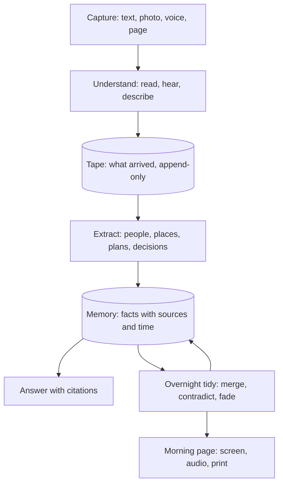

# Concept

## The problem

A local AI answers a question and then forgets. A cloud AI remembers, but the memory belongs to the
cloud: the person cannot see it, check it, or delete it. A memory that only grows fills with noise,
keeps wrong facts, and is hard to correct.

## The four loops

1. **Capture.** One inbox for typed and pasted text, photos, screenshots, voice notes, audio files and
   documents. Capture always succeeds instantly, even when understanding has to wait.
2. **Consolidate.** When the computer is idle and on power, Nocturne turns new items into facts,
   merges duplicates, surfaces contradictions, and lowers the strength of what is not reinforced. A
   laptop that sleeps at night catches up on the next wake.
3. **Serve.** A question gets a short answer built from a small, cited package of facts, never the
   whole archive. Every claim links to the original it came from.
4. **Publish.** The morning page has four parts: what changed, what needs you, what was let go, and
   one question.

## The forgetting policy

| Signal | Action | What the page says |
|---|---|---|
| Reinforced or repeated | Keep, raise confidence | kept |
| Contradicted | Keep both with valid time, ask | needs you |
| Unreferenced for 30 days | Lower confidence | fading |
| Unreferenced for 90 days | Archive, do not delete | let go |
| The person says forget | Delete with cascade | gone |
| Untrusted source | Quarantine, no promotion | unconfirmed |

Archiving is reversible; deletion is explicit. Answering the daily question is a reinforcement
signal, so the page trains the memory without a settings screen.

## Why this shape

Memory alone is a crowded category, and so is background consolidation. What no product closes is
the loop from local multimodal capture to a daily artifact with a deliberate, visible forgetting
policy. The page is the product; the memory is the engine.
