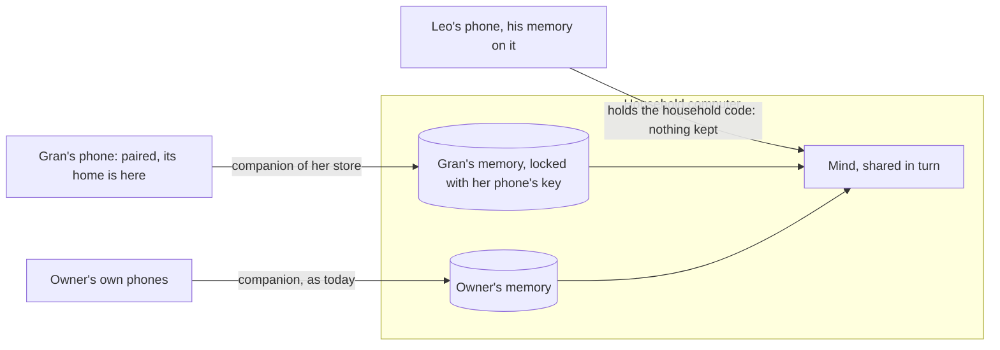
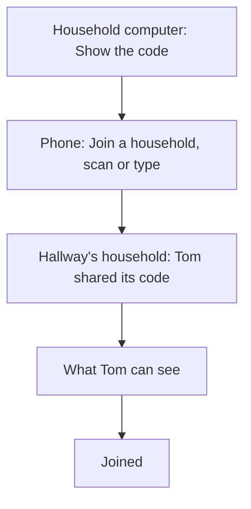
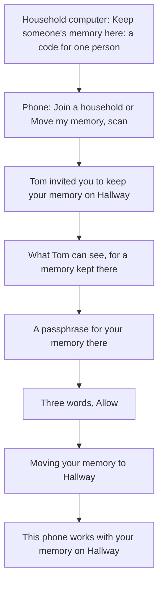

# A household computer

Part of [Phone and computer as equal starting points](phone-parity.md). A household computer is a
computer at home that runs Nocturne and lends its mind to the phones of people its owner shows the
household code to. It can be a desktop with its own owner and their memory (Sam's Home computer), or a computer that is
always on and kept for the purpose (Tom's Hallway). Either way, a household shares a mind, never a
memory.

Status: proposed, with the owner's decisions folded in. Nothing here is built. Borrowing the mind
ships first, after a phone alone and online ([decision 11](phone-parity.md#decisions)). A household
computer as someone's home follows.

| Phase 3: borrowing the mind | Phase 4: a household computer as someone's home |
|---|---|
| The Household page: the lending switch, the household code, New code | "Memories kept here", "Keep someone’s memory here…", Allow, Remove |
| Joining: scan, Found, What {runner} can see, Joined | Found for a home, the home's What {runner} can see, the passphrase, three words, the move |
| This phone, borrowing | This phone, its home; "Keep my memory on {household}…" on a borrowing phone |
| From the owner's own phone: the switch, Show the code, New code | |

Nothing from phase 4 shows before it ships.

## Mockups

In `docs/design/mockups/phone-parity/`.

| Screen | File and states | Renders |
|---|---|---|
| Joining, on the phone | `household.html`: `found`, `see`, `joined`; `passphrase` and `words` for [making it your home](#making-a-household-computer-your-home) | `household-found-light.png`, `household-see-light.png`, `household-words-light.png`, `household-joined-light.png`, `household-passphrase-light.png` |
| The mind is away, removed | `away.html`: `today`, `journal`, `back`, `removed` | `away-today-light.png`, `away-today-dark.png`, `away-journal-light.png`, `away-back-light.png`, `away-removed-light.png` |
| This phone, in a household | `this-phone.html`: `guest`, `member` | `this-phone-guest-light.png`, `this-phone-member-light.png` |
| The household, on the computer | `desktop-household.html`: `household`, `code`, `new`, `allow`, `remove`, `off` | `desktop-household-light.png`, `desktop-household-dark.png`, `desktop-household-code-light.png`, `desktop-household-new-light.png`, `desktop-household-allow-light.png`, `desktop-household-remove-light.png`, `desktop-household-off-light.png` |

The found screen for a home and the household computer as someone's home on the phone are
described here in words; they reuse the joining and companion layouts. `desktop-household.html` shows phases 3 and 4 together;
"Memories kept here" appears only once phase 4 ships.

## Borrowing, and a home

A phone has one of two relationships with a household computer, and its owner decides which: by
showing the household code, or by inviting one person to keep their memory there. They are not two settings of one thing: borrowing never turns into a home by itself.

| | Borrow its mind | Its home |
|---|---|---|
| How it starts | The owner shows the household code; the phone scans it, and that is all | The owner invites the person to keep their memory there; the person pairs and their memory moves ([Moving](moving-memory.md#to-a-household-computer)) |
| Interface words | "Borrow its mind" / "Your memory stays on this phone. {household} reads and answers for you, and keeps nothing." | "Keep my memory on {household}" / "{household} becomes your memory’s home, locked with a key this phone holds. This phone then works with it." |
| Where the memory lives | On the phone | On the household computer, one store per person |
| What travels | What each request in flight needs: a thing to read, a question with its few lines, the lines a page, reflection or tidy step needs, check-ins included; sealed | Everything kept, sealed |
| What the household computer keeps | Nothing about the phone: no name, key, list, memory, file, copy, log or count. It keeps only its one current code, which any phone holding it may use | That person's memory, locked |
| Needs | A phone that keeps its own memory ([Phone first](phone-first.md)) | Nothing new on the phone: it works as a companion of that store |
| Overnight | The phone drives its own tidy when it is charging and can reach the household | The household computer tidies overnight, with the key the phone leaves for the night ([decision 13](phone-parity.md#decisions)) |
| Things marked private | Sent when a request needs them, like everything else ([decision 15](phone-parity.md#decisions), changed by decision 37) | Read like everything else: it is their home |
| When the household computer is away | The phone works as a phone alone: keeps, finds by words; reading waits | The phone keeps recording and never reads on its own; things wait to go across |
| On Sam's desktop, which has its own owner | Yes | Yes |

A phone joins one Nocturne at a time. A phone that is a companion of its own computer is not
offered "Join a household": its person already has a mind. No phone can find a household or borrow
its mind without the code its owner shows.

## Joining

Joining is borrowing the mind. The owner shows the household code; the phone scans it; done.

**One household code.** A household has one current code. It carries the household computer's
address, its key (so the phone knows it reaches that computer and no other) and a secret. Any phone
holding the current code may borrow the mind; each request proves it holds the code inside the
sealed session. The household computer keeps only the current code, never a list of phones, so
there is no per-phone Allow, no three words and nothing to pause or remove per phone.

**New code.** "New code…" on the computer replaces the code. Every phone holding the old one is cut
off at its next request and shows "{household} has a new code". The people who should keep borrowing
scan the new one. A new code is also how the owner stops one phone, a lost phone included: there is
no way to stop one phone alone.

**When the address changes.** In Simple the address can change when the computer restarts. The code
on the computer then shows the new address with the same secret; phones that can't reach the old
address say so, and scanning the code again is enough.

A phone that scans a code made for keeping a memory there goes to [Making a household computer your
home](#making-a-household-computer-your-home) instead.

### 1. Scan or type

From Welcome's "Join a household", or This phone. The approved scan and typed screens, with these
words:

| Part | Copy |
|---|---|
| Steps | "1. Ask whoever runs Nocturne at home to show its code: {settings}, then {household}, then {showCode}." / "2. Scan the code, or type the address and the code." |
| Scan lead | "Point at the code on their screen or phone." |

### 2. Found

| Part | Copy |
|---|---|
| Title | "Join {household}’s household?" |
| Who runs it | "Run by {runner}" |
| Lead | "{runner} shared {household}’s code with you, so this phone can borrow its mind. {household} is a computer at home that runs Nocturne." |
| Bar | "Continue" · "Cancel" |

`{household}` and `{runner}` are names the person who runs it gave on the computer.

### 3. What the person who runs it can see

The screen before joining. The words are exact, and appear the same in This phone later.

| Part | Copy |
|---|---|
| Title | "What {runner} can see" |
| Can see heading | "{runner} can see" |
| Can see | "That a phone with the code is using the mind right now, not which one" |
| Can’t see heading | "{runner} can’t see, in Nocturne" |
| Can’t see | "Which phone is yours, or that it ever borrowed the mind" · "What you keep, ask or write" · "Your answers, your page or your journal" · "Your calendar and health" · "When or how much you used the mind" |
| Nothing kept | "{household} reads each thing in its memory while it works on it, then lets it go. It keeps nothing of yours and nothing about this phone: no copy, no file, no name, and no record of what it read or when." |
| Private | "Marking something private keeps it from coming up on its own. It still helps answer what you ask." |
| Others | "No one else in the household sees anything of yours, and you see nothing of theirs." |
| The limit | "Someone with full control of {household} could change Nocturne on it to look at what it reads. Nocturne can’t prevent that. Join only a household you trust." |
| Bar | "Join" · "Back" |

Why each line is true, against the research:

- **Can see.** The household screen shows a live "In use now" while any request is being worked on,
  with no phone named. Nothing about a borrowing phone is counted or stored once a request is
  answered.
- **Can't see, in Nocturne.** The calls a borrowing phone can make have no handle on any store. "In
  Nocturne" is there because the next line is about outside it.
- **Nothing kept.** Recordings and photos are read from memory, never written to a file; nothing is
  logged or counted per phone. The computer checks each request against its one current code, so
  it needs nothing about the phone itself.
- **The limit.** A computer reads what it works on in its own memory. Whoever controls it fully can
  read that memory or replace the program. The research's words are kept nearly as written.

### 4. Joined

| Part | Copy |
|---|---|
| Title | "{name} borrows {household}’s mind." |
| Body | "What you keep is read there and comes back to this phone. Your first page comes tomorrow morning." |
| Button | "Continue" |

## Making a household computer your home

The one way a memory comes to live on a household computer: its person pairs to make that computer
their home. Borrowing the mind never leads here by itself, and nothing a phone sends while borrowing
is kept for later.

### Found, for a home

| Part | Copy |
|---|---|
| Title | "Keep your memory on {household}?" |
| Who runs it | "Run by {runner}" |
| Lead | "{runner} invited you to keep your memory on {household}. It becomes your memory’s home, locked with a key this phone holds, and reads it overnight. This phone then works with it." |
| This phone has a memory | "What this phone holds now moves to {household}: {count} things, about {size}." |
| Bar | "Continue" · "Cancel" |

### What the person who runs it can see, for a home

The host's promise for a memory kept on a computer someone else runs, by [decision
13](phone-parity.md#decisions): locked with a key the phone holds, opened only while it is read or
tidied, including one night at a time.

| Part | Copy |
|---|---|
| Title | "What {runner} can see" |
| Can see | "This phone’s name" · "That your memory is kept on {household}, and how much room it takes" · "When this phone last connected" |
| Can’t see heading | "{runner} can’t see, in Nocturne" |
| Can’t see | "What you keep, ask or write" · "Your answers, your page or your journal" · "Your calendar and health" |
| Locked | "Your memory on {household} is locked with a key this phone holds, so it can’t be browsed, copied or backed up in a way anyone can read." |
| Others | "No one else in the household sees anything of yours, and you see nothing of theirs." |
| The limit | "While {household} reads or tidies your memory, it is open in that computer’s memory, and someone with full control of {household} could get at it then. That includes overnight, when this phone leaves the key there for the tidy. Nocturne can’t prevent that. Keep your memory there only if you trust who runs it." |
| Leaving | "You can bring your memory to this phone or your own computer at any time. It is deleted from {household} only when you say so." |
| Bar | "Continue" · "Back" |

### A passphrase for a memory kept there

The key that locks a memory kept on a household computer lives on the phone. So that a lost phone
does not lose the memory, the key is also locked with a passphrase the person chooses, as the
nightly backup does with its phrase. A new phone, invited again, types it.

| Part | Copy |
|---|---|
| Step label | "Keeping your memory on {household}" |
| Title | "Choose a passphrase for your memory on {household}" |
| Lead | "Your memory there is locked with a key this phone holds. If this phone is lost, this passphrase lets a new phone open it. Nobody else can, not even {runner}." |
| Fields, hint, tick | 0013's ([Back up and restore](backup-and-restore.md#the-form)) |
| Bar | "Continue" · "Back" · 0013's disabled reason |

A phone invited where its person already keeps a memory (a replacement phone) is asked instead:
"Your memory is already on {household}. Type its passphrase to open it on this phone." with "Open
it" and "That passphrase doesn’t open your memory. Check capital letters, and try again."

Then three words and Allow, since a home is one person's and is let in one phone at a time:

| Part | Copy |
|---|---|
| Label | "Keeping your memory on {household}" |
| Title | "Check {household} shows the same three words." |
| Lead | "If they match, {runner} chooses {allow} on {household}. If they don’t, {runner} chooses {dontAllow} there and you start again." |
| Warning | "If {household} asks to allow a phone and this phone isn’t showing three words, someone else is trying. Refuse it." |
| Status | "Waiting for {household}…" |

Then, when this phone held a memory, the move
([Moving](moving-memory.md#to-a-household-computer)). Joined: "Your memory’s home is {household}." /
"Keep, ask and read your page from here."

## This phone

**Borrowing.**

| Group | Row | Value |
|---|---|---|
| Your memory | "Where it is" | "On this phone" · "{size}" |
| | "Its mind" | "{household}, at home" |
| | "Backup" | As on a phone alone |
| Household | "{household}" | "Run by {runner} · borrows its mind" |
| | "What {runner} can see" | Opens the borrowing screen above |
| | "This month" | "{count} things read, {count} questions" (counted on this phone only) |
| | "Keep my memory on {household}…" (phase 4) | "Ask {runner} to invite you to keep your memory there, then scan the code they show." with "Scan" · "Cancel" |
| | "Leave this household…" | Below |

**Its home.**

| Group | Row | Value |
|---|---|---|
| Your memory | "Where it is" | "On {household}" · "{size}" |
| | "Its mind" | "{household}" |
| | "Waiting to go across" | "Nothing waiting" or "{count} waiting" |
| | "Kept here to read when you’re away" | "Today’s page, the last week of pages, and your journal entries" ([decision 17](phone-parity.md#decisions)) |
| Household | "{household}" | "Run by {runner} · your memory’s home" |
| | "What {runner} can see" | Opens the home screen above |
| | "Move my memory…" | [Moving](moving-memory.md) |
| | "Leave this household…" | Below |

Everything else is the companion's This phone, including "What this phone brings". A memory whose
home is there can delete, forget and export from the phone, because it is that person's own store:
the phone acts for its owner, not for the household's runner.

## Leaving

| Relationship | Dialog | Then |
|---|---|---|
| Borrowing | "Leave {household}’s household?" / "This phone stops using {household}’s mind and forgets its code. {household} kept nothing about this phone. Your memory stays on this phone." / "Leave" · "Stay" | Its mind reads "None yet"; the no-mind card returns on Today |
| Its home | "Where should your memory go?" / "To this phone" · "To a computer of your own" · "Cancel" | [Moving](moving-memory.md#back-to-the-phone), then "Delete your memory from {household}?" once it has arrived |

## States

| State | Borrowing | Its home |
|---|---|---|
| Connected | Status "Connected to {household}" | Status "Connected to {household}" |
| A lost phone | Nothing of the person's is on {household}. If they want the lost phone cut off, the person who runs it makes a new code, and everyone else scans it again | The person who runs it removes the lost phone; it stops at once. The memory waits, locked. A new phone, invited again, types the passphrase and carries on |
| Household computer away | Banner "{household} is out of reach." / "What you keep is kept on this phone and read when it’s back." Today keeps the last page with "Written {day}". Ask finds by words | Banner "{household} is out of reach. Still recording." / "What you keep waits here and goes across when it’s back." Today keeps the last page with "From {time} today", and "{count} waiting to go across" |
| A thing waiting | Journal row as kept, "waiting to be read" | Journal row with "waiting to go across" and a receipt chip "On this phone". It never shows as read until it has gone across and been read there |
| Back | Nothing; reading resumes | Toast "{household} is back. {count} went across." Today: "Your page is updated once they’re read." |
| A new code | "{household} has a new code." / "Ask {runner} to show it, and scan it again. Your memory is on this phone and wasn’t touched." / "Scan" · "Later" | Not affected: a home is let in by its own pairing |
| Removed | Not applicable: there is nothing to remove | "{household}’s household removed this phone." / "Your memory is still on {household}, locked. Bring it to this phone before {date}. After that, {runner} may delete it." / "Bring my memory to this phone" · "Later" |
| Household no longer lends its mind | "{household} isn’t lending its mind now." / "Your memory is on this phone and wasn’t touched. Choose another mind when you’re ready." / "Choose a mind" · "OK" | Not affected: a home carries on when lending stops |
| New address (Simple) | "{household} can’t be found at its address." / "Ask {runner} to show the code again, and scan it." / "Scan" · "Later" | The approved re-link, inside the app |
| Versions apart | The approved "Please update", naming {household} | The same |

## Behaviour

**What a borrowing phone sends.** The household calls are shaped like Nocturne's own mind, never a
general chat: turn a question into what finding needs, answer from the few lines sent (at most 12),
hear a recording, read a photo or document, read a thing's words, find what goes together, write a
reflection, write the page's headline. The household computer's own instructions and settings stay
on it.

**What the household computer keeps of a borrowing phone.** Nothing. It keeps its one current code,
which is the household's, not any phone's. What a request carries is held in memory until the answer
is sent, recordings and photos are never written to a file, and nothing is logged, cached or counted
per phone. The owner's activity list has no line about a borrowing phone.

**Overnight for a borrowing phone.** The phone runs its own tidy and calls the household's mind for
each step, when it is charging and can reach the household, as the phone allows. A morning page is
written from what finished, and says "Some of yesterday is still being read." when it is not all
done.

**Things waiting to go across (a home).** Kept on the phone in order, with the time they were kept;
sent oldest first; each kept once however often it is sent; placed on the day it was kept, not the
day it arrived. Receipts in answers cite only things the home has.

**Sharing the mind.** In turn, by [decision 16](phone-parity.md#decisions): the owner's own asks,
then household asks (one at a time per connection), then everyone's reading in turn, one thing at a
time per connection. Taking turns needs only the requests waiting now, so nothing is counted per
phone. To stop the household's use, the owner turns lending off or makes a new code. Reading by household phones never makes the computer load a different mind.
On computers with two minds, household reading goes where the owner's reading goes
([0014](/adr/0014-npu-mind.md)).

**Connections.** Household phones connect through Simple, as the owner's own phones do. With Most
private, only the owner's own devices are admitted, so Household asks to use Simple ([decision
14](phone-parity.md#decisions)).

## On the computer that runs it

A new page in Settings, "Household", with the hint "Lend this computer’s mind to people at home".
On a household computer with no window, the same page shows in its browser page.

### Household

| Part | Copy |
|---|---|
| Back link | "Settings" |
| Title | "Household" |
| Lead | "Lend this computer’s mind to people in your household. Their memories stay theirs: you can’t see what they keep or ask, and they can’t see yours." |
| Switch | "Lend this computer’s mind" |
| Name rows | "Household name" / "{household}" · "Your name, as phones see it" / "{runner}" |
| Code heading | "The household code" |
| Code body | "Anyone you show this code to can borrow this computer’s mind from their phone. This computer keeps nothing about them, not even a list." |
| Live line | "In use now" or "Not in use now" |
| Buttons | "Show the code" · "New code…" |
| Homes heading (phase 4) | "Memories kept here" |
| Each home | "{name}" / "{size} · last connected {time}" / "Remove…" |
| Homes button (phase 4) | "Keep someone’s memory here…" |
| Sharing heading | "Sharing the mind" |
| Sharing body | "Your own questions always come first. Then household questions, then everyone’s reading, in turn." |
| What you see heading | "What you can see" |
| What you see body | "Whether the mind is in use now, nothing more about the phones that borrow it: not which, not when, not how much. For a memory kept here, how much room it takes and when its phone last connected. Never what anyone kept, asked or read." |
| Foot | "Household phones connect through Simple, like your own phones. Cloudflare sees when they connect and from where, not what they send." |
| Foot, Most private | "Household phones need Simple. With Most private, only your own phones can connect." with "Change to Simple…" |

Any computer running Nocturne may lend its mind; there is no check of how strong it is ([roadmap
items](phone-parity.md#household-hosting-on-a-computer-of-ones-own)). Household reading takes its
turn behind the owner's own asks.

### Show the code

| Part | Copy |
|---|---|
| Title | "The household code" |
| Lead | "Ask them to open Nocturne on their phone, choose Join a household, and scan this." |
| The code | The code, as Add a phone shows it, with "Can’t scan?", the address and the code to type |
| Note | "Anyone with this code can borrow this computer’s mind until you make a new one. It never lets anyone see your memory." |
| Button | "Done" |

The code stays the same until the owner makes a new one; showing it again shows the same code, with
the current address.

### New code

| Part | Copy |
|---|---|
| Title | "Make a new household code?" |
| Body | "Every phone using the current code stops at once. Show the new code to the people who should keep borrowing this computer’s mind." |
| Buttons | "Make a new code" (careful) · "Cancel" |

There is no way to stop one borrowing phone alone, because this computer never knows which phones
they are. A new code stops them all; the rest scan again.

### Keep someone’s memory here (phase 4)

| Part | Copy |
|---|---|
| Title | "Keep someone’s memory here" |
| Lead | "Their memory moves here and lives here, locked with a key their phone holds. Their phone then works with it. Ask them to open Nocturne, choose Join a household, and scan this." |
| The code | A pairing code for one person, as Add a phone shows it |
| Time | "This code works for 5 minutes, once." |
| Button | "Done" |

### Allow (phase 4)

| Part | Copy |
|---|---|
| Title | "Keep {name}’s memory here?" |
| Words | "Check {name} shows the same three words." and the words |
| Body | "Its memory will be kept on this computer, locked with a key its phone holds. About {size} to start." |
| Warning | "If a phone that isn’t showing three words asks, someone else is trying. Don’t allow it." |
| Buttons | "Allow" · "Don’t allow" (the careful choice is not the default) |

### Remove (phase 4)

| Part | Copy |
|---|---|
| Title | "Remove {name} from your household?" |
| Body | "It stops at once. Their memory stays here, locked, so they can take it home. You can delete it after 30 days; they are told on their phone first." |
| Buttons | "Remove" (careful) · "Cancel" |
| After | Row "{name} · removed {day}" / "Their memory waits here, locked · {size}" / from the 30th day: "Delete their memory…" |
| Taking it home | Until the date, the removed phone may still connect for one thing only: bringing the memory to itself or to a computer of its own ([Back to the phone](moving-memory.md#back-to-the-phone)). It can't keep, ask or read the page there |
| Delete their memory | "Delete {name}’s memory from this computer?" / "They were told on {day}. If they haven’t taken it, it is gone for good." / "Delete" · "Keep it" |

### Turning it off

| Part | Copy |
|---|---|
| Title | "Stop lending this computer’s mind?" |
| Body | "Phones that borrow this computer’s mind stop at once. People whose memory is kept here carry on. Turning it back on lets the same code work again." |
| Buttons | "Stop lending" (careful) · "Keep lending" |

Stopping lending never cuts off a person whose home is here. To stop being someone's home, the owner
removes their phone, which keeps their memory locked until they take it or the 30 days' notice
ends.

### From the owner's own phone

The owner's companion phones get a Household group in This phone ([roadmap
items](phone-parity.md#household-hosting-on-a-computer-of-ones-own)), so the code can be shown where
people are:

| Row | Value |
|---|---|
| "Lend {computer}’s mind" | The switch, with the computer's turn-off dialog |
| "Show the household code" | The code full screen on this phone, with the computer's lead and note |
| "New code…" | The computer's New code dialog |
| "In use now" | As on the computer |

Phase 4 homes are managed on the computer only in their first release: removing someone's home
starts a 30-day notice about another person's memory. The reason is written here so phone parity
can be revisited.

### Elsewhere on the computer

- **Privacy screen.** Under Away from home: "Household phones can use this computer’s mind, in the
  same locked messages. Nothing they send is kept, unless their memory’s home is here." Bytes to
  household phones are counted with the rest, never per phone.
- **Activity list.** The owner's own acts: "Made a new household code", "Turned lending on" or
  "off". Nothing about a phone that borrows the mind. For a person whose home is here: "Allowed
  {name} to keep their memory here", "Removed {name}". Never what anyone sent.
- **Rail status.** "Uses the internet for" lists "Away from home and Household" while both are on.
- **Export and Delete everything.** The owner's export never includes household memories. Delete
  everything asks first: "{count} household memories are kept here. They stay, locked, until their
  people take them home, or you delete them after telling them."

## Copy

| Key | Copy |
|---|---|
| Join, steps | "Ask whoever runs Nocturne at home to show its code: {settings}, then {household}, then {showCode}." / "Scan the code, or type the address and the code." |
| Join, scan lead | "Point at the code on their screen or phone." |
| Found | "Join {household}’s household?" / "Run by {runner}" / "{runner} shared {household}’s code with you, so this phone can borrow its mind. {household} is a computer at home that runs Nocturne." |
| See, title | "What {runner} can see" |
| See, can | "{runner} can see" / "That a phone with the code is using the mind right now, not which one" |
| See, can’t | "{runner} can’t see, in Nocturne" / "Which phone is yours, or that it ever borrowed the mind" / "What you keep, ask or write" / "Your answers, your page or your journal" / "Your calendar and health" / "When or how much you used the mind" |
| See, nothing kept | "{household} reads each thing in its memory while it works on it, then lets it go. It keeps nothing of yours and nothing about this phone: no copy, no file, no name, and no record of what it read or when." |
| See, private | "Marking something private keeps it from coming up on its own. It still helps answer what you ask." |
| See, others | "No one else in the household sees anything of yours, and you see nothing of theirs." |
| See, limit, borrowing | "Someone with full control of {household} could change Nocturne on it to look at what it reads. Nocturne can’t prevent that. Join only a household you trust." |
| See, bar | "Join" / "Back" |
| Joined | "{name} borrows {household}’s mind." / "What you keep is read there and comes back to this phone. Your first page comes tomorrow morning." |
| Home, found | "Keep your memory on {household}?" / "{runner} invited you to keep your memory on {household}. It becomes your memory’s home, locked with a key this phone holds, and reads it overnight. This phone then works with it." / "What this phone holds now moves to {household}: {count} things, about {size}." |
| Home, see | "That your memory is kept on {household}, and how much room it takes" / "When this phone last connected" |
| Home, locked | "Your memory on {household} is locked with a key this phone holds, so it can’t be browsed, copied or backed up in a way anyone can read." |
| Home, limit | "While {household} reads or tidies your memory, it is open in that computer’s memory, and someone with full control of {household} could get at it then. That includes overnight, when this phone leaves the key there for the tidy. Nocturne can’t prevent that. Keep your memory there only if you trust who runs it." |
| Home, leaving | "You can bring your memory to this phone or your own computer at any time. It is deleted from {household} only when you say so." |
| Home, passphrase | "Keeping your memory on {household}" / "Choose a passphrase for your memory on {household}" / "Your memory there is locked with a key this phone holds. If this phone is lost, this passphrase lets a new phone open it. Nobody else can, not even {runner}." |
| Home, replacement phone | "Your memory is already on {household}. Type its passphrase to open it on this phone." / "Open it" / "That passphrase doesn’t open your memory. Check capital letters, and try again." |
| Home, words | "Keeping your memory on {household}" / "Check {household} shows the same three words." / "If they match, {runner} chooses {allow} on {household}. If they don’t, {runner} chooses {dontAllow} there and you start again." / "If {household} asks to allow a phone and this phone isn’t showing three words, someone else is trying. Refuse it." / "Waiting for {household}…" |
| Home, joined | "Your memory’s home is {household}." / "Keep, ask and read your page from here." |
| This phone, household | "Household" / "Run by {runner} · borrows its mind" / "Run by {runner} · your memory’s home" / "This month" / "{count} things read, {count} questions" |
| This phone, keep there | "Keep my memory on {household}…" / "Ask {runner} to invite you to keep your memory there, then scan the code they show." / "Scan" / "Cancel" |
| This phone, home rows | "On {household}" / "Waiting to go across" / "Nothing waiting" / "{count} waiting" / "Kept here to read when you’re away" / "Today’s page, the last week of pages, and your journal entries" |
| This phone, leave | "Leave this household…" |
| Leave, borrowing | "Leave {household}’s household?" / "This phone stops using {household}’s mind and forgets its code. {household} kept nothing about this phone. Your memory stays on this phone." / "Leave" / "Stay" |
| Leave, home | "Where should your memory go?" / "To this phone" / "To a computer of your own" / "Cancel" |
| Status | "Connected to {household}" |
| Away, borrowing | "{household} is out of reach." / "What you keep is kept on this phone and read when it’s back." |
| Away, home | "{household} is out of reach. Still recording." / "What you keep waits here and goes across when it’s back." |
| Last page | "Written {day}" / "From {time} today" |
| Waiting | "{count} waiting to go across" / "waiting to go across" / "On this phone" |
| Back | "{household} is back. {count} went across." / "Your page is updated once they’re read." |
| Page not done | "Some of yesterday is still being read." |
| New code, borrowing | "{household} has a new code." / "Ask {runner} to show it, and scan it again. Your memory is on this phone and wasn’t touched." / "Scan" / "Later" |
| Moved, borrowing | "{household} can’t be found at its address." / "Ask {runner} to show the code again, and scan it." |
| Removed, home | "{household}’s household removed this phone." / "Your memory is still on {household}, locked. Bring it to this phone before {date}. After that, {runner} may delete it." / "Bring my memory to this phone" / "Later" |
| Stopped lending | "{household} isn’t lending its mind now." / "Your memory is on this phone and wasn’t touched. Choose another mind when you’re ready." / "Choose a mind" / "OK" |
| Settings row | "Household" / "Lend this computer’s mind to people at home" |
| Household, lead | "Lend this computer’s mind to people in your household. Their memories stay theirs: you can’t see what they keep or ask, and they can’t see yours." |
| Household, switch | "Lend this computer’s mind" |
| Household, names | "Household name" / "Your name, as phones see it" |
| Household, code | "The household code" / "Anyone you show this code to can borrow this computer’s mind from their phone. This computer keeps nothing about them, not even a list." / "In use now" / "Not in use now" / "Show the code" / "New code…" |
| Household, homes | "Memories kept here" / "{size} · last connected {time}" / "Remove…" / "Keep someone’s memory here…" |
| Household, sharing | "Sharing the mind" / "Your own questions always come first. Then household questions, then everyone’s reading, in turn." |
| Household, you see | "What you can see" / "Whether the mind is in use now, nothing more about the phones that borrow it: not which, not when, not how much. For a memory kept here, how much room it takes and when its phone last connected. Never what anyone kept, asked or read." |
| Household, foot | "Household phones connect through Simple, like your own phones. Cloudflare sees when they connect and from where, not what they send." |
| Household, Most private | "Household phones need Simple. With Most private, only your own phones can connect." / "Change to Simple…" |
| Show the code | "The household code" / "Ask them to open Nocturne on their phone, choose Join a household, and scan this." / "Anyone with this code can borrow this computer’s mind until you make a new one. It never lets anyone see your memory." / "Done" |
| New code | "Make a new household code?" / "Every phone using the current code stops at once. Show the new code to the people who should keep borrowing this computer’s mind." / "Make a new code" / "Cancel" |
| Keep someone’s memory here | "Keep someone’s memory here" / "Their memory moves here and lives here, locked with a key their phone holds. Their phone then works with it. Ask them to open Nocturne, choose Join a household, and scan this." / "This code works for 5 minutes, once." / "Done" |
| Allow | "Keep {name}’s memory here?" / "Check {name} shows the same three words." / "Its memory will be kept on this computer, locked with a key its phone holds. About {size} to start." / "If a phone that isn’t showing three words asks, someone else is trying. Don’t allow it." / "Allow" / "Don’t allow" |
| Remove | "Remove {name} from your household?" / "It stops at once. Their memory stays here, locked, so they can take it home. You can delete it after 30 days; they are told on their phone first." / "Remove" / "Cancel" |
| Removed row | "{name} · removed {day}" / "Their memory waits here, locked · {size}" / "Delete their memory…" |
| Delete their memory | "Delete {name}’s memory from this computer?" / "They were told on {day}. If they haven’t taken it, it is gone for good." / "Delete" / "Keep it" |
| Turn off | "Stop lending this computer’s mind?" / "Phones that borrow this computer’s mind stop at once. People whose memory is kept here carry on. Turning it back on lets the same code work again." / "Stop lending" / "Keep lending" |
| Owner's phone | "Lend {computer}’s mind" / "Show the household code" / "New code…" / "In use now" |
| Privacy screen | "Household phones can use this computer’s mind, in the same locked messages. Nothing they send is kept, unless their memory’s home is here." |
| Activity | "Made a new household code" / "Turned lending on" / "Turned lending off" / "Allowed {name} to keep their memory here" / "Removed {name}" |
| Rail status | "Away from home and Household" |
| Delete everything, household | "{count} household memories are kept here. They stay, locked, until their people take them home, or you delete them after telling them." |

## Accessibility

- The "What {runner} can see" screen reads as two lists with headings, then the paragraphs; the
  limit is a paragraph, not small print.
- "In use now" is announced politely, not on every change.
- Show the code reads its lead, then "Can’t scan?" with the address and code as text, before
  "Done".
- New code announces that every phone using the current code stops before its buttons.
- The Allow dialog for a home announces what it will keep before the buttons, and Allow is never
  the default.
