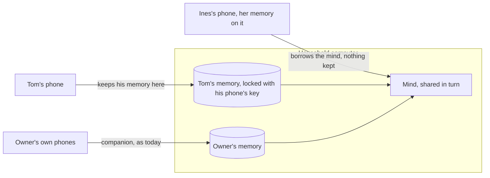
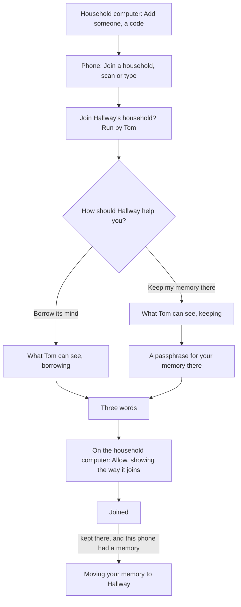

# A household computer

Part of [Phone and computer as equal starting points](phone-parity.md). A household computer is a
computer at home that runs Nocturne and lets the phones of people in the household use it. It can be
a desktop with its own owner and their memory (Sam's Home computer), or a computer that is always on
and kept for the purpose (Tom's Hallway). Either way, a household shares a mind, never a memory.

Status: proposed. Nothing here is built. The first slice, by the research and [decision
11](phone-parity.md#decisions-for-the-owner), is keeping a memory on someone's desktop; borrowing
the mind follows once a phone keeps its own memory.

## Mockups

In `docs/design/mockups/phone-parity/`.

| Screen | File and states | Renders |
|---|---|---|
| Joining, on the phone | `household.html`: `found`, `choose`, `see`, `passphrase`, `words`, `joined` | `household-found-light.png`, `household-choose-light.png`, `household-choose-dark.png`, `household-see-light.png`, `household-passphrase-light.png`, `household-words-light.png`, `household-joined-light.png` |
| The mind is away, removed | `away.html`: `today`, `journal`, `back`, `removed` | `away-today-light.png`, `away-today-dark.png`, `away-journal-light.png`, `away-back-light.png`, `away-removed-light.png` |
| This phone, in a household | `this-phone.html`: `guest`, `member` | `this-phone-guest-light.png`, `this-phone-member-light.png` |
| The household, on the computer | `desktop-household.html`: `household`, `add`, `allow`, `remove`, `off` | `desktop-household-light.png`, `desktop-household-dark.png`, `desktop-household-add-light.png`, `desktop-household-allow-light.png`, `desktop-household-remove-light.png`, `desktop-household-off-light.png` |

## Two ways to join

| | Borrow its mind | Keep my memory there |
|---|---|---|
| Interface words | "Borrow its mind" / "Your memory stays on this phone. {household} reads and answers for you, and keeps nothing." | "Keep my memory there" / "{household} keeps your memory, locked with a key this phone holds, and reads it overnight. This phone keeps what you add until it can reach {household}." |
| Where the memory lives | On the phone | On the household computer, one store per person |
| What travels | Each thing to be read, each question with its few lines, the lines a page or tidy needs; sealed | Everything kept, sealed |
| What the household computer keeps | Nothing | That person's memory, locked |
| Needs | A phone that keeps its own memory ([Phone first](phone-first.md)) | Nothing new on the phone: it works as a companion of that store |
| Overnight | The phone drives its own tidy when it is charging and can reach the household | The household computer tidies overnight, with the key the phone leaves for the night ([decision 13](phone-parity.md#decisions-for-the-owner)) |
| Things marked private | Never sent ([decision 15](phone-parity.md#decisions-for-the-owner)) | Read like everything else: it is their home |
| When the household computer is away | The phone works as a phone alone: keeps, finds by words; reading waits | The phone keeps recording and never reads on its own; things wait to go across |
| On Sam's desktop, which has its own owner | Yes | Yes, in the first slice |

A phone joins one Nocturne at a time. A phone that is a companion of its own computer is not
offered "Join a household": its person already has a mind.

## Joining

Pairing is today's protocol ([Remote access](/architecture/remote.md#pairing)): a code, a name,
three words, Allow. The way it joins travels inside the sealed pairing message and shows on the
Allow screen, which is where the person who runs the household decides. Changing the way one
joined later is moving a memory ([Moving](moving-memory.md)).

### 1. Scan or type

From Welcome's "Join a household", or This phone. The approved scan and typed screens, with these
words:

| Part | Copy |
|---|---|
| Steps | "1. Ask whoever runs Nocturne at home to open {settings}, then {household}, then {addSomeone}." / "2. Scan the code it shows, or type the address and the code." |
| Scan lead | "Point at the code on their screen, under {addSomeone}." |

### 2. Found

| Part | Copy |
|---|---|
| Title | "Join {household}’s household?" |
| Who runs it | "Run by {runner}" |
| Lead | "{household} is a computer at home that runs Nocturne. Next, choose how it should help you." |
| Bar | "Continue" · "Cancel" |

`{household}` and `{runner}` are names the person who runs it gave on the computer.

### 3. How should it help you?

| Part | Copy |
|---|---|
| Title | "How should {household} help you?" |
| Choice | "Borrow its mind" / "Your memory stays on this phone. {household} reads and answers for you, and keeps nothing." |
| Choice | "Keep my memory there" / "{household} keeps your memory, locked with a key this phone holds, and reads it overnight. This phone keeps what you add until it can reach {household}." |
| Hint | "You can change this later." |
| This phone already has a memory, keeping chosen | "What this phone holds now moves to {household} after you join: {count} things, about {size}." |
| Bar | "Continue" · "Back" |

"Borrow its mind" is offered only on a phone that keeps its own memory; before phase 4 the choice
screen shows "Keep my memory there" alone, with the title "{household} will keep your memory".

### What the person who runs it can see

The screen before the three words. The words are exact, and appear the same in This phone later.

**Borrowing its mind.**

| Part | Copy |
|---|---|
| Title | "What {runner} can see" |
| Can see heading | "{runner} can see" |
| Can see | "This phone’s name" · "That it borrows {household}’s mind" · "When it last used it, and how much: how many things were read, how many questions, and the mind’s time" |
| Can’t see heading | "{runner} can’t see, in Nocturne" |
| Can’t see | "What you keep, ask or write" · "Your answers, your page or your journal" · "Your calendar and health" |
| Nothing kept | "{household} reads each thing in its memory while it works on it, then lets it go. It keeps nothing, and no record of what it read." |
| Private | "Things you marked private never go to {household}." |
| Others | "No one else in the household sees anything of yours, and you see nothing of theirs." |
| The limit | "Someone with full control of {household} could change Nocturne on it to look at what it reads. Nocturne can’t prevent that. Join only a household you trust." |
| Bar | "Continue" · "Back" |

**Keeping your memory there.**

| Part | Copy |
|---|---|
| Title | "What {runner} can see" |
| Can see | "This phone’s name" · "That your memory is kept on {household}, and how much room it takes" · "When this phone last used it, and how much" |
| Can’t see heading | "{runner} can’t see, in Nocturne" |
| Can’t see | "What you keep, ask or write" · "Your answers, your page or your journal" · "Your calendar and health" |
| Locked | "Your memory on {household} is locked with a key this phone holds, so it can’t be browsed, copied or backed up in a way anyone can read." |
| Others | "No one else in the household sees anything of yours, and you see nothing of theirs." |
| The limit | "While {household} reads or tidies your memory, it is open in that computer’s memory, and someone with full control of {household} could get at it then. That includes overnight, when this phone leaves the key there for the tidy. Nocturne can’t prevent that. Keep your memory there only if you trust who runs it." |
| Leaving | "You can bring your memory to this phone or your own computer at any time. It is deleted from {household} only when you say so." |
| Bar | "Continue" · "Back" |

Why each line is true, against the research:

- **Can see.** The household screen shows names, the way each joined, last use, counts and the
  mind's time, and room taken. The activity trail records action, result and size, never content.
- **Can't see, in Nocturne.** The calls a borrowing phone can make have no handle on any store; a
  kept memory is its own store with its own key. "In Nocturne" is there because the next line is
  about outside it.
- **Nothing kept.** Recordings and photos are read from memory or a temporary place removed when
  the reading returns; nothing is logged beyond counts.
- **The limit.** A computer reads what it works on in its own memory. Whoever controls it fully can
  read that memory or replace the program. The research's words are kept nearly as written.

### A passphrase, when keeping the memory there

The key that locks a memory kept on the household computer lives on the phone. So that a lost phone
does not lose the memory, the key is also locked with a passphrase the person chooses, as the
locked copy online does. A new phone joins again and types it.

| Part | Copy |
|---|---|
| Step label | "Keeping your memory on {household}" |
| Title | "Choose a passphrase for your memory on {household}" |
| Lead | "Your memory there is locked with a key this phone holds. If this phone is lost, this passphrase lets a new phone open it. Nobody else can, not even {runner}." |
| Fields, hint, tick | 0013's, as in [the locked copy](phone-first.md#step-2-the-passphrase) |
| Bar | "Continue" · "Back" · 0013's disabled reason |

A phone that joins where its person already keeps a memory (a replacement phone) is asked instead:
"Your memory is already on {household}. Type its passphrase to open it on this phone." with "Open
it" and "That passphrase doesn’t open your memory. Check capital letters, and try again."

### 4. Three words, and Allow

The approved words screen, with these words:

| Part | Copy |
|---|---|
| Label | "Adding {name} to {household}’s household" |
| Title | "Check {household} shows the same three words." |
| Lead | "If they match, {runner} chooses {allow} on {household}. If they don’t, {runner} chooses {dontAllow} there and you start again." |
| Warning | "If {household} asks to allow a phone and this phone isn’t showing three words, someone else is trying to join. Refuse it." |
| Status | "Waiting for {household}…" |

On the household computer the Allow dialog shows the way the phone asked to join ([below](#allow)).

### 5. Joined

| Part | Copy |
|---|---|
| Title, borrowing | "{name} borrows {household}’s mind." |
| Body, borrowing | "What you keep is read there and comes back to this phone. Your first page comes tomorrow morning." |
| Title, keeping | "{name} keeps your memory on {household}." |
| Body, keeping, empty phone | "Keep, ask and read your page from here." |
| Body, keeping, phone had a memory | "Next, your memory moves to {household}." and the button leads to [Moving](moving-memory.md#from-a-phone-to-a-household) |
| Button | "Continue" |

## This phone

**Borrowing.**

| Group | Row | Value |
|---|---|---|
| Your memory | "Where it is" | "On this phone" · "{size}" |
| | "Its mind" | "{household}, at home" |
| | "A locked copy online" | As on a phone alone |
| Household | "{household}" | "Run by {runner} · borrows its mind" |
| | "What {runner} can see" | Opens the borrowing screen above |
| | "This month" | "{count} things read, {count} questions" |
| | "Change how {household} helps you…" | Moving |
| | "Leave this household…" | Below |

**Keeping the memory there.**

| Group | Row | Value |
|---|---|---|
| Your memory | "Where it is" | "On {household}" · "{size}" |
| | "Its mind" | "{household}" |
| | "Waiting to go across" | "Nothing waiting" or "{count} waiting" |
| | "Kept here to read when you’re away" | "Today’s page, the last week of pages, and your journal entries" ([decision 17](phone-parity.md#decisions-for-the-owner)) |
| Household | "{household}" | "Run by {runner} · keeps your memory" |
| | "What {runner} can see" | Opens the keeping screen above |
| | "Move my memory…" | [Moving](moving-memory.md) |
| | "Leave this household…" | Below |

Everything else is the companion's This phone, including "What this phone brings". A kept memory
there can delete, forget and export from the phone, because it is that person's own store: the
phone acts for its owner, not for the household's runner.

## Leaving

| Way joined | Dialog | Then |
|---|---|---|
| Borrowing | "Leave {household}’s household?" / "This phone stops using {household}’s mind. Your memory stays on this phone." / "Leave" · "Stay" | Its mind reads "None yet"; the no-mind card returns on Today |
| Keeping the memory there | "Where should your memory go?" / "To this phone" · "To a computer of your own" · "Cancel" | [Moving](moving-memory.md#back-to-the-phone), then "Delete your memory from {household}?" once it has arrived |

## States

| State | Borrowing | Keeping the memory there |
|---|---|---|
| Connected | Status "Connected to {household}" | Status "Connected to {household}" |
| A lost phone, memory kept there | Not applicable | The person who runs it removes the lost phone; it stops at once. The memory waits, locked. A new phone joins and types the passphrase, and carries on |
| Household computer away | Banner "{household} is out of reach." / "What you keep is kept on this phone and read when it’s back." Today keeps the last page with "Written {day}". Ask finds by words | Banner "{household} is out of reach. Still recording." / "What you keep waits here and goes across when it’s back." Today keeps the last page with "From {time} today", and "{count} waiting to go across" |
| A thing waiting | Journal row as kept, "waiting to be read" | Journal row with "waiting to go across" and a receipt chip "On this phone". It never shows as read until it has gone across and been read there |
| Back | Nothing; reading resumes | Toast "{household} is back. {count} went across." Today: "Your page is updated once they’re read." |
| Daily share used | "Today’s share of {household}’s mind is used. Reading carries on tomorrow; Ask finds by words until then." | The same words |
| Paused by the runner | "{runner} has paused this phone in {household}’s household. What you keep is safe on this phone." | "{runner} has paused this phone in {household}’s household. What you keep waits here." |
| Removed | "{household}’s household removed this phone." / "Your memory is on this phone and wasn’t touched. Choose another mind when you’re ready." / "Choose a mind" · "OK" | "{household}’s household removed this phone." / "Your memory is still on {household}, locked. Bring it to this phone before {date}. After that, {runner} may delete it." / "Bring my memory to this phone" · "Later" |
| Household no longer lends its mind | As removed, with "{household} stopped lending its mind." | As removed, with "{household} stopped lending its mind." |
| New address (Simple) | The approved re-link, inside the app | The same |
| Versions apart | The approved "Please update", naming {household} | The same |

## Behaviour

**What a borrowing phone sends.** The household calls are shaped like Nocturne's own mind, never a
general chat: turn a question into what finding needs, answer from the few lines sent (at most 12),
hear a recording, read a photo or document, read a thing's words, find what goes together, write a
reflection, write the page's headline. The household computer's own instructions and settings stay
on it. Nothing it reads is kept, logged or cached on disk.

**Overnight for a borrowing phone.** The phone runs its own tidy and calls the household's mind for
each step, when it is charging and can reach the household, as the phone allows. A morning page is
written from what finished, and says "Some of yesterday is still being read." when it is not all
done.

**Things waiting to go across.** Kept on the phone in order, with the time they were kept; sent
oldest first; each kept once however often it is sent; placed on the day it was kept, not the day it
arrived. Receipts in answers cite only things the home has.

**Sharing the mind.** In turn, by [decision 16](phone-parity.md#decisions-for-the-owner): the owner's
own asks, then household asks (one at a time per phone), then everyone's reading in turn, one thing
at a time per phone. Reading by household phones never makes the computer load a different mind. On
computers with two minds, household reading goes where the owner's reading goes
([0014](/adr/0014-npu-mind.md)).

**Connections.** Household phones connect through Simple, as the owner's own phones do. With Most
private, only the owner's own devices are admitted, so Household asks to use Simple ([decision
14](phone-parity.md#decisions-for-the-owner)).

## On the computer that runs it

A new page in Settings, "Household", with the hint "Lend this computer’s mind to people at home".
On a household computer with no window, the same page shows in its browser page.

### Household

| Part | Copy |
|---|---|
| Back link | "Settings" |
| Title | "Household" |
| Lead | "Lend this computer’s mind to people in your household. Their memories stay theirs: you can’t see what they keep or ask, and they can’t see yours." |
| Switch | "Lend this computer’s mind" |
| Name rows | "Household name" / "{household}" · "Your name, as phones see it" / "{runner}" |
| List heading | "Phones in your household" |
| Each phone, borrowing | "{name}" / "Borrows the mind · last used {time}" / "Today: {count} things read, {count} questions · {minutes} of the mind’s time" / "Pause" · "Remove…" |
| Each phone, keeping | "{name}" / "Keeps its memory here · {size} · last used {time}" / "Today: {count} things kept, {count} questions · {minutes} of the mind’s time" / "Pause" · "Remove…" |
| Nothing today | "Today: nothing yet" |
| Paused | "Paused" tag and "Resume" |
| Empty | "No one yet. Add someone and they scan the code with Nocturne on their phone." |
| Button | "Add someone…" |
| Sharing heading | "Sharing the mind" |
| Sharing body | "Your own questions always come first. Then household questions, then everyone’s reading, in turn." |
| Limit row | "A daily share for each phone" / "Off" or "{minutes} minutes of the mind’s time a day" |
| What you see heading | "What you can see" |
| What you see body | "Each phone’s name, the way it joined, when it was last used and how much it used. Never what it kept, asked or read." |
| Foot | "Household phones connect through Simple, like your own phones. Cloudflare sees when they connect and from where, not what they send." |
| Foot, Most private | "Household phones need Simple. With Most private, only your own phones can connect." with "Change to Simple…" |

### Add someone

| Part | Copy |
|---|---|
| Title | "Add someone to your household" |
| Lead | "Ask them to open Nocturne on their phone, choose Join a household, and scan this." |
| The code | The code, as Add a phone shows it, with "Can’t scan?" and the four words and the code |
| Note | "Anyone with this code can ask to join. You still choose Allow, and you see the way they want to join first." |
| Time | "This code works for 5 minutes, once." |
| Button | "Done" |

### Allow

| Part | Copy |
|---|---|
| Title | "Allow {name} to join your household?" |
| Words | "Check {name} shows the same three words." and the words |
| The way, borrowing | "It wants to borrow this computer’s mind." / "Its memory stays on its phone. This computer reads and answers for it and keeps nothing." |
| The way, keeping | "It wants to keep its memory here." / "Its memory will be kept on this computer, locked with a key its phone holds. About {size} to start." |
| Warning | "If a phone that isn’t showing three words asks to join, someone else is trying. Don’t allow it." |
| Buttons | "Allow" · "Don’t allow" (the careful choice is not the default) |

### Remove

| Part | Copy |
|---|---|
| Title | "Remove {name} from your household?" |
| Borrowing | "It stops at once. Its memory is on its phone and isn’t touched." |
| Keeping | "It stops at once. Their memory stays here, locked, so they can take it home. You can delete it after 30 days; they are told on their phone first." |
| Buttons | "Remove" (careful) · "Cancel" |
| After, keeping | Row "{name} · removed {day}" / "Their memory waits here, locked · {size}" / from the 30th day: "Delete their memory…" |
| Delete their memory | "Delete {name}’s memory from this computer?" / "They were told on {day}. If they haven’t taken it, it is gone for good." / "Delete" · "Keep it" |

### Turning it off

| Part | Copy |
|---|---|
| Title | "Stop lending this computer’s mind?" |
| Body | "Every household phone stops at once. Memories kept here stay, locked, until their people take them home." |
| Buttons | "Stop lending" (careful) · "Keep lending" |

### Elsewhere on the computer

- **Privacy screen.** Under Away from home: "Household phones can use this computer’s mind, in the
  same locked messages. Nothing they send is kept, unless their memory is kept here." Bytes to
  household phones are counted with the rest.
- **Activity list.** "{name} used the mind: {count} things read, {count} questions", never what.
- **Rail status.** "Uses the internet for" lists "Away from home and Household" while both are on.
- **Export and Delete everything.** The owner's export never includes household memories. Delete
  everything asks first: "{count} household memories are kept here. They stay, locked, until their
  people take them home, or you delete them after telling them."

## Copy

| Key | Copy |
|---|---|
| Join, steps | "Ask whoever runs Nocturne at home to open {settings}, then {household}, then {addSomeone}." / "Scan the code it shows, or type the address and the code." |
| Join, scan lead | "Point at the code on their screen, under {addSomeone}." |
| Found | "Join {household}’s household?" / "Run by {runner}" / "{household} is a computer at home that runs Nocturne. Next, choose how it should help you." |
| Choose, title | "How should {household} help you?" / single: "{household} will keep your memory" |
| Choose, borrow | "Borrow its mind" / "Your memory stays on this phone. {household} reads and answers for you, and keeps nothing." |
| Choose, keep | "Keep my memory there" / "{household} keeps your memory, locked with a key this phone holds, and reads it overnight. This phone keeps what you add until it can reach {household}." |
| Choose, hint | "You can change this later." |
| Choose, moves | "What this phone holds now moves to {household} after you join: {count} things, about {size}." |
| See, title | "What {runner} can see" |
| See, can | "{runner} can see" / "This phone’s name" / "That it borrows {household}’s mind" / "That your memory is kept on {household}, and how much room it takes" / "When it last used it, and how much: how many things were read, how many questions, and the mind’s time" / "When this phone last used it, and how much" |
| See, can’t | "{runner} can’t see, in Nocturne" / "What you keep, ask or write" / "Your answers, your page or your journal" / "Your calendar and health" |
| See, nothing kept | "{household} reads each thing in its memory while it works on it, then lets it go. It keeps nothing, and no record of what it read." |
| See, private | "Things you marked private never go to {household}." |
| See, others | "No one else in the household sees anything of yours, and you see nothing of theirs." |
| See, locked | "Your memory on {household} is locked with a key this phone holds, so it can’t be browsed, copied or backed up in a way anyone can read." |
| See, limit, borrowing | "Someone with full control of {household} could change Nocturne on it to look at what it reads. Nocturne can’t prevent that. Join only a household you trust." |
| See, limit, keeping | "While {household} reads or tidies your memory, it is open in that computer’s memory, and someone with full control of {household} could get at it then. That includes overnight, when this phone leaves the key there for the tidy. Nocturne can’t prevent that. Keep your memory there only if you trust who runs it." |
| See, leaving | "You can bring your memory to this phone or your own computer at any time. It is deleted from {household} only when you say so." |
| Words | "Adding {name} to {household}’s household" / "Check {household} shows the same three words." / "If they match, {runner} chooses {allow} on {household}. If they don’t, {runner} chooses {dontAllow} there and you start again." / "If {household} asks to allow a phone and this phone isn’t showing three words, someone else is trying to join. Refuse it." / "Waiting for {household}…" |
| Passphrase | "Keeping your memory on {household}" / "Choose a passphrase for your memory on {household}" / "Your memory there is locked with a key this phone holds. If this phone is lost, this passphrase lets a new phone open it. Nobody else can, not even {runner}." |
| Replacement phone | "Your memory is already on {household}. Type its passphrase to open it on this phone." / "Open it" / "That passphrase doesn’t open your memory. Check capital letters, and try again." |
| Joined, borrowing | "{name} borrows {household}’s mind." / "What you keep is read there and comes back to this phone. Your first page comes tomorrow morning." |
| Joined, keeping | "{name} keeps your memory on {household}." / "Keep, ask and read your page from here." / "Next, your memory moves to {household}." |
| This phone, household | "Household" / "Run by {runner} · borrows its mind" / "Run by {runner} · keeps your memory" / "This month" / "{count} things read, {count} questions" |
| This phone, member rows | "On {household}" / "Waiting to go across" / "Nothing waiting" / "{count} waiting" / "Kept here to read when you’re away" / "Today’s page, the last week of pages, and your journal entries" |
| This phone, actions | "Change how {household} helps you…" / "Leave this household…" |
| Leave, borrowing | "Leave {household}’s household?" / "This phone stops using {household}’s mind. Your memory stays on this phone." / "Leave" / "Stay" |
| Leave, keeping | "Where should your memory go?" / "To this phone" / "To a computer of your own" / "Cancel" |
| Status | "Connected to {household}" |
| Away, borrowing | "{household} is out of reach." / "What you keep is kept on this phone and read when it’s back." |
| Away, keeping | "{household} is out of reach. Still recording." / "What you keep waits here and goes across when it’s back." |
| Last page | "Written {day}" / "From {time} today" |
| Waiting | "{count} waiting to go across" / "waiting to go across" / "On this phone" |
| Back | "{household} is back. {count} went across." / "Your page is updated once they’re read." |
| Page not done | "Some of yesterday is still being read." |
| Share used | "Today’s share of {household}’s mind is used. Reading carries on tomorrow; Ask finds by words until then." |
| Paused | "{runner} has paused this phone in {household}’s household. What you keep is safe on this phone." / "{runner} has paused this phone in {household}’s household. What you keep waits here." |
| Removed, borrowing | "{household}’s household removed this phone." / "Your memory is on this phone and wasn’t touched. Choose another mind when you’re ready." / "Choose a mind" / "OK" |
| Removed, keeping | "{household}’s household removed this phone." / "Your memory is still on {household}, locked. Bring it to this phone before {date}. After that, {runner} may delete it." / "Bring my memory to this phone" / "Later" |
| Stopped lending | "{household} stopped lending its mind." |
| Settings row | "Household" / "Lend this computer’s mind to people at home" |
| Household, lead | "Lend this computer’s mind to people in your household. Their memories stay theirs: you can’t see what they keep or ask, and they can’t see yours." |
| Household, switch | "Lend this computer’s mind" |
| Household, names | "Household name" / "Your name, as phones see it" |
| Household, list | "Phones in your household" |
| Household, borrowing row | "Borrows the mind · last used {time}" / "Today: {count} things read, {count} questions · {minutes} of the mind’s time" |
| Household, keeping row | "Keeps its memory here · {size} · last used {time}" / "Today: {count} things kept, {count} questions · {minutes} of the mind’s time" |
| Household, nothing today | "Today: nothing yet" |
| Household, actions | "Pause" / "Resume" / "Paused" / "Remove…" / "Add someone…" |
| Household, empty | "No one yet. Add someone and they scan the code with Nocturne on their phone." |
| Household, sharing | "Sharing the mind" / "Your own questions always come first. Then household questions, then everyone’s reading, in turn." / "A daily share for each phone" / "Off" / "{minutes} minutes of the mind’s time a day" |
| Household, you see | "What you can see" / "Each phone’s name, the way it joined, when it was last used and how much it used. Never what it kept, asked or read." |
| Household, foot | "Household phones connect through Simple, like your own phones. Cloudflare sees when they connect and from where, not what they send." |
| Household, Most private | "Household phones need Simple. With Most private, only your own phones can connect." / "Change to Simple…" |
| Add someone | "Add someone to your household" / "Ask them to open Nocturne on their phone, choose Join a household, and scan this." / "Anyone with this code can ask to join. You still choose Allow, and you see the way they want to join first." / "This code works for 5 minutes, once." / "Done" |
| Allow | "Allow {name} to join your household?" / "Check {name} shows the same three words." / "If a phone that isn’t showing three words asks to join, someone else is trying. Don’t allow it." / "It wants to borrow this computer’s mind." / "Its memory stays on its phone. This computer reads and answers for it and keeps nothing." / "It wants to keep its memory here." / "Its memory will be kept on this computer, locked with a key its phone holds. About {size} to start." / "Allow" / "Don’t allow" |
| Remove | "Remove {name} from your household?" / "It stops at once. Its memory is on its phone and isn’t touched." / "It stops at once. Their memory stays here, locked, so they can take it home. You can delete it after 30 days; they are told on their phone first." / "Remove" / "Cancel" |
| Removed row | "{name} · removed {day}" / "Their memory waits here, locked · {size}" / "Delete their memory…" |
| Delete their memory | "Delete {name}’s memory from this computer?" / "They were told on {day}. If they haven’t taken it, it is gone for good." / "Delete" / "Keep it" |
| Turn off | "Stop lending this computer’s mind?" / "Every household phone stops at once. Memories kept here stay, locked, until their people take them home." / "Stop lending" / "Keep lending" |
| Privacy screen | "Household phones can use this computer’s mind, in the same locked messages. Nothing they send is kept, unless their memory is kept here." |
| Activity | "{name} used the mind: {count} things read, {count} questions" |
| Rail status | "Away from home and Household" |
| Delete everything, household | "{count} household memories are kept here. They stay, locked, until their people take them home, or you delete them after telling them." |

## Accessibility

- The "What {runner} can see" screen reads as three lists with headings, then the two paragraphs;
  the limit is a paragraph, not small print.
- The household list reads each phone as one row: "{name}, borrows the mind, last used {time},
  today {counts}", then its actions.
- The Allow dialog announces the way the phone wants to join before the buttons, and Allow is never
  the default.
