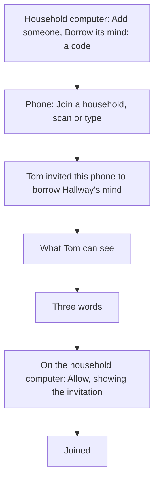
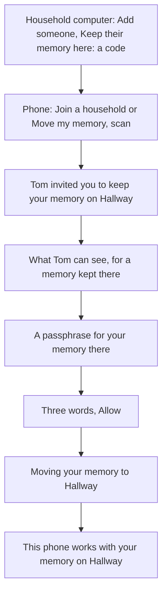

# A household computer

Part of [Phone and computer as equal starting points](phone-parity.md). A household computer is a
computer at home that runs Nocturne and lends its mind to the phones of people its owner invites. It
can be a desktop with its own owner and their memory (Sam's Home computer), or a computer that is
always on and kept for the purpose (Tom's Hallway). Either way, a household shares a mind, never a
memory.

Status: proposed, with the owner's decisions folded in. Nothing here is built. Borrowing the mind
ships first, after a phone alone and online ([decision 11](phone-parity.md#decisions)). A household
computer as someone's home follows.

| Phase 3: borrowing the mind | Phase 4: a household computer as someone's home |
|---|---|
| Household page, Add someone with no choice of way (borrowing only), Allow, Pause, Remove | Add someone gains "How should this computer help them?" |
| Joining, What {runner} can see, three words, Joined | Found for a home, the home's What {runner} can see, the passphrase, the move |
| This phone, borrowing | This phone, its home; "Keep my memory on {household}…" on a borrowing phone |

Nothing from phase 4 shows before it ships.

## Mockups

In `docs/design/mockups/phone-parity/`.

| Screen | File and states | Renders |
|---|---|---|
| Joining, on the phone | `household.html`: `found`, `see`, `words`, `joined`; `passphrase` for [making it your home](#making-a-household-computer-your-home) | `household-found-light.png`, `household-see-light.png`, `household-words-light.png`, `household-joined-light.png`, `household-passphrase-light.png` |
| The mind is away, removed | `away.html`: `today`, `journal`, `back`, `removed` | `away-today-light.png`, `away-today-dark.png`, `away-journal-light.png`, `away-back-light.png`, `away-removed-light.png` |
| This phone, in a household | `this-phone.html`: `guest`, `member` | `this-phone-guest-light.png`, `this-phone-member-light.png` |
| The household, on the computer | `desktop-household.html`: `household`, `add`, `allow`, `remove`, `off` | `desktop-household-light.png`, `desktop-household-dark.png`, `desktop-household-add-light.png`, `desktop-household-allow-light.png`, `desktop-household-remove-light.png`, `desktop-household-off-light.png` |

The found screen for a home and the household computer as someone's home on the phone are
described here in words; they reuse the joining and companion layouts.

## Borrowing, and a home

A phone has one of two relationships with a household computer, and its owner's invitation decides
which. They are not two settings of one thing: borrowing never turns into a home by itself.

| | Borrow its mind | Its home |
|---|---|---|
| How it starts | The owner invites the person to borrow the mind; the phone joins with the code | The owner invites the person to keep their memory there; the person pairs and their memory moves ([Moving](moving-memory.md#to-a-household-computer)) |
| Interface words | "Borrow its mind" / "Your memory stays on this phone. {household} reads and answers for you, and keeps nothing." | "Keep my memory on {household}" / "{household} becomes your memory’s home, locked with a key this phone holds. This phone then works with it." |
| Where the memory lives | On the phone | On the household computer, one store per person |
| What travels | What each request in flight needs: a thing to read, a question with its few lines, the lines a page, reflection or tidy step needs, check-ins included; sealed | Everything kept, sealed |
| What the household computer keeps | The phone's name and the key it was invited with, so it can let it in. No memory, file, copy, log or count | That person's memory, locked |
| Needs | A phone that keeps its own memory ([Phone first](phone-first.md)) | Nothing new on the phone: it works as a companion of that store |
| Overnight | The phone drives its own tidy when it is charging and can reach the household | The household computer tidies overnight, with the key the phone leaves for the night ([decision 13](phone-parity.md#decisions)) |
| Things marked private | Never sent ([decision 15](phone-parity.md#decisions)) | Read like everything else: it is their home |
| When the household computer is away | The phone works as a phone alone: keeps, finds by words; reading waits | The phone keeps recording and never reads on its own; things wait to go across |
| On Sam's desktop, which has its own owner | Yes | Yes |

A phone joins one Nocturne at a time. A phone that is a companion of its own computer is not
offered "Join a household": its person already has a mind. No phone can find a household or ask to
join it without an invitation.

## Joining

Joining is borrowing the mind. The owner invites; the phone scans; the owner allows.

Pairing is today's protocol ([Remote access](/architecture/remote.md#pairing)): a code, a name,
three words, Allow. The invitation's way travels inside the sealed pairing message, was chosen by
the owner when they made the code, and shows again on the Allow screen. A phone that scans a code
made for keeping a memory there goes to [Making a household computer your
home](#making-a-household-computer-your-home) instead.

### 1. Scan or type

From Welcome's "Join a household", or This phone. The approved scan and typed screens, with these
words:

| Part | Copy |
|---|---|
| Steps | "1. Ask whoever runs Nocturne at home to invite you: {settings}, then {household}, then {addSomeone}." / "2. Scan the code it shows, or type the address and the code." |
| Scan lead | "Point at the code on their screen, under {addSomeone}." |

### 2. Found

| Part | Copy |
|---|---|
| Title | "Join {household}’s household?" |
| Who runs it | "Run by {runner}" |
| Lead | "{runner} invited this phone to borrow {household}’s mind. {household} is a computer at home that runs Nocturne." |
| Bar | "Continue" · "Cancel" |

`{household}` and `{runner}` are names the person who runs it gave on the computer.

### 3. What the person who runs it can see

The screen before the three words. The words are exact, and appear the same in This phone later.

| Part | Copy |
|---|---|
| Title | "What {runner} can see" |
| Can see heading | "{runner} can see" |
| Can see | "This phone’s name" · "That it borrows {household}’s mind" · "Whether it is using the mind right now" |
| Can’t see heading | "{runner} can’t see, in Nocturne" |
| Can’t see | "What you keep, ask or write" · "Your answers, your page or your journal" · "Your calendar and health" · "When or how much you used the mind" |
| Nothing kept | "{household} reads each thing in its memory while it works on it, then lets it go. It keeps nothing of yours: no copy, no file, and no record of what it read or when. It keeps only this phone’s name and the key that lets it in." |
| Private | "Things you marked private never go to {household}." |
| Others | "No one else in the household sees anything of yours, and you see nothing of theirs." |
| The limit | "Someone with full control of {household} could change Nocturne on it to look at what it reads. Nocturne can’t prevent that. Join only a household you trust." |
| Bar | "Continue" · "Back" |

Why each line is true, against the research:

- **Can see.** The household screen shows each phone's name, how it was invited, and a live mark
  while one of its requests is being worked on. Nothing about a borrowing phone is counted or
  stored once a request is answered.
- **Can't see, in Nocturne.** The calls a borrowing phone can make have no handle on any store. "In
  Nocturne" is there because the next line is about outside it.
- **Nothing kept.** Recordings and photos are read from memory, never written to a file; nothing is
  logged or counted per phone. The name and key are what any invited phone needs to be let in, and
  they go when the phone leaves or is removed.
- **The limit.** A computer reads what it works on in its own memory. Whoever controls it fully can
  read that memory or replace the program. The research's words are kept nearly as written.

### 4. Three words, and Allow

The approved words screen, with these words:

| Part | Copy |
|---|---|
| Label | "Adding {name} to {household}’s household" |
| Title | "Check {household} shows the same three words." |
| Lead | "If they match, {runner} chooses {allow} on {household}. If they don’t, {runner} chooses {dontAllow} there and you start again." |
| Warning | "If {household} asks to allow a phone and this phone isn’t showing three words, someone else is trying to join. Refuse it." |
| Status | "Waiting for {household}…" |

### 5. Joined

| Part | Copy |
|---|---|
| Title | "{name} borrows {household}’s mind." |
| Body | "What you keep is read there and comes back to this phone. Your first page comes tomorrow morning." |
| Button | "Continue" |

## Making a household computer your home

The one way a memory comes to live on a household computer: its person pairs to make that computer
their home. Borrowing the mind never leads here by itself, and nothing a phone sends while borrowing
is kept for later.

### Found, for a home

| Part | Copy |
|---|---|
| Title | "Keep your memory on {household}?" |
| Who runs it | "Run by {runner}" |
| Lead | "{runner} invited you to keep your memory on {household}. It becomes your memory’s home, locked with a key this phone holds, and reads it overnight. This phone then works with it." |
| This phone has a memory | "What this phone holds now moves to {household}: {count} things, about {size}." |
| Bar | "Continue" · "Cancel" |

### What the person who runs it can see, for a home

The host's promise for a memory kept on a computer someone else runs, by [decision
13](phone-parity.md#decisions): locked with a key the phone holds, opened only while it is read or
tidied, including one night at a time.

| Part | Copy |
|---|---|
| Title | "What {runner} can see" |
| Can see | "This phone’s name" · "That your memory is kept on {household}, and how much room it takes" · "When this phone last connected" |
| Can’t see heading | "{runner} can’t see, in Nocturne" |
| Can’t see | "What you keep, ask or write" · "Your answers, your page or your journal" · "Your calendar and health" |
| Locked | "Your memory on {household} is locked with a key this phone holds, so it can’t be browsed, copied or backed up in a way anyone can read." |
| Others | "No one else in the household sees anything of yours, and you see nothing of theirs." |
| The limit | "While {household} reads or tidies your memory, it is open in that computer’s memory, and someone with full control of {household} could get at it then. That includes overnight, when this phone leaves the key there for the tidy. Nocturne can’t prevent that. Keep your memory there only if you trust who runs it." |
| Leaving | "You can bring your memory to this phone or your own computer at any time. It is deleted from {household} only when you say so." |
| Bar | "Continue" · "Back" |

### A passphrase for a memory kept there

The key that locks a memory kept on a household computer lives on the phone. So that a lost phone
does not lose the memory, the key is also locked with a passphrase the person chooses, as the
locked copy online does. A new phone, invited again, types it.

| Part | Copy |
|---|---|
| Step label | "Keeping your memory on {household}" |
| Title | "Choose a passphrase for your memory on {household}" |
| Lead | "Your memory there is locked with a key this phone holds. If this phone is lost, this passphrase lets a new phone open it. Nobody else can, not even {runner}." |
| Fields, hint, tick | 0013's, as in [the locked copy](phone-first.md#step-2-the-passphrase) |
| Bar | "Continue" · "Back" · 0013's disabled reason |

A phone invited where its person already keeps a memory (a replacement phone) is asked instead:
"Your memory is already on {household}. Type its passphrase to open it on this phone." with "Open
it" and "That passphrase doesn’t open your memory. Check capital letters, and try again."

Then the three words and Allow as for joining, and, when this phone held a memory, the move
([Moving](moving-memory.md#to-a-household-computer)). Joined: "Your memory’s home is {household}." /
"Keep, ask and read your page from here."

## This phone

**Borrowing.**

| Group | Row | Value |
|---|---|---|
| Your memory | "Where it is" | "On this phone" · "{size}" |
| | "Its mind" | "{household}, at home" |
| | "A locked copy online" | As on a phone alone |
| Household | "{household}" | "Run by {runner} · borrows its mind" |
| | "What {runner} can see" | Opens the borrowing screen above |
| | "This month" | "{count} things read, {count} questions" (counted on this phone only) |
| | "Keep my memory on {household}…" | "Ask {runner} to invite you to keep your memory there, then scan the code they show." with "Scan" · "Cancel" |
| | "Leave this household…" | Below |

**Its home.**

| Group | Row | Value |
|---|---|---|
| Your memory | "Where it is" | "On {household}" · "{size}" |
| | "Its mind" | "{household}" |
| | "Waiting to go across" | "Nothing waiting" or "{count} waiting" |
| | "Kept here to read when you’re away" | "Today’s page, the last week of pages, and your journal entries" ([decision 17](phone-parity.md#decisions)) |
| Household | "{household}" | "Run by {runner} · your memory’s home" |
| | "What {runner} can see" | Opens the home screen above |
| | "Move my memory…" | [Moving](moving-memory.md) |
| | "Leave this household…" | Below |

Everything else is the companion's This phone, including "What this phone brings". A memory whose
home is there can delete, forget and export from the phone, because it is that person's own store:
the phone acts for its owner, not for the household's runner.

## Leaving

| Relationship | Dialog | Then |
|---|---|---|
| Borrowing | "Leave {household}’s household?" / "This phone stops using {household}’s mind, and {household} forgets this phone. Your memory stays on this phone." / "Leave" · "Stay" | Its mind reads "None yet"; the no-mind card returns on Today |
| Its home | "Where should your memory go?" / "To this phone" · "To a computer of your own" · "Cancel" | [Moving](moving-memory.md#back-to-the-phone), then "Delete your memory from {household}?" once it has arrived |

## States

| State | Borrowing | Its home |
|---|---|---|
| Connected | Status "Connected to {household}" | Status "Connected to {household}" |
| A lost phone | The person who runs it removes the lost phone; it stops at once. Nothing of the person's is on {household} | The person who runs it removes the lost phone; it stops at once. The memory waits, locked. A new phone, invited again, types the passphrase and carries on |
| Household computer away | Banner "{household} is out of reach." / "What you keep is kept on this phone and read when it’s back." Today keeps the last page with "Written {day}". Ask finds by words | Banner "{household} is out of reach. Still recording." / "What you keep waits here and goes across when it’s back." Today keeps the last page with "From {time} today", and "{count} waiting to go across" |
| A thing waiting | Journal row as kept, "waiting to be read" | Journal row with "waiting to go across" and a receipt chip "On this phone". It never shows as read until it has gone across and been read there |
| Back | Nothing; reading resumes | Toast "{household} is back. {count} went across." Today: "Your page is updated once they’re read." |
| Paused by the runner | "{runner} has paused this phone in {household}’s household. What you keep is safe on this phone." | "{runner} has paused this phone in {household}’s household. What you keep waits here." |
| Removed | "{household}’s household removed this phone." / "Your memory is on this phone and wasn’t touched. Choose another mind when you’re ready." / "Choose a mind" · "OK" | "{household}’s household removed this phone." / "Your memory is still on {household}, locked. Bring it to this phone before {date}. After that, {runner} may delete it." / "Bring my memory to this phone" · "Later" |
| Household no longer lends its mind | As removed, with "{household} stopped lending its mind." | Not affected: a home carries on when lending stops |
| New address (Simple) | The approved re-link, inside the app | The same |
| Versions apart | The approved "Please update", naming {household} | The same |

## Behaviour

**What a borrowing phone sends.** The household calls are shaped like Nocturne's own mind, never a
general chat: turn a question into what finding needs, answer from the few lines sent (at most 12),
hear a recording, read a photo or document, read a thing's words, find what goes together, write a
reflection, write the page's headline. The household computer's own instructions and settings stay
on it.

**What the household computer keeps of a borrowing phone.** Its name and the public key from the
invitation, so it can let it in, and whether it is paused. Nothing else, ever: what a request
carries is held in memory until the answer is sent, recordings and photos are never written to a
file, and nothing is logged, cached or counted per phone. The name and key are deleted when the
phone leaves or is removed. The owner's activity list has no line about a borrowing phone, so
nothing about it outlives its name and key.

**Overnight for a borrowing phone.** The phone runs its own tidy and calls the household's mind for
each step, when it is charging and can reach the household, as the phone allows. A morning page is
written from what finished, and says "Some of yesterday is still being read." when it is not all
done.

**Things waiting to go across (a home).** Kept on the phone in order, with the time they were kept;
sent oldest first; each kept once however often it is sent; placed on the day it was kept, not the
day it arrived. Receipts in answers cite only things the home has.

**Sharing the mind.** In turn, by [decision 16](phone-parity.md#decisions): the owner's own asks,
then household asks (one at a time per phone), then everyone's reading in turn, one thing at a time
per phone. Taking turns needs only the requests waiting now, so nothing is counted per phone. The
owner can pause a phone. Reading by household phones never makes the computer load a different mind.
On computers with two minds, household reading goes where the owner's reading goes
([0014](/adr/0014-npu-mind.md)).

**Connections.** Household phones connect through Simple, as the owner's own phones do. With Most
private, only the owner's own devices are admitted, so Household asks to use Simple ([decision
14](phone-parity.md#decisions)).

## On the computer that runs it

A new page in Settings, "Household", with the hint "Lend this computer’s mind to people at home".
On a household computer with no window, the same page shows in its browser page.

### Household

| Part | Copy |
|---|---|
| Back link | "Settings" |
| Title | "Household" |
| Lead | "Lend this computer’s mind to people in your household. Their memories stay theirs: you can’t see what they keep or ask, and they can’t see yours." |
| Switch | "Lend this computer’s mind" |
| Name rows | "Household name" / "{household}" · "Your name, as phones see it" / "{runner}" |
| List heading | "Phones in your household" |
| Each phone, borrowing | "{name}" / "Borrows the mind" / while a request is worked on: "Using the mind now" / "Pause" · "Remove…" |
| Each phone, its home | "{name}" / "Keeps its memory here · {size} · last connected {time}" / "Pause" · "Remove…" |
| Paused | "Paused" tag and "Resume" |
| Empty | "No one yet. Add someone and they scan the code with Nocturne on their phone." |
| Button | "Add someone…" |
| Sharing heading | "Sharing the mind" |
| Sharing body | "Your own questions always come first. Then household questions, then everyone’s reading, in turn." |
| What you see heading | "What you can see" |
| What you see body | "Each phone’s name and how it was invited. For a memory kept here, how much room it takes and when its phone last connected. Never what anyone kept, asked or read, and no record of when a phone borrowed the mind." |
| Foot | "Household phones connect through Simple, like your own phones. Cloudflare sees when they connect and from where, not what they send." |
| Foot, Most private | "Household phones need Simple. With Most private, only your own phones can connect." with "Change to Simple…" |

### Add someone

| Part | Copy |
|---|---|
| Title | "Add someone to your household" |
| Choice heading | "How should this computer help them?" |
| Choice | "Borrow its mind" (selected) / "Their memory stays on their phone. This computer reads and answers for them and keeps nothing of theirs." |
| Choice | "Keep their memory here" / "Their memory moves here and lives here, locked with a key their phone holds. Their phone then works with it." |
| Lead | "Ask them to open Nocturne on their phone, choose Join a household, and scan this." |
| The code | The code, as Add a phone shows it, with "Can’t scan?" and the four words and the code |
| Note | "Anyone with this code can ask to join, only in the way you chose. You still choose Allow." |
| Time | "This code works for 5 minutes, once." |
| Button | "Done" |

The code appears once a way is chosen; changing the way makes a new code.

### Allow

| Part | Copy |
|---|---|
| Title | "Allow {name} to join your household?" |
| Words | "Check {name} shows the same three words." and the words |
| The way, borrowing | "You invited it to borrow this computer’s mind." / "Its memory stays on its phone. This computer reads and answers for it and keeps nothing of it." |
| The way, its home | "You invited it to keep its memory here." / "Its memory will be kept on this computer, locked with a key its phone holds. About {size} to start." |
| Warning | "If a phone that isn’t showing three words asks to join, someone else is trying. Don’t allow it." |
| Buttons | "Allow" · "Don’t allow" (the careful choice is not the default) |

### Remove

| Part | Copy |
|---|---|
| Title | "Remove {name} from your household?" |
| Borrowing | "It stops at once, and this computer forgets it. Its memory is on its phone and isn’t touched." |
| Its home | "It stops at once. Their memory stays here, locked, so they can take it home. You can delete it after 30 days; they are told on their phone first." |
| Buttons | "Remove" (careful) · "Cancel" |
| After, its home | Row "{name} · removed {day}" / "Their memory waits here, locked · {size}" / from the 30th day: "Delete their memory…" |
| Taking it home | Until the date, the removed phone may still connect for one thing only: bringing the memory to itself or to a computer of its own ([Back to the phone](moving-memory.md#back-to-the-phone)). It can't keep, ask or read the page there |
| Delete their memory | "Delete {name}’s memory from this computer?" / "They were told on {day}. If they haven’t taken it, it is gone for good." / "Delete" · "Keep it" |

### Turning it off

| Part | Copy |
|---|---|
| Title | "Stop lending this computer’s mind?" |
| Body | "Phones that borrow this computer’s mind stop at once. People whose memory is kept here carry on." |
| Buttons | "Stop lending" (careful) · "Keep lending" |

Stopping lending never cuts off a person whose home is here. To stop being someone's home, the owner
removes their phone, which keeps their memory locked until they take it or the 30 days' notice
ends.

### Elsewhere on the computer

- **Privacy screen.** Under Away from home: "Household phones can use this computer’s mind, in the
  same locked messages. Nothing they send is kept, unless their memory’s home is here." Bytes to
  household phones are counted with the rest, never per phone.
- **Activity list.** Nothing about a phone that borrows the mind. For a person whose home is here:
  "Allowed {name} to keep their memory here", "Removed {name}". Never what anyone sent.
- **Rail status.** "Uses the internet for" lists "Away from home and Household" while both are on.
- **Export and Delete everything.** The owner's export never includes household memories. Delete
  everything asks first: "{count} household memories are kept here. They stay, locked, until their
  people take them home, or you delete them after telling them."

## Copy

| Key | Copy |
|---|---|
| Join, steps | "Ask whoever runs Nocturne at home to invite you: {settings}, then {household}, then {addSomeone}." / "Scan the code it shows, or type the address and the code." |
| Join, scan lead | "Point at the code on their screen, under {addSomeone}." |
| Found | "Join {household}’s household?" / "Run by {runner}" / "{runner} invited this phone to borrow {household}’s mind. {household} is a computer at home that runs Nocturne." |
| See, title | "What {runner} can see" |
| See, can | "{runner} can see" / "This phone’s name" / "That it borrows {household}’s mind" / "Whether it is using the mind right now" |
| See, can’t | "{runner} can’t see, in Nocturne" / "What you keep, ask or write" / "Your answers, your page or your journal" / "Your calendar and health" / "When or how much you used the mind" |
| See, nothing kept | "{household} reads each thing in its memory while it works on it, then lets it go. It keeps nothing of yours: no copy, no file, and no record of what it read or when. It keeps only this phone’s name and the key that lets it in." |
| See, private | "Things you marked private never go to {household}." |
| See, others | "No one else in the household sees anything of yours, and you see nothing of theirs." |
| See, limit, borrowing | "Someone with full control of {household} could change Nocturne on it to look at what it reads. Nocturne can’t prevent that. Join only a household you trust." |
| Words | "Adding {name} to {household}’s household" / "Check {household} shows the same three words." / "If they match, {runner} chooses {allow} on {household}. If they don’t, {runner} chooses {dontAllow} there and you start again." / "If {household} asks to allow a phone and this phone isn’t showing three words, someone else is trying to join. Refuse it." / "Waiting for {household}…" |
| Joined | "{name} borrows {household}’s mind." / "What you keep is read there and comes back to this phone. Your first page comes tomorrow morning." |
| Home, found | "Keep your memory on {household}?" / "{runner} invited you to keep your memory on {household}. It becomes your memory’s home, locked with a key this phone holds, and reads it overnight. This phone then works with it." / "What this phone holds now moves to {household}: {count} things, about {size}." |
| Home, see | "That your memory is kept on {household}, and how much room it takes" / "When this phone last connected" |
| Home, locked | "Your memory on {household} is locked with a key this phone holds, so it can’t be browsed, copied or backed up in a way anyone can read." |
| Home, limit | "While {household} reads or tidies your memory, it is open in that computer’s memory, and someone with full control of {household} could get at it then. That includes overnight, when this phone leaves the key there for the tidy. Nocturne can’t prevent that. Keep your memory there only if you trust who runs it." |
| Home, leaving | "You can bring your memory to this phone or your own computer at any time. It is deleted from {household} only when you say so." |
| Home, passphrase | "Keeping your memory on {household}" / "Choose a passphrase for your memory on {household}" / "Your memory there is locked with a key this phone holds. If this phone is lost, this passphrase lets a new phone open it. Nobody else can, not even {runner}." |
| Home, replacement phone | "Your memory is already on {household}. Type its passphrase to open it on this phone." / "Open it" / "That passphrase doesn’t open your memory. Check capital letters, and try again." |
| Home, joined | "Your memory’s home is {household}." / "Keep, ask and read your page from here." |
| This phone, household | "Household" / "Run by {runner} · borrows its mind" / "Run by {runner} · your memory’s home" / "This month" / "{count} things read, {count} questions" |
| This phone, keep there | "Keep my memory on {household}…" / "Ask {runner} to invite you to keep your memory there, then scan the code they show." / "Scan" / "Cancel" |
| This phone, home rows | "On {household}" / "Waiting to go across" / "Nothing waiting" / "{count} waiting" / "Kept here to read when you’re away" / "Today’s page, the last week of pages, and your journal entries" |
| This phone, leave | "Leave this household…" |
| Leave, borrowing | "Leave {household}’s household?" / "This phone stops using {household}’s mind, and {household} forgets this phone. Your memory stays on this phone." / "Leave" / "Stay" |
| Leave, home | "Where should your memory go?" / "To this phone" / "To a computer of your own" / "Cancel" |
| Status | "Connected to {household}" |
| Away, borrowing | "{household} is out of reach." / "What you keep is kept on this phone and read when it’s back." |
| Away, home | "{household} is out of reach. Still recording." / "What you keep waits here and goes across when it’s back." |
| Last page | "Written {day}" / "From {time} today" |
| Waiting | "{count} waiting to go across" / "waiting to go across" / "On this phone" |
| Back | "{household} is back. {count} went across." / "Your page is updated once they’re read." |
| Page not done | "Some of yesterday is still being read." |
| Paused | "{runner} has paused this phone in {household}’s household. What you keep is safe on this phone." / "{runner} has paused this phone in {household}’s household. What you keep waits here." |
| Removed, borrowing | "{household}’s household removed this phone." / "Your memory is on this phone and wasn’t touched. Choose another mind when you’re ready." / "Choose a mind" / "OK" |
| Removed, home | "{household}’s household removed this phone." / "Your memory is still on {household}, locked. Bring it to this phone before {date}. After that, {runner} may delete it." / "Bring my memory to this phone" / "Later" |
| Stopped lending | "{household} stopped lending its mind." |
| Settings row | "Household" / "Lend this computer’s mind to people at home" |
| Household, lead | "Lend this computer’s mind to people in your household. Their memories stay theirs: you can’t see what they keep or ask, and they can’t see yours." |
| Household, switch | "Lend this computer’s mind" |
| Household, names | "Household name" / "Your name, as phones see it" |
| Household, list | "Phones in your household" |
| Household, borrowing row | "Borrows the mind" / "Using the mind now" |
| Household, home row | "Keeps its memory here · {size} · last connected {time}" |
| Household, actions | "Pause" / "Resume" / "Paused" / "Remove…" / "Add someone…" |
| Household, empty | "No one yet. Add someone and they scan the code with Nocturne on their phone." |
| Household, sharing | "Sharing the mind" / "Your own questions always come first. Then household questions, then everyone’s reading, in turn." |
| Household, you see | "What you can see" / "Each phone’s name and how it was invited. For a memory kept here, how much room it takes and when its phone last connected. Never what anyone kept, asked or read, and no record of when a phone borrowed the mind." |
| Household, foot | "Household phones connect through Simple, like your own phones. Cloudflare sees when they connect and from where, not what they send." |
| Household, Most private | "Household phones need Simple. With Most private, only your own phones can connect." / "Change to Simple…" |
| Add someone | "Add someone to your household" / "How should this computer help them?" / "Borrow its mind" / "Their memory stays on their phone. This computer reads and answers for them and keeps nothing of theirs." / "Keep their memory here" / "Their memory moves here and lives here, locked with a key their phone holds. Their phone then works with it." / "Ask them to open Nocturne on their phone, choose Join a household, and scan this." / "Anyone with this code can ask to join, only in the way you chose. You still choose Allow." / "This code works for 5 minutes, once." / "Done" |
| Allow | "Allow {name} to join your household?" / "Check {name} shows the same three words." / "If a phone that isn’t showing three words asks to join, someone else is trying. Don’t allow it." / "You invited it to borrow this computer’s mind." / "Its memory stays on its phone. This computer reads and answers for it and keeps nothing of it." / "You invited it to keep its memory here." / "Its memory will be kept on this computer, locked with a key its phone holds. About {size} to start." / "Allow" / "Don’t allow" |
| Remove | "Remove {name} from your household?" / "It stops at once, and this computer forgets it. Its memory is on its phone and isn’t touched." / "It stops at once. Their memory stays here, locked, so they can take it home. You can delete it after 30 days; they are told on their phone first." / "Remove" / "Cancel" |
| Removed row | "{name} · removed {day}" / "Their memory waits here, locked · {size}" / "Delete their memory…" |
| Delete their memory | "Delete {name}’s memory from this computer?" / "They were told on {day}. If they haven’t taken it, it is gone for good." / "Delete" / "Keep it" |
| Turn off | "Stop lending this computer’s mind?" / "Phones that borrow this computer’s mind stop at once. People whose memory is kept here carry on." / "Stop lending" / "Keep lending" |
| Privacy screen | "Household phones can use this computer’s mind, in the same locked messages. Nothing they send is kept, unless their memory’s home is here." |
| Activity | "Allowed {name} to keep their memory here" / "Removed {name}" |
| Rail status | "Away from home and Household" |
| Delete everything, household | "{count} household memories are kept here. They stay, locked, until their people take them home, or you delete them after telling them." |

## Accessibility

- The "What {runner} can see" screen reads as two lists with headings, then the paragraphs; the
  limit is a paragraph, not small print.
- The household list reads each phone as one row: "{name}, borrows the mind" or "{name}, keeps its
  memory here, {size}, last connected {time}", then its actions. "Using the mind now" is announced
  politely, not on every change.
- Add someone announces the chosen way before the code; the code changes only when the way does.
- The Allow dialog announces the invitation's way before the buttons, and Allow is never the
  default.
