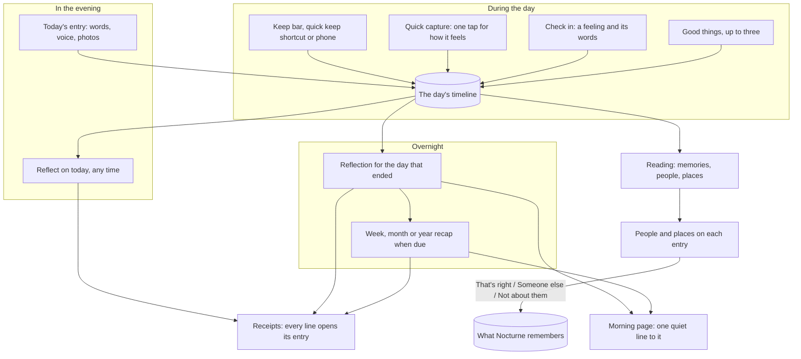

# Journaling

Nocturne already keeps the day: a note typed in the keep bar, a voice note held down on Space, a
photo of a school letter, something kept from a phone while out. What it does with the day is turn
it into memories and a page for tomorrow morning. It never gives the day back as a day.

This page proposes making journaling a core part of Nocturne. A journal here is not a second app
beside the memory. It is a new way to look at what Nocturne already keeps, plus four things it does
not have yet: a place to write about the day at length, a way to say how it felt, a way to note
the good things, and a reflection that gives the day, the week, the month and the year back in
plain words, each line with its receipt.

Status: proposal, revised after the owner answered every open question (see [Decisions](#decisions)).
Nothing here is in the interface.

## Mockups

In `docs/design/mockups/journaling/`. Each HTML file imports the app's own stylesheet for tokens and
fonts, so serve the repository root over HTTP after `make ui/install` and open the files there.
Add `?state=` to pick a view and `&theme=light` or `&theme=dark`. `index.html` links every view.
Renders, 1280 pixels wide and full length for the computer and 390 by 844 for the phone, sit
beside them. A dashed outline marks what is new in the app frame; it is not part of the design.

| Screen | File and states | Renders |
|---|---|---|
| Today's entry with the day's timeline | `day.html`: `day`, `first`, `empty`, `partial`, `notready` | `day-light.png`, `day-dark.png`, `day-first-light.png`, `day-notready-light.png` |
| Quick capture, with a feeling in one tap | `quick.html`: `text`, `feeling`, `kept` | `quick-feeling-light.png` |
| The feelings check-in and good things | `checkin.html`: `field`, `words`, `list`, `done`, `help` | `checkin-words-light.png`, `checkin-words-dark.png`, `checkin-list-light.png`, `checkin-help-light.png` |
| The day's reflection | `reflection.html`: `written`, `sofar`, `writing`, `glance` | `reflection-written-light.png`, `reflection-sofar-light.png`, `reflection-glance-light.png` |
| A period recap | `recap.html`: `week`, `month`, `year` | `recap-week-light.png`, `recap-month-dark.png`, `recap-year-light.png` |
| People and places found in an entry | `people.html`: `strip`, `new`, `someone`, `removed`, `which` | `people-new-light.png`, `people-someone-light.png`, `people-which-light.png` |
| Phone: home with a Journal tile | `phone-home.html`: `home`, `asleep` | `phone-home-light.png`, `phone-home-dark.png` |
| Phone: keeping on the go | `phone-keep.html`: `text`, `feeling`, `voice`, `photo`, `good`, `kept`, `waiting` | `phone-keep-light.png`, `phone-keep-dark.png`, `phone-keep-voice-light.png`, `phone-keep-photo-light.png`, `phone-keep-good-light.png` |
| Phone: the check-in for touch | `phone-checkin.html`: `field`, `words`, `list`, `saved` | `phone-checkin-light.png`, `phone-checkin-dark.png`, `phone-checkin-field-light.png` |
| Phone: today's timeline | `phone-day.html`: `day`, `asleep`, `empty` (and `answer`, `answerWaiting`, from [the journal question on the phone](phone-journal-question.md)) | `phone-day-light.png`, `phone-day-dark.png`, `phone-day-asleep-light.png` |
| Phone: a day, looked back on | `phone-reflection.html`: `written`, `writing` | `phone-reflection-light.png`, `phone-reflection-dark.png` |
| Phone: your week | `phone-recap.html`: `week` | `phone-recap-light.png`, `phone-recap-dark.png` |
| Phone: which Sam is this? | `phone-which.html`: `which`, `done` | `phone-which-light.png`, `phone-which-dark.png` |
| Online answers, said openly | `online-step1.html` (`?open=1` opens the expander), `online-step5.html`, `online-settings.html` | `online-step1-light.png`, `online-step1-dark.png`, `online-step1-open-light.png`, `online-step5-light.png`, `online-step5-dark.png` (full length), `online-settings-light.png`, `online-settings-dark.png` |
| Delete this day, a check-in's own page, deleting a recap, the page question from the journal | `delete-day.html`, `checkin-item.html`, `delete-lookback.html`, `page-question.html`; see [Journaling follow-ups](journaling-follow-ups.md) | Listed in [Journaling follow-ups](journaling-follow-ups.md) |

The mockups use made-up people (Gran, Sam, Leo, Priya) and places, the same household the guide
and the other designs use.

## How it fits Nocturne

Journaling extends the four loops. It does not run beside them.

| Loop | Today | With journaling |
|---|---|---|
| Capture | One inbox: keep bar, quick keep shortcut, drop, watched folder, phone | Same inbox. Adds a longer daily entry that mixes words, voice and photos, a feelings check-in and good things. Every one of them is an item on the tape |
| Consolidate | Reads items into memories, files them under people, places and things, fades what is unused | Same reading. People and places found in entries are shown on the entry, where the person can confirm, correct or remove them. The night also writes the reflection for the day that ended and any recap that is due |
| Serve | Answers a question from memories, with receipts | Same. Questions about a day ("When did I last see Priya?", "What did I write about the move?") are answered from entries and good things. With Online answers on, their sentences may go with the question. Check-ins are never used by Ask; how a day felt is looked back on in its reflection |
| Publish | One page each morning | The morning page stays the one daily page. The journal adds a reflection on any day, at any time, and a recap of each week, month and year, reached from the journal |

### Reused and new

| Part | Reused as it is | New |
|---|---|---|
| Quick entries | The keep bar, quick keep shortcut, hold Space to talk, drop, Away from home keeping | A one-tap feeling row in quick capture; the day's timeline that shows them |
| Daily entry | Items on the tape, reading, voice transcripts, photo reading, receipts with spans | A writing surface that mixes text, voice and photos; versions when an entry is changed after it was read |
| Feelings | Nothing | The check-in: a field of energy and pleasantness, a word list, an optional line on what is behind it |
| Good things | Items on the tape, photos already kept | A short list of up to three lines a day, each with an optional photo |
| People and places | Entities, roles, Rename, Merge, Re-file, Delete, the Undo ids in the data model | A link from an entry to each person, place or thing it mentions, shown on the entry; "Which Sam?" in Needs you |
| Day reflection | The answer pipeline, receipts, bold spans, receipt cards and chips | The reflection itself, written on demand or at night; "At a glance", which needs no reading at all |
| Recaps | The page's sections, receipts, Past pages and Print | Week, month and year recaps with highlights |
| Privacy | The rules for notifications, the tray, reading aloud, phones and Online answers | One fixed rule for the journal, with no private switch; reflections, recaps and check-ins always written and kept on this computer |
| Forgetting | Delete with cascade, letting go, Fading & let go, Undo | "Leave out of reflections"; lines in reflections and recaps removed when their entry is deleted |

### Where it lives

A new rail entry, **Journal**, second after Today. It opens on today. Today stays the morning page.
The journal is the evening side of the same day: the page tells you what the night made of
yesterday, and the journal is where today is written down and looked back on.

```text
Today                 the morning page (unchanged)
Journal               today's entry, the day's timeline, reflections and recaps   NEW
Needs you
What Nocturne remembers
Recently kept
Fading & let go
Past pages
```

Recently kept stays. It is the list of what is waiting to be read and what could not be read, with
"Read now". The journal's timeline uses the same rows and statuses, but it is about the day, not
about the reading.

### What a day is

A day runs from 4 in the morning to 4 the next morning, so a note kept at half past midnight
belongs to the evening it was written in. The timeline says so: "12:40 am, after midnight". When
the person's page time is earlier than 4:30 am, the day instead ends half an hour before the page
time, so the page always comes after the day it looks back on. This is the day boundary
everywhere on this page. The day's reflection is written after the boundary, never while the day
can still change.

## Journeys



### Five journeys

| Journey | Steps |
|---|---|
| A quick note on the go | Press the quick keep shortcut, say or type "Lunch with Priya, finally", tap a feeling, Enter. "Kept." It is on today's timeline at 1:12 pm with the feeling beside it |
| Writing about the day | Open Journal. Write a few lines, hold Space to add a voice note, drop a photo. It saves as you go. Priya appears under the entry as someone new; confirm her with "That's right" |
| Saying how it feels | Check in. Choose a part of the field, choose up to three words, add a line if you want. Save. If the words were heavy, "Something that might help" is there to open, never pushed |
| Looking back on today | "Reflect on today" at 9 pm writes a reflection on the day so far, each line with its receipt. The night writes the finished one |
| Looking back on a week or a year | Monday's morning page has one line: "Last week, looked back on". It opens the week's recap: highlights, how the week felt, good things, people and places, what is still open |

## Surfaces

The copy in quotes is the proposed interface copy, in plain words, ready for the copy deck. Curly
braces are values. Each surface lists its states.

### 1. The journal day

`day.html`. The screen Journal opens on.

**Layout.** One sheet with two columns at standard width, one column on a narrow window.

- **Head.** Eyebrow "Journal". Title "{weekday} {day} {month}", for example "Thursday 19
  November". Under it, "← {previous weekday}" and "Choose a day" on the left like the page's own
  "← {day}", and on the right the primary button "Reflect on today" ("Reflect on this day" on a
  past day).
- **Main column, top: Today's entry.** A writing surface with a quiet frame. See [Today's
  entry](#2-todays-entry).
- **Main column, below: Through the day.** The timeline. See [The timeline](#3-the-timeline).
- **Side column.** Four small blocks, each hidden when it has nothing:
  - "How today felt": the day's check-ins as dots on a small field, with their words. "Check in"
    button.
  - "Good things": up to three lines. "Add a good thing" button.
  - "People and places today": names found in today's entries, as chips. A new one has a "new"
    mark. Pressing a chip opens its card (see [People and places](#7-people-and-places-in-entries)).
  - "Looked back on": the latest reflection's first sentence and when it was written, with
    "Open".

**Copy.**

| Key | Copy |
|---|---|
| Rail | "Journal" |
| Eyebrow | "Journal" |
| Previous day | "← {weekday}" |
| Day picker | "Choose a day" |
| Primary | "Reflect on today" / "Reflect on this day" |
| Side, feelings | "How today felt" |
| Side, feelings empty | "No check-ins today." |
| Side, feelings button | "Check in" |
| Side, good things | "Good things" |
| Side, good things button | "Add a good thing" |
| Side, people | "People and places today" |
| Side, reflection | "Looked back on" |
| Side, reflection meta | "{time}, from {count} things you kept" |

**States.**

| State | What shows |
|---|---|
| Empty day | The entry surface with its placeholder. Timeline: "Nothing kept today yet. Anything you keep, from here, the keep bar or your phone, shows up here." Side column hidden except "Check in". "Reflect on today" is shown but disabled, with "Keep something about today first." under it |
| First use | Above the entry, once, a short card: title "Your journal", body "Write about your day here, in words, voice or photos. Everything you keep during the day lands on the timeline below, so it is already half written. It is kept on this computer. A phone you added can read it too." Button "Got it". No tour, no sample data |
| Partial day | As the full day. Items still being read show "reading…" as Recently kept does. The reflection button works and says what it will leave out (see [Reflection states](#reflection-states)) |
| Not ready (first download or the engine starting) | Writing, keeping, checking in and good things all work. A notice at the top of the timeline: "Nocturne is getting ready. What you keep is safe and will be read when it is." "Reflect on today" opens "At a glance" (see below) instead of a written reflection |
| A past day | Same screen. The entry can still be added to and changed. The title is the date; "Reflect on this day" |
| A day in the future | Not reachable. "Choose a day" stops at today |

### 2. Today's entry

The free-form daily entry. One per day, as long or short as the person likes.

**Behaviour.**

- Typing writes text. Holding Space in an empty line records a voice note, as the keep bar does;
  the voice note sits in the entry as a block with its length, a play button and, once read, its
  words under a "What was said" disclosure. Dropping or pasting a photo places it where the cursor
  is; once read, its description becomes its alternative text, which the person can change.
- **The microphone.** Holding Space or the record button is what grants the microphone; Nocturne
  asks nothing more for it. On Linux it settles the request itself for its own pages, while a page
  from anywhere else, and the camera, are refused. macOS and Windows also show the system's
  question once.
- **Saving.** The entry saves as the person writes. Nothing is lost if the window closes. It is
  read when the person has stopped writing for ten minutes, when they leave the journal, or at
  night, whichever comes first. Each text block, voice note and photo is one item on the tape,
  grouped by the day, so a receipt can open the exact paragraph, the exact second of a voice note
  or the exact part of a photo.
- **Changing it after it was read.** The tape is append-only, so a changed block is kept as a new
  version and read again, and the earlier version stays as history. The entry shows "Changed
  {time}" with "Earlier version" to see it. Receipts in reflections written before the change
  still open the words they quoted. "Delete…" can remove earlier versions.
- **Prompts.** None by default. The placeholder is the only invitation. Nocturne never asks a
  second question a day of its own accord (see [Calm](#calm-no-streaks-no-nagging)).

**Copy.**

| Key | Copy |
|---|---|
| Heading | "Today's entry" / "{weekday}'s entry" |
| Placeholder | "Write about today, or hold Space to talk." |
| Toolbar | "Add a photo", "Record", "Check in", "Add a good thing" |
| Saved | "Saved {time}" |
| Reading | "Nocturne will read this when you stop writing for a while." |
| Read | "Read {time}" |
| Changed | "Changed {time}" |
| Earlier version | "Earlier version" |
| Voice block | "Voice note, {duration}" |
| Voice words | "What was said" |
| Photo alt edit | "Describe this photo" |
| Mic failed | reuses "Nocturne couldn’t start the microphone. Check that nothing else is using it, then try again." |

### 3. The timeline

"Through the day". Everything kept that day, oldest at the top, grouped "Morning", "Afternoon",
"Evening" and "After midnight".

| Kind of row | How it looks |
|---|---|
| A note or voice note the person kept | Full row: time, a small kind icon, the first lines or the voice note's words, people and places as chips, its feeling if one was tapped |
| A check-in | A dot in its part of the field, the words chosen, the line written with it |
| A good thing | A small sun mark, the line, its photo as a thumbnail |
| A photo the person took | A thumbnail and what Nocturne saw in it, once read |
| Something kept from elsewhere (a document, a web page, a screenshot, a file from the inbox folder) | A compact one-line row: time, kind, title. It counts as part of the day but the reflection treats it as background |
| Today's entry | Not repeated. One row marks when it was written: "{time} · Today's entry" |

Each row opens the item's own page ("Something you kept"), the same page receipts open, where Keep
forever, Read it again and Delete… already live; a journal item's page does not offer Mark
private. Two new row actions sit in its menu: "Leave out of reflections" and, for a quick note,
"Move to {weekday}" when it was kept after the day it was about.

| Key | Copy |
|---|---|
| Heading | "Through the day" |
| Groups | "Morning", "Afternoon", "Evening", "After midnight" |
| Entry marker | "{time} · Today's entry" |
| Row from phone | "{time} · from {phone name}" |
| Leave out | "Leave out of reflections" / done: "Left out. It stays in your journal." / undo: "Undo" |
| Empty | "Nothing kept today yet. Anything you keep, from here, the keep bar or your phone, shows up here." |
| Error | "Nocturne couldn’t get this day. What you kept is safe." with "Try again" |

### 4. Quick capture, on the go

`quick.html`. The existing quick capture window and the keep bar, unchanged in how they keep.

- **A feeling in one tap.** Under the box, a quiet row of four small marks for the four parts of
  the field, labelled with their names. Tapping one attaches it to what is being kept, and a word
  row slides open under it with the four most used words in that part for this person (or the
  first four of the list before there is any history). Choosing a word is optional. Nothing is
  required: Enter keeps, as it always has.
- **Keeping from a phone.** Away from home already keeps text, photos and voice notes. They land
  on the timeline with "from {phone name}". What the phone adds is in [The phone](#12-the-phone).
- **The toast** says where it went: "Kept. It’s on today’s journal." with "Undo".

| Key | Copy |
|---|---|
| Feeling row label | "How does it feel? (optional)" |
| The four marks | "Wound up", "Lit up", "Low", "Settled" |
| Word row label | "A word for it" |
| More words | "More words…" (opens the check-in) |
| Kept | "Kept. It’s on today’s journal." |
| Kept with feeling | "Kept, with {word}. It’s on today’s journal." |

### 5. The feelings check-in

`checkin.html`. Opened from "Check in" on the journal, from the quick capture's "More words…", or
from the tray menu ("Check in…").

**What it is based on.** How We Feel builds its check-in on the Mood Meter from the Yale Center for
Emotional Intelligence: feelings placed by how pleasant they are (left to right) and how much
energy they carry (bottom to top), which makes four quadrants, then a precise word chosen from
about 144 ([Marc Brackett on How We Feel](https://marcbrackett.com/how-we-feel-app-3/), [the
Mood Meter overview for families](https://rulerapproach.org/wp-content/uploads/2025/07/Families_MoodMeter_Overview.pdf)).
The aim is a growing vocabulary: "learn precise words to describe how you feel, spot trends and
patterns, and practice simple strategies" ([How We Feel, about](https://howwefeel.org/therapists-deepdive)).
Their guidance is to check in at moments worth remembering, "rather than trying to check in on a
schedule" ([3 check-ins](https://howwefeel.org/resources/getting-started/three-check-ins)), and to
add "a few words or a sentence" when you want to ([5 journals](https://howwefeel.org/resources/between-sessions/five-journals)).
The Mood Meter overview says "all emotions are okay".

**What Nocturne adapts, and how it differs.** The two axes and the idea of a precise word are
kept. The names, colours, word list, layout and flow are Nocturne's own. Nocturne does not use
the four colour names, does not show a coloured grid, and does not ask for tags: the people,
places and plans around a feeling come from what the person writes or says, found by reading.

**Step 1: the field.** A square field with four parts. Axis labels sit outside it: "More energy"
at the top, "Less energy" at the bottom, "Unpleasant" on the left, "Pleasant" on the right. Each
part has its own name, a quiet tone from Nocturne's palette and a small shape, so colour never
carries the meaning alone.

| Part | Energy | Pleasantness | Name | Shape |
|---|---|---|---|---|
| Top left | More | Unpleasant | "Wound up" | zigzag |
| Top right | More | Pleasant | "Lit up" | rays |
| Bottom left | Less | Unpleasant | "Low" | a falling line |
| Bottom right | Less | Pleasant | "Settled" | a flat wave |

Choosing a point in the field chooses the part and how far into it the point is. A point near a
corner is stronger, near the middle milder. The point itself is kept, so the recap can place the
dot where the person put it.

**Step 2: the words.** The part's words fill the panel beside the field. Each word has a place in
its part, mild near the middle and strong near the corner, and the words nearest the chosen point
come first. Each word shows its one-line meaning when it has focus or is hovered, so a person can
tell "flat" from "numb" without leaving the screen. Up to three words, because a moment can be
mixed. "More words" shows the longer list for that part. "Show all words as a list" swaps the
field for a plain list grouped by part, for anyone who finds the field hard to use; there the
words can come from different parts, and the check-in takes the part of the first word chosen.

**Step 3: optional.** "What’s going on?" A line of text. (Changed: a voice note here is out of scope
until designed; see [Journaling follow-ups](journaling-follow-ups.md).) People and places in it
are found by reading and shown as mentions, but nothing in a check-in becomes a memory: its
lines, the urge line included, yield mentions only, so nothing from a check-in can reach Ask or
go online. A second optional line, from How We Feel's feelings and
urges exercise ([resources](https://howwefeel.org/resources)), is offered only behind a "More"
disclosure: "Did you feel like doing anything?"

**Save.** "Save". The check-in becomes an item on the tape and a row on the timeline. A done
state says "Saved. {word}, {word}." and offers, only after a check-in in Wound up or Low, a quiet
link "Something that might help ›" (see step 4). Nothing else is offered. There is no score.

**Step 4: Something that might help.** Decided: it ships, behind its link. A short,
fixed set of ideas shipped with Nocturne and written for it, never written by the mind, never
chosen by reading the entry. How We Feel groups its strategies by kind and suggests trying a few
to "notice what feels useful in different situations" ([3 strategies](https://howwefeel.org/resources/regulate/try-three-strategies),
[regulation strategies](https://howwefeel.org/resources/regulate/regulation-strategies)). Nocturne
adapts that as four kinds with two ideas each, and one line about safety that is always there.

| Kind | Ideas |
|---|---|
| "Move" | "Walk to the end of the road and back." / "Shake out your hands and shoulders for a minute." |
| "Slow down" | "Breathe out for longer than you breathe in, five times." / "Name five things you can see." |
| "Think it through" | "Write the worry down, then write what you would tell a friend." / "Ask: will this matter in a week?" |
| "Reach someone" | "Send a message to someone you like." / "Tell someone how today is going." |

Footer, always: "If you feel unsafe, or might hurt yourself, call your local emergency number or
someone you trust now." After trying one, the person can note it ("I tried this") so the recap
can say what they tried, from their own words. Nocturne never says whether it worked.

**Word list.** Nocturne's own, written for plain reading in British English, 12 shown first in
each part and 8 more behind "More words", 80 in all. The meanings are part of this proposal so
they can be approved with it.

Wound up, more energy and unpleasant:

| Word | Meaning |
|---|---|
| uneasy | Something feels a bit off |
| restless | Hard to sit still or settle |
| irritated | Small things are getting to you |
| nervous | Worried about what is coming |
| frustrated | Something keeps getting in the way |
| worried | Your mind keeps going back to a problem |
| stressed | Too much to do or think about |
| tense | Tight in your body, braced |
| overwhelmed | More than you can handle right now |
| anxious | A strong worry you cannot put down |
| angry | Something feels wrong or unfair |
| panicked | Fear that takes over |
| More words: jittery, impatient, annoyed, on edge, pressured, defensive, resentful, furious | Jittery: shaky and keyed up. Impatient: tired of waiting. Annoyed: bothered by someone or something. On edge: ready for something to go wrong. Pressured: pushed to do more or go faster. Defensive: ready to protect yourself. Resentful: still hurt by something unfair. Furious: very angry |

Lit up, more energy and pleasant:

| Word | Meaning |
|---|---|
| pleased | Things went the way you hoped |
| cheerful | In a good mood |
| curious | You want to find out more |
| hopeful | Expecting something good |
| motivated | Ready to get going |
| playful | In the mood for fun |
| proud | Glad about something you did |
| energised | Full of get-up-and-go |
| excited | Looking forward to something |
| joyful | Very happy |
| delighted | Really pleased by something |
| thrilled | Excited and very happy |
| More words: amused, eager, focused, inspired, confident, lively, elated, overjoyed | Amused: something made you laugh. Eager: keen to start. Focused: your attention is all on one thing. Inspired: full of ideas. Confident: sure you can do it. Lively: bright and full of energy. Elated: on top of the world. Overjoyed: so happy it is hard to contain |

Low, less energy and unpleasant:

| Word | Meaning |
|---|---|
| tired | You need rest |
| bored | Nothing holds your interest |
| flat | Not much feeling either way |
| disappointed | Something was less than you hoped |
| left out | Others are together without you |
| lonely | You miss being close to someone |
| sad | Something feels like a loss |
| drained | Nothing left to give |
| guilty | You feel you did something wrong |
| discouraged | Hard to keep trying |
| numb | Cut off from feeling |
| hopeless | It feels like nothing will get better |
| More words: weary, wistful, homesick, hurt, embarrassed, ashamed, burnt out, grieving | Weary: tired for a long time. Wistful: missing something that is past. Homesick: missing home or someone there. Hurt: someone's words or actions stung. Embarrassed: you wish others had not seen. Ashamed: you feel bad about who you are. Burnt out: worn down by too much for too long. Grieving: mourning someone or something lost |

Settled, less energy and pleasant:

| Word | Meaning |
|---|---|
| calm | Quiet inside |
| relaxed | Loose and easy |
| content | Happy with how things are |
| comfortable | At ease where you are |
| grateful | Thankful for something or someone |
| relieved | A worry has lifted |
| peaceful | Nothing pulling at you |
| cosy | Warm and snug |
| safe | Nothing to fear right now |
| loved | Cared for by someone |
| rested | Slept or recharged well |
| at ease | Nothing to prove |
| More words: mellow, thoughtful, satisfied, tender, balanced, fulfilled, serene, sleepy | Mellow: soft and easy-going. Thoughtful: quietly turning things over. Satisfied: you got what you needed. Tender: gentle and full of care. Balanced: steady, nothing too much. Fulfilled: your life feels full. Serene: deeply calm. Sleepy: ready for bed in a nice way |

**Copy.**

| Key | Copy |
|---|---|
| Title | "How are you feeling?" |
| Lead | "Pick a spot, then the words that fit. There are no wrong answers." |
| Axis labels | "More energy", "Less energy", "Unpleasant", "Pleasant" |
| Words heading | "Words for {part}" |
| Words hint | "Choose up to three." |
| More words | "More words" / "Fewer words" |
| List toggle | "Show all words as a list" / "Show the field" |
| What's going on | "What’s going on? (optional)" with placeholder "A line, if you like." |
| Urge | "Did you feel like doing anything? (optional)" |
| Save | "Save" |
| Saved | "Saved. {words}." |
| Help link | "Something that might help ›" |
| Help title | "Something that might help" |
| Help lead | "Some ideas people find useful. Try one if you like." |
| Ideas | Each idea is a choice that can be selected, one at a time |
| Tried | "I tried this" / done: "Noted." |
| Tried, nothing chosen | "Pick one above first." |
| Safety line | "If you feel unsafe, or might hurt yourself, call your local emergency number or someone you trust now." |
| Change | On the timeline, a check-in has "Change" for that day: it opens the same screen with the choice made |
| Back | "Back to the journal" |

### 6. Good things

Gratitude journaling, kept small. How We Feel's Grateful Moments asks for three or more photos of
moments you are grateful for and a way to "revisit those memories whenever you need a positive
reminder" ([Grateful Moments](https://howwefeel.org/resources/regulate/grateful-moments)), and its
"glimmer" is "a small moment that brought you joy, calm, connection, relief, or hope"
([resources](https://howwefeel.org/resources)).

- "Add a good thing" opens a line in the side column. Up to three lines a day; the button hides
  after the third. Each line can take a photo, either a new one or one already kept today ("Use a
  photo from today").
- A good thing is an item on the tape, read like any other, so "Sam fixed the gate" files under
  Sam.
- Good things are never asked for. The journal shows the button; it never says "You haven't added
  a good thing".
- Each recap has "Good things" with the photos, which is the adapted slideshow: a row of the
  period's good things, each opening its entry.

| Key | Copy |
|---|---|
| Heading | "Good things" |
| Button | "Add a good thing" |
| Placeholder | "Something good, big or small." |
| Photo | "Add a photo" / "Use a photo from today" |
| Full | (none; the button hides after three) |

### 7. People and places in entries

`people.html`. Entries are read like any other item, so the people, places and things in them are
already found and filed under entities in What Nocturne remembers. What is new is that the entry
shows them, and the person can confirm, correct or remove each link where they wrote it.

**The strip.** Under each entry block, check-in and quick note, once read: "In this entry" and a
chip per person, place or thing it mentions, in the order they appear. A name Nocturne has not
seen before carries "new". Hovering a chip outlines the words in the entry it came from.

**The card.** Pressing a chip opens a small card.

- For someone known: their name, role and the memories this entry added about them ("2 memories
  from this entry"), with "Open {name}" to go to their page.
- For someone new: "Nocturne thinks {name} is someone new." and, optionally, "Who is {name} to
  you?" with a short field ("a friend from climbing"), which becomes their role.
- Actions on every card:
  - "That’s right". Confirms the link. Counts as a confirmation for the memories from this entry,
    the same reinforcement as confirming on the page.
  - "Someone else…". Opens the existing Re-file search ("Find a person, place or thing") to
    move this entry's memories to a person, place or thing Nocturne already knows, or to a new
    one. Only the memories from this entry move, and their words stay as they are. The dialog
    is today's, with one sentence changed for a whole entry: "Choose who or what this belongs
    to instead of {subject}. Only the memories from this entry move, and their words stay as
    they are." A new name left with nothing filed under it is removed, as any empty one is. To
    say that two names are always the same person, Rename on their page offers the existing
    Merge.
  - "Not a person" (or "Not a place", "Not a thing"). Opens the same dialog with the kind
    choice first.
  - "Not about {name}". Removes the link. The memories this entry added about {name} are let go,
    not deleted, so they show in Fading & let go and can be brought back. Toast: "Removed {name}
    from this entry. What it said about them is let go, not deleted." with "Undo".
- Deleting a person entirely stays where it is today, on their page ("Delete…").

**Relationships.** A role ("my sister", "Leo's teacher") is the entity's role, as today. A
relationship between two other people ("Priya is Sam's sister") is a `knows` memory, shown and
corrected on either person's page as any memory is. The journal adds no new kind of relationship.

**Which Sam?** When a name in an entry fits two people Nocturne already knows, the reader does not
guess. This is a question about a name, not the existing which-is-right question about two
memories that disagree, which keeps its badge "Which is right?" and stays on the computer. It files nothing under either and adds an item to Needs you: "Which Sam is this?" with the
quoted line, a choice of the two with their roles, "Someone new" and "Leave it". This is new in
Needs you.

**On a person's page.** What Nocturne remembers gets a section on each person and place: "In your
journal", the days they appear in, newest first, each opening that day. Hidden for things.

**Discovery in reflections.** The day's reflection lists new names in "People and places", and the
week's recap lists "New this week". Each has the same card. Nothing is asked by notification.

| Key | Copy |
|---|---|
| Strip | "In this entry" |
| New mark | "new" |
| New card | "Nocturne thinks {name} is someone new." |
| Role | "Who is {name} to you? (optional)" with placeholder "For example, a friend from climbing" |
| Known card meta | "{role} · {count, plural, one {# memory} other {# memories}} from this entry" |
| Confirm | "That’s right" / done: "Thanks. {name} is kept." |
| Someone else | "Someone else…" |
| Wrong kind | "Not a person" / "Not a place" / "Not a thing" |
| Remove | "Not about {name}" |
| Removed | "Removed {name} from this entry. What it said about {them, for a person; it, for a place or thing} is let go, not deleted." |
| Open | "Open {name}" |
| Needs you badge | "Same name" (not "Which is right?", and not Ask's "Which one?") |
| Needs you title | "Which {name} is this?" |
| Needs you choices | "{name}, {role}" for each, "Someone new", "Leave it" |
| Person page section | "In your journal" with rows "{weekday} {day} {month}" |
| Reflection section | "People and places" |
| Recap section | "New this week" / "New this month" / "Firsts" |

### 8. The day's reflection

`reflection.html`. A short piece of writing that looks back on one day, from what was kept that
day, each sentence with its receipt.

**When.** Any time. "Reflect on today" writes a reflection on the day so far, labelled with the
time. The night after a day ends writes the finished one, which replaces any written earlier that
day. A past day without one shows "Reflect on this day", which writes it.

**What it says.** Written in the second person, past tense for finished parts, plain and warm, and
never more than the entries say.

- **The day.** Three to six sentences on what happened, in the order it happened, mainly from the
  person's own words (entry, notes, voice notes), with things kept from elsewhere only as
  background ("You also kept Leo's trip form").
- **How it felt.** Only from check-ins and from feelings the person put in words. A feeling is
  quoted, never guessed: "At 6:10 pm you checked in as relieved and content." "You wrote that
  the drive home was 'the best bit'." If nothing says how the day felt, the section says "You
  didn’t say how today felt." and nothing else.
- **Good things.** The day's good things, as written.
- **People and places.** Who and where the day was with, new names marked "new", each with its
  card.
- **Still open.** Promises, plans and due dates said that day, which already reach Needs you and
  the page. Each links there.

**What it never does.** It never gives advice, never diagnoses or names a condition, never scores
the day, never compares the person with anyone, never says what they "should" feel, and never
mentions that they did not write on a day. It never brings in things from other days except
where an entry that day refers to them, and then with that day's receipt.

**Receipts.** As in an answer: bold spans in the text with receipt cards beside or under them, and
receipt chips at the end of each paragraph in a compact layout. A voice note's receipt opens the
recording at the second it was said; a photo's opens the part of the photo.

**Copy.**

| Key | Copy |
|---|---|
| Eyebrow, finished | "{weekday} {day} {month} · Looked back on" |
| Eyebrow, so far | "Today so far · at {time}" |
| Sections | "The day", "How it felt", "Good things", "People and places", "Still open" |
| Feelings empty | "You didn’t say how today felt." |
| Footer, on demand | "Written on this computer at {time} from {count, plural, one {# thing} other {# things}} you kept that day." |
| Footer, overnight | "Written overnight on this computer, from {count, plural, one {# thing} other {# things}} you kept that day." |
| Write again | "Write it again" |
| Delete | "Delete this reflection", confirmed first (see [Journaling follow-ups](journaling-follow-ups.md)) / done: "Deleted. Your entries are untouched. You can write it again." |
| Print | Reuses "Print" from the page. There is no Listen: the journal is never read aloud |

#### Reflection states

| State | What shows |
|---|---|
| Writing | "Looking back on your day…" and "This can take a minute on this computer." with "Stop". The first sentences appear as they are written |
| Partial (some items still being read) | Written from what has been read. A line above it: "{count, plural, one {# thing from today is} other {# things from today are}} still being read, so {count, plural, one {it isn’t} other {they aren’t}} in this yet." with "Write it again when {count, plural, one {it’s} other {they’re}} read", which waits and writes again |
| Nothing to reflect on | "Nothing to look back on yet. Keep something about today, and come back." |
| Not ready, or this computer cannot write it | "At a glance" instead (below), with one line: "Nocturne can write about this day once it is ready. Until then, here is the day at a glance." On a size of computer that has not passed the gate: "On this computer, Nocturne lists the day rather than writing about it." |
| Written overnight | The eyebrow date, and the overnight footer, "Written overnight on this computer, …". No "so far" label and no time |
| A line removed by a deletion | "One line was taken out because what it came from was deleted." with "Write it again" |
| Failed | "Nocturne couldn’t write this just now. Your entries are safe." with "Try again" |

#### At a glance

A version of the day that needs no reading at all, built from what is already known: counts,
check-in words, good things as written, names already found, first lines of the entry. It is what
shows when the engine is not ready, on a size of computer that has not passed the gate, and as the
top of the "Writing" state. Every line is its own receipt: each count opens the items it
counted, each word its check-in, each name its mentions.

| Line | Example |
|---|---|
| Kept | "9 things kept: 4 notes, 2 voice notes, 2 photos, 1 document." |
| Felt | "Felt: tired (8:05 am), relieved and content (6:10 pm)." |
| Good things | The lines as written. |
| With | "With: Gran, Priya (new). At: the allotment." |
| Entry | The first two lines of today's entry. |

### 9. Recaps: week, month, year

`recap.html`. A recap looks back on a period, built from the days in it. It is reached from the
journal ("Weeks", "Months", "Years" under "Choose a day") and from one quiet line on the morning
page when it is new.

**When.** The week runs Monday to Sunday (or as the computer's first day of the week says), and
is written the night after it ends. A month is written the night after its last day, a year the
night after 31 December. Each can also be asked for on demand while it is still going: "Look back
on this week so far". A recap is put together from what is already stored, with no sentence written
for it, so it shows on every computer (see
[Journaling follow-ups](journaling-follow-ups.md)). A deleted recap is not put together again unless the person
asks.

**Sections.**

| Section | Week | Month | Year | What it shows |
|---|---|---|---|---|
| Highlights | 3 to 5 | 5 to 8 | 12, one from each month, plus up to 3 more | Moments chosen from entries: good things, strong check-ins, firsts, decisions, days the person wrote the most about. Each is a card with its day, a line in the person's own words and its photo if it has one |
| How it felt | A strip of 7 days with each check-in as a dot in its part | A month calendar with dots | 12 small fields, one per month | Dots are placed where the person put them. Under it, the words used most, with counts. Then, only when it holds at least three times, what tended to go together: "On 3 of the 4 days with Gran in your journal, you checked in as settled." Never a cause, never a score |
| Good things | All of them | All, as a row of photos and lines | One from each month | Each opens its entry |
| People and places | Who and where, by days | Same, with "most days" first | The year's most frequent, then "Firsts" | "Gran · 4 days". Counts are days, not mentions |
| New this period | New names | New names | "Firsts": the first time a person or place appeared | Each with its card |
| What you tried | Only when something was tried | Same | Same | From "I tried this", as the person noted it |
| What changed | Memories that changed, as the page shows them | Same | Same | Reuses the page's "What changed" lines |
| Still open | Promises and plans not done | Same | Omitted | Links to Needs you |

The month and year compare with the period before only in counts ("12 check-ins, 4 more than
October"), never in judgements ("better", "worse").

**Copy.**

| Key | Copy |
|---|---|
| Titles | "Your week", "Your month", "Your year" |
| Choose a day, tabs | "Days", "Weeks", "Months", "Years" |
| Eyebrow | "{start} to {end}" / "{month} {year}" / "{year}" |
| So far | "So far, at {time}" |
| On demand | "Look back on this week so far" / "this month so far" / "this year so far" |
| Sections | "Highlights", "How it felt", "Good things", "People and places", "What you tried", "What changed", "Still open" |
| New names | "New this week" (week), "New this month" (month), "Firsts" (year) |
| Felt words | "Words you used most" |
| Together line | "On {count} of the {total} days with {name} in your journal, you checked in as {part or word}." |
| Compare | "{count} check-ins, {difference} more than {period}" / "fewer than" / "the same as" |
| No check-ins | "No check-ins this week." |
| Footer | "Written on this computer {when}, from {count} days in your journal." |
| Being written | "Your year is being written. It will be ready by tomorrow morning." |
| Picker, empty | "No weeks to look back on yet." / "No months to look back on yet." / "No years to look back on yet." |
| Delete | "Delete this recap", confirmed first (see [Journaling follow-ups](journaling-follow-ups.md)) |
| After deleting | "Look back on this week" / "this month" / "this year" |
| Page line | "Last week, looked back on ›" / "{month}, looked back on ›" / "{year}, looked back on ›" |
| Text alternative | "Show as a table" under each chart |

**States.** Empty period: "Nothing was kept this week." and nothing else. A period with only
things kept from elsewhere: the recap is "At a glance" only. Not ready: the recap from what has
been read, with a line saying what is still being read (this was "At a glance" for the period). A recap that cites a deleted entry: the line is taken out, as for
a reflection.

### 10. The morning page

The page keeps its four parts and its one question. Two small changes, both decided:

- One quiet line under the page's last section on the morning a reflection or recap is new:
  "Yesterday, looked back on ›" (only when the night wrote it) or "Last week, looked back on ›".
- At most once a week, the one question may come from the journal: "Yesterday you wrote:
  “Parents’ evening at six. Not looking forward to it.” How did it go?" with "Fine", "Not great",
  "Not yet" and a line to add more, kept on today's journal. The rule that picks it and its
  templates are in [Journaling follow-ups](journaling-follow-ups.md).

Both are journal content, so neither is read aloud. When the page is read aloud, the quiet line is
skipped, and on a morning whose question comes from the journal the reading ends after "Let go"
with "Today’s question is on the page." A page line that cites any journal item, alone or with
other things kept, is skipped too, because memories read from journal items carry the journal
mark (see [Privacy](#privacy)), and the reading ends with "{count, plural, one {# line from your journal is} other {# lines from
your journal are}} on the page, not read aloud."

### 11. Ask

Unchanged in shape. Entries and good things are items like any other, so Ask can answer "When did
I last see Priya?" or "What did I write about the move?", with receipts. Check-ins are not
memories and Ask never searches them; how a day or a week felt is looked back on in its
reflection or recap.

While Online answers is on, a question asked through Ask may send the journal sentences it needs
to the service the person chose, exactly as it sends any other kept sentence (see
[Privacy](#privacy)). Check-ins never go, because Ask never uses them.

### 12. The phone

`phone-*.html`. A paired phone (Away from home) is where most quick entries happen, and the phone
reads the whole journal. The rule is the same as on the computer: journal content is shown in full,
and never in a notification, on the lock screen or read aloud.

**What the phone can and cannot do.**

| On the phone | Can | Cannot |
|---|---|---|
| Keep | A note, voice note or photo, with a feeling, words and a good-thing mark | Write or change today's entry |
| Check in | The whole check-in, by touch | |
| Read | Any day's timeline, entry, reflection, and any week, month or year recap; "Reflect on today" asks the computer to write one | Write a reflection on the phone, or read it aloud |
| The page's question | Answer the question from the journal, with its line ([design](phone-journal-question.md)) | Answer the page's other questions |
| People and places | Answer "Which {name} is this?" | Answer "Which is right?", which stays on the computer; confirm, correct or remove a link; rename, merge or delete |
| Change | Take back what it just kept, as today | Leave out, delete, or change settings |
| Offline | Keep; what is kept waits on the phone, and goes on the day it was kept | Read the journal; the phone keeps no copy |

**Home.** A fourth tile under Keep, Ask and Today's page: "Journal", "Today so far, and looking
back." When the computer cannot be reached, it is greyed like Ask: "Back when your computer is.
This phone keeps no copy." The Keep tile's hint becomes "A note, a photo or a voice note, a
feeling or a good thing."

**Keeping on the go.** The phone's Keep screen gains two optional rows under the box and the Photo
and Record buttons:

- "How does it feel? (optional)": the four parts as four 48px buttons in two rows, each with its
  shape and name. Choosing one opens "A word for it" with four word buttons, 44px tall, and
  "More words…", which opens the check-in.
- "This is a good thing", a switch with the sun mark.

A voice note and a photo get the same feeling row; a photo's "Add a note (optional)" stays as it
is. "Keep" sends it as today. The kept screen says "Kept, with {word}." and "It’s on today’s
journal. Your computer reads it shortly." When the computer cannot be reached, the existing
"Waiting." screen applies, and "Take back" works as it does today.

**The check-in, for touch.** A full screen with the field filling the width, a square of about
350 points, with "More energy" above, "Less energy" below and "← Unpleasant" and "Pleasant →"
under it. Tapping or dragging places the point, with a light tap of vibration when it crosses into
another part. Once a point is placed, the field shrinks to the top and a sheet rises with "Words
for {part}", "Up to three", eight word buttons nearest the point, "More words", the meaning of the
last word tapped (there is no hover on a phone), "What’s going on? (optional)" as a line of text,
and
"Save", which stays in view. "Show all words as a list" gives one list grouped by part, each word a
52px row with a checkbox and its meaning under it once chosen. Saved: "Saved. {words}." and "It’s
on today’s journal."

**Today's timeline.** Back bar "Journal", the date, then, when there is one, a card "Which Sam is
this?" under "Needs you" with the badge "Same name". Today's entry is a card with its first lines and "Read it
all". The timeline is a list with the time on the left, each row as on the computer: notes, voice
notes, photos, check-ins with their part and words, good things with the sun. Pinned at the
bottom: "Reflect on today" and "← {weekday}". "Choose a day" in the bar's menu reaches any day.

**A day, looked back on.** The reflection as written on the computer, every section, with receipt
chips that open the original, as the phone already does for the page. "Reflect on today" shows
"Your computer is looking back on your day…" and "This can take a minute. You can leave this page;
it will be in your journal."

**Your week.** The recap in one column: highlights as cards, "How it felt" as a strip of seven
small fields with the shapes, the words used most, "What tended to go together", good things in
two columns, people and places, and "Still open" with "Mark it done on your computer." Months and
years follow the same column.

**Which Sam is this?** Opened from the card on Today or from Needs you on the page. The question,
the quoted line, where it came from, the choices as 56px rows with their roles, and "This one" and
"Leave it" pinned at the bottom, with "Only this one is filed. You can change it later on your
computer." Done: "Filed under {name}, {role}." and "Only this one. You can change it on your
computer."

Beyond keeping, the phone changes only this and the answer to the page's question from the
journal ([design](phone-journal-question.md)). It answers the name question, because that files one
item and can be changed back on the computer. The phone's page
keeps "Choose which is right on your computer." for which-is-right questions about two memories
that disagree: those stay on the computer.

**A lost phone.** A paired phone reads the whole journal, so a lost or unlocked phone can read it
too until it is removed. The guide's "Remove a lost phone" already says a phone "can read
everything not marked private"; with the journal it gains one sentence: "That includes your
journal." Nothing is cached, so once the phone is removed it can read nothing more.

**States.**

| State | What shows |
|---|---|
| Connected | As above |
| Computer asleep or unreachable | The existing banner, "{name} is asleep, switched off or has a new address." Journal reads "The journal is back when your computer is. This phone keeps no copy. What you keep now waits here." and lists what is waiting on this phone |
| Nothing kept today | "Nothing kept today yet." and "Anything you keep, here or on your computer, shows up here." with "Keep something" and "Check in" |
| Not ready on the computer | As on the computer: keeping works, reflections show the day at a glance |
| Paired before journaling shipped | The Journal tile appears after the phone next connects; nothing to pair again |

**Copy.**

| Key | Copy |
|---|---|
| Home tile | "Journal" / "Today so far, and looking back." |
| Home tile, asleep | "Back when your computer is. This phone keeps no copy." |
| Keep tile hint | "A note, a photo or a voice note, a feeling or a good thing." |
| Feeling row | "How does it feel? (optional)" |
| Word row | "A word for it" / "More words…" |
| Good thing | "This is a good thing" |
| Kept | "Kept, with {word}." / "It’s on today’s journal. Your computer reads it shortly." |
| Check-in lead | "Tap or drag to a spot, then pick the words that fit." |
| Words | "Words for {part}" / "Up to three" |
| Check-in saved | "Saved. {words}." / "It’s on today’s journal." |
| Entry card | "Today’s entry" / "Read it all" |
| Writing | "Your computer is looking back on your day…" / "This can take a minute. You can leave this page; it will be in your journal." |
| Still open | "Mark it done on your computer." |
| Which, card | "Needs you" / "Which {name} is this?" / badge "Same name" |
| Which, note | "Only this one is filed. You can change it later on your computer." |
| Which, done | "Filed under {name}, {role}." / "Only this one. You can change it on your computer." |
| Asleep | "The journal is back when your computer is. This phone keeps no copy. What you keep now waits here." |
| Lost phone, guide | "That includes your journal." |

**Accessibility on the phone.** Every target is at least 44 points and main buttons 52. The field
is also four radio buttons, so a screen reader user chooses a part and then words without
dragging; the drag is never the only way. Vibration is a hint, never the only signal, and follows
the phone's own setting. The sheet traps focus while open and closes with the system back gesture.

## Calm: no streaks, no nagging

The experience principles say "No badges, streaks or engagement loops; one page a day, one
question a day". Journal apps lean on all three. Nocturne does not.

- No streaks, no counts of days written, no "you missed a day", no badges.
- No reminders by default. One optional evening reminder in Settings, off unless turned on:
  "Evening reminder", "A quiet nudge at a time you choose. It says nothing about your journal."
  Its title is "Evening reminder" and its text is always the same and never contains anything from
  the journal: "Anything about today you want to keep?"
- No daily prompt. The placeholder is the only invitation.
- A reflection or recap is never pushed. The page gets at most one line.
- Gaps are silent. A week with one entry gets a short recap, not a comment on the gaps.

## Privacy

The journal follows one fixed rule, with no switch to learn.

**Journal content is never in a notification, the tray or read aloud.** Journal content is today's
entry, check-ins, good things, reflections and recaps. It never appears in a notification, in the
tray, on a phone's lock screen, or in anything Nocturne reads aloud (Listen, the voice of the
page). It is shown in full everywhere else: in the journal, in search, in Print, in export and on
a paired phone, and entries and good things in Ask.

**What counts as a journal item.**

| Item | Journal content | Can be marked private | May go online with Ask | Read aloud or notified | Printed | On a paired phone |
|---|---|---|---|---|---|---|
| Today's entry blocks (text, voice, photo) | Yes | No | Yes, a line it needs; never the photo or recording itself | Never | Yes | Yes |
| Check-in, including a feeling tapped in quick capture | Yes | No | Never; Ask never uses check-ins | Never | Yes | Yes |
| Good thing | Yes | No | Yes, a line it needs; never its photo | Never | Yes | Yes |
| Quick note, voice note or photo kept from the keep bar or the phone | No: an ordinary thing kept, shown on the timeline | Yes, as today | As today: a line it needs, unless marked private | As today: unless marked private | As today: unless marked private | As today: unless marked private |
| Reflection | Yes | No | Never | Never | Yes | Yes |
| Recap | Yes | No | Never | Never | Yes | Yes |

A quick note kept with a feeling is two things: the note, which is ordinary, and the feeling,
which is a check-in. A quick note kept with "This is a good thing" on is a good thing.

**The journal mark reaches memories.** Memories read from an entry or a good thing inherit a
journal mark, the third value of `sensitivity` beside `normal` and `private`. The mark keeps a
memory out of audio, notifications, the tray and a phone's lock screen, and allows Print, export,
the phone and Online answers. A memory with more than one source takes the strictest of them:
private, then journal, then normal. A check-in yields no memories at all, only mentions.

**No private switch in the journal.** No journal screen has a "Private" control, and a journal
item's own page does not offer "Mark private". The rule above already keeps the journal out of the
places a private mark protects most. The existing private mark on ordinary things kept is
unchanged: a quick note kept from the keep bar and later marked private stays off the phone and
out of online answers as today, and simply does not appear on the phone's timeline.

**Everything is kept on this computer.** Entries, check-ins, good things, reflections and recaps
are in the same local file as everything else. There is no account to sync it to and no count of
use. A paired phone reads it from the computer and keeps no copy.

**Online answers.** When Online answers is on, a question asked through Ask may send the journal
sentences it needs to the service the person chose, like any other kept sentence: the few lines
that help answer it, at most twelve, shown afterwards in "See what was sent". This is stated openly
when Online answers is set up and on its settings page (see [Online answers, said
openly](#online-answers-said-openly)). There is no per-entry exception, and because entries and
good things cannot be marked private, the usual advice to "mark anything you never want sent as
private" does not hold for them; the Online answers screens say so in as many words. The health,
money and ID check applies to journal sentences as it does to everything else, so "Gran’s scan
came back clear" stays here unless the person chose to send such lines.

**What never goes online.** Reflections, recaps and check-ins, including the words, points and
lines of a check-in and any summary of them. They are written on this computer, even when Online answers is
on. A computer that cannot write a reflection itself shows "At a glance" instead; recaps need no
writing (see [Journaling follow-ups](journaling-follow-ups.md)).

**Someone else at the computer.** Nocturne has no lock of its own; the computer's own sign-in is
the lock. A setting "Hide the journal from the rail" is out of scope for now.

### Online answers, said openly

The words below add the journal to Online answers, in the style of its approved copy
([Keeping the next step in view](step-flow-actions.md)). New and changed words only; everything
else on those screens is unchanged. Mockups: `online-step1.html` and `online-step5.html` in
`docs/design/mockups/journaling/`, with a dashed outline on what is new.

Step 1, the short lines:

| Part | Today | With the journal |
|---|---|---|
| Sent | "Your question, with a few short lines from what you kept that help answer it." | "Your question, with a few short lines from what you kept that help answer it, your journal entries and good things included." |
| Never sent | "Your photos, recordings and documents themselves, and anything you marked private." | "Your photos, recordings and documents themselves, your check-ins, reflections and recaps, and anything you marked private." |

Step 1, behind "Everything that is sent, and what stays here":

| Part | Added words |
|---|---|
| What is sent, after its first sentence | "A line from a journal entry or a good thing can go too, when it helps answer the question." |
| Never sent, after "Things you marked private are never sent." | "Your check-ins, reflections and recaps are never sent: they are written and kept on this computer." |
| Never sent, after "so mark anything you never want sent as private." | "Journal entries and good things can’t be marked private, so while this is on, a line from one can go with a question it helps answer." |
| Stays on this computer, a fifth line | "Writing your reflections and recaps" |

Step 5:

| Part | Today | With the journal |
|---|---|---|
| What is sent, for each question | "Your question, and the few things you kept that answer it, as short sentences. At most 12, each with the day you kept it. For example:" | "Your question, and the few things you kept that answer it, as short sentences, lines from your journal entries and good things included. At most 12, each with the day you kept it. For example:" |
| Never sent, a new line after "Things you marked private" | | "Your check-ins, reflections and recaps. They are written on this computer and stay here." |
| Never sent, a line under the list | | "Journal entries and good things can’t be marked private, so while this is on, a line from one can go with a question it helps answer." |
| Your choices, two new rows | | "Journal entries and good things" / "May be sent" and "Check-ins, reflections, recaps" / "Never sent" |

The Online answers page in Settings (mockup `online-settings.html`):

| Part | Words |
|---|---|
| New row, label | "Your journal" |
| New row, hint | "A line from an entry or a good thing may go with a question it helps answer. They can’t be marked private. Check-ins, reflections and recaps never go." |
| New row, value | "Entries and good things, when they help" |
| "Always stays here", a new line | "Your check-ins, reflections and recaps" |
| "Always stays here", after the health, money and ID line | "Journal entries and good things can’t be marked private, so while this is on, a line from one can go with a question it helps answer." |
| "See what was sent", beside a journal line | "from your journal, {day}" |

## Receipts

Receipts or it did not happen. For the journal that means:

1. **Every line in a reflection or recap cites at least one item.** A sentence without a receipt
   is dropped before it is shown. If more than half of a reflection is dropped, the reflection is
   replaced by "At a glance".
2. **Receipts point at originals.** A recap cites entries and check-ins, never another
   reflection's or recap's words. A year recap built from months still carries the receipts of
   the entries underneath.
3. **Counts cite every item counted.** "4 days with Gran" carries four receipts, shown as the
   first two chips and "+2".
4. **Feelings cite the check-in or the words.** "You felt drained" is only written when a check-in
   says drained or the person wrote it, and the receipt opens that.
5. **Highlights cite the moment.** Each highlight card opens its entry, at the paragraph or second.
6. **Dots are receipts.** Every dot in "How it felt" opens its check-in.
7. **Spans work as in answers.** Bold spans outline their receipt on hover and focus.

This uses the provenance rules in the data model unchanged: a line cites ids, each resolves to an
item.

## Forgetting and deletion

**Entries do not fade.** The tape is never let go, and entries are on the tape. The memories read
from an entry follow the normal forgetting policy: fading after 30 days unused, let go after 90,
brought back by use.

**Looking back is not use.** A reflection or recap citing an entry does not count as using the
memories from it. Otherwise every year recap would bring a year of memories back from let go, and
the forgetting policy would stop working. Confirming a link in an entry, or answering a page
question from the journal, does count, as confirming does everywhere.

**Leave out of reflections.** Reversible. The entry stays in the journal and in search, and
reflections and recaps skip it. Lines already written that cite it are hidden at once. "Undo"
brings it back.

**Delete…** Explicit and confirmed, through the existing delete dialog. For an entry block,
check-in, good thing or quick note the list shows:

- the item and its earlier versions,
- the memories read from it,
- the original file, when no other memory uses it (the existing rule),
- "{count, plural, one {# line in your reflections and recaps cites it and will be taken out.}
  other {# lines in your reflections and recaps cite it and will be taken out.}}"

and the existing line "Anything you exported or printed is out of reach. Nocturne can’t delete
it." A line that cites a deleted item is removed whole, never rewritten, and the reflection says
"One line was taken out because what it came from was deleted." The page's own rule for its lines
is unchanged.

**Delete this day…** On the day's menu. Lists everything kept that day, with the same rules. The
person can untick things kept from elsewhere (a school letter) to keep them. Something from another
day that shares a memory with this one is listed unticked, and goes only if the person ticks it.
The dialog's layout, rows and copy, and a check-in's own page, are in
[Journaling follow-ups](journaling-follow-ups.md).

**Deleting a reflection or recap** removes only the writing, never an entry, after a short
confirmation. It is not written again overnight; the person can ask for it again. Where the action
lives and its words are in [Journaling follow-ups](journaling-follow-ups.md).

**Delete everything** removes the journal with everything else. **Export** includes the journal:
one file per day in plain text with its voice notes and photos beside it, and check-ins as part,
point and words.

## Data, in brief

For the implementation PR that follows the approved design.

| Change | Where |
|---|---|
| A new item kind `checkin`: part, point (two numbers from -1 to 1), up to three words, optional line, optional urge | Event tape `kind`; `metadata` holds the rest. Not a fact: reading a check-in's lines, the urge included, writes mentions only, never memories, so check-ins never enter the fact graph, never fade, never reach Ask and are never sent online |
| A good thing is a `note` with `metadata.journal = "good"` | Event tape |
| Journal grouping: `metadata.journal_day` (the day, by the boundary in [What a day is](#what-a-day-is)) and `metadata.block` (order in the entry) | Event tape |
| Versions: `metadata.replaces` points at the earlier version; the earlier one stays until deleted | Event tape; reading treats it as a re-read through the same path |
| Mentions: item, entity, span, state (`found`, `confirmed`, `removed`) | New table; "Not about {name}" sets `removed` and lets go the memories from that item filed under the entity |
| Reflections and recaps: period, kind, lines, each line's item ids, when written, written on demand or overnight | New table; derived, deleted with Delete everything, in export as text |
| "Leave out of reflections" | A flag on the item |
| Use | Citing in a reflection or recap does not update `last_seen` |
| "Which {name} is this?" | A new Needs you kind, `same_name`, with the badge "Same name"; the existing which-is-right kind is unchanged and stays computer-only |
| Ask and check-ins | Ask never searches check-ins, so none can be cited in an answer or sent online |
| The phone's keep message | Gains an optional feeling (part, point, words) and a good-thing mark. New requests: any journal day, a reflection, a recap, "Reflect on today" and the answer to "Which {name} is this?" |
| The journal mark | A third `sensitivity` value, `journal`, beside `normal` and `private`, on journal items, reflection and recap lines, and every memory read from an entry or a good thing. It blocks audio, notifications, the tray and a phone's lock screen, and allows Print, export and the phone. Online answers applies only to memories read from entries and good things: check-ins, reflections and recaps are never in Ask's search, so they can never be sent. A memory takes the strictest of its sources. Editions and the notifier check it the way they check `private` today |
| No new predicates | Roles and `knows` cover relationships ([decision 0008](/adr/0008-small-schema.md) stands) |

## Changes to other pages

When this is built, these pages change in the same pull request, so the docs never disagree with
the app. AGENTS.md needs no change: the journal stays local, and its one way out is the Online
answers route the invariant already allows.

| Page | Where | Change |
|---|---|---|
| [Data model](data-model.md) | Event tape, `kind` | Add `checkin`, and say a check-in yields mentions only, never facts |
| [Data model](data-model.md) | Fact graph, `sensitivity` | Add `journal` beside `normal` and `private`: kept out of audio, notifications, the tray and a phone's lock screen; allowed in Print, export, the phone and Online answers; a fact takes the strictest of its sources |
| [Data model](data-model.md) | New sections | Mentions, journal grouping and versions, reflections and recaps, as in [Data, in brief](#data-in-brief) |
| [Runtime](/architecture/runtime.md) | Desktop integration, Notification | A second notification: the evening reminder, off by default, at the time the person picks, always the same words and never anything kept |
| [Runtime](/architecture/runtime.md) | Scheduler | A new morning page run after the day boundary, separate from the tidy, whose first step writes the reflection for the day that ended; on a missed night it runs in the catch-up. Runtime has no such run today |
| [Runtime](/architecture/runtime.md) | Editions | The spoken page skips any line with `journal` sensitivity, and the journal's quiet line and question |
| [Online answers guide](/guide/online-answers.md) | What is never sent | Add check-ins, reflections and recaps; add that journal entries and good things cannot be marked private, so a line from one can go while Online answers is on |
| [Away from home guide](/guide/away-from-home.md) | What the phone can do, the lost phone paragraph | The phone reads the journal, keeps with a feeling or as a good thing, and answers "Which {name} is this?"; "That includes your journal." after "can read everything not marked private" |
| [Keeping the next step in view](step-flow-actions.md) | Online answers step 1 and step 5 | The approved copy changes in [Online answers, said openly](#online-answers-said-openly): the Sent and Never sent lines, the expander's added sentences, the never-sent line about journal entries and good things, and the two new "Your choices" rows |
| [Decision 0011](/adr/0011-online-answers.md) | Only the last step | Journal sentences may be among the 12 remembered sentences; check-ins, reflections and recaps never are |
| [Evaluation](evaluation.md) | New gate | The journal evaluation set for writing reflections |
| [Experience principles](experience-principles.md) | Calm presence | Note the one optional evening reminder |

### Proposed decision: a journal privacy class

A short record to add under `docs/adr/` with the build.

- **Context.** A journal holds what people least want read out or shown on a lock screen, but the
  owner wants it readable everywhere the person reads, including the phone, and usable by Ask. A
  per-item private switch was tried in the design and dropped: it hid most of the journal from the
  phone and asked people to make a choice on every entry.
- **Decision.** Add a third sensitivity, `journal`, set on journal items and on every memory read
  from an entry or a good thing. It is kept out of audio, notifications, the tray and a phone's lock
  screen, and allowed in Print, export and the phone. Online answers applies only to memories read
  from entries and good things. A memory takes the strictest sensitivity of its sources.
  Check-ins write no memories, and check-ins, reflections and recaps are never in Ask's search, so
  they never go online.
- **Consequences.** One rule, no switch. While Online answers is on, a journal sentence can leave
  the computer with a question, and the setup and settings screens say so. A lost phone can read
  the journal until it is removed.

## Overnight and on demand

| Job | On demand | Overnight | Needs the mind |
|---|---|---|---|
| Reading entries and good things | Soon after keeping when the computer is free, as today | Whatever is left | Yes |
| Finding names in check-in lines (mentions only) | Soon after saving | Whatever is left | Yes |
| Finding people and places | Part of reading | Part of reading | Yes |
| At a glance | Always, instantly | Not needed | No |
| Reflection on today so far | "Reflect on today" | Not written | Yes |
| Reflection on the day that ended | "Reflect on this day" | Written in the tidy, before the page | Yes |
| Week, month, year recap so far | "Look back on this week so far" | Not written | No (was yes) |
| Week, month, year recap when the period ends | Not needed | Put together in the tidy after the day's reflection | No (was yes) |
| The journal's line on the page | Not needed | Written with the page | No |

**The day's end and the night's work.** A day ends at the boundary in [What a day is](#what-a-day-is).
The reflection for the day that just ended is the first step of the morning's page run, a run
separate from the tidy, which starts at the boundary or when the computer is next idle and on
power after it, and finishes before the page time. If the night's tidy ran before the boundary,
it does everything else and leaves the reflection to that run. When the computer is not idle
and on power before the page time, as on a laptop that slept, the reflection is written in the
catch-up, before the page is shown. So the page can carry "Yesterday, looked back on ›"
whenever the reflection exists.

On demand writing runs on battery, because the person asked; it says "This can take a minute on
this computer." Overnight writing follows the tidy's rules for power. A laptop that slept writes
missed reflections in the catch-up, newest first, and stops at seven days back; older days without
one keep "Reflect on this day".

**A gate for each size of computer.** As for help: before a size of computer writes reflections
(and only reflections: recaps need no writing, decided in
[Journaling follow-ups](journaling-follow-ups.md)), an evaluation set of journal days must pass: every sentence carries a receipt, no feeling is
written that no check-in or quote supports, no advice, no invented people. A size that fails shows
"At a glance" and the line "On this computer, Nocturne lists the day rather than writing about
it." The evaluation set is added to [Evaluation](evaluation.md) with the build.

## Accessibility

WCAG 2.2 AA, as everywhere.

- **The feelings field** is a group of four radio buttons (the parts), then a list of words with
  checkboxes, so it works by keyboard and screen reader without the field. Arrow keys move the
  point in the field in small steps; the point is announced as "Lit up, a little" to "Lit up,
  strongly". "Show all words as a list" gives the whole choice as plain grouped lists.
- **Colour is never alone.** Each part has a name and a shape; dots in recaps carry the shape;
  every chart has "Show as a table".
- **Words with meanings** are real text, read on focus, not tooltips that vanish.
- **Voice** blocks always have their words once read, and "What was said" is a disclosure, not a
  hover. A voice note can be kept without speaking (typing works everywhere).
- **Photos** take their description as alternative text, editable with "Describe this photo".
- **Writing** surface: plain text, the app's own fonts and text sizes, no autocorrect from the
  web view's spellchecker unless the computer's own setting has it. Saving is announced once
  ("Saved") and not on every keystroke.
- **Time** is written in words and numbers ("6:10 pm"), groups have headings, and the timeline is a
  list with each row a single tab stop.
- **Reduced motion**: dots appear without animation, the word row opens without sliding.
- **Reading**: the control chips and reading rules from [Control chips](control-chips.md) apply to
  every string here; sentences in the interface stay under 20 words.
- **Narrow windows**: one column; the side blocks move under the timeline; the keep bar stays
  pinned.

## Out of scope

- Streaks, badges, scores for a day, and reminders that are on by default.
- Advice written by the mind, coaching, or anything that reads as diagnosis or therapy.
- Sharing a journal, a check-in or a recap with friends, family or a therapist. How We Feel has
  both ([privacy policy](https://howwefeel.org/privacy-policy)); Nocturne keeps it on one
  computer.
- Health, sleep, steps and weather from other apps or services. Weather needs the internet.
- Places from a photo's location data. Places come from what is said and seen.
- Writing a reflection with Online answers.
- A lock or passphrase for the journal inside Nocturne, and a setting to hide the journal from the
  rail.
- Writing or changing today's entry on the phone, and deleting or leaving out anything from the
  phone.
- A private mark for journal items, or any per-entry exception for Online answers.
- Templates, daily prompts and themes.
- Printing a recap as a booklet. Print works as for the page; there is no Listen.

## Decisions

The owner answered every open question on 2026-11-19.

| # | Question | Decision |
|---|---|---|
| 1 | Where the journal lives | A: "Journal" has its own rail entry, second |
| 2 | What starts private | Dropped: the journal has no private switch; one fixed rule instead (see [Privacy](#privacy)) |
| 3 | Something that might help | B: a fixed, reviewed set behind a link, never written by the mind |
| 4 | A line about safety | B: one fixed line, always present |
| 5 | An evening reminder | B: optional, off by default, with no journal content in it |
| 6 | The morning page link | B: one quiet line when a reflection or recap is new |
| 7 | The one question from the journal | B: at most once a week, and never read aloud. The rule and templates are in [Journaling follow-ups](journaling-follow-ups.md) |
| 8 | Recaps on a computer that cannot write them | Changed on 2026-11-19: recaps show on every computer and never go online; only reflections fall back to "At a glance" (see [Journaling follow-ups](journaling-follow-ups.md)) |
| 9 | The phone and the journal | Dropped: the phone reads the whole journal, and answers the name question but not which-is-right |
| | Online answers | Ask may send the journal sentences a question needs; reflections, recaps and check-ins never go; said openly in setup and settings, with no per-entry exception |

## Sources

Research from How We Feel and the Mood Meter it is built on. The ideas were adapted; no names,
branding, colours, word lists or interface were copied.

- [How We Feel](https://howwefeel.org/), the app's site.
- [How We Feel, about and practitioner overview](https://howwefeel.org/therapists-deepdive):
  precise words, trends and patterns, strategies; context such as sleep, activities and people.
- [3 check-ins](https://howwefeel.org/resources/getting-started/three-check-ins): a quadrant, then
  a word; moments worth remembering rather than a schedule.
- [5 journals](https://howwefeel.org/resources/between-sessions/five-journals): a few words or a
  sentence with a check-in.
- [Grateful Moments](https://howwefeel.org/resources/regulate/grateful-moments): photos of moments
  to be grateful for, revisited later.
- [3 strategies](https://howwefeel.org/resources/regulate/try-three-strategies) and [regulation
  strategies](https://howwefeel.org/resources/regulate/regulation-strategies): trying a few kinds
  of strategy and noticing what helps.
- [Resources for practitioners](https://howwefeel.org/resources): the trigger and glimmer, and the
  feelings and urges exercises.
- [Privacy policy](https://howwefeel.org/privacy-policy): without an account, data stays on the
  device; sharing with friends and researchers needs an account.
- [Marc Brackett on How We Feel](https://marcbrackett.com/how-we-feel-app-3/): the Mood Meter, 144
  words, the circumplex model of emotion.
- [The Mood Meter overview for families](https://rulerapproach.org/wp-content/uploads/2025/07/Families_MoodMeter_Overview.pdf),
  Yale Center for Emotional Intelligence: the two axes, the four quadrants, "all emotions are okay".
- [The How We Feel app, Yale School of Medicine](https://medicine.yale.edu/news-article/the-how-we-feel-app-helping-emotions-work-for-us-not-against-us/):
  checking in, then tagging or journaling what contributes.
