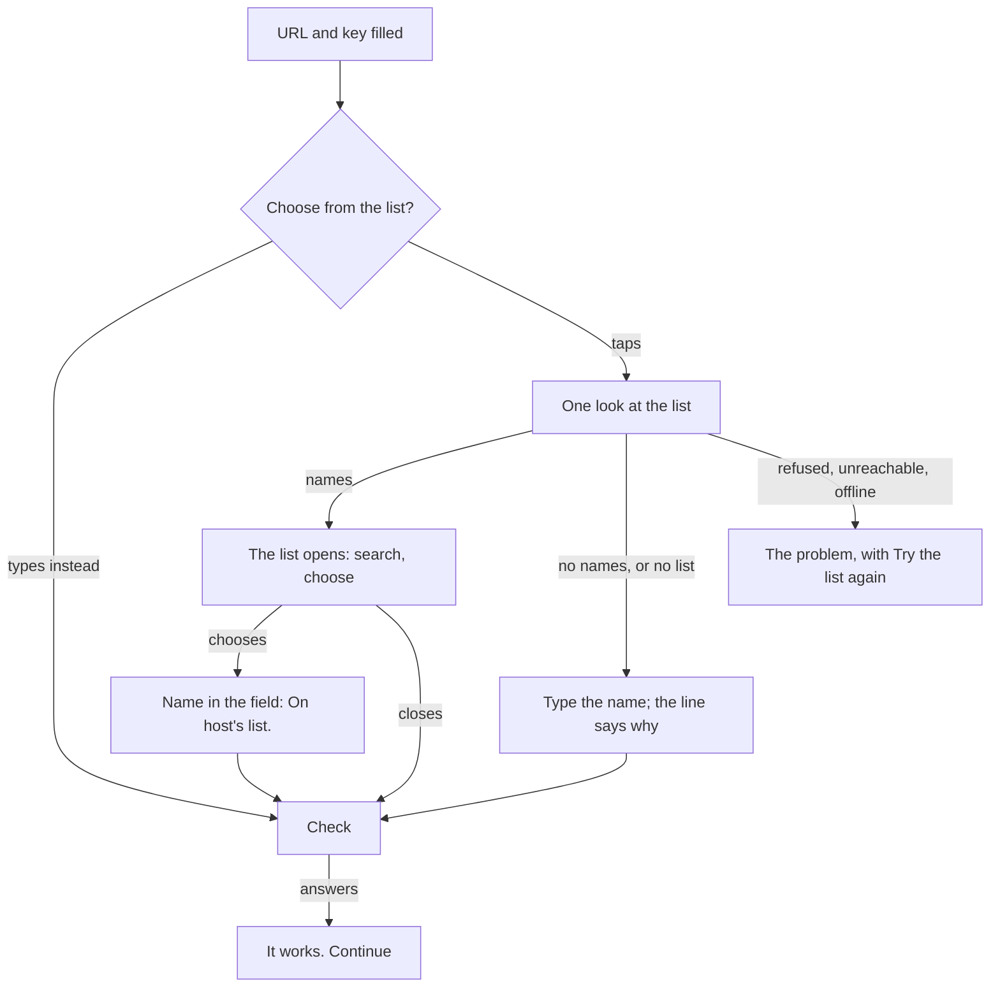

# Setting up Nocturne's mind online

Part of [Nocturne on a phone of its own](phone-first.md#an-online-service-you-choose). Two problems
in the setup of "Nocturne's mind online" on the phone, and the same form in Online answers on the
computer:

1. **The buttons are out of reach.** Step 4 of 4 is long, and its "Turn on" and "Not now" sit at
   the end of the scroll. On a real phone the person sees the words and the back arrow, and goes
   back.
2. **The model name is typed by hand.** Step 2 asks for "Model name" as free text, though its check
   already takes one look at the service's list of models. People copy a name with a wrong
   capital, a missing date or a stray space, and learn it only when the check fails.

Status: proposed. Nothing here is built. It extends the approved
[Keeping the next step in view](step-flow-actions.md) to the phone, and changes the details step of
both setups.

## Mockups

In `docs/design/mockups/mind-online-setup/`. `phone.html` uses the phone parity kit, Android and
iPhone side by side; `?state=`, `?theme=dark`, `?text=200` (the phone's text at 200 per cent, at
the phone's real height) and `?end=1` (scrolled to the end) work on every state. `desktop.html` uses
the app's own tokens like the step flow mockups: serve the repository root over HTTP after
`make ui/install`.

| Screen | File and state | Renders |
|---|---|---|
| Step 1, "Everything that is sent" open | `phone.html?state=what` | `what-light.png` |
| Step 4, agree | `phone.html?state=agree` | `agree-light.png`, `agree-dark.png`, `agree-200-light.png` |
| Step 2, URL and key filled | `phone.html?state=details` | `details-light.png` |
| Step 2, looking at the list | `phone.html?state=loading` | `loading-light.png` |
| The list, short | `phone.html?state=list` | `list-light.png`, `list-dark.png` |
| The list, long, searched | `phone.html?state=search` | `search-light.png` |
| The list, nothing matches | `phone.html?state=nomatch` | `nomatch-light.png` |
| Step 2, a name chosen | `phone.html?state=picked&end=1` | `picked-light.png`, `picked-dark.png`, `picked-200-light.png` |
| Step 2, the list failed: key refused | `phone.html?state=failed&end=1` | `failed-light.png`, `failed-dark.png` |
| Step 2, no list at that address | `phone.html?state=nolist&end=1` | `nolist-light.png` |
| Step 2, a typed name not on the list | `phone.html?state=notlisted&end=1` | `notlisted-light.png` |
| Online answers, Connect, a name chosen | `desktop.html?state=picked` | `desktop-picked-light.png`, `desktop-picked-dark.png` |
| Online answers, Connect, the list | `desktop.html?state=list` | `desktop-list-light.png`, `desktop-list-dark.png` |

### Before and after

Every "before" is captured from the phone app's own build with its scripted engine, at 412 by 915,
light. Every "after" is rendered from the mockups.

| View | Before | After |
|---|---|---|
| Step 4, top of the screen | `agree-before-light.png` | `agree-light.png` |
| Step 4, text at 200 per cent | `agree-200-before-light.png` | `agree-200-light.png` |
| Step 2, the model name | `details-before-light.png` (typed) | `picked-light.png` (chosen) |
| Step 2, a refused key | `failed-before-light.png` (found at Check) | `failed-light.png` (found at the list) |

## Problem 1: buttons out of reach

### Today on the phone

The phone's bar (`ph-foot`) is the last thing in the page. It sits at the bottom only when the
words are short; otherwise it scrolls away with them. Positions are the top edge of the main button
at 412 by 915, measured in the scripted build. The screen shows up to about 915.

| Screen | Main button at 100 per cent | At 200 per cent |
|---|---|---|
| Where should Nocturne's mind be? | 789, in view | 1,392, hidden |
| Step 1 | 760, in view | 1,568, hidden |
| Step 1, "Everything that is sent" open | 1,439, hidden | 4,164, hidden |
| Step 2 | 760, in view | 1,071, hidden |
| Step 2, the key refused | 760, in view | 1,331, hidden |
| Step 3, an amount | 760, in view | 816: "Back" and the reason hidden |
| Step 4 | 1,398, hidden | 4,068, hidden |
| Save a backup (to a file) | 818, in view | 1,505, hidden |

### The rule on the phone

The computer's bar rule, carried over to the phone's sizes. Nothing changes in the words, the
buttons or their order.

| Rule | Detail |
|---|---|
| Place | The bar is pinned to the bottom of the screen, above the gesture bar or home indicator, on every step listed below, however long the words |
| Order | Unchanged: the main button first and full width, then the quiet one, then the line. The phone stacks them, as today |
| More to read | While words continue below the bar, the last 40 pixels fade into it. At the end of the words the fade goes. A rule line separates the bar from the words, as today |
| Reading order | The bar stays after the words in the page, so a screen reader meets the words first. Each step's heading still takes focus on arrival |
| Focus | The page keeps room at its bottom the height of the bar, so a focused field or button never hides behind it (WCAG 2.2, 2.4.11 Focus Not Obscured) |
| Large text | The bar stays pinned while it takes no more than a third of the screen's height. At 200 per cent on a 412 by 915 phone, step 4's bar takes about a fifth and step 2's, with its two-line reason, under a third, so both stay pinned |
| Short screens | When the bar would take more than a third, such as a phone on its side or text above 200 per cent, it sits after the words, as today |
| Keyboard | While the on-screen keyboard is up, the bar sits after the words, so the field and the keyboard have the room. It pins again when the keyboard goes |
| Reduced motion | The fade shows and goes without a transition |
| Back arrow | Unchanged. "Back" or "Not now" in the bar does what it does today |

Step 4 keeps "Turn on" usable from the start, as the computer's step 5 does. Asking the person to
scroll to the end first was not used: the fade already says there is more, and a button that waits
for scrolling is a hurdle that teaches people to scroll without reading.

### Which phone screens

The rule belongs to the bar itself, so every screen that ends in it gets it. Checked against
`ui/src/phone`:

| Flow | Screens | Why it needs it |
|---|---|---|
| Nocturne's mind online, `alone/screens/Mind.tsx` | Where should Nocturne's mind be?, steps 1 to 4 | Measured above: step 4 always, the rest at 200 per cent or with the expander open |
| Nightly backup, designed in [Backup on a phone of its own](phone-backup.md) | Steps 1 to 3, a recovery key, Make a recovery key | Step 1's expander and step 2's phrase and note run long. Its mockups already draw the bar pinned; this makes it the rule |
| Backup to a file and restore, `alone/screens/Backup.tsx` | Save a backup, Bring back your memory, Replace | Save a backup is hidden at 200 per cent |
| Moving your memory, `alone/screens/MoveScreens.tsx` | Found, size, failed, moved, used | Long explanations of what moves and what stays |
| First run, `alone/screens/Welcome.tsx` | Your memory lives on this phone, the mind offer | Long at 200 per cent |
| Permissions, `alone/screens/Permissions.tsx` | Calendar and Health permissions | Long at 200 per cent |
| Confirmations, `alone/screens/DeleteEverything.tsx`, `DeleteKept.tsx`, `Forget.tsx`, `PutAside.tsx` | Delete everything, delete a kept thing, forget, put aside | Their safeguards stay: Delete everything still waits for the typed word, and the safe choice keeps its place |
| The companion's journal, `screens/CheckIn.tsx`, `Journal.tsx`, `LookBack.tsx`, `Which.tsx` | Save a check-in, choose which one, back to today | A check-in's Save sits under a long list of feelings |

The morning page and an original (`PageScreen.tsx`, `Original.tsx`) already hold a fixed layout
with their bar in place, so nothing changes there. Screens whose one button sits under a short
message, such as "Reading what you kept" and "Backed up", get the rule too and look the same.

## Problem 2: the model name

### Today

Step 2 holds three free text fields, "API URL", "API key" and "Model name", then "Check". The check
(`crates/provider/src/client.rs`, `check()`) does two things in order:

1. One look at the service's list of models (`models()`). If the list has names and the typed one
   is not among them, the check stops: "{host} doesn't know a name like “{used}”." A service
   with no list, answering "not found", is let through.
2. One short question, with nothing the person kept. If an answer comes back, it works.

So Nocturne already fetches the list, and throws it away. The person never sees it.

The list a standard service gives holds little more than names, such as `reader-small` or
`reader-large-2026-09`. It says nothing about what each one is for, its price or its size, and
Nocturne does not guess any of that from a name.

### The design

The name field stays a text field the person can always type in. Under it, one more control:
"Choose from {host}'s list…". It takes the same one look the check already takes, at the moment the
person asks for it, and shows the names to choose from.

- **One look, as allowed.** The look is the check's own: same address, same key, and recorded
  wherever the check's look is recorded today (on the phone, a "Connection check" row in Sent
  online). When "Check" follows with the same address and key, it
  uses the list from that look instead of looking again, so a check still takes one look at the
  list, which is what invariant 2 allows. Nothing new leaves the phone or the computer, and nothing
  goes anywhere else.
- **Only when asked.** The list is fetched when the person taps "Choose from {host}'s list…", never
  by itself while they type (open question 2).
- **The address and key decide.** Changing either drops the list, as it already drops a passed
  check. The name in the field stays.
- **Choosing is typing.** Choosing a name puts it in the field exactly as listed, as if typed. The
  check runs as today; choosing never passes the check by itself.
- **The list is not kept.** Leaving the step forgets it. Coming back and tapping again looks again.

### Behaviour, state by state

| State | When | The name field | Under it | The list control | Check |
|---|---|---|---|---|---|
| Not ready | The URL or key is empty | Typable | Nothing | "Choose from the service's list…", not pressable, with "Fill in the API URL and key first." | Not pressable until all three are filled, as today |
| Ready | URL and key filled | Typable | Nothing | "Choose from {host}'s list…" | As today |
| Looking | The person tapped it | Typable | Nothing | "Looking at {host}'s list…" with the breathing dot, not pressable | Not pressable while it looks |
| Listed | The look found names | Typable | Nothing | The list opens over the step (below) | As today |
| Chosen | A name was chosen in the list | The name, as listed | "On {host}'s list." | "Choose from {host}'s list…" again, to change it | Pressable; it uses the same list |
| Empty list | The look worked but listed no names | Typable, focused | "{host} didn't give a list at that address." and how to go on | "Try the list again" | Pressable once typed |
| No list | The address answered "not found", or with something that is not a list | As above | As above | As above | As above. The check then asks its question, as today |
| List failed, typing can help | The service was busy or had a problem on its side | Typable | The problem, then "Type the name exactly as its website shows it, or try the list again in a moment." | "Try the list again" | As today |
| List failed, typing can't help | The key was refused, no credit, nothing answered at the address, this phone or computer is offline, the address is not allowed | Typable | The problem, worded as the check words it, pointing at the URL or the key | "Try the list again" | As today, and it will fail the same way until the URL or key is fixed |
| Typed name not on the list | A list is known and the typed name is not in it | The typed name | "“{name}” isn't on {host}'s list. Check the spelling, or choose from the list. Capitals and dashes matter." | "Choose from {host}'s list…" | Pressable. Today's check then says "{host} doesn't know a name like “{name}”." (open question 1) |
| Only the capitals differ | As above, and one listed name matches but for capitals | The typed name | "“{name}” isn't on {host}'s list, but “{listed}” is." with "Use “{listed}”" | As above | As above |
| Long list | More than 8 names | | | The list opens with a search field, focused | |
| Checked, then changed | The check passed, then the person chose or typed another name | The new name | As for its state | As for its state | "Check" again; Continue waits, as for any edit today |

The two failures are told apart because they need different help. When typing a name could still
work, Nocturne says so. When the key or the address is the problem, a typed name will fail at the
check too, so the words point at the key or the address instead of inviting a name.

"Not found" at the list's address is not proof that the address is wrong: some services have no
list. The words say both, and the check that follows settles it.

### The list

| Part | On the phone | On the computer |
|---|---|---|
| Shape | A sheet from the bottom, up to 86 per cent of the screen, full height while the keyboard is up | A dialog over Connect, 520 pixels wide |
| Title | "{host}'s list" | Same |
| Under the title | "{count} names, A to Z" | Same |
| Search | Shown when there are more than 8 names, focused on opening: "Search the list" | Same |
| Rows | One per name, exactly as listed, in the monospaced type so `l`, `1`, `O` and `0` differ. A radio button shows the name in the field, if it is listed | Same, 40 pixels tall |
| Order | A to Z, ignoring capitals, numbers in number order (open question 3) | Same |
| Choosing | One tap chooses and closes the list | One click, or Enter on the focused row. Arrow keys move without closing |
| Searching | Matches any part of the name, ignoring capitals. The matching part is marked. "{shown} of {count} have “{query}” in them." | Same |
| Nothing matches | "No name on the list has “{query}” in it." with "Use “{query}” as typed", which puts it in the field and closes the list | Same |
| Under the rows | "Not here? Close the list and type the name from the service's website." | Same |
| Closing | The close button, the system back gesture, or tapping outside. Nothing changes | "Close", Escape, or clicking outside |

No grouping, no labels, no "recommended" and no "best for": a standard service's list holds names
only, and anything Nocturne added would be a guess. Nocturne still recommends no service and no
name.

### On the computer: same form, same change

Online answers' Connect (`ui/src/screens/online/Connect.tsx`) is the same form: the same three
details, the same check through the same client, and the same outcomes. Its labels differ ("Address",
"Key", "Which one to use", each with its technical word beside it), and it sits under Advanced
details. It gets the same list, in a dialog, with the computer's words for being offline. The
`desktop-*` renders show it. The phone and the computer would otherwise teach two ways to fill in one
form.

## Copy

New strings only. Everything else on both steps is unchanged. `{host}` is the address's host, as
the check already names it.

### Phone, step 2

| Key | Copy |
|---|---|
| `phone.mind.details.model.placeholder` | "Type it, or choose from the list" |
| `phone.mind.details.list` | "Choose from {host}’s list…" |
| `phone.mind.details.list.noHost` | "Choose from the service’s list…" |
| `phone.mind.details.list.needs` | "Fill in the API URL and key first." |
| `phone.mind.details.list.looking` | "Looking at {host}’s list…" |
| `phone.mind.details.list.again` | "Try the list again" |
| `phone.mind.details.list.on` | "On {host}’s list." |
| `phone.mind.details.list.notOn` | "“{name}” isn’t on {host}’s list. Check the spelling, or choose from the list. Capitals and dashes matter." |
| `phone.mind.details.list.capitals` | "“{name}” isn’t on {host}’s list, but “{listed}” is." |
| `phone.mind.details.list.useListed` | "Use “{listed}”" |
| `phone.mind.details.list.none` | "{host} didn’t give a list at that address." |
| `phone.mind.details.list.none.detail` | "Some services don’t. Type the name exactly as its website shows it, then check. If the check can’t reach it either, look at the API URL again." |
| `phone.mind.details.list.later.detail` | "Type the name exactly as its website shows it, or try the list again in a moment." |
| `phone.mind.details.list.keyRefused.detail` | "Check you copied all of it, then try the list again. Some services also need credit on the account before a key works." |
| `phone.mind.details.list.noInternet.detail` | "Connect to the internet, then try the list again. Nothing was sent." |
| `phone.mind.details.list.failed` | "The list couldn’t be fetched. Type the name, or try the list again." |

The titles of the failures reuse the check's own: `phone.mind.check.keyRefused`, `noCredit`,
`unreachable`, `noInternet`, `notHttps`, `addressNotAllowed`, `busy` and `serverError`, with their
details where the list adds nothing (`noCredit`, `unreachable`, `notHttps`, `addressNotAllowed`).
`busy` and `serverError` take `list.later.detail`; an empty or missing list takes `list.none`.

### Phone, the list

| Key | Copy |
|---|---|
| `phone.mind.list.title` | "{host}’s list" |
| `phone.mind.list.count` | "{count, plural, one {# name} other {# names}}, A to Z" |
| `phone.mind.list.search` | "Search the list" |
| `phone.mind.list.matches` | "{shown} of {count} have “{query}” in them." |
| `phone.mind.list.noMatch` | "No name on the list has “{query}” in it." |
| `phone.mind.list.useTyped` | "Use “{query}” as typed" |
| `phone.mind.list.note` | "Not here? Close the list and type the name from the service’s website." |
| `phone.mind.list.close` | "Close" |

### Computer, Connect

The same strings under `advanced.online.connect.list.*`, with these differences:

| Key | Copy |
|---|---|
| `advanced.online.connect.name.placeholder` (changed) | "Type it, or choose from the list" (was "The exact name from its website") |
| `advanced.online.connect.list.needs` | "Fill in the address and key first." |
| `advanced.online.connect.list.none.detail` | "Some services don’t. Type the name exactly as its website shows it, then check. If the check can’t reach it either, look at the address again." |
| `advanced.online.connect.list.noInternet.detail` | "Connect, then try the list again. Nothing was sent." |

The failure titles reuse `advanced.online.connect.*`, whose `noInternet` already says "This computer
isn’t connected to the internet."

## Accessibility

- **The control.** "Choose from {host}'s list…" is a button. The ellipsis says it opens something,
  as elsewhere. While it looks it is not pressable, and "Looking at {host}'s list…" is a polite
  status.
- **The list.** A modal sheet or dialog named by its title. Focus moves to the search field when
  there is one, otherwise to the chosen row or the first. Rows are a group of radio buttons named
  by the title, so a screen reader says "reader-small, radio button, 3 of 6". Arrow keys move,
  Space or Enter chooses, Escape closes. Focus returns to the name field when it closes.
- **The match count** is a polite live region, read once typing pauses, never on every key.
- **The field.** "On {host}'s list." and the not-on-the-list line are joined to the name field with
  `aria-describedby`, so they are read with it. Failures are alerts, as the check's are.
- **200 per cent text.** Rows grow and names wrap anywhere, since names have no spaces. The sheet
  scrolls; its title and search stay at its top. The step's bar stays pinned as above.
- **Targets.** Rows are at least 48 pixels on the phone, 40 on the computer; the close button is 44.
- **Colour.** The matching part is marked by a background and the chosen row by its radio, never by
  colour alone.
- **Reduced motion.** The sheet appears without sliding.
- **Light and dark.** Both, as the renders show.

## What this does not change

- The check, its question and its outcomes, apart from reusing the list from the last look.
- The words of steps 1, 3 and 4, and of every other screen named above. Only where the bar sits.
- The labels "API URL", "API key", "Model name" on the phone, and Connect's on the computer.
- Invariant 2: one look at the chosen service's list when it is checked, on the person's request.

## Open questions for the owner

### 1. A typed name that isn't on the service's list

Some services list names wrongly: they leave out a name they answer to, such as an older name kept
for a while, or one that only some accounts can use. Today's check stops those at the list.

| Option | What happens | Trade-off |
|---|---|---|
| A. Keep today's check | A name not on a non-empty list fails: "{host} doesn't know a name like “{name}”." | Catches typos before any question goes. A service that lists wrongly cannot be used at all |
| B. Let the question decide | The not-on-the-list line still shows, but Check asks its one question anyway. If an answer comes back, it works: "{host} answered. It works." | Works with any service that answers. A typo that a service happens to accept would pass, and the answer proves that name works |

**Recommendation: B.** The answer is the real proof; the list only helps choose. The warning line
already catches typos before the person presses Check. It changes one line of `check()`.

### 2. When the list is fetched

| Option | What happens | Trade-off |
|---|---|---|
| A. On a tap | "Choose from {host}'s list…" fetches it | One more tap. Every request to the service is one the person asked for |
| B. By itself | Once the URL and key are filled and the person moves on from the key | No tap. Half-pasted keys and mistyped addresses send requests the person never meant |

**Recommendation: A.** It keeps every request to the service a person's action, which is how the
check already works.

### 3. The order of the list

| Option | What happens | Trade-off |
|---|---|---|
| A. A to Z | Names sort alphabetically, ignoring capitals, numbers in number order | Predictable, and names of one family sit together. It may differ from the service's website |
| B. The service's order | As the service sends them | May match its website. Often no order at all, and hard to scan |

**Recommendation: A.** Search finds a known name either way; A to Z makes the short lists easy to
scan.

### 4. The computer in the same release

| Option | What happens | Trade-off |
|---|---|---|
| A. Together | Phone and computer change in one piece of work | One way to fill in one form everywhere. A little more to build at once |
| B. Phone first | The computer follows later | Smaller first change. The two setups differ for a while |

**Recommendation: A.** It is the same form and the same check; the list and its words are shared.

## Checks for the build

- At 412 by 915 and at 200 per cent text, every screen named in [Which phone
  screens](#which-phone-screens) shows its main button on arrival, light and dark, with axe clean.
- With the keyboard up on step 2, the focused field is in view and the bar sits after the words.
- With a stand-in service: a list of 6, of 214, an empty list, "not found", a refused key, a busy
  service and no network each give the state above, and the phone's Sent online lists exactly one
  connection check for each look.
- "Check" right after choosing makes no second look at the list.
- Changing the URL or key after a look drops the list.
- No grouping or description of a name appears anywhere.
