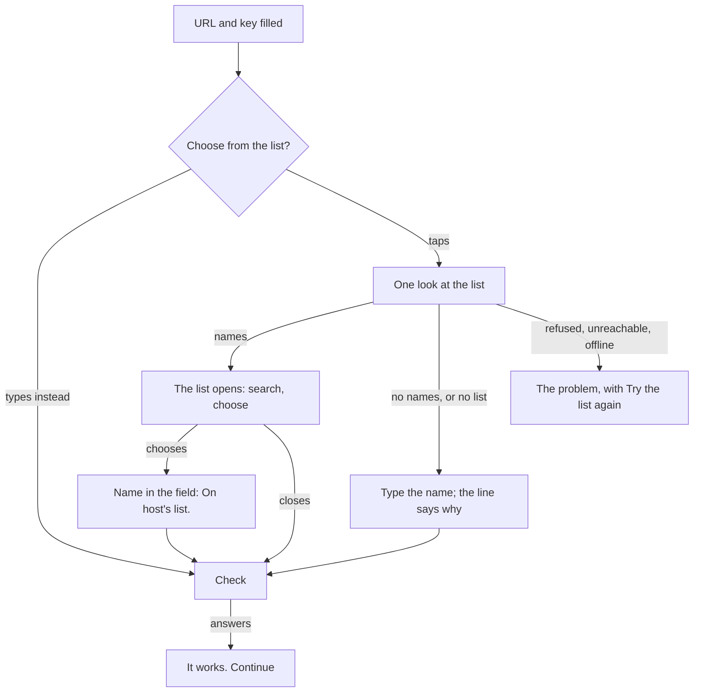

# Setting up Nocturne's mind online

Part of [Nocturne on a phone of its own](phone-first.md#an-online-service-you-choose). Three problems
with "Nocturne's mind online" on the phone, the second shared with Online answers on the computer:

1. **The buttons are out of reach.** Step 4 of 4 is long, and its "Turn on" and "Not now" sit at
   the end of the scroll. On a real phone the person sees the words and the back arrow, and goes
   back.
2. **The model name is typed by hand.** Step 2 asks for "Model name" as free text, though its check
   already takes one look at the service's list of models. People copy a name with a wrong
   capital, a missing date or a stray space, and learn it only when the check fails.
3. **Reading looks stuck on battery.** The phone reads only while it charges, but This phone says
   "Reading · 0 of 89", and there is no way to read now.

Status: proposed, with the owner's decisions of 2026-11-24 folded in. Nothing here is built. It
extends the approved [Keeping the next step in view](step-flow-actions.md) to the phone, and changes
the details step of both setups.

## The owner's decisions

Settled on 2026-11-24, each as recommended.

| # | Decision | Where it lands |
|---|---|---|
| 1 | A typed name that isn't on the service's list is warned about, and the check's one question decides: if an answer comes back, it works | [Behaviour](#behaviour-state-by-state), [The check](#the-check-and-a-name-not-on-the-list) |
| 2 | The list is fetched only when the person taps "Choose from {host}'s list…", never by itself | [The design](#the-design) |
| 3 | The list is sorted A to Z, ignoring capitals, numbers in number order | [The list](#the-list) |
| 4 | Online answers' Connect on the computer changes in the same release | [On the computer](#on-the-computer-same-form-same-change) |

## Mockups

In `docs/design/mockups/mind-online-setup/`. `phone.html` uses the phone parity kit, Android and
iPhone side by side; `?state=`, `?theme=dark`, `?text=200` (the phone's text at 200 per cent, at
the phone's real height) and `?end=1` (scrolled to the end) work on every state. `desktop.html` uses
the app's own tokens like the step flow mockups: serve the repository root over HTTP after
`make ui/install`. `reading.html` shows This phone and "Reading what you kept" on battery, with the
same parameters as `phone.html`; at 200 per cent each screen starts at the mind group.

| Screen | File and state | Renders |
|---|---|---|
| Step 1, "Everything that is sent" open | `phone.html?state=what` | `what-light.png` |
| Step 4, agree | `phone.html?state=agree` | `agree-light.png`, `agree-dark.png`, `agree-200-light.png` |
| Step 2, URL and key filled | `phone.html?state=details` | `details-light.png` |
| Step 2, looking at the list | `phone.html?state=loading` | `loading-light.png` |
| The list, short | `phone.html?state=list` | `list-light.png`, `list-dark.png` |
| The list, long, searched | `phone.html?state=search` | `search-light.png` |
| The list, nothing matches | `phone.html?state=nomatch` | `nomatch-light.png` |
| Step 2, a name chosen | `phone.html?state=picked&end=1` | `picked-light.png`, `picked-dark.png`, `picked-200-light.png` |
| Step 2, the list failed: key refused | `phone.html?state=failed&end=1` | `failed-light.png`, `failed-dark.png` |
| Step 2, no list at that address | `phone.html?state=nolist&end=1` | `nolist-light.png` |
| Step 2, a typed name not on the list | `phone.html?state=notlisted&end=1` | `notlisted-light.png` |
| Online answers, Connect, a name chosen | `desktop.html?state=picked` | `desktop-picked-light.png`, `desktop-picked-dark.png` |
| Online answers, Connect, the list | `desktop.html?state=list` | `desktop-list-light.png`, `desktop-list-dark.png` |
| This phone, waiting to charge | `reading.html?state=waiting` | `reading-waiting-light.png`, `reading-waiting-dark.png`, `reading-waiting-200-light.png` |
| This phone, reading now | `reading.html?state=now` | `reading-now-light.png`, `reading-now-dark.png`, `reading-now-200-light.png` |
| This phone, stopped when the person left | `reading.html?state=left` | `reading-left-light.png` |
| This phone, stopped at 20 per cent | `reading.html?state=low` | `reading-low-light.png` |
| This phone, all read | `reading.html?state=done` | `reading-done-light.png` |
| This phone, paused by the limit | `reading.html?state=paused` | `reading-paused-light.png` |
| This phone, the service not answering | `reading.html?state=unreachable` | `reading-unreachable-light.png` |
| Reading what you kept, on battery | `reading.html?state=first-waiting` | `reading-first-waiting-light.png`, `reading-first-waiting-dark.png` |
| Reading what you kept, reading now | `reading.html?state=first-now` | `reading-first-now-light.png` |

### Before and after

Every "before" is captured from the phone app's own build with its scripted engine, at 412 by 915,
light. Every "after" is rendered from the mockups.

| View | Before | After |
|---|---|---|
| Step 4, top of the screen | `agree-before-light.png` | `agree-light.png` |
| Step 4, text at 200 per cent | `agree-200-before-light.png` | `agree-200-light.png` |
| Step 2, the model name | `details-before-light.png` (typed) | `picked-light.png` (chosen) |
| Step 2, a refused key | `failed-before-light.png` (found at Check) | `failed-light.png` (found at the list) |
| This phone, on battery with 89 waiting | `this-phone-before-light.png` | `reading-waiting-light.png` |
| This phone, dark | `this-phone-before-dark.png` | `reading-waiting-dark.png` |
| This phone, text at 200 per cent | `this-phone-before-200-light.png` | `reading-waiting-200-light.png` |
| Reading what you kept, on battery | `reading-before-light.png` | `reading-first-waiting-light.png` |

The scripted engine reports 12 of 46 read; the "before" captures of This phone and "Reading what you
kept" show the reported "0 of 89" in its place, with nothing else changed.

## Problem 1: buttons out of reach

### Today on the phone

The phone's bar (`ph-foot`) is the last thing in the page. It sits at the bottom only when the
words are short; otherwise it scrolls away with them. Positions are the top edge of the main button
at 412 by 915, measured in the scripted build. The screen shows up to about 915.

| Screen | Main button at 100 per cent | At 200 per cent |
|---|---|---|
| Where should Nocturne's mind be? | 789, in view | 1,392, hidden |
| Step 1 | 760, in view | 1,568, hidden |
| Step 1, "Everything that is sent" open | 1,439, hidden | 4,164, hidden |
| Step 2 | 760, in view | 1,071, hidden |
| Step 2, the key refused | 760, in view | 1,331, hidden |
| Step 3, an amount | 760, in view | 816: "Back" and the reason hidden |
| Step 4 | 1,398, hidden | 4,068, hidden |
| Save a backup (to a file) | 818, in view | 1,505, hidden |

### The rule on the phone

The computer's bar rule, carried over to the phone's sizes. Nothing changes in the words, the
buttons or their order.

| Rule | Detail |
|---|---|
| Place | The bar is pinned to the bottom of the screen, above the gesture bar or home indicator, on every step listed below, however long the words |
| Order | Unchanged: the main button first and full width, then the quiet one, then the line. The phone stacks them, as today |
| More to read | While words continue below the bar, the last 40 pixels fade into it. At the end of the words the fade goes. A rule line separates the bar from the words, as today |
| Reading order | The bar stays after the words in the page, so a screen reader meets the words first. Each step's heading still takes focus on arrival |
| Focus | The page keeps room at its bottom the height of the bar, so a focused field or button never hides behind it (WCAG 2.2, 2.4.11 Focus Not Obscured) |
| Large text | The bar stays pinned while it takes no more than a third of the screen's height. At 200 per cent on a 412 by 915 phone, step 4's bar takes about a fifth and step 2's, with its two-line reason, under a third, so both stay pinned |
| Short screens | When the bar would take more than a third, such as a phone on its side or text above 200 per cent, it sits after the words, as today |
| Keyboard | While the on-screen keyboard is up, the bar sits after the words, so the field and the keyboard have the room. It pins again when the keyboard goes |
| Reduced motion | The fade shows and goes without a transition |
| Back arrow | Unchanged. "Back" or "Not now" in the bar does what it does today |

Step 4 keeps "Turn on" usable from the start, as the computer's step 5 does. Asking the person to
scroll to the end first was not used: the fade already says there is more, and a button that waits
for scrolling is a hurdle that teaches people to scroll without reading.

### Which phone screens

The rule belongs to the bar itself, so every screen that ends in it gets it. Checked against
`ui/src/phone`:

| Flow | Screens | Why it needs it |
|---|---|---|
| Nocturne's mind online, `alone/screens/Mind.tsx` | Where should Nocturne's mind be?, steps 1 to 4 | Measured above: step 4 always, the rest at 200 per cent or with the expander open |
| Nightly backup, designed in [Backup on a phone of its own](phone-backup.md) | Steps 1 to 3, a recovery key, Make a recovery key | Step 1's expander and step 2's phrase and note run long. Its mockups already draw the bar pinned; this makes it the rule |
| Backup to a file and restore, `alone/screens/Backup.tsx` | Save a backup, Bring back your memory, Replace | Save a backup is hidden at 200 per cent |
| Moving your memory, `alone/screens/MoveScreens.tsx` | Found, size, failed, moved, used | Long explanations of what moves and what stays |
| First run, `alone/screens/Welcome.tsx` | Your memory lives on this phone, the mind offer | Long at 200 per cent |
| Permissions, `alone/screens/Permissions.tsx` | Calendar and Health permissions | Long at 200 per cent |
| Confirmations, `alone/screens/DeleteEverything.tsx`, `DeleteKept.tsx`, `Forget.tsx`, `PutAside.tsx` | Delete everything, delete a kept thing, forget, put aside | Their safeguards stay: Delete everything still waits for the typed word, and the safe choice keeps its place |
| The companion's journal, `screens/CheckIn.tsx`, `Journal.tsx`, `LookBack.tsx`, `Which.tsx` | Save a check-in, choose which one, back to today | A check-in's Save sits under a long list of feelings |

The morning page and an original (`PageScreen.tsx`, `Original.tsx`) already hold a fixed layout
with their bar in place, so nothing changes there. Screens whose one button sits under a short
message, such as "Reading what you kept" and "Backed up", get the rule too and look the same.

## Problem 2: the model name

### Today

Step 2 holds three free text fields, "API URL", "API key" and "Model name", then "Check". The check
(`crates/provider/src/client.rs`, `check()`) does two things in order:

1. One look at the service's list of models (`models()`). If the list has names and the typed one
   is not among them, the check stops: "{host} doesn't know a name like “{used}”." A service
   with no list, answering "not found", is let through.
2. One short question, with nothing the person kept. If an answer comes back, it works.

So Nocturne already fetches the list, and throws it away. The person never sees it.

The list a standard service gives holds little more than names, such as `reader-small` or
`reader-large-2026-09`. It says nothing about what each one is for, its price or its size, and
Nocturne does not guess any of that from a name.

### The design

The name field stays a text field the person can always type in. Under it, one more control:
"Choose from {host}'s list…". It takes the same one look the check already takes, at the moment the
person asks for it, and shows the names to choose from.

- **One look, as allowed.** The look is the check's own: same address, same key, and recorded
  wherever the check's look is recorded today (on the phone, a "Connection check" row in Sent
  online). When "Check" follows with the same address and key, it
  uses the list from that look instead of looking again, so a check still takes one look at the
  list, which is what invariant 2 allows. Nothing new leaves the phone or the computer, and nothing
  goes anywhere else.
- **Only when asked.** The list is fetched when the person taps "Choose from {host}'s list…", never
  by itself while they type (decision 2).
- **The address and key decide.** Changing either drops the list, as it already drops a passed
  check. The name in the field stays.
- **Choosing is typing.** Choosing a name puts it in the field exactly as listed, as if typed. The
  check runs as today; choosing never passes the check by itself.
- **The list is not kept.** Leaving the step forgets it. Coming back and tapping again looks again.

### Behaviour, state by state

| State | When | The name field | Under it | The list control | Check |
|---|---|---|---|---|---|
| Not ready | The URL or key is empty | Typable | Nothing | "Choose from the service's list…", not pressable, with "Fill in the API URL and key first." | Not pressable until all three are filled, as today |
| Ready | URL and key filled | Typable | Nothing | "Choose from {host}'s list…" | As today |
| Looking | The person tapped it | Typable | Nothing | "Looking at {host}'s list…" with the breathing dot, not pressable | Not pressable while it looks |
| Listed | The look found names | Typable | Nothing | The list opens over the step (below) | As today |
| Chosen | A name was chosen in the list | The name, as listed | "On {host}'s list." | "Choose from {host}'s list…" again, to change it | Pressable; it uses the same list |
| Empty list | The look worked but listed no names | Typable, focused | "{host} didn't give a list at that address." and how to go on | "Try the list again" | Pressable once typed |
| No list | The address answered "not found", or with something that is not a list | As above | As above | As above | As above. The check then asks its question, as today |
| List failed, typing can help | The service was busy or had a problem on its side | Typable | The problem, then "Type the name exactly as its website shows it, or try the list again in a moment." | "Try the list again" | As today |
| List failed, typing can't help | The key was refused, no credit, nothing answered at the address, this phone or computer is offline, the address is not allowed | Typable | The problem, worded as the check words it, pointing at the URL or the key | "Try the list again" | As today, and it will fail the same way until the URL or key is fixed |
| Typed name not on the list | A list is known and the typed name is not in it | The typed name | "“{name}” isn't on {host}'s list. Check the spelling, or choose from the list. Capitals and dashes matter." | "Choose from {host}'s list…" | Pressable. The check asks its question; if an answer comes back, it works (decision 1) |
| Only the capitals differ | As above, and one listed name matches but for capitals | The typed name | "“{name}” isn't on {host}'s list, but “{listed}” is." with "Use “{listed}”" | As above | As above |
| Long list | More than 8 names | | | The list opens with a search field, focused | |
| Checked, then changed | The check passed, then the person chose or typed another name | The new name | As for its state | As for its state | "Check" again; Continue waits, as for any edit today |

The two failures are told apart because they need different help. When typing a name could still
work, Nocturne says so. When the key or the address is the problem, a typed name will fail at the
check too, so the words point at the key or the address instead of inviting a name.

"Not found" at the list's address is not proof that the address is wrong: some services have no
list. The words say both, and the check that follows settles it.

### The list

| Part | On the phone | On the computer |
|---|---|---|
| Shape | A sheet from the bottom, up to 86 per cent of the screen, full height while the keyboard is up | A dialog over Connect, 520 pixels wide |
| Title | "{host}'s list" | Same |
| Under the title | "{count} names, A to Z" | Same |
| Search | Shown when there are more than 8 names, focused on opening: "Search the list" | Same |
| Rows | One per name, exactly as listed, in the monospaced type so `l`, `1`, `O` and `0` differ. A radio button shows the name in the field, if it is listed | Same, 40 pixels tall |
| Order | A to Z, ignoring capitals, numbers in number order (decision 3) | Same |
| Choosing | One tap chooses and closes the list | One click, or Enter on the focused row. Arrow keys move without closing |
| Searching | Matches any part of the name, ignoring capitals. The matching part is marked. "{shown} of {count} have “{query}” in them." | Same |
| Nothing matches | "No name on the list has “{query}” in it." with "Use “{query}” as typed", which puts it in the field and closes the list | Same |
| Under the rows | "Not here? Close the list and type the name from the service's website." | Same |
| Closing | The close button, the system back gesture, or tapping outside. Nothing changes | "Close", Escape, or clicking outside |

No grouping, no labels, no "recommended" and no "best for": a standard service's list holds names
only, and anything Nocturne added would be a guess. Nocturne still recommends no service and no
name.

### The check and a name not on the list

Some services list names wrongly: they leave out a name they answer to, such as an older name kept
for a while, or one that only some accounts can use. Today's check stops those at the list. With
decision 1 it no longer does: a name not on a non-empty list is warned about under the field, and
the check still asks its one question. If an answer comes back, it works ("{host} answered. It
works."), and the name is used as typed. If not, the check's own outcome shows, as today. In
`check()`, a name missing from the list stops being a reason to return before the question.

### On the computer: same form, same change

Online answers' Connect (`ui/src/screens/online/Connect.tsx`) is the same form: the same three
details, the same check through the same client, and the same outcomes. Its labels differ ("Address",
"Key", "Which one to use", each with its technical word beside it), and it sits under Advanced
details. It gets the same list, in a dialog, with the computer's words for being offline. The
`desktop-*` renders show it. The phone and the computer would otherwise teach two ways to fill in one
form.

## Copy

New strings only. Everything else on both steps is unchanged. `{host}` is the address's host, as
the check already names it.

### Phone, step 2

| Key | Copy |
|---|---|
| `phone.mind.details.model.placeholder` | "Type it, or choose from the list" |
| `phone.mind.details.list` | "Choose from {host}’s list…" |
| `phone.mind.details.list.noHost` | "Choose from the service’s list…" |
| `phone.mind.details.list.needs` | "Fill in the API URL and key first." |
| `phone.mind.details.list.looking` | "Looking at {host}’s list…" |
| `phone.mind.details.list.again` | "Try the list again" |
| `phone.mind.details.list.on` | "On {host}’s list." |
| `phone.mind.details.list.notOn` | "“{name}” isn’t on {host}’s list. Check the spelling, or choose from the list. Capitals and dashes matter." |
| `phone.mind.details.list.capitals` | "“{name}” isn’t on {host}’s list, but “{listed}” is." |
| `phone.mind.details.list.useListed` | "Use “{listed}”" |
| `phone.mind.details.list.none` | "{host} didn’t give a list at that address." |
| `phone.mind.details.list.none.detail` | "Some services don’t. Type the name exactly as its website shows it, then check. If the check can’t reach it either, look at the API URL again." |
| `phone.mind.details.list.later.detail` | "Type the name exactly as its website shows it, or try the list again in a moment." |
| `phone.mind.details.list.keyRefused.detail` | "Check you copied all of it, then try the list again. Some services also need credit on the account before a key works." |
| `phone.mind.details.list.noInternet.detail` | "Connect to the internet, then try the list again. Nothing was sent." |
| `phone.mind.details.list.failed` | "The list couldn’t be fetched. Type the name, or try the list again." |

The titles of the failures reuse the check's own: `phone.mind.check.keyRefused`, `noCredit`,
`unreachable`, `noInternet`, `notHttps`, `addressNotAllowed`, `busy` and `serverError`, with their
details where the list adds nothing (`noCredit`, `unreachable`, `notHttps`, `addressNotAllowed`).
`busy` and `serverError` take `list.later.detail`; an empty or missing list takes `list.none`.

### Phone, the list

| Key | Copy |
|---|---|
| `phone.mind.list.title` | "{host}’s list" |
| `phone.mind.list.count` | "{count, plural, one {# name} other {# names}}, A to Z" |
| `phone.mind.list.search` | "Search the list" |
| `phone.mind.list.matches` | "{shown} of {count} have “{query}” in them." |
| `phone.mind.list.noMatch` | "No name on the list has “{query}” in it." |
| `phone.mind.list.useTyped` | "Use “{query}” as typed" |
| `phone.mind.list.note` | "Not here? Close the list and type the name from the service’s website." |
| `phone.mind.list.close` | "Close" |

### Computer, Connect

The same strings under `advanced.online.connect.list.*`, with these differences:

| Key | Copy |
|---|---|
| `advanced.online.connect.name.placeholder` (changed) | "Type it, or choose from the list" (was "The exact name from its website") |
| `advanced.online.connect.list.needs` | "Fill in the address and key first." |
| `advanced.online.connect.list.none.detail` | "Some services don’t. Type the name exactly as its website shows it, then check. If the check can’t reach it either, look at the address again." |
| `advanced.online.connect.list.noInternet.detail` | "Connect, then try the list again. Nothing was sent." |

The failure titles reuse `advanced.online.connect.*`, whose `noInternet` already says "This computer
isn’t connected to the internet."

## Accessibility

- **The control.** "Choose from {host}'s list…" is a button. The ellipsis says it opens something,
  as elsewhere. While it looks it is not pressable, and "Looking at {host}'s list…" is a polite
  status.
- **The list.** A modal sheet or dialog named by its title. Focus moves to the search field when
  there is one, otherwise to the chosen row or the first. Rows are a group of radio buttons named
  by the title, so a screen reader says "reader-small, radio button, 3 of 6". Arrow keys move,
  Space or Enter chooses, Escape closes. Focus returns to the name field when it closes.
- **The match count** is a polite live region, read once typing pauses, never on every key.
- **The field.** "On {host}'s list." and the not-on-the-list line are joined to the name field with
  `aria-describedby`, so they are read with it. Failures are alerts, as the check's are.
- **200 per cent text.** Rows grow and names wrap anywhere, since names have no spaces. The sheet
  scrolls; its title and search stay at its top. The step's bar stays pinned as above.
- **Targets.** Rows are at least 48 pixels on the phone, 40 on the computer; the close button is 44.
- **Colour.** The matching part is marked by a background and the chosen row by its radio, never by
  colour alone.
- **Reduced motion.** The sheet appears without sliding.
- **Light and dark.** Both, as the renders show.

## Problem 3: reading on battery

### Today

The phone reads what was kept only while it charges. Every pass of the mind stops at once when
the phone is not known to charge (`pass()` in `phone/src-tauri/src/mind/mod.rs` returns
`Pass::NotCharging`), even with Nocturne open in the person's hand. A phone that cannot say whether
it charges is taken as on battery. Questions asked in Ask are answered at once, charging or not.

Nothing on screen says so. This phone shows "Its mind · answers.example, online · Reading · 0 of 89"
and "Reading what you kept" shows a breathing dot over "0 of 89 read", so reading looks stuck. The
only line about charging, "Reading carries on when this phone allows it, often while it charges.",
is on the screen a person sees once, right after turning the mind on.

Reading while charging is right: reading many things uses the network and the processor, and a
person should not find their battery run down by something they didn't start. What is missing is
saying so, and a way for the person to choose otherwise.

### The design

- **Say what is happening.** On battery with things waiting, the status says "Waiting to charge ·
  89 to read", not "Reading · 0 of 89".
- **Say why, once, where it shows.** "Nocturne reads what you keep while this phone charges, so it
  doesn't run the battery down."
- **Offer Read now.** "Read now reads while Nocturne stays open, and uses some battery." It is the
  person's act: Nocturne offers it on This phone and on "Reading what you kept", and never starts
  it, suggests it in a notification or puts it on Today.
- **Stop plainly.** Read now ends when the person leaves Nocturne, when nothing is left, when the
  battery reaches 20 per cent or the phone saves battery, when the service stops answering, the key
  is refused or the month's limit is reached, or when the person presses Stop. Each says why.

### Where the reading state shows

| Place | Today | After |
|---|---|---|
| This phone, "Its mind" row | "{host}, online · Reading · {done} of {count}" whenever things wait | The row's words by state (below), and the Read now block under the row |
| "Reading what you kept", once after turning on | "{done} of {count} read" with a breathing dot, and the charging note | By state: waiting to charge, or reading now, with Read now or Stop |
| Today | Nothing while reading (phone-first's states) | Unchanged. Nothing about charging, so Today never nags |
| Ask | Finds by words while things wait to be read | Unchanged |

### Battery

Read now cannot start, and stops, at 20 per cent battery or below, or while the phone's own battery
saving is on (Battery Saver on Android, Low Power Mode on iPhone). 20 per cent is where iPhone first
offers Low Power Mode, and leaves the person most of their battery's last stretch. The phone's own
saving is the person's own choice to save battery, so Nocturne keeps to it. On the charger neither
limit applies, as today.

### States

`{left}` is what still waits, `{count}` minus `{done}`. "The block" is the part under "Its mind".

| State | When | "Its mind" row | The block | "Reading what you kept" |
|---|---|---|---|---|
| Nothing waiting | All read | "{host}, online" | Nothing | Not shown |
| Reading, charging | On the charger, things waiting | "{host}, online · Reading · {done} of {count}" (unchanged) | Nothing: there is nothing to do | Unchanged |
| Waiting to charge | On battery, or the phone can't say, things waiting | "{host}, online · Waiting to charge · {left} to read" | The why line, the cost line, "Read now" | "Waiting to charge · {count} to read", the why and cost in one note, "OK" and "Read now" |
| Reading now | The person pressed Read now | "{host}, online · Reading now · {done} of {count}" | A progress bar, "Keep Nocturne open. The screen stays on until it's done or you stop.", "Stop" | A progress bar, "Reading now · {done} of {count}" with the breathing dot, the same line, "OK" and "Stop". "OK" leaves the screen and reading carries on |
| Left Nocturne | The person went to another app, locked the phone, or Nocturne closed | "{host}, online · Waiting to charge · {left} to read" | "Read now stopped when you left Nocturne, after {done}.", then as waiting | Not shown again |
| All read | Nothing left while reading now | "{host}, online" | "Everything you kept is read.", until the person leaves This phone | "Everything you kept is read." and "OK" |
| Low battery | 20 per cent or below, before or during | "{host}, online · Waiting to charge · {left} to read" | During: "Read now stopped at 20% battery, after {done}. The rest is read while this phone charges." Then the why line, "Read now" not pressable, "Read now works above 20% battery." | The same lines |
| Battery saving on | Before or during | As waiting | During: "Read now stopped because Battery Saver is on, after {done}." (iPhone: "Low Power Mode") Then "Read now" not pressable, "Read now works when Battery Saver is off." | The same lines |
| Charger plugged in | During Read now | "{host}, online · Reading · {done} of {count}" | "Charging, so reading carries on by itself.", then nothing | The charging words, unchanged |
| Stopped by the person | "Stop" | As waiting | As waiting, with no stop line | As waiting |
| Paused by the limit | The month's limit is reached, before or during | "{host}, online · Paused by your limit · {left} to read" | "You've reached this month's limit. The rest is read from {day}, or when you change the limit." with "Change limit". No Read now: the limit holds | The same, with "OK" |
| Not answering | The service stopped answering, before or during | "{host}, online · Not answering · {left} to read" | "{host} hasn't answered since {time}. Nocturne looks again on its own." and "Read now looks once more, then reads while Nocturne stays open, and uses some battery." with "Read now" | The same |
| Read now, still not answering | The person pressed Read now and the one look found nothing | As above | "{host} still isn't answering. Nocturne looks again on its own." with "Read now" | The same |
| Not online | This phone can't reach the internet | "{host}, online · Not online · {left} to read" | "This phone isn't online. What you keep waits to be read." "Read now" not pressable, "Read now works once this phone is online." | The same |
| Key refused, no credit | Before or during | "{host}, online · Stopped · {left} to read" | The problem's own words and action, as today ("Check the key…", "Check again"). No Read now | The same |

Read now under "Not answering" takes one look at the service's list, the same look the phone
already makes on its own schedule, listed in Sent online as a "Connection check". If it answers,
reading now begins; if not, the line says so and nothing else is sent.

Read now reads what was kept. Writing the morning page still waits for the charger, as today.

### Copy

| Key | Copy |
|---|---|
| `phone.mind.row.waiting` | "Waiting to charge · {left} to read" |
| `phone.mind.row.readingNow` | "Reading now · {done} of {count}" |
| `phone.mind.row.paused` | "Paused by your limit · {left} to read" |
| `phone.mind.row.notAnswering` | "Not answering · {left} to read" |
| `phone.mind.row.notOnline` | "Not online · {left} to read" |
| `phone.mind.row.stopped` | "Stopped · {left} to read" |
| `phone.mind.row.reading` (unchanged) | "Reading · {done} of {count}" |
| `phone.mind.readNow` | "Read now" |
| `phone.mind.readNow.stop` | "Stop" |
| `phone.mind.readNow.why` | "Nocturne reads what you keep while this phone charges, so it doesn’t run the battery down." |
| `phone.mind.readNow.cost` | "Read now reads while Nocturne stays open, and uses some battery." |
| `phone.mind.readNow.keepOpen` | "Keep Nocturne open. The screen stays on until it’s done or you stop." |
| `phone.mind.readNow.left` | "Read now stopped when you left Nocturne, after {done}." |
| `phone.mind.readNow.done` | "Everything you kept is read." |
| `phone.mind.readNow.low` | "Read now stopped at 20% battery, after {done}. The rest is read while this phone charges." |
| `phone.mind.readNow.lowNeeds` | "Read now works above 20% battery." |
| `phone.mind.readNow.saver` (Android) | "Read now stopped because Battery Saver is on, after {done}." |
| `phone.mind.readNow.saverNeeds` (Android) | "Read now works when Battery Saver is off." |
| `phone.mind.readNow.saver` (iPhone) | "Read now stopped because Low Power Mode is on, after {done}." |
| `phone.mind.readNow.saverNeeds` (iPhone) | "Read now works when Low Power Mode is off." |
| `phone.mind.readNow.charging` | "Charging, so reading carries on by itself." |
| `phone.mind.readNow.paused` | "You’ve reached this month’s limit. The rest is read from {day}, or when you change the limit." |
| `phone.mind.readNow.changeLimit` | "Change limit" |
| `phone.mind.readNow.notAnswering` | "{host} hasn’t answered since {time}. Nocturne looks again on its own." |
| `phone.mind.readNow.lookAgain` | "Read now looks once more, then reads while Nocturne stays open, and uses some battery." |
| `phone.mind.readNow.stillNot` | "{host} still isn’t answering. Nocturne looks again on its own." |
| `phone.mind.readNow.offline` | "This phone isn’t online. What you keep waits to be read." |
| `phone.mind.readNow.offlineNeeds` | "Read now works once this phone is online." |
| `phone.mind.reading.bodyWaiting` | "Nocturne reads the {count, plural, one {# thing} other {# things}} you kept while this phone charges, a few at a time. Your first page comes tomorrow morning." |
| `phone.mind.reading.waiting` | "Waiting to charge · {count} to read" |
| `phone.mind.reading.noteWaiting` | "Nocturne reads what you keep while this phone charges, so it doesn’t run the battery down. Read now reads while Nocturne stays open, and uses some battery." |

"Reading what you kept" while charging keeps today's body, progress and note.

### Accessibility

- **Read now and Stop** are buttons of at least 44 pixels. Pressing Read now moves focus to Stop,
  which takes its place; Stop moves it back to Read now.
- **Not pressable** uses `aria-disabled`, so Read now stays focusable and its reason, joined with
  `aria-describedby`, is read with it.
- **Progress.** The bar states "{done} of {count} read" to screen readers and is announced at most
  every ten seconds, as the backup's are. The row's words change without being announced.
- **Why it stopped** is a polite status, read once.
- **200 per cent text.** The block's lines wrap and the buttons grow, as `reading-waiting-200` and
  `reading-now-200` show.
- **Colour and motion.** No state is told by colour alone. With reduced motion the breathing dot is
  still.
- **The screen stays on** only while Read now runs and Nocturne is in front, and the line says so.

### The code it implies

Not written here; for the build.

- **`pass()`** gains a "reading now" override: the charging gate returns `Pass::NotCharging` only
  when the phone is not charging and the person has not chosen Read now. The override lets the
  reader run; the scheduler's page and reflections keep waiting for the charger.
- **The override is set** only by the person's Read now, and **cleared** when Nocturne leaves the
  front, when a pass finds nothing left, at 20 per cent battery or with the phone's battery saving
  on, on Stop, on a pause by the limit, on trouble (not answering, key refused, no credit, not
  online), and when the mind is turned off. It is never kept across launches.
- **The phone's power reading** (`Power` in the system plugin) gains the battery level and whether
  battery saving is on, and `PhoneHost::battery_percent` returns the level.
- **The mind's status** tells the interface why reading waits (charging, on battery, reading now,
  and why Read now stopped), so the words above are chosen from facts, never guessed.
- **The screen** is kept on with the platform's own flag while Read now runs in front, and let go at
  every stop.
- **Nothing new leaves the phone:** the same requests to the one chosen host, sooner.

### Open questions for the owner

#### 1. The screen while Read now runs

| Option | What happens | Trade-off |
|---|---|---|
| A. Keep it on | The screen stays on until Read now ends, and the line says so | Read now can finish: reading 89 things takes minutes, longer than most screens stay on. Uses more battery |
| B. Let it sleep | The screen sleeps as usual; Read now stops when it does | Less battery. Read now usually stops after the first minute, and looks broken |

**Recommendation: A.** The person chose to read now; letting the screen sleep would end it behind
their back. The 20 per cent stop still protects the battery.

#### 2. Where Read now stops for battery

| Option | What happens | Trade-off |
|---|---|---|
| A. 20 per cent, and the phone's battery saving | As above | Matches where iPhone first offers Low Power Mode, and keeps to the person's own saving |
| B. 20 per cent only | Battery saving doesn't stop it | One rule. Reads against a setting the person chose to save battery |
| C. No limit | Read now runs to the end | Simplest. Can run a phone down |

**Recommendation: A.**

## What this does not change

- The check, its question and its outcomes, apart from reusing the list from the last look and
  letting the question decide for a name not on the list.
- The words of steps 1, 3 and 4, and of every other screen named above. Only where the bar sits.
- The labels "API URL", "API key", "Model name" on the phone, and Connect's on the computer.
- Invariant 2: one look at the chosen service's list when it is checked, on the person's request.
  Read now sends the same requests to the same host, sooner.
- When the phone reads on the charger, and that the page waits for it.

## Checks for the build

- At 412 by 915 and at 200 per cent text, every screen named in [Which phone
  screens](#which-phone-screens) shows its main button on arrival, light and dark, with axe clean.
- With the keyboard up on step 2, the focused field is in view and the bar sits after the words.
- With a stand-in service: a list of 6, of 214, an empty list, "not found", a refused key, a busy
  service and no network each give the state above, and the phone's Sent online lists exactly one
  connection check for each look.
- "Check" right after choosing makes no second look at the list.
- A name not on a list of names, which the stand-in answers to, passes the check after the warning.
- Changing the URL or key after a look drops the list.
- No grouping or description of a name appears anywhere.
- On battery with things waiting, This phone says "Waiting to charge" and nothing is read until Read
  now. Read now reads with the app in front and stops on leaving it, on Stop, at 20 per cent, with
  battery saving on, on a pause by the limit and on each trouble, saying why each time.
- After Read now ends, no pass reads until the charger or the next Read now.
