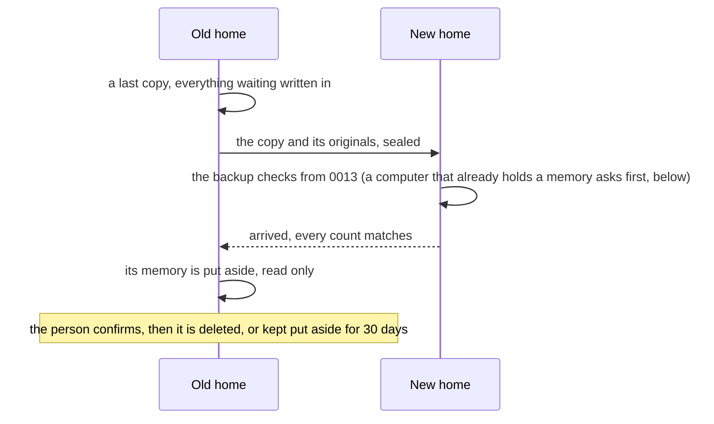
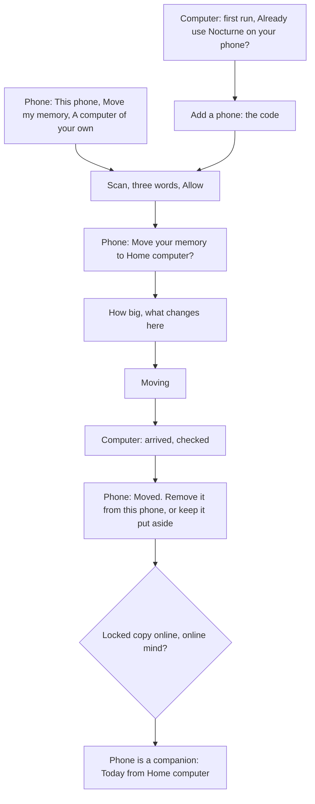
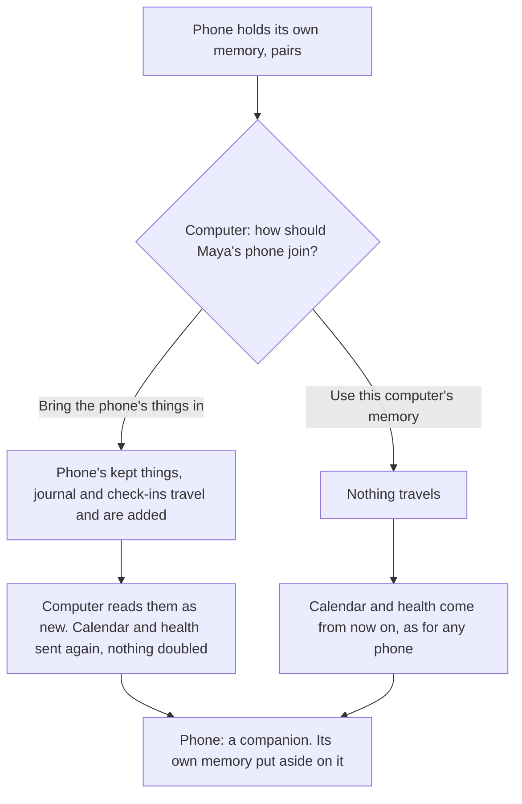

# Moving your memory

Part of [Phone and computer as equal starting points](phone-parity.md). A memory lives in one place
at a time. Moving it is how a person goes up the ladder and back down: a phone alone to a laptop, a
phone to a household computer it makes its home, a household computer to a computer of their own, a
computer back to a phone.

A memory moves only by pairing. The person pairs the phone with the new home, or the new home with
the phone, and agrees to the move. Using a mind, online or a household's, never moves a memory or
leaves a copy of it on the mind's machine. The locked copy online is a copy of the one home, used to
restore it, never a home of its own.

Status: proposed, with the owner's decisions folded in. Nothing here is built.

## Mockups

| Screen | File and states | Renders |
|---|---|---|
| On the phone | `move.html`: `found`, `size`, `moving`, `moved` | `move-found-light.png`, `move-size-light.png`, `move-moving-light.png`, `move-moved-light.png`, `move-moved-dark.png` |
| On the computer | `desktop-move.html`: `receive`, `done`, `choose`, `merged` | `desktop-move-receive-light.png`, `desktop-move-done-light.png`, `desktop-move-receive-dark.png`, `desktop-move-choose-light.png`, `desktop-move-choose-dark.png`, `desktop-move-merged-light.png` |

## One home holds the pen

The home is the one place that writes the memory and runs its tidy. Everywhere else reads it, or
keeps things waiting to go across. A move hands the pen over once.

| Rule | Detail |
|---|---|
| What moves | Everything: what was kept, what Nocturne remembers and what is fading, every page, the journal, check-ins, settings that belong to the memory, things marked private (locked like the rest). The same as a backup ([Back up and restore](backup-and-restore.md#what-is-in-a-backup)) |
| What stays | The old home's own settings: its mind, its connection, its phones list |
| How it travels | Over the sealed channel between the two, using the backup format. The locked copy online is never read by a computer: it is for restoring on a phone |
| Nothing read again | When both homes find things the same way, nothing is read again. When they don't, the new home gets each thing ready again in the background, and finding by words works meanwhile |
| Nothing deleted early | The old home's memory is put aside, read only, once the new home has it and every count matches. It is deleted only when the person confirms |
| Joining a computer's memory | The one exception to one home moving whole. When any memory moves into a computer that already holds one (from a phone alone, a household computer or another computer), the computer offers two choices ([below](#when-the-computer-already-holds-a-memory)): bring the phone's things in, which adds them to the computer's memory, or use the computer's memory, which brings nothing. Either way there is one home afterwards, and nothing is ever synced both ways. Putting the computer's memory aside for the phone's is not offered in a move; it stays only in restoring a backup file ([Back up and restore](backup-and-restore.md)) |
| Where a thing was kept | Each thing keeps the name of the device it was kept on. As a memory leaves a home, that home writes its own name into what it kept that has none yet (a phone uses the name it paired with), so the new home can say "Kept on {device}" |
| After | A phone whose memory left becomes a companion of the new home (or a phone alone again, if the memory came to it) |

## The moves

### From a phone to a computer

The computer's first run gains one question before its step 1: "Already use Nocturne on your
phone?" with "Yes, bring my memory here" and "No, start fresh". Yes goes straight to Add a phone and,
once paired, to the move. A computer that is already set up offers the move whenever a phone that
holds its own memory is added.

### To a household computer

Only when the household's owner gave the person a code to keep their memory there, and they pair
([Making a household computer your home](household-server.md#making-a-household-computer-your-home)).
Then the same move, with the household computer as the new home and its own per-person store locked
with this phone's key. A phone that only borrows a household's mind has nothing there to move from
or into; making the household its home takes a code for that person and a new pairing.

### From a household computer to a computer

From This phone, "Move my memory…", "A computer of your own". The phone pairs with the computer,
then asks the household computer to send the memory. It travels from the household computer to the
new computer through the phone's sealed sessions with each, so the household computer never pairs
with the new one. When it has arrived: "Delete your memory from {household}?".

### Back to the phone

From a household computer that is its home: "Leave this household…", "To this phone". From a computer of one's own:
Settings, "Your data", "Move my memory to a phone…", choosing one paired phone. Both check room on
the phone first, since photos and recordings can be large. The phone becomes a phone alone. On a
computer, the done screen offers "Keep using this computer’s mind", which turns on Household and adds
that phone as borrowing its mind, so the page does not stop. The person is the computer's owner, so
this is their own invitation; the computer then keeps nothing of the memory it handed over once the
person removes what was put aside.

## Afterwards

| Thing | When the memory leaves a phone | When the memory comes to a phone |
|---|---|---|
| The phone | A companion of the new home | A phone alone, its mind "None yet" unless the person chooses one |
| The old memory on the phone | Put aside; the person removes it or keeps it put aside for 30 days | Not applicable |
| A locked copy online | Turned off. "Delete the copy online" or "Keep it as it is" ([decision 19](phone-parity.md#decisions)) | Offered: "Keep a locked copy online?" |
| Its online mind | Turned off on the phone. The computer has its own mind, and Online answers can be set up there | Offered: "Choose a mind" |
| Calendar and health | Keep coming, now to the new home | Stay on the phone |
| The Sent online list | Moves with the memory | Moves with the memory |

## Screens

### Move your memory to {computer}?

| Part | Copy |
|---|---|
| Title | "Move your memory to {computer}?" |
| Lead | "{computer} becomes the home of your memory. It reads, tidies and writes your page from now on." |
| Then | "This phone then works with {computer}: keep, ask and read your page from here." |
| One home | "Your memory lives in one place at a time, so it moves rather than copies." |
| Bar | "Continue" · "Not now" |

For a household: "{household}" in place of "{computer}", and "keeps your memory, locked with a key
this phone holds" after "becomes the home of your memory".

### How big, and what changes here

| Part | Copy |
|---|---|
| Title | "What moves" |
| Counts | "{count} things you kept since {date}" · "{count} journal entries" · "{count} pages" · "About {size}, most of it photos and recordings". The journal and pages lines each show only when above zero; a phone alone with no mind has no pages. When photos and recordings are under half the size, the line is "About {size}" alone |
| Time | "Keep Nocturne open; it carries on if the phone allows." No time estimate before the move starts: the speed isn't known yet |
| After, on this phone | "Your memory here is put aside once it has arrived. You choose then whether to remove it." |
| Locked copy line, when on | "Your locked copy online stops being made. You choose then whether to delete it." |
| Online mind line, when on | "Nocturne’s mind online turns off on this phone. {computer} has its own." |
| Bar | "Move my memory" · "Back" |

### Moving

| Part | Copy |
|---|---|
| Title | "Moving your memory" |
| Preparing | While the phone makes the copy that will travel, before anything is sent: "Getting your memory ready to move…" with a moving bar that shows no amount. It can take a few minutes for a large memory. "Stop" stays |
| Progress | Once sending starts: "{done} of {size}", and once 10 seconds of the move have been measured, "About {minutes} minutes left" |
| Note | "You can still keep things. They go across at the end." |
| Cancel | "Stop" with "Stop moving? Nothing has changed here, and {computer} keeps nothing of it." / "Stop moving" (careful) · "Keep moving" |
| Finishing | After every count matches: "Finishing on {computer}. Nocturne there restarts to open your memory; this takes a moment." The phone's memory is put aside only after {computer} says the memory opened |

### Moved

| Part | Copy |
|---|---|
| Title | "Your memory is on {computer}." |
| Body | "{count} things arrived, and every count matches. This phone now works with {computer}." |
| Choice heading | "Your memory on this phone" |
| Choice | "Remove it from this phone" (selected) / "Keep it put aside for 30 days" |
| Copy choice, when on | "Your locked copy online" / "Delete the copy online" · "Keep it as it is" |
| Button | "Done" |

### On the computer: a phone with its own memory

| Part | Copy |
|---|---|
| Title | "{name} has its own memory. Move it here?" |
| Counts | "{count} things kept since {date} · about {size}" |
| Lead | "This computer becomes its home: it reads, tidies and writes the page. {name} then works with it like your other phones." |
| Buttons | "Move it here" · "Not now" |
| Not enough room | Before the buttons, when free space is short: "This computer needs about {size} free for it and has {free}. Free some room here, then choose {moveItHere}." The move button waits until there is room |
| Preparing | After "Move it here" and before anything arrives: "{name} is getting its memory ready…" with a moving bar that shows no amount, and "Stop" |
| Arriving | Once the first part arrives: "Arriving from {name} · {done} of {size}" with "Stop" |
| Stop | "Stop this move? Nothing changes here, and {name} keeps its memory." / "Stop moving" (careful) · "Keep moving" |
| Checking | "Checking · every count must match before {name} lets go of it" |
| Restarting | Once every count matches, for about two seconds: "Nocturne restarts to open the memory from {name}. It opens again by itself." Then it closes and opens again, or opens in the tray if it was started there |

"Not now" leaves the phone as it was, with "Move my memory" still in its This phone. The first
three rows are for an empty computer; a computer that already holds a memory asks the question
below instead.

Nocturne restarts on the computer to open a moved memory, because a restore opens the new memory on
the next start ([0013](/adr/0013-passphrase-backup.md)). Stopping is possible on either side until
the restart; after it, the move finishes or changes nothing.

### When the computer already holds a memory

The owner's decision: a computer that already holds a memory never puts it aside for an arriving
one. It asks how the arriving memory joins it, and the phone waits for the answer. This holds for
any move into such a computer: from a phone alone, from a household computer that was the person's
home (the things travel through the phone, as in that move), or from another computer. The screens
below show a phone alone; for the others, "{name}" names where the memory comes from.
"Bring the phone’s things in" is selected when the dialog opens (decision 33).

**On the computer: how should it join?**

| Part | Copy |
|---|---|
| Title | "{name} has its own memory, and this computer has one too." |
| Counts | "{count} things kept on {name} since {date} · about {size}" |
| Lead | "A computer holds one person’s memory. Choose how {name} joins this one." |
| Choice, selected | "Bring the phone’s things in" / "What was kept on {name}, with its journal and check-ins, joins the memory here, and Nocturne reads it as new. Its calendar and health readings are sent again, with nothing doubled." |
| Choice | "Use this computer’s memory" / "Nothing comes in from {name}. It works with this computer like your other phones, and what it holds now is put aside on it." |
| Not enough room | As above, for bringing the things in |
| Buttons | "Continue" · "Not now" |

**On the phone, meanwhile.** After pairing, instead of "Move your memory to {computer}?":
"{computer} already holds a memory." / "Choose on {computer} what happens to yours. Nothing changes
until you do." / "Waiting for {computer}…", with "Cancel", which undoes the pairing and leaves the
phone as it was.

**Bringing the phone's things in.**

| Side | Stage | Copy |
|---|---|---|
| Phone | Preparing | "Bringing your things to {computer}" / "Getting your things ready…" with a moving bar and "Stop" |
| Phone | Stop | Until adding begins: "Stop bringing your things in? Nothing changes on {computer}, and your memory stays on this phone." / "Stop" (careful) · "Keep going". The phone tells {computer}, which stops too. After: "Stopped. Nothing changed on {computer}." |
| Phone | Sending | "{done} of {size}", and "About {minutes} minutes left" once measured |
| Phone | Adding | "Adding them to the memory on {computer}…" |
| Phone | Done | "Your things are on {computer}." / "{count} things, {entries} journal entries and {checkins} check-ins were added to the memory there. {computer} reads them over the next while. This phone now works with {computer}." Then the usual choice for what stays on the phone: "Remove it from this phone" (selected) / "Keep it put aside for 30 days" |
| Computer | Preparing | "{name} is getting its things ready…" with a moving bar and "Stop" |
| Computer | Arriving | "Bringing in {name}’s things · {done} of {size}" with "Stop" ("Stop bringing them in? Nothing changes here, and {name} keeps its memory." / "Stop" · "Keep going") |
| Computer | Adding | "Adding them to the memory here…" Stop is no longer offered |
| Computer | Stopped by the phone | "{name} stopped bringing its things in. Nothing changed here." / "OK" |
| Computer | Done | "{name}’s things are here." / "{count} things, {entries} journal entries and {checkins} check-ins were added. Nocturne reads them as new over the next while; finding them by their words works now." / "Open today’s page" |

**Finding them before they are read.** On the computer, Ask finds brought-in things by their words
at once, in their own section under the answer's results:

| Part | With a mind | With no mind yet |
|---|---|---|
| Section heading | "Not read yet" | "Not read yet" |
| Lead | "Nocturne hasn’t read these yet, so they are found by their words. It reads them tonight." | "Found by their words. Answers need a mind." |
| Each row | The words with the match marked, then "Kept {day} · reads tonight" | The words with the match marked, then "Kept {day} · waiting to be read" |

The same section shows any other thing kept but not yet read. When it has been read, it moves up
into the answer's results.

Nothing is added until everything has arrived and every count matches; then all of it is added in
one step, or none of it. Adding happens while Nocturne runs: no restart. The phone puts its memory
aside only once the computer says the things were added.

**Using the computer's memory.**

| Side | Copy |
|---|---|
| Computer | "{name} now works with this computer." / "Nothing came in from it. Its calendar and health come here from now on." / "OK" |
| Phone | "This phone now works with {computer}." / "Nothing went to {computer}. What this phone held is put aside here, and its calendar and health go to {computer} from now on." Then: "Keep it put aside" (selected) / "Remove it from this phone", with "Nothing from this phone went to {computer}, so removing it deletes it for good." |

**What "put aside" means for each.**

| | Bring the phone's things in | Use the computer's memory |
|---|---|---|
| What is put aside on the phone | Its whole memory, read only, after its things were added to the computer's | Its whole memory, read only. Nothing of it is on the computer |
| How long | Removed now, or kept 30 days, as the person chooses | Kept until the person removes it; never removed by itself, since it is the only copy |
| Later | "Remove…" in This phone | "Bring its things to {computer}…" in This phone, which runs the bringing in from what was put aside (decision 33), or "Remove…" |
| "Remove…" asks | "Remove what was put aside {day}?" / "Its things are on {computer} now. This removes the copy left on this phone." and, when the phone had pages or reflections, "Pages and reflections written on this phone go with it." / "Remove" (careful) · "Keep it" | "Delete what was put aside {day} for good?" / "Nothing from it went to {computer}. This deletes {things} things kept, {entries} journal entries and {media} photos and recordings, and they can’t be brought back." / "Delete for good" (careful) · "Keep it" |

A later "Bring its things to {computer}…" asks first: "Bring the things put aside {day} to
{computer}?" / "{things} things kept, {entries} journal entries and {checkins} check-ins join the
memory on {computer}, which reads them as new. What is put aside here stays until you remove it." /
"Bring them in" · "Not now". It then runs the same stages as bringing things in, from what was put
aside, and afterwards "Remove…" asks as it does after bringing things in. Stopping it on the phone stops it on the computer too, with the lines above; what was put
aside stays as it was.

**What travels, and what doesn't, when things are brought in.** Every kept thing with its original,
how and where it was kept, and its private mark; journal entries and good things; check-ins. Not the
phone's pages, reflections or what a mind worked out on the phone: the computer reads the things as
new and writes its own. They stay in what is put aside on the phone. Calendar and health are not
copied from the phone's memory; the phone sends them again into the computer's, over the usual
window (two days back to two weeks ahead, and the last 30 days of readings), and what the computer
already has counts as unchanged.

**Edge cases.**

| Case | What happens |
|---|---|
| The same thing kept on both | Kept once. The one already on the computer stays, and its page adds a line under "Kept": "Also kept on {name} · {day}, {time}" (one line for each other place, "{day}, {time}" left out when unknown) |
| Journal entries or check-ins for the same day on both | Both kept, each on its day in time order. Nothing is joined into one entry |
| Private marks | Kept as they were. When the same thing is on both and one of them is private, it is private |
| A thing the phone sent earlier, as a companion of this computer | Already here, so it is not added again |
| A thing the person forgot or deleted on the phone | Not there to travel |
| Things marked private on the phone | Travel locked, like everything else, and stay private |
| The phone is removed from the computer while its things are arriving | Nothing is added. Computer: "{name} was removed, so nothing came in from it." / "OK" |
| The phone is removed while its things are being added | Adding finishes, since everything had arrived whole. Computer: "{name}’s things are here." with the usual counts, and "{name} was removed while they were added, so it still holds its own memory." / "Open today’s page". The phone never hears that the things were added, so it stays a phone alone with its memory, and shows the approved removed words when it next tries to connect |
| The phone is lost before the person chooses what stays on it | The computer has the things; what was put aside is only on the lost phone, and removing it in Away from home stops it |

### On the computer: arrived

| Part | Copy |
|---|---|
| Title | "The memory from {name} is here." |
| When | Shown when Nocturne opens again after the restart. If it opened in the tray, it shows the next time its window opens |
| Body | "Reading carries on from where it was. Nothing is read again." |
| Body, finding differs | "This computer finds things its own way, so it gets each thing ready again over the next while. Finding by words works meanwhile." |
| Online answers line | "To have answers written online here, set up Online answers in {settings}." |
| Button | "Open today’s page" |

### On the computer: move my memory to a phone

| Part | Copy |
|---|---|
| Row in Your data | "Move my memory to a phone…" / "Your phone becomes its home. This computer then keeps nothing of yours." |
| Choose | "Which phone?" with each paired app phone and its free room |
| Too big | "{name} has {free} free and your memory needs about {size}. Free some room on {name}, or move it somewhere else." |
| Done | "Your memory is on {name}." / "What was here is put aside until you remove it." / "Keep using this computer’s mind" · "Remove it from this computer" |

## States

| State | What shows |
|---|---|
| Connection lost while moving, or {computer} out of reach | "Moving paused. It carries on when {computer} is back." (as built). Nothing is put aside until it completes |
| Counts don't match | "Something didn’t arrive whole, so nothing changed. Try again." with "Try again" |
| Not enough room on the new home | Before anything moves: the computer's not-enough-room line, and on the phone "{computer} needs more free room for your memory. Free some there, then try again." |
| Room runs out during the move | Computer: "There wasn’t room for {name}’s memory, so nothing changed. Free about {size} here, then move it again from {name}." Phone: "{computer} ran out of room, so nothing changed. Your memory is still on this phone." with "Try again" · "Not now". Nothing is retried silently |
| The memory doesn't open after the restart | Computer: "The memory from {name} couldn’t be opened here, so nothing changed. What was on this computer is as it was." with "OK". Phone: "{computer} couldn’t open your memory, so nothing changed. Your memory is still on this phone." with "Try again" · "Not now". The phone's memory was never put aside |
| Stopped on the computer | Phone: "{computer} stopped the move. Nothing changed, and your memory is still on this phone." with "OK" |
| New home has a newer Nocturne | Moves normally |
| New home has an older Nocturne | 0013's newer-Nocturne words: "Update Nocturne on {computer}, then try again. Nothing was changed." |
| The phone is lost before confirming | The computer has the memory; the phone's put-aside memory is only on the lost phone, and removing the phone in Away from home stops it at once |
| Two homes try to take the pen | The newer claim wins; the old home's unsent things still go across as waiting things, never as a second memory |

## Copy

| Key | Copy |
|---|---|
| First run question | "Already use Nocturne on your phone?" / "Yes, bring my memory here" / "No, start fresh" |
| Found | "Move your memory to {computer}?" / "{computer} becomes the home of your memory. It reads, tidies and writes your page from now on." / "This phone then works with {computer}: keep, ask and read your page from here." / "Your memory lives in one place at a time, so it moves rather than copies." |
| Found, household | "keeps your memory, locked with a key this phone holds" |
| What moves | "What moves" / "{count} things you kept since {date}" / "{count} journal entries" / "{count} pages" / "About {size}, most of it photos and recordings" / "Keep Nocturne open; it carries on if the phone allows." |
| What changes | "Your memory here is put aside once it has arrived. You choose then whether to remove it." / "Your locked copy online stops being made. You choose then whether to delete it." / "Nocturne’s mind online turns off on this phone. {computer} has its own." |
| Buttons | "Move my memory" / "Back" / "Not now" |
| Moving | "Moving your memory" / "Getting your memory ready to move…" / "{done} of {size}" / "About {minutes} minutes left" / "You can still keep things. They go across at the end." / "Stop" / "Stop moving? Nothing has changed here, and {computer} keeps nothing of it." / "Stop moving" / "Keep moving" |
| Finishing | "Finishing on {computer}. Nocturne there restarts to open your memory; this takes a moment." |
| Moved | "Your memory is on {computer}." / "{count} things arrived, and every count matches. This phone now works with {computer}." / "Your memory on this phone" / "Remove it from this phone" / "Keep it put aside for 30 days" / "Your locked copy online" / "Delete the copy online" / "Keep it as it is" / "Done" |
| Leaving a household | "Delete your memory from {household}?" |
| Computer, receive | "{name} has its own memory. Move it here?" / "{count} things kept since {date} · about {size}" / "This computer becomes its home: it reads, tidies and writes the page. {name} then works with it like your other phones." |
| Computer, choose | "{name} has its own memory, and this computer has one too." / "{count} things kept on {name} since {date} · about {size}" / "A computer holds one person’s memory. Choose how {name} joins this one." / "Bring the phone’s things in" / "What was kept on {name}, with its journal and check-ins, joins the memory here, and Nocturne reads it as new. Its calendar and health readings are sent again, with nothing doubled." / "Use this computer’s memory" / "Nothing comes in from {name}. It works with this computer like your other phones, and what it holds now is put aside on it." / "Continue" / "Not now" |
| Computer, bringing in | "{name} is getting its things ready…" / "Bringing in {name}’s things · {done} of {size}" / "Adding them to the memory here…" / "Stop" / "Stop bringing them in? Nothing changes here, and {name} keeps its memory." / "Stop" / "Keep going" |
| Computer, brought in | "{name}’s things are here." / "{count} things, {entries} journal entries and {checkins} check-ins were added. Nocturne reads them as new over the next while; finding them by their words works now." / "Open today’s page" |
| Computer, use this one | "{name} now works with this computer." / "Nothing came in from it. Its calendar and health come here from now on." / "OK" |
| Phone, waiting for the choice | "{computer} already holds a memory." / "Choose on {computer} what happens to yours. Nothing changes until you do." / "Waiting for {computer}…" |
| Phone, bringing in | "Bringing your things to {computer}" / "Getting your things ready…" / "{done} of {size}" / "Adding them to the memory on {computer}…" |
| Phone, brought in | "Your things are on {computer}." / "{count} things, {entries} journal entries and {checkins} check-ins were added to the memory there. {computer} reads them over the next while. This phone now works with {computer}." |
| Phone, use the computer's | "This phone now works with {computer}." / "Nothing went to {computer}. What this phone held is put aside here, and its calendar and health go to {computer} from now on." / "Keep it put aside" / "Remove it from this phone" / "Nothing from this phone went to {computer}, so removing it deletes it for good." |
| Put aside, later | "Bring its things to {computer}…" |
| Phone, stop bringing in | "Stop bringing your things in? Nothing changes on {computer}, and your memory stays on this phone." / "Stop" / "Keep going" / "Stopped. Nothing changed on {computer}." |
| Computer, stopped by the phone | "{name} stopped bringing its things in. Nothing changed here." / "OK" |
| Remove, after bringing in | "Remove what was put aside {day}?" / "Its things are on {computer} now. This removes the copy left on this phone." / "Pages and reflections written on this phone go with it." / "Remove" / "Keep it" |
| Remove, after using the computer's | "Delete what was put aside {day} for good?" / "Nothing from it went to {computer}. This deletes {things} things kept, {entries} journal entries and {media} photos and recordings, and they can’t be brought back." / "Delete for good" / "Keep it" |
| Item, also kept | "Also kept on {name} · {day}, {time}" / "Also kept on {name}" |
| Bring them in later | "Bring the things put aside {day} to {computer}?" / "{things} things kept, {entries} journal entries and {checkins} check-ins join the memory on {computer}, which reads them as new. What is put aside here stays until you remove it." / "Bring them in" / "Not now" |
| Computer, not read yet | "Not read yet" / "Nocturne hasn’t read these yet, so they are found by their words. It reads them tonight." / "Found by their words. Answers need a mind." / "Kept {day} · reads tonight" / "Kept {day} · waiting to be read" |
| Counts, plural forms | "{count, plural, one {# thing} other {# things}}" · "{entries, plural, one {# journal entry} other {# journal entries}}" · "{checkins, plural, one {# check-in} other {# check-ins}}" · "{media, plural, one {# photo or recording} other {# photos and recordings}}" |
| Computer, phone removed | "{name} was removed, so nothing came in from it." / "{name} was removed while they were added, so it still holds its own memory." |
| Computer, arriving | "{name} is getting its memory ready…" / "Arriving from {name} · {done} of {size}" / "Stop" / "Stop this move? Nothing changes here, and {name} keeps its memory." / "Stop moving" / "Keep moving" / "Checking · every count must match before {name} lets go of it" / "Nocturne restarts to open the memory from {name}. It opens again by itself." |
| Computer, room | "This computer needs about {size} free for it and has {free}. Free some room here, then choose {moveItHere}." / "There wasn’t room for {name}’s memory, so nothing changed. Free about {size} here, then move it again from {name}." |
| Computer, didn't open | "The memory from {name} couldn’t be opened here, so nothing changed. What was on this computer is as it was." / "OK" |
| Computer, arrived | "The memory from {name} is here." / "Reading carries on from where it was. Nothing is read again." / "This computer finds things its own way, so it gets each thing ready again over the next while. Finding by words works meanwhile." / "To have answers written online here, set up Online answers in {settings}." / "Open today’s page" |
| Computer, to a phone | "Move my memory to a phone…" / "Your phone becomes its home. This computer then keeps nothing of yours." / "Which phone?" / "{name} has {free} free and your memory needs about {size}. Free some room on {name}, or move it somewhere else." / "Your memory is on {name}." / "What was here is put aside until you remove it." / "Keep using this computer’s mind" / "Remove it from this computer" |
| States | "Moving paused. It carries on when {computer} is back." / "Something didn’t arrive whole, so nothing changed. Try again." / "Try again" / "Update Nocturne on {computer}, then try again. Nothing was changed." / "{computer} needs more free room for your memory. Free some there, then try again." / "{computer} ran out of room, so nothing changed. Your memory is still on this phone." / "{computer} couldn’t open your memory, so nothing changed. Your memory is still on this phone." / "{computer} stopped the move. Nothing changed, and your memory is still on this phone." / "Not now" / "OK" |
