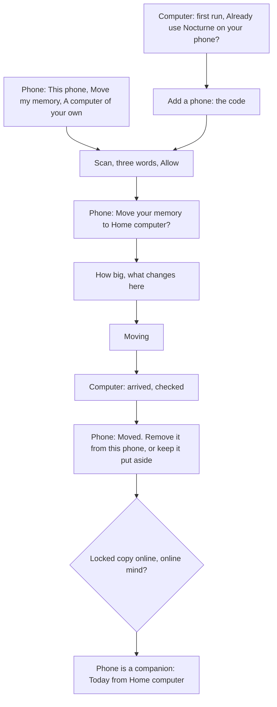

# Moving your memory

Part of [Phone and computer as equal starting points](phone-parity.md). A memory lives in one place
at a time. Moving it is how a person goes up the ladder and back down: a phone alone to a laptop, a
phone into a household, a household to a computer of their own, a computer back to a phone.

Status: proposed. Nothing here is built.

## Mockups

| Screen | File and states | Renders |
|---|---|---|
| On the phone | `move.html`: `found`, `size`, `moving`, `moved` | `move-found-light.png`, `move-size-light.png`, `move-moving-light.png`, `move-moved-light.png`, `move-moved-dark.png` |
| On the computer | `desktop-move.html`: `receive`, `done` | `desktop-move-receive-light.png`, `desktop-move-done-light.png`, `desktop-move-receive-dark.png` |

## One home holds the pen

The home is the one place that writes the memory and runs its tidy. Everywhere else reads it, or
keeps things waiting to go across. A move hands the pen over once.

```mermaid
sequenceDiagram
    participant O as Old home
    participant N as New home
    O->>O: a last copy, everything waiting written in
    O->>N: the copy and its originals, sealed (or N opens the locked copy online)
    N->>N: the backup checks from 0013; anything already here is put aside
    N-->>O: arrived, every count matches
    O->>O: its memory is put aside, read only
    Note over O: the person confirms, then it is deleted, or kept put aside for 30 days
```

| Rule | Detail |
|---|---|
| What moves | Everything: what was kept, what Nocturne remembers and what is fading, every page, the journal, check-ins, settings that belong to the memory, things marked private (locked like the rest). The same as a backup ([Back up and restore](backup-and-restore.md#what-is-in-a-backup)) |
| What stays | The old home's own settings: its mind, its connection, its phones list |
| How it travels | Over the sealed channel between the two, using the backup format; or, when the old home is a phone with a locked copy online, the new home may open that copy with the passphrase instead |
| Nothing read again | When both homes find things the same way, nothing is read again. When they don't, the new home gets each thing ready again in the background, and finding by words works meanwhile |
| Nothing deleted early | The old home's memory is put aside, read only, once the new home has it and every count matches. It is deleted only when the person confirms |
| No merging | A home that already holds a memory is offered 0013's choice: put what is here aside and take the new one, or keep this one and move nothing |
| After | A phone whose memory left becomes a companion of the new home (or a phone alone again, if the memory came to it) |

## The moves

### From a phone to a computer



The computer's first run gains one question before its step 1: "Already use Nocturne on your
phone?" with "Yes, bring my memory here" and "No, start fresh". Yes goes straight to Add a phone and,
once paired, to the move. A computer that is already set up offers the move whenever a phone that
holds its own memory is added.

### From a phone to a household

Joining with "Keep my memory there" ([Household](household-server.md#joining)), then the same move,
with the household computer as the new home and its own per-person store locked with this phone's
key.

### From a household to a computer

From This phone, "Move my memory…", "A computer of your own". The phone pairs with the computer,
then asks the household computer to send the memory. It travels from the household computer to the
new computer through the phone's sealed sessions with each, so the household computer never pairs
with the new one. When it has arrived: "Delete your memory from {household}?".

### Back to the phone

From a household: "Leave this household…", "To this phone". From a computer of one's own:
Settings, "Your data", "Move my memory to a phone…", choosing one paired phone. Both check room on
the phone first, since photos and recordings can be large. The phone becomes a phone alone. On a
computer, the done screen offers "Keep using this computer’s mind", which turns on Household and adds
that phone as borrowing its mind, so the page does not stop.

## Afterwards

| Thing | When the memory leaves a phone | When the memory comes to a phone |
|---|---|---|
| The phone | A companion of the new home | A phone alone, its mind "None yet" unless the person chooses one |
| The old memory on the phone | Put aside; the person removes it or keeps it put aside for 30 days | Not applicable |
| A locked copy online | Turned off. "Delete the copy online" or "Keep it as it is" ([decision 19](phone-parity.md#decisions-for-the-owner)) | Offered: "Keep a locked copy online?" |
| Its online mind | Turned off on the phone. The computer has its own mind, and Online answers can be set up there | Offered: "Choose a mind" |
| Calendar and health | Keep coming, now to the new home | Stay on the phone |
| The Sent online list | Moves with the memory | Moves with the memory |

## Screens

### Move your memory to {computer}?

| Part | Copy |
|---|---|
| Title | "Move your memory to {computer}?" |
| Lead | "{computer} becomes the home of your memory. It reads, tidies and writes your page from now on." |
| Then | "This phone then works with {computer}: keep, ask and read your page from here." |
| One home | "Your memory lives in one place at a time, so it moves rather than copies." |
| Bar | "Continue" · "Not now" |

For a household: "{household}" in place of "{computer}", and "keeps your memory, locked with a key
this phone holds" after "becomes the home of your memory".

### How big, and what changes here

| Part | Copy |
|---|---|
| Title | "What moves" |
| Counts | "{count} things you kept since {date}" · "{count} pages and your journal" · "About {size}, most of it photos and recordings" |
| Time | "About {minutes} minutes on this connection. Keep Nocturne open; it carries on if the phone allows." |
| After, on this phone | "Your memory here is put aside once it has arrived. You choose then whether to remove it." |
| Locked copy line, when on | "Your locked copy online stops being made. You choose then whether to delete it." |
| Online mind line, when on | "Nocturne’s mind online turns off on this phone. {computer} has its own." |
| Bar | "Move my memory" · "Back" |

### Moving

| Part | Copy |
|---|---|
| Title | "Moving your memory" |
| Progress | "{done} of {size}" |
| Note | "You can still keep things. They go across at the end." |
| Cancel | "Stop" with "Stop moving? Nothing has changed here, and {computer} keeps nothing of it." |

### Moved

| Part | Copy |
|---|---|
| Title | "Your memory is on {computer}." |
| Body | "{count} things arrived, and every count matches. This phone now works with {computer}." |
| Choice heading | "Your memory on this phone" |
| Choice | "Remove it from this phone" (selected) / "Keep it put aside for 30 days" |
| Copy choice, when on | "Your locked copy online" / "Delete the copy online" · "Keep it as it is" |
| Button | "Done" |

### On the computer: a phone with its own memory

| Part | Copy |
|---|---|
| Title | "{name} has its own memory. Move it here?" |
| Counts | "{count} things kept since {date} · about {size}" |
| Lead | "This computer becomes its home: it reads, tidies and writes the page. {name} then works with it like your other phones." |
| Already a memory here | "This computer already holds a memory. A computer holds one person’s memory. Move {name}’s here and put what is here aside, or keep what is here and move nothing." |
| Buttons | "Move it here" · "Not now"; with a memory here: "Put this aside and move it here" · "Keep what’s here" |
| Arriving | "Arriving from {name} · {done} of {size}" |
| Checking | "Checking · every count must match before {name} lets go of it" |

"Keep what’s here" leaves the phone as it was, with "Move my memory" still in its This phone.

### On the computer: arrived

| Part | Copy |
|---|---|
| Title | "The memory from {name} is here." |
| Body | "Reading carries on from where it was. Nothing is read again." |
| Body, finding differs | "This computer finds things its own way, so it gets each thing ready again over the next while. Finding by words works meanwhile." |
| Online answers line | "To have answers written online here, set up Online answers in {settings}." |
| Button | "Open today’s page" |

### On the computer: move my memory to a phone

| Part | Copy |
|---|---|
| Row in Your data | "Move my memory to a phone…" / "Your phone becomes its home. This computer then keeps nothing of yours." |
| Choose | "Which phone?" with each paired app phone and its free room |
| Too big | "{name} has {free} free and your memory needs about {size}. Free some room on {name}, or move it somewhere else." |
| Done | "Your memory is on {name}." / "What was here is put aside until you remove it." / "Keep using this computer’s mind" · "Remove it from this computer" |

## States

| State | What shows |
|---|---|
| Connection lost while moving | "Moving paused. It carries on when {computer} is back." Nothing is put aside until it completes |
| Counts don't match | "Something didn’t arrive whole, so nothing changed. Try again." with "Try again" |
| Not enough room on the new home | The too-big line, before anything moves |
| New home has a newer Nocturne | Moves normally |
| New home has an older Nocturne | 0013's newer-Nocturne words: "Update Nocturne on {computer}, then try again. Nothing was changed." |
| The phone is lost before confirming | The computer has the memory; the phone's put-aside memory is only on the lost phone, and removing the phone in Away from home stops it at once |
| Two homes try to take the pen | The newer claim wins; the old home's unsent things still go across as waiting things, never as a second memory |

## Copy

| Key | Copy |
|---|---|
| First run question | "Already use Nocturne on your phone?" / "Yes, bring my memory here" / "No, start fresh" |
| Found | "Move your memory to {computer}?" / "{computer} becomes the home of your memory. It reads, tidies and writes your page from now on." / "This phone then works with {computer}: keep, ask and read your page from here." / "Your memory lives in one place at a time, so it moves rather than copies." |
| Found, household | "keeps your memory, locked with a key this phone holds" |
| What moves | "What moves" / "{count} things you kept since {date}" / "{count} pages and your journal" / "About {size}, most of it photos and recordings" / "About {minutes} minutes on this connection. Keep Nocturne open; it carries on if the phone allows." |
| What changes | "Your memory here is put aside once it has arrived. You choose then whether to remove it." / "Your locked copy online stops being made. You choose then whether to delete it." / "Nocturne’s mind online turns off on this phone. {computer} has its own." |
| Buttons | "Move my memory" / "Back" / "Not now" |
| Moving | "Moving your memory" / "{done} of {size}" / "You can still keep things. They go across at the end." / "Stop" / "Stop moving? Nothing has changed here, and {computer} keeps nothing of it." |
| Moved | "Your memory is on {computer}." / "{count} things arrived, and every count matches. This phone now works with {computer}." / "Your memory on this phone" / "Remove it from this phone" / "Keep it put aside for 30 days" / "Your locked copy online" / "Delete the copy online" / "Keep it as it is" / "Done" |
| Leaving a household | "Delete your memory from {household}?" |
| Computer, receive | "{name} has its own memory. Move it here?" / "{count} things kept since {date} · about {size}" / "This computer becomes its home: it reads, tidies and writes the page. {name} then works with it like your other phones." |
| Computer, already | "This computer already holds a memory. A computer holds one person’s memory. Move {name}’s here and put what is here aside, or keep what is here and move nothing." / "Put this aside and move it here" / "Keep what’s here" / "Move it here" |
| Computer, arriving | "Arriving from {name} · {done} of {size}" / "Checking · every count must match before {name} lets go of it" |
| Computer, arrived | "The memory from {name} is here." / "Reading carries on from where it was. Nothing is read again." / "This computer finds things its own way, so it gets each thing ready again over the next while. Finding by words works meanwhile." / "To have answers written online here, set up Online answers in {settings}." / "Open today’s page" |
| Computer, to a phone | "Move my memory to a phone…" / "Your phone becomes its home. This computer then keeps nothing of yours." / "Which phone?" / "{name} has {free} free and your memory needs about {size}. Free some room on {name}, or move it somewhere else." / "Your memory is on {name}." / "What was here is put aside until you remove it." / "Keep using this computer’s mind" / "Remove it from this computer" |
| States | "Moving paused. It carries on when {computer} is back." / "Something didn’t arrive whole, so nothing changed. Try again." / "Try again" / "Update Nocturne on {computer}, then try again. Nothing was changed." |
