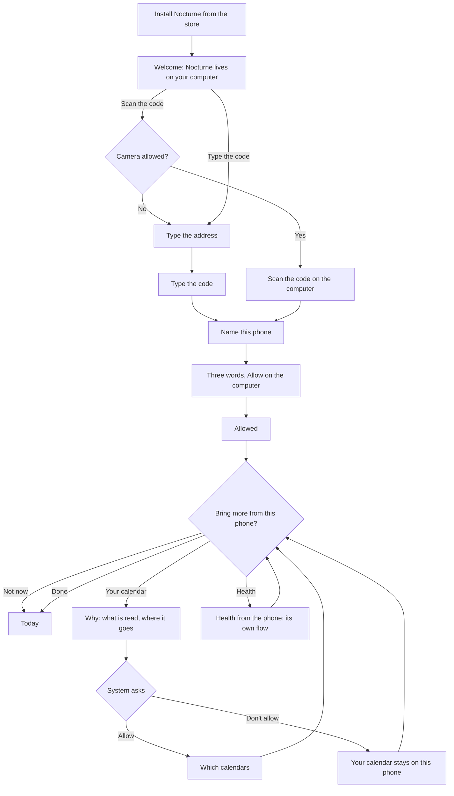
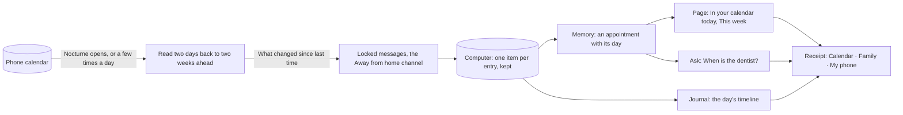

# Nocturne on Android and iPhone

Today a paired phone uses Nocturne through a page its browser keeps, served by the computer over
Away from home ([decision 0010](/adr/0010-away-from-home.md)). That page cannot read the phone's
calendar or health readings, it has to be added to the home screen by hand, and in Simple its code
comes through Cloudflare, which decision 0010 lists as a known limitation with "a native phone app"
as the long-term fix.

This page proposes that app, for Android and for iPhone. It is the same Nocturne on the phone: the
same screens, words and rules as the phone page, inside a real app that follows each platform's
own conventions. It adds two things the browser could never do, both optional and both read only:
bringing the phone's calendar and its health readings to the computer, where they show on the
morning page and beside the journal. Health has its own page, [Health from the phone](phone-health.md).

Status: approved. The owner accepted every recommendation on 2026-11-21. Nothing here is built yet. A feasibility build showed that Tauri 2 runs the existing
phone screens unchanged on Android, and that a small native piece reads the phone's calendar on
Android and the calendar on a Mac. See [Decisions for the owner](#decisions-for-the-owner).

## Mockups

In `docs/design/mockups/phone-apps/` and `docs/design/mockups/phone-health/`. Each HTML file
imports the app's own stylesheet for tokens and fonts, through the journaling kit, so serve the
repository root over HTTP after `make ui/install` and open the files there. Add `?state=` to pick a
view and `&theme=light` or `&theme=dark`. `index.html` in each folder links every view. Phone
screens show Android (412 by 892) and iPhone (393 by 852) side by side, rendered 920 by 1000. The
computer's screens are 1280 wide, full length. A dashed outline marks what is new on an existing
screen; it is not part of the design.

| Screen | File and states | Renders |
|---|---|---|
| First run and pairing | `pair.html`: `welcome`, `scan`, `camera-off`, `type`, `type-name`, `type-wrong`, `type-lost`, `type-code`, `words`, `allowed` | `pair-welcome-light.png`, `pair-welcome-dark.png`, `pair-scan-light.png`, `pair-camera-off-light.png`, `pair-type-light.png`, `pair-type-name-light.png`, `pair-type-wrong-light.png`, `pair-type-lost-light.png`, `pair-type-code-light.png`, `pair-words-light.png`, `pair-allowed-light.png` |
| Bringing the calendar | `calendar.html`: `offer`, `why`, `system`, `no`, `pick` | `calendar-offer-light.png`, `calendar-why-light.png`, `calendar-why-dark.png`, `calendar-system-light.png`, `calendar-no-light.png`, `calendar-pick-light.png` |
| Today, the page | `today.html`: `page`, `away`, `update-phone`, `update-computer` | `today-page-light.png`, `today-page-dark.png`, `today-away-light.png`, `today-update-phone-light.png`, `today-update-computer-light.png` |
| The journal | `journal.html`: `day` | `journal-day-light.png`, `journal-day-dark.png` |
| Keeping, and keeping from other apps | `keep.html`: `keep`, `share` | `keep-keep-light.png`, `keep-share-light.png` |
| This phone | `settings.html`: `phone`, `calendar`, `stopped`, `revoked` | `settings-phone-light.png`, `settings-phone-dark.png`, `settings-calendar-light.png`, `settings-stopped-light.png`, `settings-revoked-light.png` |
| The computer's page with the calendar | `desktop-page.html`: `page` | `desktop-page-light.png`, `desktop-page-dark.png` |
| From your phones, on the computer | `desktop-sources.html`: `sources`, `came-in`, `item`, `delete`, `remove`, `add-phone` | `desktop-sources-light.png`, `desktop-sources-dark.png`, `desktop-came-in-light.png`, `desktop-item-light.png`, `desktop-delete-light.png`, `desktop-remove-light.png`, `desktop-add-phone-light.png` |

Health screens and their renders are listed in [Health from the phone](phone-health.md#mockups).

## Goals

1. **The same Nocturne, as a real app.** Installed from the store, opened from the home screen,
   paired from inside the app. Nothing to add to the home screen by hand, no browser address bar.
2. **Each platform's own feel.** Material 3 on Android and Apple's Human Interface Guidelines on
   iPhone for navigation, controls, sheets, permission prompts and gestures, with Nocturne's own
   colours, type and words throughout.
3. **The phone's calendar on the page.** "What's on today" and the coming days, from the calendar
   the person already keeps on their phone, with no sign-in to any calendar company.
4. **Health beside the journal.** Sleep, heart rate and a few more readings from Apple Health or
   Health Connect, shown where they help and never as medical advice ([Health from the phone](phone-health.md)).
5. **A working no.** Every ask can be refused and Nocturne keeps working, with a plain way back.
6. **Nothing new leaves home.** Phone data travels only over the sealed phone-to-computer channel
   Away from home already has. No account, no hosted service, no counting of use.

Not goals: a phone that works without a computer, a copy of the memory on the phone, notifications,
writing to the calendar or to Health, a watch app, widgets.

## What changes and what stays

| Part | The phone page today | The app |
|---|---|---|
| Getting it | Scan the computer's code with the camera, the browser opens the page, add it to the home screen | Install "Nocturne" from Google Play or the App Store, open it, scan or type the code inside the app |
| Where its code comes from | The computer, through the connection (in Simple, Cloudflare carries it) | The store, signed; the connection carries only locked messages |
| Pairing | Code, name, three words, Allow on the computer | Unchanged, inside the app |
| A new address in Simple | Re-link code or four words, from inside the home screen page | Unchanged, inside the app |
| Keep, Ask, Today's page, Journal, check-in, the page's question | As designed | Same screens and words, in native navigation |
| Keeping from other apps | Not possible on iPhone; Android only through the browser | "Nocturne" in every app's share menu, on both |
| Calendar and health | Not possible | Optional, read only, sent to the computer |
| Offline | Keeps wait on the phone; nothing else | Unchanged. The phone still keeps no copy of the memory |
| Updates | Always matches the computer, which serves it | Updated by the store, so phone and computer can drift: see [Please update](#please-update) |
| Notifications, lock screen, reading aloud | None | None |

The phone page stays available for anyone who does not install the app ([decision 4](#decisions-for-the-owner)).

## Each platform, the same Nocturne

The platform decides how things move and how controls look. Nocturne decides colour, type, words
and what is on each screen.

| Part | Android (Material 3) | iPhone (Human Interface Guidelines) | Nocturne's own, on both |
|---|---|---|---|
| Top level | Navigation bar at the bottom: Today, Journal, Ask, each an icon and a label, the current one in a pill | Tab bar at the bottom: Today, Journal, Ask, the current one tinted | Three places, in this order, named as on the phone page |
| Keep | Extended floating button "Keep" at the bottom right on Today and Journal | A round "Keep" button at the bottom right on Today and Journal, the way Notes places its new-note button | The word "Keep" and the plus mark; the main action on the main screens |
| This phone (settings) | Icon button at the right of the top app bar | "This phone" button at the right of the navigation bar | Same rows and words |
| Titles | Top app bar, title at the left, shrinks on scroll | Large title that shrinks into the navigation bar | Newsreader for the page's title and dates; IBM Plex Sans for everything else |
| Back | System back gesture and the arrow in the top bar | Swipe from the left edge and "‹ {previous}" | Same screens in the same order |
| Buttons | Full-round buttons, 52 tall for the main one | Rounded rectangle buttons, 52 tall for the main one | Ink fill for the main action, an outline for the second, accent text for links |
| Lists and settings | Full-width rows with section headings | Inset grouped rows with a chevron to open more | Same labels, hints and order |
| Switches | Material switch | iPhone switch | On is ink, off is the rule colour |
| Sheets | Bottom sheet with a grab handle | Sheet with a grab handle, medium then large | The check-in's words, sharing in, confirmations |
| Confirmations | Material dialog, buttons at the right | Alert, buttons stacked or side by side | Same words; the careful button never the default |
| Permission prompts | The system's own dialog, after Nocturne's screen | The system's own alert, with Nocturne's purpose string | One Nocturne screen first, in plain words, with "Not now" |
| Haptics | Light tick when a check-in point crosses a part | Selection feedback, same moment | A hint only, follows the phone's setting |
| Text size | Follows the phone's font size | Follows Dynamic Type | Nothing cut off up to 200 per cent |
| Dark mode | Follows the phone | Follows the phone | The app's own dark tokens |
| Colours from the wallpaper | Not used | Not applicable | Nocturne's paper and ink stay the same everywhere |

## Journeys

What happens to a calendar entry once it is on the phone:

## Screens

The copy in quotes is the proposed interface copy. Curly braces are values. `{settings}` and
similar names in braces are control chips ([Control chips](control-chips.md)). Where a string already
exists on the phone page it is reused as it is and marked "Phone page".

### 1. Install and the store listing

| Part | Copy |
|---|---|
| Name | "Nocturne" |
| Short description (Google Play, 80 characters at most) | "Keep, ask and read your morning page while you’re out. Works with your computer." |
| Subtitle (App Store, 30 characters at most) | "Keep and ask while you’re out" |
| First lines of the description | "Nocturne on your phone works with Nocturne on your computer. Your memory stays on your computer. This app lets you keep a note, a photo or a voice note, ask a question and read today’s page while you’re out. It needs Nocturne on your computer, with Away from home turned on." |
| Optional extras, in the description | "If you choose, it can also bring your phone’s calendar and health readings to your computer, so they show on your morning page and beside your journal. Both are read only, and both go only to your computer." |
| What it does not do, in the description | "No account. No sign-in. No ads. Nothing is sent to anyone but your own computer." |

The screenshots are the mockups' Today, Journal, Keep and the calendar on the page, with the
fictional data used here.

### 2. Welcome

The app opens here until it is paired. One screen, two ways in.

| Part | Copy |
|---|---|
| Mark and title | "Nocturne lives on your computer" |
| Lead | "This app lets you keep things, ask and read your page while you’re out. It works with Nocturne on your computer." |
| Steps | "1. On your computer, open Nocturne and choose {settings}, then {awayFromHome}, then {addAPhone}." / "2. Scan the code it shows, or type the address and the code." |
| Main button | "Scan the code" |
| Second button | "Type the code" |
| Foot | "No account and no sign-in. This phone keeps no copy of your memory." |
| Link | "No Nocturne on your computer yet?" opens the project's site in the phone's browser |

Waiting things from before (the app was disconnected or removed) show above the buttons with the
phone page's "{count} things are still waiting on this phone."

### 3. Pairing

The protocol is the one in [Remote access](/architecture/remote.md#pairing), unchanged: one code, a
name, three words compared on both screens, Allow on the computer. Only the way in changes.

**Scan.** "Scan the code" asks for the camera the first time, with the system's own prompt (see
[The asks](#4-the-asks)). The scanner fills the screen, with "Scan the code", "Point at the code on
your computer’s screen, under {addAPhone}." and "Nocturne uses the camera only while this is open,
and keeps no pictures." (Phone page). "Type the code instead" sits at the bottom. A code that is
not from Nocturne: "That isn’t a code from your computer. Try again." (Phone page).

The computer's code is the same for the app and the phone page. Scanned inside the app, the app
reads it. Scanned with the phone's own camera, it still opens the phone page in the browser, which
gains one line: "Got the Nocturne app? Open it and choose Scan the code instead."

**Camera refused.** "The camera is off for Nocturne." and "Allow it in your phone’s settings, or
type the code instead." with "Open phone settings" and "Type the code". On iPhone after one refusal,
and on Android after two, only the phone's settings can turn it back on, so the first button is
the way back.

**Type.** A scanned code carries the computer's address; typing does not, and the app has no page
address to borrow as the phone page does. So typing takes two screens, the address first.

| Screen | What it asks | Copy |
|---|---|---|
| Address | One field, "Your computer’s address". Four words (Simple) or a full name (Most private), told apart by the dots in a name. Spaces, dashes and capitals are fine | Title "Your computer’s address". "On your computer, under the code, find the four words or the name. Type it here." Hint "Simple shows four words. Most private shows a name. Capitals don’t matter." Placeholder "Four words, or a name". Buttons "Next" and "Scan the code instead" |
| Code | The 24 characters in four groups of six | Title "Type the code". "Now the 24 letters and numbers under the address on your computer." "Capitals don’t matter." Buttons "Connect" and "Scan the code instead" |

"Next" stays dim until the field holds four words or something shaped like a name. On "Next" the
app asks the address whether it answers, then moves to the code. The typed code carries the same
secret as the scanned one. Wrong or unreachable addresses keep the person on the address screen
with what they typed still in the field, and the message under it (see [States](#states)).
The re-link path ("Type the four words") is unchanged.

**Name and three words.** As on the phone page: "Name this phone", "Your computer shows this name in
its list of phones, so pick one you’ll recognise.", then "Check your computer shows the same three
words." with the warning about a computer asking to allow a phone that is not showing three words.
The default name is the phone's own name where the platform gives it (Android's device name;
iPhone gives only "iPhone"), else "My phone".

**Allowed.** "{name} can now use Nocturne." and "Keep, ask and read your page from here." The phone
page's "Add to home screen" steps are gone. One button, "Continue", leads to the offer below.

**Offer: bring more from this phone.** Shown once after pairing, and reachable later from This
phone. Both rows start off.

| Part | Copy |
|---|---|
| Title | "Bring more from this phone?" |
| Lead | "Your computer can show what’s in this phone’s calendar and health readings, on your page and beside your journal. Both are optional. You can change your mind any time in {thisPhone}." |
| Calendar row | "Your calendar" / "What’s on today and the next two weeks, on your page." / "Choose ›" |
| Health row | "Health" / "Sleep, heart rate and a few more, beside your journal." / "Choose ›" |
| Main button | "Done" |
| Second button | "Not now" |
| After choosing, a row says | "On · {count} calendars" / "On · {count} kinds" / "Not brought" |

**Re-link in Simple.** When the computer has a new address, Today shows the phone page's banner
and "Has your computer got a new address?" with "Scan the new code" and "Type the four words",
both inside the app. The phone page's "Open Nocturne from your home screen" step is gone.

### 4. The asks

Every ask that touches something personal follows the same three steps: Nocturne's own screen in
plain words, then the system's prompt, then a screen for either answer. Asks come when the person
reaches the thing that needs them, never at start-up.

| Ask | When | Nocturne's screen first | The system's prompt |
|---|---|---|---|
| Camera | First "Scan the code", first "Photo" in Keep | No: the reason is plain at that moment. iPhone shows the purpose string | Android: allow while using the app / only this time / don't allow. iPhone: Allow / Don't Allow |
| Microphone | First "Record" in Keep or the check-in | No: same reason | Same |
| Photos | Never | Not needed: Nocturne uses the system's photo picker, which needs no permission | None |
| Calendar | "Your calendar" in the offer or in This phone | Yes, below | Android: allow / don't allow. iPhone 17 and later: full access / don't allow |
| Health | "Health" in the offer or in This phone | Yes: [Health from the phone](phone-health.md#connecting-health-on-the-phone) | Health Connect's own screen, or Apple Health's own sheet |
| Notifications | Never | Not asked: the app has none | None |
| Location, contacts, files | Never | Not asked | None |

**Calendar: why, first.** This is the store's prominent disclosure, and it is also how Nocturne
talks.

| Part | Copy |
|---|---|
| Label | "Your calendar" |
| Title | "Bring your calendar to your computer?" |
| What is read | "Nocturne reads what’s in this phone’s calendar: each appointment’s title, time, place and who’s invited, from two days ago to two weeks ahead." |
| Where it goes | "It goes only to your computer, the same way as everything this phone keeps: in locked messages only your computer can open. Nocturne has no account and keeps nothing anywhere else." |
| What it is for | "Your page shows what’s on today and this week, and Ask can answer “When is the dentist?” Each line shows which calendar it came from." |
| Never | "Nocturne never adds, changes or deletes anything in your calendar." |
| Next | "Next, your phone asks if Nocturne may see your calendar." |
| Main button | "Continue" |
| Second button | "Not now" |
| Link | "Privacy policy" |

**The system's prompt.** Android shows "Allow Nocturne to access your calendar?". iPhone shows
"“Nocturne” Would Like Full Access to Your Calendar" with the purpose string:

> "Nocturne reads your calendar so your computer can show what’s on today on your morning page. It
> never changes your calendar."

**Allowed.** "Which calendars?" opens (see [This phone](#9-this-phone)), then back to the offer.

**Refused, or "Not now".**

| Part | Copy |
|---|---|
| Title | "Your calendar stays on this phone." |
| Body | "Nocturne works just the same without it. You can bring it later in {thisPhone}." |
| Button | "OK" |

Nothing is asked again on its own. In This phone the calendar row reads "Not brought", and opening
it starts the same three steps. When the system will no longer show its prompt (refused twice on
Android, once on iPhone), the row reads "Off in your phone’s settings" and the screen offers "Open
phone settings" in place of "Continue".

### 5. Today

The first tab. It is the phone edition of the morning page, as on the phone page, with what the
calendar and health add.

| Part | What shows |
|---|---|
| Top bar | The Nocturne mark and "Today", and This phone at the right |
| Status | "Connected to {name}" (Phone page) |
| Date | "{weekday} {day} {month}" |
| Page title and deck | As on the computer's phone edition |
| Last night | When sleep is brought: "Last night · {duration} asleep" and the night's bar ([Health from the phone](phone-health.md#on-the-page)) |
| In your calendar today | Up to five rows, time on the left, then the title, then the place in the secondary ink; "{count} more today" when there are more. All-day entries first, as "All day". Each row's receipt chip says "Calendar · {calendar}" |
| The page's sections | As on the phone page: what changed, needs you, let go, the question |
| Foot | "Things you marked private stay on your computer." (Phone page) |
| Keep | The floating Keep button |

"In your calendar today" comes from the computer's page, so it holds what every paired phone
brought, not only this one. When no phone brings a calendar, the section is not shown.

### 6. The journal

The second tab. The screens, rules and words of [Journaling](journaling.md#12-the-phone) and
[The journal question on the phone](phone-journal-question.md), in native navigation: today's
timeline, the entry card, the check-in, a day looked back on, recaps and "Which {name} is this?".

Two additions:

- **Calendar rows on the timeline.** An appointment in the day shows at its time as a quiet row:
  the calendar mark, the title, and "from your calendar" in the secondary ink. They help the person
  see the day's shape; they are plans, not things kept, so they never count in "{count} kept today".
- **Health beside the day.** Last night's sleep beside the morning check-in, workouts as rows, and
  a small strip of the day's readings: see [Health from the phone](phone-health.md#in-the-journal).

### 7. Ask

The third tab. Unchanged from the phone page in shape and words. Answers may cite a calendar entry
("Calendar · Family · My phone"), which opens its own page.

### 8. Keep, and keeping from other apps

**Keep.** The floating button opens the phone page's Keep screen as a full-height sheet: the box,
"Photo" and "Record", the feeling row and "This is a good thing" ([Journaling](journaling.md#12-the-phone)).
"Photo" offers "Take a photo" and "Choose a photo", the second through the system's picker.

**From other apps.** Nocturne appears in every app's share menu as "Nocturne". Sharing text, a link,
a photo, a document or a voice memo opens a sheet over the other app:

| Part | Copy |
|---|---|
| Title | "Keep in Nocturne" |
| Preview | The text, or the photo, or the file's name and size |
| Note | "Add a note (optional)" |
| Feeling row | "How does it feel? (optional)" (Phone page) |
| Button | "Keep" |
| Kept | "Kept." and "It’s on today’s journal. Your computer reads it shortly." (Phone page) |
| Computer away | "Waiting." and the phone page's waiting words |

Shared pages from the web are kept as untrusted, as pasted web content already is
([Data model](data-model.md#trust-by-source)).

**From the app icon.** A long press on the icon offers "Keep a note", "Record a voice note" and
"Check in", each opening that screen directly. The words are the same on both platforms.

### 9. This phone

Opened from the top bar on every tab. It replaces the phone page's "This phone" sheet with a full
settings screen, grouped as each platform groups settings.

| Group | Row | Value or hint |
|---|---|---|
| Connected to | "{computer name}" | "Simple, through Cloudflare" or "Most private, through Tailscale" (Phone page) |
| What this phone brings | "Your calendar" | "On · {count} calendars", "Not brought" or "Off in your phone’s settings" |
| | "Health" | "On · {count} kinds", "Not brought" ([Health from the phone](phone-health.md#on-the-phone)) |
| | "Last sent" | "{time} · {count} calendar changes, {count} readings" |
| When it sends | "While Nocturne is open" | Always. Hint: "And when you open it." |
| | "Also a few times a day" | A switch, per [decision 2](#decisions-for-the-owner). Hint: "So last night’s sleep reaches your page before you open the app. Uses a little battery." |
| This phone | "Name" | "{name}" and "Rename it on your computer" (Phone page) |
| | "Version" | "Nocturne {version}" and, under it, "Your computer: Nocturne {version}" |
| Help | "Privacy policy" | Opens the policy page in the browser |
| | "What this phone can do" | "This phone can ask, keep and read today’s page. It can’t delete, forget, export or change settings." (Phone page) |
| At the end | "Disconnect this phone…" | As on the phone page |

**Your calendar.** The screen behind the calendar row.

| Part | Copy |
|---|---|
| Switch | "Bring my calendar" |
| Hint | "Two days back to two weeks ahead, read only." |
| List heading | "Which calendars" |
| Each row | The calendar's name and colour dot as the phone shows them, with a switch |
| Note under the list | "Holidays and birthdays start off, because they fill the page without saying much." |
| Notes switch | "Notes on each appointment" / "Usually call links and dial-in numbers. Off keeps your page tidy." |
| Last sent | "Last sent {time} · {count} appointments" |
| Already sent | "What already went across stays on your computer. To delete it, use {fromYourPhones} there." |

Turning "Bring my calendar" off stops sending at once and says "Stopped. Nothing more goes across."
The phone cannot delete what the computer already has, as a phone cannot delete anything.

**Stopped on the computer.** When the computer has stopped taking the calendar from this phone:
"Your computer isn’t taking your calendar from this phone." and "Turn it back on there, under
{fromYourPhones}." The switch stays as the person left it; nothing is read or sent.

**Off in the phone's settings.** When the permission was taken back in the phone's settings:
"Calendar is off in your phone’s settings." and "Nothing is read until you turn it back on there."
with "Open phone settings".

## States

| State | What shows |
|---|---|
| Connecting | "Connecting to {name}…" (Phone page) in the status line; the tabs work from what is already open |
| Computer asleep or unreachable | The phone page's banner, "{name} is asleep, switched off or has a new address.", on Today and Journal. Today reads "Today’s page is back when your computer is. This phone keeps no copy." Keep works and waits, with "{count} waiting". Calendar and health changes wait too, and only the latest version of each goes across |
| Address incomplete, in the app | Under the field: "Type all four words, or the full name." "Next" stays dim |
| Address did not answer, in the app | Under the field: "That address didn’t answer. Check the words, and that your computer is awake." (Most private: "That address didn’t answer. Check the name, and that Tailscale is on for this phone."). What was typed stays; nothing moves on |
| New address (Simple) | The re-link banner, with "Scan the new code" and "Type the four words" |
| Please update this phone | See [Please update](#please-update) |
| Please update the computer | See [Please update](#please-update) |
| Removed on the computer | The phone page's "This phone was removed from Nocturne." with its waiting rules. Calendar and health stop; nothing more is read |
| New computer key or Delete everything | "Can’t connect", as decision 0010 says; Welcome offers to pair again |
| A permission taken back | The row in This phone says so; Today and Journal show nothing missing and no warning |

### Please update

Phone and computer now update apart. Each side says which versions of the phone channel it speaks,
and they use the newest both know.

| Case | On the phone | On the computer |
|---|---|---|
| Both speak a shared version, and both are current | Nothing | Nothing |
| Shared version, but the computer lacks something the phone offers (for example, calendar) | That row in This phone: "Needs a newer Nocturne on your computer." The offer hides it | Nothing |
| Shared version, the phone is older than the computer's newest | Nothing until the next row applies | In the phones list: "{name} · an update is ready for it" |
| No shared version, the phone is older | A card on Today: "Update Nocturne on this phone", "Your computer has a newer Nocturne that this version can’t talk to. What you keep waits here until you update.", "Update in Google Play" or "Update in the App Store", and "Your computer: Nocturne {version} · This phone: Nocturne {version}" | In the phones list: "{name} needs an update before it can connect" |
| No shared version, the computer is older | A card on Today: "Update Nocturne on your computer", "This phone has a newer Nocturne than your computer. What you keep waits here until your computer is updated." and the two versions | Nothing can reach it; the phone's attempts are noted in the activity list as "{name} needs a newer Nocturne here" |

Keeping always works while waiting, because keeps wait on the phone. A newer computer keeps
speaking the previous phone version for at least six months after a release that changes it, so a
phone that updates now and then never meets the card.

## Behaviour

**When the phone sends.** While Nocturne is open on the phone, and each time it is opened, it
sends what changed in the calendar and in Health since the last send. With "Also a few times a day"
on, it does the same in the background when the phone allows it (Android's scheduled work, iPhone's
background refresh), which the phone decides and may skip. Nothing is ever sent while Away from
home is off on the computer.

**What a calendar entry carries.** The title, start and end with their time zone, all-day or not,
the place, the names of the people invited, the calendar's name and colour, whether it repeats,
the phone's own id for it, and the notes only when "Notes on each appointment" is on. Repeating
entries go as the separate days they fall on inside the window.

**What is left out.** Invitations the person has not answered or has declined, and calendars that
are switched off. The person's own response to an invitation is not sent.

**The window.** Two days back to two weeks ahead, read again each time. An entry that moves or
changes is sent again; one that is deleted or cancelled on the phone is sent as gone.

**On the computer.**

| What arrives | What the computer does |
|---|---|
| A new entry | One item on the tape, kind `calendar`, trusted, with the phone as its source. Its title is read for people and places like any item. It becomes one memory: an appointment with its day and time, which does not fade before its day ([Data model](data-model.md#status-lifecycle)) |
| A changed entry | A new version of the item that replaces the old one, read again through the same path as an edited journal block. The page's "What changed" can say "Dentist moved from Wednesday to Thursday, in your calendar." |
| A cancelled or deleted entry | The memory is closed, never deleted: its valid time ends and the page's "What changed" can say "Dentist on Thursday was cancelled in your calendar." The item stays, marked "Removed from your calendar", until the person deletes it |
| The same appointment from a kept letter and the calendar | One memory with both receipts, like any claim two items make the same way |
| A kept note and the calendar disagree | "Which is right?" in Needs you, as for any two items that disagree |
| An entry in a time zone other than the computer's | Shown in the computer's time, with "{time} in {place}" when the zone differs |
| More than 500 entries in one send | Only the first 500 are taken, and This phone says "Too many to bring at once. Choose fewer calendars." |

Past appointments from the calendar fade and are let go like any memory, but the page's "Let go"
section leaves them out: a dentist's appointment that happened needs no goodbye. They are listed in
Fading & let go as usual.

**Receipts.** Every page line, journal row and answer that comes from the calendar cites its item.
The receipt chip reads "Calendar · {calendar} · {phone}" and opens the item's own page: the title,
day and time, place, people, the calendar's name, "From {phone}’s calendar · last updated {time}",
earlier versions when it changed ("Was {old day and time}"), and "Delete…".

**Ask.** Calendar memories answer questions like any other, cited. With Online answers on, an
appointment's sentence may go with a question it helps answer, like any kept sentence; one that
looks like health, money or ID (a clinic, a bank, a passport office) is kept back by the same check
unless the person chose otherwise ([decision 0011](/adr/0011-online-answers.md)).

## On the computer

### Adding a phone

The "Add a phone" step in Away from home gains one paragraph under the code, and its words change
where they promised there was nothing to install. Under "Can’t scan?" it also shows what the app
needs when typing: the address, then the code. The line for the browser stays, so the page path
still works.

| Part | Today | With the app |
|---|---|---|
| Under the code | "Scan it with your phone’s camera." | "Scan it with the Nocturne app on your phone. No app? Your phone’s camera opens Nocturne in its browser instead." |
| Can’t scan, intro | "Can’t scan?" | "Can’t scan? In the app, choose Type the code, then type:" |
| Can’t scan, address | | Simple: "The four words" and the words, such as "amber otter quiet river". Most private: "Your computer’s name" and the full name |
| Can’t scan, code | "On your phone, open {address} and type this code:" and the code | "The code" and the code in four groups of six |
| Can’t scan, browser | | "No app? In your phone’s browser, open {address} and type the code." The address is the full one in both modes |
| A new line | | "Get the free Nocturne app: search for “Nocturne” in Google Play or the App Store. It has the same half-moon mark." |
| Simple, what it needs | "Nothing to sign up for. Nothing to install on your phone." | "Nothing to sign up for. Use the Nocturne app, or your phone’s browser." |
| Simple, what it sees | "Cloudflare carries locked messages between your phone and this computer. It can see when your phone connects and from where, and it supplies the page your phone opens." | "Cloudflare carries locked messages between your phone and this computer. It can see when your phone connects and from where. If you use the browser instead of the app, it also supplies the page your phone opens." |

### The phones list

Each phone in Away from home's list gains a second line: "Android app · Nocturne {version}",
"iPhone app · Nocturne {version}" or "In the browser", then "Brings your calendar and health" (or
the one it brings) when it brings anything, and the update lines from [Please update](#please-update).

### From your phones

A new page in Settings, "From your phones", with the hint "Calendar and health your phones bring".
The row shows only once a phone with the app is paired. It is also reached from each phone in the
phones list.

| Part | What shows |
|---|---|
| Title and lead | "From your phones" / "What your phones bring to this computer. Your phones read it; nothing here changes it on the phone." |
| Per phone | The phone's name, then a row for each source it brings |
| Calendar row | "Calendar" / "{count} calendars · last came in {time}" / "{count} appointments in the next two weeks" / "See what came in" and "Stop taking it…" |
| Health row | "Health" / the kinds it brings / "last came in {time}" / "See readings" and "Stop taking it…" ([Health from the phone](phone-health.md#on-the-computer)) |
| A phone in the browser | Its name, "In the browser", and "A phone in the browser can’t bring its calendar or health. The Nocturne app can." |
| On the page | "On your page" with switches "Your calendar today" (on), "What’s on today, from every phone that brings its calendar.", and "Sleep last night" (on), "One line under the page’s title, once the night has come in. Never read aloud." |
| Delete | "Delete what came in…" per phone, with "From the calendar, from Health, or both." |
| Foot | "Calendar and health come only through Away from home, in locked messages. Nothing else is downloaded or sent." |

**See what came in.** A list in the Recently kept style, newest change first, filtered to one phone
and one source: each row the time it came in, the title and its day, and a tag "new", "changed" or
"removed from your calendar". Rows open the item's own page. Calendar entries do not appear in
Recently kept, which stays the list of what the person kept and what is waiting to be read.

**Stop taking it.** A short confirmation: "Stop taking the calendar from {phone}?", "What already
came in stays. {phone} is told next time it connects, and stops sending.", "Stop" and "Keep taking
it". The row then reads "Stopped" with "Take it again".

**Delete what came in.** The existing delete dialog, listing:

- "{count} appointments from {phone}’s calendar, and their earlier versions",
- "What Nocturne learned from them",
- "{count, plural, one {# line on your past pages cites them and will say (forgotten).} other {# lines on your past pages cite them and will say (forgotten).}}",
- a tick, on by default: "Also stop taking the calendar from {phone}" with the hint "If you leave this off, the next two weeks come back the next time {phone} sends.",
- the existing line "Anything you exported or printed is out of reach. Nocturne can’t delete it.",
- and "Your phone’s calendar isn’t touched."

Buttons: "Delete" in the careful style and "Keep them".

**Removing a phone.** The existing remove dialog gains: "Calendar entries and health readings it
brought stay too. To delete them, use {fromYourPhones}." and an unticked "Also delete what it
brought" which, when ticked, adds the delete list above to the same dialog.

### The morning page

| Part | Change |
|---|---|
| In your calendar today | A new short section after the deck, before "What changed": "In your calendar today · {count}", up to five rows with the time in the mono face, the title in the page's serif, the place after it in the secondary ink, and the receipt chip. "{count} more today" links to the journal's day. Not shown when nothing is brought or nothing is on |
| Last night | When sleep is brought, one line under the page's title, before the deck: see [Health from the phone](phone-health.md#on-the-page) |
| This week | Appointments from the calendar join the ones kept from letters and notes, one line for each, with both receipts when both said it |
| What changed | Can say an appointment moved or was cancelled in the calendar |
| Let go | Leaves out past calendar appointments |
| Read aloud | "In your calendar today" is read like any page line: "In your calendar today: dentist at nine." Health lines are never read aloud ([Health from the phone](phone-health.md#privacy)) |
| Print | Printed like the rest of the page |

### The journal

Calendar rows on the day's timeline, as on the phone: quiet rows with the calendar mark and "from
your calendar". The day's reflection may mention an appointment, with its receipt. Delete this day
lists the calendar entries kept that day under a new group "From your calendar", unticked, because
they belong to the phone's calendar and will come back if still inside the window.

### Privacy, activity and export

- **The Privacy screen** gains a line under Away from home: "Your phones can bring their calendar
  and health readings, in the same locked messages." The list of what the internet is used for is
  unchanged, because nothing new goes out.
- **The activity list** notes "{name} sent {count} calendar changes" and "{name} sent {count}
  readings", never what they were.
- **Export** includes calendar entries as one calendar file per phone and readings as one table per
  kind ([Health from the phone](phone-health.md#export)).
- **Delete everything** removes them with everything else.

## Privacy and the rules that apply

The same rules as everything else, with nothing added for the calendar.

| Rule | Calendar entries |
|---|---|
| Shown in the app, on the page, in the journal, on a paired phone, in Print and export | Yes |
| Read aloud, in a notification, in the tray, on the lock screen | As any ordinary kept thing: yes on the page read aloud, unless marked private. Nocturne has no notifications or lock screen content on the phone |
| Online answers | A sentence may go when it helps answer a question; health, money and ID ones are kept back by default |
| Marked private | Possible on the item's own page, as for any kept thing; a private entry stays off phones and out of online answers |
| Local only | Read on the phone, sent only to the person's own computer through the sealed channel. No calendar company is contacted by Nocturne |
| Read only | Nocturne never writes to the phone's calendar |

Invariant 2 does not change: the phone's calendar and health travel inside the Away from home
channel the invariant already allows, and the stores' own update checks are the phone's, not
Nocturne's.

## The stores

What each store asks for, and the screen or words that answer it. Check each rule again at
submission; store rules change.

| Store rule | Where it is answered |
|---|---|
| Google Play: calendar is a sensitive permission, used only for a feature in the listing, asked at run time with a clear reason, and refusing must leave the app usable | The listing's optional extras; the calendar's why screen; the refused screen; every feature works without it |
| Google Play: a prominent disclosure and consent before reading personal data that the person may not expect | The why screens for the calendar and Health, each with "Continue" and "Not now", before the system's prompt |
| Google Play: a privacy policy for every app, linked in the listing and inside the app | "Privacy policy" on each why screen and in This phone |
| Google Play: the Data safety form | Filled in from what is sent and to whom: only to the person's own device, sealed end to end. The answers are checked against the form's wording at submission |
| Google Play: Health Connect needs a declared reason for each kind read and a screen that explains it | [Health from the phone](phone-health.md#the-stores) |
| Apple: a purpose string for each permission, shown in the system's prompt | Camera, microphone, calendar and Health purpose strings in [Copy](#copy) and in [Health from the phone](phone-health.md#copy) |
| Apple: App Review checks Health use, a privacy policy and that refusing works | The same screens; a review note explains that a paired computer is needed and how to try it |
| Apple: App Privacy details | Filled in from the same facts. Nothing is collected by the developer |

**The privacy policy.** A plain page on the project's site, in the same voice: what the app reads
(only what the person turns on), where it goes (only the person's own computer, sealed), what the
developer receives (nothing: no account, no analytics, no crash reports), what the connection's
company can see (as in Away from home), how to stop (switches on the phone, Stop on the computer),
and how to delete (on the computer, From your phones and Delete everything). Its words go through
design with the site copy before submission.

## Accessibility

- Every target is at least 48 by 48 on Android and 44 by 44 on iPhone; main buttons are 52 tall.
- Navigation and tab bars are labelled, and the current place is announced.
- The scanner always has "Type the code instead"; scanning is never the only way.
- Calendar rows read as one item: "9:00 am, Dentist, check-up, at Bridge Street Surgery, from your
  Family calendar".
- Every system prompt is preceded by Nocturne's own screen, which works with TalkBack and
  VoiceOver and says what the next prompt will ask.
- Text follows the phone's size up to 200 per cent without cutting off, and motion follows reduced
  motion.

## Copy

New strings only; everything marked "Phone page" above is reused as it is.

| Key | Copy |
|---|---|
| Welcome, title | "Nocturne lives on your computer" |
| Welcome, lead | "This app lets you keep things, ask and read your page while you’re out. It works with Nocturne on your computer." |
| Welcome, step 1 | "On your computer, open Nocturne and choose {settings}, then {awayFromHome}, then {addAPhone}." |
| Welcome, step 2 | "Scan the code it shows, or type the address and the code." |
| Welcome, foot | "No account and no sign-in. This phone keeps no copy of your memory." |
| Welcome, link | "No Nocturne on your computer yet?" |
| Phone page, app line | "Got the Nocturne app? Open it and choose Scan the code instead." |
| Camera off | "The camera is off for Nocturne." / "Allow it in your phone’s settings, or type the code instead." |
| Open settings | "Open phone settings" |
| Address, title | "Your computer’s address" |
| Address, lead | "On your computer, under the code, find the four words or the name. Type it here." |
| Address, hint | "Simple shows four words. Most private shows a name. Capitals don’t matter." |
| Address, placeholder | "Four words, or a name" |
| Address, incomplete | "Type all four words, or the full name." |
| Address, no answer | "That address didn’t answer. Check the words, and that your computer is awake." / Most private: "That address didn’t answer. Check the name, and that Tailscale is on for this phone." |
| Address, button | "Next" |
| Code, lead | "Now the 24 letters and numbers under the address on your computer." |
| Type, hint | "Capitals don’t matter." |
| Computer, can’t scan | "Can’t scan? In the app, choose Type the code, then type:" |
| Computer, address | "The four words" (Simple) / "Your computer’s name" (Most private) |
| Computer, code | "The code" |
| Computer, browser | "No app? In your phone’s browser, open {address} and type the code." |
| Allowed, body | "Keep, ask and read your page from here." |
| Allowed, button | "Continue" |
| Offer, title | "Bring more from this phone?" |
| Offer, lead | "Your computer can show what’s in this phone’s calendar and health readings, on your page and beside your journal. Both are optional. You can change your mind any time in {thisPhone}." |
| Offer, calendar | "Your calendar" / "What’s on today and the next two weeks, on your page." |
| Offer, health | "Health" / "Sleep, heart rate and a few more, beside your journal." |
| Offer, values | "On · {count, plural, one {# calendar} other {# calendars}}" / "On · {count, plural, one {# kind} other {# kinds}}" / "Not brought" |
| Offer, buttons | "Done" / "Not now" |
| Calendar why, title | "Bring your calendar to your computer?" |
| Calendar why, read | "Nocturne reads what’s in this phone’s calendar: each appointment’s title, time, place and who’s invited, from two days ago to two weeks ahead." |
| Calendar why, goes | "It goes only to your computer, the same way as everything this phone keeps: in locked messages only your computer can open. Nocturne has no account and keeps nothing anywhere else." |
| Calendar why, for | "Your page shows what’s on today and this week, and Ask can answer “When is the dentist?” Each line shows which calendar it came from." |
| Calendar why, never | "Nocturne never adds, changes or deletes anything in your calendar." |
| Calendar why, next | "Next, your phone asks if Nocturne may see your calendar." |
| Calendar why, buttons | "Continue" / "Not now" |
| Privacy policy | "Privacy policy" |
| Calendar refused | "Your calendar stays on this phone." / "Nocturne works just the same without it. You can bring it later in {thisPhone}." |
| Off in settings | "Off in your phone’s settings" |
| Today, tab | "Today" |
| Journal, tab | "Journal" |
| Ask, tab | "Ask" |
| This phone | "This phone" |
| In your calendar today | "In your calendar today · {count}" |
| All day | "All day" |
| More today | "{count} more today" |
| Calendar receipt | "Calendar · {calendar} · {phone}"; on the phone, "Calendar · {calendar}" |
| Timeline tag | "from your calendar" |
| Away, today | "Today’s page is back when your computer is. This phone keeps no copy." |
| Keep in Nocturne | "Keep in Nocturne" |
| Add a note | "Add a note (optional)" |
| Photo choices | "Take a photo" / "Choose a photo" |
| Icon shortcuts | "Keep a note" / "Record a voice note" / "Check in" |
| This phone, groups | "Connected to" / "What this phone brings" / "When it sends" / "This phone" / "Help" |
| Last sent | "{time} · {count, plural, one {# calendar change} other {# calendar changes}}, {count, plural, one {# reading} other {# readings}}" |
| While open | "While Nocturne is open" / "And when you open it." |
| A few times a day | "Also a few times a day" / "So last night’s sleep reaches your page before you open the app. Uses a little battery." |
| Version, computer | "Your computer: Nocturne {version}" |
| What it can do | "What this phone can do" |
| Calendar screen, switch | "Bring my calendar" / "Two days back to two weeks ahead, read only." |
| Which calendars | "Which calendars" |
| Calendars note | "Holidays and birthdays start off, because they fill the page without saying much." |
| Notes switch | "Notes on each appointment" / "Usually call links and dial-in numbers. Off keeps your page tidy." |
| Calendar last sent | "Last sent {time} · {count, plural, one {# appointment} other {# appointments}}" |
| Already sent | "What already went across stays on your computer. To delete it, use {fromYourPhones} there." |
| Stopped | "Stopped. Nothing more goes across." |
| Stopped on computer | "Your computer isn’t taking your calendar from this phone." / "Turn it back on there, under {fromYourPhones}." |
| Revoked | "Calendar is off in your phone’s settings." / "Nothing is read until you turn it back on there." |
| Too many | "Too many to bring at once. Choose fewer calendars." |
| Needs newer computer | "Needs a newer Nocturne on your computer." |
| Update phone | "Update Nocturne on this phone" / "Your computer has a newer Nocturne that this version can’t talk to. What you keep waits here until you update." |
| Update buttons | "Update in Google Play" / "Update in the App Store" |
| Update computer | "Update Nocturne on your computer" / "This phone has a newer Nocturne than your computer. What you keep waits here until your computer is updated." |
| Versions | "Your computer: Nocturne {version} · This phone: Nocturne {version}" |
| iPhone purpose, camera | "Nocturne uses the camera to scan the code on your computer’s screen, and to take photos you choose to keep." |
| iPhone purpose, microphone | "Nocturne records voice notes you choose to keep, only while you’re recording." |
| iPhone purpose, calendar | "Nocturne reads your calendar so your computer can show what’s on today on your morning page. It never changes your calendar." |
| Computer, add a phone | "Scan it with the Nocturne app on your phone. No app? Your phone’s camera opens Nocturne in its browser instead." |
| Computer, get the app | "Get the free Nocturne app: search for “Nocturne” in Google Play or the App Store. It has the same half-moon mark." |
| Computer, Simple needs | "Nothing to sign up for. Use the Nocturne app, or your phone’s browser." |
| Computer, Simple sees | "Cloudflare carries locked messages between your phone and this computer. It can see when your phone connects and from where. If you use the browser instead of the app, it also supplies the page your phone opens." |
| Computer, phone kind | "Android app · Nocturne {version}" / "iPhone app · Nocturne {version}" / "In the browser" |
| Computer, brings | "Brings your calendar and health" / "Brings your calendar" / "Brings health" |
| Computer, update ready | "{name} · an update is ready for it" |
| Computer, needs update | "{name} needs an update before it can connect" |
| Computer, activity old phone | "{name} needs a newer Nocturne here" |
| From your phones, row | "From your phones" / "Calendar and health your phones bring" |
| From your phones, lead | "What your phones bring to this computer. Your phones read it; nothing here changes it on the phone." |
| Calendar source row | "Calendar" / "{count, plural, one {# calendar} other {# calendars}} · last came in {time}" / "{count, plural, one {# appointment} other {# appointments}} in the next two weeks" |
| Source actions | "See what came in" / "Stop taking it…" / "Take it again" / "Delete what came in…" / "From the calendar, from Health, or both." / "Stopped" |
| Browser phone | "In the browser" / "A phone in the browser can’t bring its calendar or health. The Nocturne app can." |
| On your page | "On your page" / "Your calendar today" / "What’s on today, from every phone that brings its calendar." / "Sleep last night" / "One line under the page’s title, once the night has come in. Never read aloud." |
| From your phones, foot | "Calendar and health come only through Away from home, in locked messages. Nothing else is downloaded or sent." |
| Came in, tags | "new" / "changed" / "removed from your calendar" |
| Stop, confirm | "Stop taking the calendar from {phone}?" / "What already came in stays. {phone} is told next time it connects, and stops sending." / "Stop" / "Keep taking it" |
| Delete, rows | "{count, plural, one {# appointment} other {# appointments}} from {phone}’s calendar, and their earlier versions" / "What Nocturne learned from them" |
| Delete, also stop | "Also stop taking the calendar from {phone}" / "If you leave this off, the next two weeks come back the next time {phone} sends." |
| Delete, phone untouched | "Your phone’s calendar isn’t touched." |
| Delete, buttons | "Delete" / "Keep them" |
| Remove phone, adds | "Calendar entries and health readings it brought stay too. To delete them, use {fromYourPhones}." / "Also delete what it brought" |
| Item page, from | "From {phone}’s calendar · last updated {time}" |
| Item page, was | "Was {day and time}" |
| Item page, removed | "Removed from your calendar" |
| Page, changed | "{title} moved from {old} to {new}, in your calendar." / "{title} on {day} was cancelled in your calendar." |
| Time zone | "{time} in {place}" |
| Delete this day, group | "From your calendar" |
| Privacy screen | "Your phones can bring their calendar and health readings, in the same locked messages." |
| Activity | "{name} sent {count, plural, one {# calendar change} other {# calendar changes}}" / "{name} sent {count, plural, one {# reading} other {# readings}}" |

## Out of scope

- Using the phone without a computer, or a copy of the memory on the phone for reading offline.
- Notifications of any kind, including the evening reminder, on the phone.
- Widgets, lock screen content, watch apps, car screens, tablets in their own layout.
- Writing to the calendar or to Health; accepting invitations.
- Contacts, messages, call history, location, email.
- Calendars on the computer itself (macOS Calendar, GNOME's calendar): a separate design, which can
  reuse the item, receipt and page parts here.
- Pairing more than one computer to a phone.
- Changing computer settings from the phone, beyond this phone's own choices.

## Changes to other pages

Made with the build, not in this proposal.

| Page | Change |
|---|---|
| [0010 Away from home](/adr/0010-away-from-home.md) | The native app is built: in the app, the page's code comes from the store, so the Simple limitation applies only to the phone page in a browser. Pairing and re-link work from inside the app. The phone verbs add sending calendar changes and readings, and a version window |
| [Remote access](/architecture/remote.md) | The phone's calls gain "send calendar changes" and "send readings", each a typed match with its own limits, and the version handshake |
| [Data model](data-model.md) | Two new tape kinds, `calendar` and `reading`, with their metadata and sources ([Health from the phone](phone-health.md#how-readings-are-kept)) |
| [Journaling](journaling.md) | The phone section points here for the app |
| [Experience principles](experience-principles.md) | None: the calendar uses "appointment" and "calendar", never the word the never-say list keeps out |

## Decisions for the owner

The owner accepted every recommendation on 2026-11-21: the Recommendation column is the decision.
Nocturne has one person and their own data, so nothing in this design restricts content beyond the
rules that already apply: online answers, reading aloud, notifications, the tray, a lock screen and
things marked private.

| # | Question | Options | Trade-offs | Recommendation |
|---|---|---|---|---|
| 1 | Main navigation in the app | A: keep the phone page's home tiles (Keep, Ask, Today's page, Journal). B: a bottom bar with Today, Journal and Ask, and Keep as a floating button | A matches the phone page exactly and needs no relearning. B is what each platform expects, keeps Keep one tap away everywhere, and leaves room for the page itself on the first screen | **B** |
| 2 | When the phone sends calendar and health | A: only while Nocturne is open. B: also a few times a day in the background, behind a switch, off by default. C: same as B, on by default | A is simplest and costs no battery, but last night's sleep reaches the page only once the person opens the app. B puts sleep on the page by morning for those who want it; the background work needs the sealed channel in native code, about a week more. C surprises people with background traffic | **A** in the first release, then **B** |
| 3 | Order of the two apps | A: Android and iPhone together. B: Android first, iPhone after it has proved out | A gives everyone the same thing at once but waits for a Mac, an Apple developer account and App Review. B ships sooner and learns from real use; iPhone people keep the phone page meanwhile | **B**, with this design covering both so the iPhone app follows the same screens |
| 4 | The phone page in the browser | A: keep it alongside the apps, without calendar or health. B: retire it once both apps exist. C: keep it only for Most private | A keeps a way in for people who will not install an app and for phones the apps do not support, but keeps the Simple limitation for those people. B removes that limitation entirely but leaves those people out. C keeps the limitation away from Simple but is harder to explain | **A**, and look again a year after the iPhone app ships |
| 5 | Getting the Android app | A: Google Play only. B: Google Play and a signed file on the project's site. C: B and F-Droid | A is the easiest for most people and updates itself. B adds a way for phones without Google Play, at the cost of a second update path. C reaches people who avoid Google entirely, but F-Droid builds the app itself and has its own rules | **B** |
| 6 | Which calendars start on | A: all of them. B: all but holiday and birthday calendars. C: none until chosen | A is fewest taps but fills the page with bank holidays and distant birthdays. B keeps the page useful with one extra screen to change. C makes the person choose every calendar before anything works | **B** |
| 7 | Appointment notes | A: left out, with a switch to bring them. B: always brought | A keeps call links and dial-in numbers off the page and out of memory; a person who writes real notes there turns it on once. B brings everything, mostly noise | **A** |
| 8 | The calendar window | A: two days back to two weeks ahead. B: a week back to a month ahead. C: everything | A covers today's journal, yesterday's reflection and the page's This week, with the least sent. B helps planning further ahead and sends more each time. C sends years of entries with little use | **A** |
| 9 | A removed phone's calendar and health | A: they stay, like keeps; the remove dialog offers an unticked "Also delete what it brought". B: they go with the phone | A follows "deletion is explicit" and matches what happens to a removed phone's keeps. B is tidier but deletes without a separate choice | **A** |
| 10 | Something removed on the phone (a cancelled appointment, a reading deleted in Health) | A: kept on the computer, marked as removed, left out of the page and charts, deleted only when the person chooses. B: deleted on the computer too | A never deletes silently and keeps the page honest about what changed. B mirrors the phone exactly but deletes data without the person asking | **A** |
| 11 | How the computer's code opens the app | A: one code for both; the app scans it, and the phone's own camera opens the phone page. B: a link that opens the app straight from the phone's camera, which needs a verified address on the project's site | A needs nothing new and no site involvement. B is one step shorter, but ties pairing to the site staying up and lets the site see that someone tried to pair, though not the secret | **A** |
| 12 | How far apart phone and computer may be | A: the same version only. B: each side keeps the previous phone version for six months after a change | A is simplest to build and test but shows "please update" after almost every release. B means a phone that updates now and then never sees the card, at the cost of testing two versions | **B** |
| 13 | Typed pairing in the app asks for the address too | A: the app asks for the computer’s address (four words in Simple, the full name in Most private), then the code. B: fold the address into the typed code | A reuses the four words people already type to re-link, and the code stays the 24 characters it is. B makes one long string to type with nothing to check by eye, and changes the code the protocol already defines | **A** |

Health decisions H1 to H8 are on [Health from the phone](phone-health.md#decisions-for-the-owner).
