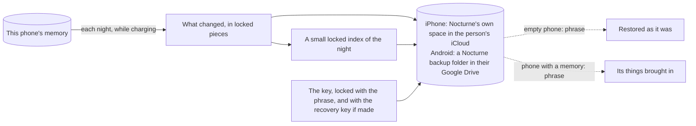
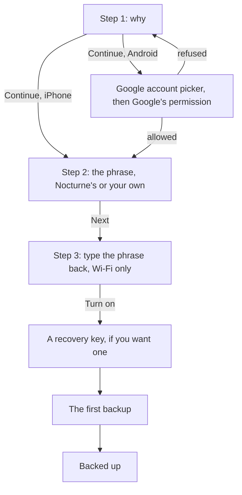
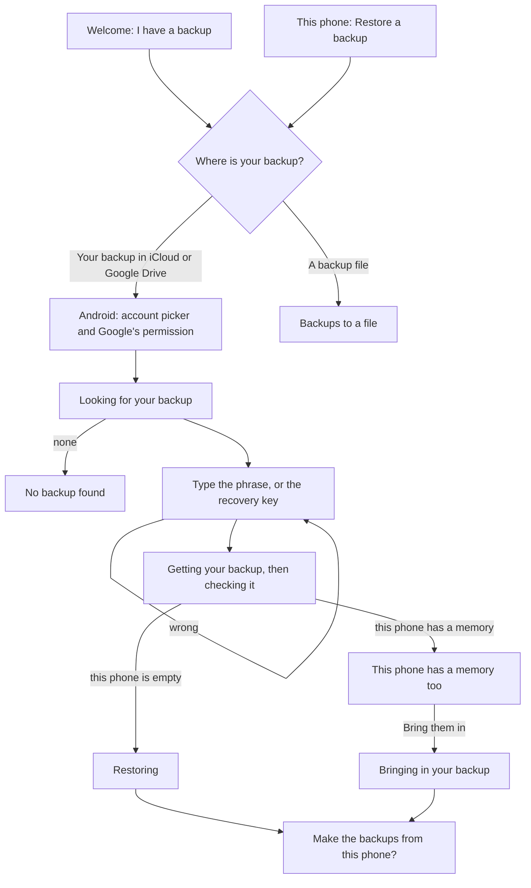

# Backup on a phone of its own

Part of [Nocturne on a phone of its own](phone-first.md), step 2 of the [roadmap](phone-parity.md)
(phase 2b). The record is [0019 A locked copy online](/adr/0019-a-locked-copy-online.md). This page
holds the whole backup design; [Backup](phone-first.md#backup) in the parent page is its summary.

Status: proposed, with the owner's decisions of 2026-11-23 and 2026-11-24 folded in. It ships after
the online mind. Saving one whole file ([Backups to a file](phone-first.md#backups-to-a-file)) stays
its own action.

## The owner's decisions

| Decision | Where it lands |
|---|---|
| Nightly and incremental, locked, for a phone that is its own home, while it charges | [How it works](#how-it-works) |
| "Wi-Fi only" is a setting, off by default | [Step 3](#step-3-check-the-phrase), [This phone](#backup-in-this-phone) |
| The phone's own account: the app's own iCloud space on iPhone; the person's Google Drive, only the files Nocturne makes, on Android, with Google's one-time permission | [Where it goes](#where-it-goes) |
| A random phrase of six words, or the person's own, shown once and confirmed | [Step 2](#step-2-the-phrase), [Step 3](#step-3-check-the-phrase) |
| An optional recovery key, offered at turn on and made later in This phone | [A recovery key](#a-recovery-key-offered-once), [Make a recovery key](#make-a-recovery-key) |
| Export is separate | [Backups to a file](phone-first.md#backups-to-a-file), unchanged |
| Restore onto a new or reset phone | [Onto an empty phone](#onto-an-empty-phone) |
| Restore onto a phone that already holds a memory brings the backup's things in, as a move into a computer that holds one does | [Onto a phone that has a memory](#onto-a-phone-that-has-a-memory) |
| Forgetting and Delete everything reach the backup | [Forgetting, Delete everything and private](#forgetting-delete-everything-and-private) |
| No server of Nocturne's | [How it works](#how-it-works) |
| Private governs notifications, reminders, updates and the lock screen, never the backup | [Forgetting, Delete everything and private](#forgetting-delete-everything-and-private) |

## Mockups

In `docs/design/mockups/phone-parity/`, Android and iPhone side by side, with the kit of the other
mockups. Names and data are fictional. `?theme=dark` and `?text=200` (the phone's text at 200 per
cent, the screen grown to show all of it) work on every state.

| Screen | File and state | Renders |
|---|---|---|
| Step 1: why | `copy-online.html?state=why` | `copy-online-why-light.png`, `copy-online-why-dark.png`, `copy-online-why-200-light.png` |
| Step 1, can't go on (Google refused; iCloud off) | `copy-online.html?state=blocked` | `copy-online-blocked-light.png` |
| Step 2: Nocturne's phrase | `copy-online.html?state=passphrase` | `copy-online-passphrase-light.png`, `copy-online-passphrase-dark.png`, `copy-online-passphrase-200-light.png` |
| Step 2: your own phrase, easy to guess | `copy-online.html?state=own` | `copy-online-own-light.png` |
| Step 3: check the phrase, Wi-Fi only | `copy-online.html?state=check` | `copy-online-check-light.png`, `copy-online-check-dark.png`, `copy-online-check-200-light.png` |
| A recovery key | `copy-online.html?state=key` | `copy-online-key-light.png` |
| The first backup | `copy-online.html?state=first` | `copy-online-first-light.png` |
| Backed up | `copy-online.html?state=done` | `copy-online-done-light.png` |
| This phone, on | `copy-online.html?state=on` | `copy-online-on-light.png`, `copy-online-on-dark.png`, `copy-online-on-200-light.png` |
| This phone, waiting for Wi-Fi | `copy-online.html?state=wifi` | `copy-online-wifi-light.png` |
| This phone, stopped: no room; signed out | `copy-online.html?state=stopped` | `copy-online-stopped-light.png` |
| Today, the backup has stopped | `copy-online.html?state=today` | `copy-online-today-light.png` |
| Turn off backup? | `copy-online.html?state=off` | `copy-online-off-light.png` |
| Make a recovery key? | `copy-online.html?state=makekey` | `copy-online-makekey-light.png` |
| Your new recovery key | `copy-online.html?state=newkey` | `copy-online-newkey-light.png` |
| Delete everything, with a backup | `copy-online.html?state=delete` | `copy-online-delete-light.png` |
| Where is your backup? | `copy-online-restore.html?state=where` | `copy-online-restore-where-light.png` |
| Found: type the phrase | `copy-online-restore.html?state=found` | `copy-online-restore-found-light.png`, `copy-online-restore-found-dark.png`, `copy-online-restore-found-200-light.png` |
| Which night? | `copy-online-restore.html?state=nights` | `copy-online-restore-nights-light.png` |
| Wrong recovery key | `copy-online-restore.html?state=wrong` | `copy-online-restore-wrong-light.png` |
| No backup found | `copy-online-restore.html?state=none` | `copy-online-restore-none-light.png` |
| Getting your backup | `copy-online-restore.html?state=getting` | `copy-online-restore-getting-light.png` |
| Part of it is missing | `copy-online-restore.html?state=missing` | `copy-online-restore-missing-light.png` |
| Restored onto an empty phone | `copy-online-restore.html?state=restored` | `copy-online-restore-restored-light.png` |
| Make the backups from this phone? | `copy-online-restore.html?state=in-use` | `copy-online-restore-in-use-light.png` |
| This phone has a memory too | `copy-online-restore.html?state=merge` | `copy-online-restore-merge-light.png`, `copy-online-restore-merge-dark.png`, `copy-online-restore-merge-200-light.png` |
| Bringing in your backup | `copy-online-restore.html?state=adding` | `copy-online-restore-adding-light.png` |
| Your backup's things are here | `copy-online-restore.html?state=merged` | `copy-online-restore-merged-light.png` |

## How it works

Like a messaging app's chat backup: each night, while the phone charges, Nocturne backs up what
changed, locked with a phrase only the person holds, to their own account with the phone's company.
There is no server of Nocturne's, and nothing about the backup passes through one.

| Part | Choice |
|---|---|
| What goes each night | Each thing kept, its original, the journal, check-ins, pages, reflections, calendar entries, and the marks on them, as locked pieces, each named by a hash of its locked contents. Only pieces the account doesn't have yet go. Then a small locked index that lists the night's pieces |
| Health readings | Never in the backup, on iPhone and Android alike ([decision 8](#decisions)). The night notes only the first day the phone holds readings for. Pages, reflections and day lines that speak of them are backed up as usual. A restore reads the readings again from Health or Health Connect ([below](#health-readings-after-a-restore)) |
| Private things | Backed up like everything else, locked like everything else. A private mark decides what comes up on its own, never what is backed up ([What private means](only-marked-private.md)) |
| How many | Seven nightly indexes. A piece no kept index lists is removed |
| When | At night while the phone charges, at a time the phone's system chooses. Over mobile data too, unless "Wi-Fi only" is on (off by default). "Back up now" runs one at once, charging or not |
| The lock | 0013's sealing for the pieces and the index. One key locks them; that key is kept locked with the phrase, and with the recovery key if the person made one. The key itself stays in the phone's own safe place, so nightly backups need no phrase |
| Who can open it | Only someone with the phrase or the recovery key. Not Apple or Google, and not Nocturne's makers |
| Another phone | Each index names, unlocked, a random number for the phone that wrote it and a count. A phone that finds a newer index from another phone stops, so nothing is overwritten. Bringing a backup into a phone is a restore the person asks for, never something the nightly backup does |
| Not a home | The backup is only for restoring. Nothing opens or edits it in place, and nothing syncs |
| The phone's own device backup | Leaves the memory out, so this is the one copy online |

### Where it goes

| | iPhone | Android |
|---|---|---|
| Place | The app's own space in the person's iCloud. It doesn't show among their files | A folder called "Nocturne backup" in the person's Google Drive |
| What Nocturne can reach | Only its own space | Only the files it makes. Nothing else in the Drive |
| Signing in | None: the iCloud the iPhone is signed in to | The phone's own Google account picker, then Google's one-time permission screen. No password is typed into Nocturne |
| Where the person sees it | Settings, their name, iCloud, Manage storage, Nocturne | Google Drive, Nocturne backup |
| Release needs | The iCloud capability on Nocturne's Apple developer account | An OAuth client for the app with Google Cloud, and Google's review of the narrow scope if it asks for one |

## Turning it on

From This phone, "Backup", or the no-backup card on Today ("Turn on backup"). Three light steps, as
Online answers ([Keeping the next step in view](step-flow-actions.md)). Nothing is turned on, and
nothing is written to the account, until "Turn on".

### Step 1: why

| Part | Copy |
|---|---|
| Step label | "Backup · step 1 of 3" |
| Title | "Back up your memory every night, so a lost phone doesn’t lose it." |
| What goes | "Everything you kept, locked. Each night, while this phone charges, only what changed goes." |
| Who can open it | iPhone: "Only someone with your phrase. Apple keeps it in your iCloud but can’t open it, and neither can Nocturne’s makers." Android: "Only someone with your phrase. Google keeps it in your Drive but can’t open it, and neither can Nocturne’s makers." |
| You need | iPhone: "iCloud turned on, with room for about {size}." Android: "Your Google account on this phone, with room for about {size} in its Drive." |
| Expander, closed | "Everything about the backup" |
| Bar | "Continue" · "Not now" · "Nothing is turned on until the last step." |

{size} is the locked size of the memory today, rounded up ("about 1.4 GB").

Behind the expander, in this order, each under its label:

| Label | Copy |
|---|---|
| "Where" | iPhone: "In your iCloud, in a place only Nocturne uses. It doesn’t show among your files." Android: "In your Google Drive, in a folder called Nocturne backup. Nocturne can reach only what it puts there, nothing else in your Drive." |
| "What the company sees" | "{company} can see that the backup is there, how big it is and when it changes. It can’t see what is in it." |
| "When" | "Each night while this phone charges, at a time your phone chooses. Over mobile data too, unless you choose Wi-Fi only." |
| "How many" | "You can go back up to seven nights. When you forget something for good, it goes from the backup at once." |
| "Private things" | "Things you mark private are backed up too, locked like everything else. Private only keeps them out of notifications, reminders and the lock screen." |
| "Your phone’s own backup" | "Your phone’s own backup leaves your memory out, so this is the one copy online." |
| "A new phone" | iPhone: "Sign in with the same Apple Account, install Nocturne, choose I have a backup, and type your phrase." Android: "Install Nocturne, choose I have a backup, choose the same Google account, and type your phrase." |
| "A phone that already has a memory" | "Restore a backup in {thisPhone} brings the backup’s things in. Nothing on the phone is put aside or deleted." |
| "One file" | "To keep a copy somewhere else too, {saveBackup} in {thisPhone} saves everything as one file." |
| "Turning it off" | "Turn it off in {thisPhone}. You then choose whether to delete the backup." |

{company} is "Apple" or "Google". {thisPhone} and {saveBackup} are control chips
([Control chips](control-chips.md)).

### Step 1, when it can't go on

| Case | What shows, under the "You need" line | Bar |
|---|---|---|
| iPhone, signed out of iCloud | "Sign in to iCloud in Settings to back up." | Continue not pressable |
| iPhone, iCloud on but off for Nocturne | "Turn on iCloud for Nocturne in Settings to back up." | Continue not pressable |
| iPhone, not enough room in iCloud | "Your iCloud has {free} free. Make room there first, or choose more storage in Settings." | Continue not pressable |
| Android, no Google account on the phone | "Add a Google account in your phone’s settings to back up." | Continue not pressable |
| Android, the person refused on Google's screen, or left its box unticked | "Nothing was turned on. Google didn’t allow it." | Unchanged; Continue asks again |
| Android, not enough room in the Drive (known only after the permission) | "Your Google Drive has {free} free. Make room there first, then choose Continue." | Unchanged |
| No internet | "This phone isn’t online. Backup needs the internet to start." | Continue not pressable |

Each line goes by itself once the phone's state changes, so the person never has to come back and
retry by hand. Nocturne reads the free room from the account itself; it never guesses.

### Google's permission (Android only)

"Continue" opens the phone's own Google account picker, then Google's own screen, which says Nocturne
may see and change only the files it makes in the Drive. Nocturne shows nothing of its own between
them. On iPhone there is no step: the backup goes to the iCloud the iPhone is signed in to.

The permission is asked once. It is asked again only when it was taken back, or the account left
the phone ([States](#states-in-this-phone)).

### Step 2: the phrase

A phrase of six everyday words, made up by Nocturne, balances safety and ease: hard to guess, easy
to write down. The person may type their own; Nocturne warns only when it is easy to guess, and has
no rules about symbols, capitals or length.

| Part | Copy |
|---|---|
| Step label | "Backup · step 2 of 3" |
| Title | "Your phrase for the backup" |
| Lead | "It opens your backup on a new phone. Nocturne made this one up for you." |
| The phrase | Six words in large type, for example "harbour violet pencil maple drift oven", with "Another phrase" and "Copy" |
| Link | "Use my own phrase instead" |
| Note title | "Keep this phrase safe" |
| Note body | "Nocturne doesn’t keep it. Without it, nobody can open your backup, not even Nocturne. Write it down and keep it somewhere safe, or save it in a password manager." |
| Bar | "Next" · "Back" |

With "Use my own phrase instead":

| Part | Copy |
|---|---|
| Lead | "It opens your backup on a new phone." |
| Field | "Your phrase" / hint "A few words that don’t go together are strong and easy to remember." |
| Easy to guess | "This phrase is easy to guess. Someone who finds your backup could try it. Nocturne’s own phrase is harder to guess." with "Use Nocturne’s phrase". Nothing is blocked |
| Note | As above |
| Link | "Use Nocturne’s phrase instead" |
| Bar | "Next" · "Back" · disabled reason "Type a phrase to go on." |

"Easy to guess" is the strength estimate 0013 uses, below its lowest band; nothing else is checked.
"Copy" puts the phrase where the person can paste it into a password manager, marked so the phone
doesn't show it in its paste previews, and clears it after a minute.

### Step 3: check the phrase

The phrase is shown once. Typing it back proves it was written down or saved before anything is
turned on; it replaces 0013's tick.

| Part | Copy |
|---|---|
| Step label | "Backup · step 3 of 3" |
| Title | "Type your phrase" |
| Lead | "Type it from where you wrote it down or saved it, so you know you have it." |
| Field | "Your phrase" |
| Wrong | Under the field: "That isn’t the phrase. Check each word, or go back to see it again." |
| Row | "Wi-Fi only" (switch, off) / hint, off: "Backups use mobile data too: about {size} the first time, then a little each night." / hint, on: "Backups wait for Wi-Fi." |
| Bar | "Turn on" · "Back" · disabled reason "Type your phrase to go on." |

The check ignores capitals and extra spaces, never the words or their order. There is no limit on
tries. "Back" shows step 2 with the same phrase. Once "Turn on" is pressed the phrase is never shown
again: it is not kept on the phone in a form that can be shown.

### A recovery key, offered once

Straight after "Turn on", once, and never again unprompted. A person who says "Not now" can make one
later with [Make a recovery key](#make-a-recovery-key):

| Part | Copy |
|---|---|
| Title | "A recovery key, if you want one" |
| Body | "If you ever lose your phrase, a recovery key opens your backup instead. Print it or save it, and keep it away from this phone." |
| Key | Six groups of four letters and numbers, in large type |
| Buttons | "Print or save…" (the phone's own print and share sheet) · "Not now" |
| Foot | "Nocturne shows this only once." |

The key is shown on screen only here and is not kept on the phone in a form that can be shown again.
After "Print or save…" the button reads "Done". The key opens the backup only once it is saved and
the account has taken it. When the account can't be reached then, a line says: "Your key is saved,
but it doesn’t open your backup yet: Nocturne couldn’t reach your iCloud." (or "your Google Drive"),
and the button reads "Try again"; "Not now" or "Cancel" leaves the saved key opening nothing.

### The first backup

| Part | Copy |
|---|---|
| Title | "Backing up for the first time" |
| Progress | A bar with "{done} of {size}" |
| Note | "You can use Nocturne while this runs. If it doesn’t finish now, it carries on tonight while this phone charges." |
| Waiting for Wi-Fi | "Waiting for Wi-Fi. It starts when this phone is on Wi-Fi." |
| Button | "Use Nocturne" (the backup carries on) |

| Part | Copy |
|---|---|
| Done title | "Your memory is backed up." |
| Done body | "{time}, in your iCloud." or "{time}, in your Google Drive." / "From now on, each night while this phone charges." |
| Button | "OK" |

The first backup is read back and checked before the switch in This phone shows as on. Until then
This phone shows "Backing up for the first time · {done} of {size}".

### Turning it on again

After "Turn off" with the backup kept, the switch turns it on again with no steps: the key is still
in the phone's safe place, so the same phrase and recovery key go on working. A line under the switch
says so as it turns on: "On again, with the same phrase." After "Turn off" with "Also delete the
backup", the three steps run again from the start.

## Backup in This phone

Under Your memory, the row "Backup" shows "Off" or the up to date line, and opens this screen.

| Part | Copy |
|---|---|
| Switch | "Back up every night" |
| Hint, on | "Last backup {day}, {time} · {size} in your iCloud" or "in your Google Drive" |
| Hint, off | "Off" (and "Your backup from {day} is still in your iCloud." when one was kept) |
| Row | "Wi-Fi only" (switch) |
| Row | "Back up now" / while it runs: "Backing up · {done} of {size}" |
| Row | "Change the phrase…" |
| Row | "Make a recovery key…" / hint "None made yet", or "Made {day}" |
| Row | "Turn off…" |
| About heading | "About the backup", then the expander's labels and lines from "Where" to "A phone that already has a memory" |

"Last backup" is the time the last one finished. The phone's system chooses when it runs, so This
phone shows when it last ran, never a promised time.

### States in This phone

The hint under "Back up every night" changes; when the person must act, a line and a button show
under the switch group.

| State | Hint | Line and button |
|---|---|---|
| Up to date | "Last backup {day}, {time} · {size} in your iCloud" | None |
| Backing up now | "Backing up · {done} of {size}" | None |
| Waiting for tonight | "Last backup {day}, {time} · next tonight while this phone charges" | None |
| Not charged last night | "Last backup {day}, {time} · waits for this phone to charge" | None |
| Waiting for Wi-Fi | "Last backup {day}, {time} · waiting for Wi-Fi" | "Wi-Fi only is on, so the backup waits until this phone is on Wi-Fi and charging." with "Back up now over mobile data" |
| No internet | As waiting for tonight | None: it carries on when the phone is online |
| Last night's didn't finish | As waiting for tonight | None: it carries on from where it stopped |
| No room in the account | "Stopped · last backup {day}, {time}" | iPhone: "There’s no room in your iCloud for tonight’s backup. Your last backup from {day} is still there." with "Open iCloud settings". Android: "There’s no room in your Google Drive for tonight’s backup. Your last backup from {day} is still there." with "Open Google Drive" |
| Signed out of the account | "Stopped · last backup {day}, {time}" | iPhone: "This iPhone is signed out of iCloud, so the backup has stopped. Sign in to iCloud in Settings to carry on." with "Open Settings". Android: "The Google account your backup uses isn’t on this phone any more, so the backup has stopped." with "Choose account" |
| Permission taken back | "Stopped · last backup {day}, {time}" | iPhone: "iCloud is turned off for Nocturne, so the backup has stopped. Turn it on in Settings, under iCloud." with "Open Settings". Android: "Google no longer lets Nocturne back up. Choose the account again." with "Choose account" |
| Another phone made a newer backup | "Stopped · last backup {day}, {time}" | [Below](#a-newer-backup-from-another-phone) |
| A backup from a newer Nocturne in the account | "Stopped · last backup {day}, {time}" | "A newer Nocturne made the latest backup. Update Nocturne from {store} to carry on." with "Update". {store} is "the App Store" or "Google Play" |
| Android, the account chosen already holds another backup | "Stopped · last backup {day}, {time}" | "This Google account’s Drive already holds another Nocturne backup, so the backup has stopped and nothing was written over it. Choose another account, or delete the Nocturne backup folder in that Drive and choose this account again." with "Choose account". Nocturne doesn't try again by itself |
| Android, the phrase is needed again in the account chosen | "Stopped · last backup {day}, {time}" | "To carry on in this account, the backup needs its phrase set again. A recovery key you made before doesn’t open it there." with "Change the phrase…". "Make a recovery key…" is not offered until then |
| No backup yet, after turning on or in an account chosen since | "No backup yet · next tonight while this phone charges"; waiting for Wi-Fi: "No backup yet · waiting for Wi-Fi"; not charged: "No backup yet · waits for this phone to charge"; stopped: "Stopped · no backup yet" | As the state's, and for no room only its first sentence: "There’s no room in your iCloud for tonight’s backup." or "in your Google Drive" |

On an iPhone, Nocturne can open only its own page in Settings, so under the line it says where to
go next. No room and iCloud off for Nocturne: "Settings opens on Nocturne’s page. Go back to the
first page of Settings, then tap your name, then iCloud." Signed out: "Settings opens on Nocturne’s
page. Go back to the first page of Settings to sign in."

"Choose account" runs the picker and Google's permission again. When the person picks a different
account than before, the backup starts afresh there and a line says: "Your earlier backup stays in
the Drive of {account}. Delete it there if you no longer want it." Nocturne cannot reach it once its
permission there is gone.

A deletion of the whole backup still owed to the earlier account (Delete everything, or "Turn off"
with "Also delete the backup", while that account couldn't be reached) stays tied to it. Choosing
another account never drops it and never sends it there: it runs the next time Nocturne reaches the
earlier account, when the person chooses it again. The phone notes each account by its address for
this, and the change of account waits for a deletion already under way.

### On Today

No system notifications about the backup. On Today, as one card, at most once for each cause:

| When | Card | Buttons |
|---|---|---|
| The morning after the first night it stopped for something only the person can fix (no room, signed out, permission taken back, another phone) | "Your backup has stopped." / the state's line from the table above, without its button | "Open backup" · "Not now" |
| Seven nights with no backup, for any other cause | "Your last backup was {day}." | "Open backup" · "Not now" |
| No backup turned on, after 30 days of keeping | "No backup yet. If this phone is lost, what you kept goes with it." | "Turn on backup" · "Not now" |

### Change the phrase

"Change the phrase…" asks first: "Change the phrase?" / "Your old phrase stops opening the backup. A
recovery key you saved still works." / "Change it" · "Cancel". Then steps 2 and 3, with "Save" for
"Turn on". The key is locked again with the new phrase in the next backup; nothing else is sent
again.

### Make a recovery key

"Make a recovery key…" is for a person who said "Not now" when it was offered, or who lost a key
they made. It asks first, then shows the key once, as at turn on.

| Part | Copy |
|---|---|
| Ask, title | "Make a recovery key?" |
| Ask, body | "A recovery key opens your backup if you lose your phrase. It is shown once. If you made one before, it stops working." |
| Ask, buttons | "Make it" · "Cancel" |
| Title | "Your new recovery key" |
| Body | "It opens your backup if you lose your phrase. Print it or save it, and keep it away from this phone. An earlier key no longer works." |
| Key | Six groups of four letters and numbers, in large type |
| Buttons | "Print or save…" (the phone's own print and share sheet) · "Cancel" |
| Foot | "Nocturne shows this only once." |

The new key locks the same backup key as the phrase does, in the next backup; nothing else is sent
again. "Cancel" before "Print or save…" keeps the earlier key, if any. After it the button reads
"Done". The row's hint reads "None made yet" until a key is made, then "Made {day}".

### Turn off

| Part | Copy |
|---|---|
| Title | "Turn off backup?" |
| Body | "No new backups are made. The backup in your iCloud stays as it is until you delete it." or "in your Google Drive" |
| Tick, off | "Also delete the backup" |
| Tick hint, when ticked | "All seven nights go from your iCloud for good. Nobody can bring them back." or "from your Google Drive" |
| Buttons | "Turn off" (careful when ticked) · "Keep it on" |
| After, kept | Row hint: "Off · your backup from {day} is still in your iCloud" |
| After, deleted | Row hint: "Off" and, once, "Your backup was deleted." |
| Deleting while offline | Row hint: "Off · your backup goes from your iCloud the next time this phone is online" |

What happens to the copies:

| Choice | The account | The phone |
|---|---|---|
| Turn off, keep | The last seven nights stay exactly as they were. Nothing more is added or removed by nightly runs | The key stays in the phone's safe place, so turning it on again needs no steps |
| Turn off, delete | Every index and piece Nocturne made is removed | The key is removed |

Forgetting for good, or deleting a thing, a day or a recap, still reaches a kept backup while it
is off, exactly as when it is on: a new index without it is written, and every older index that
lists it is removed, with its pieces. Nothing else goes while it is off: the new index holds the
newest night that was kept, as it was, without what was forgotten, and is dated as that night;
what was kept or changed since stays on the phone. A line the forget blanked in a page goes blank
there too; a page or reflection that changed in other ways since is left out of that night, and
comes back with the next night once backup is on again. Nocturne keeps its access to the account for that, and for
nothing else ([below](#forgetting-delete-everything-and-private)).

### A newer backup from another phone

In This phone, and nowhere else but the Today card: "Another phone made a newer backup on {day}. This
phone has stopped backing up, so nothing is overwritten." with "Make this phone the one in use",
which explains first: "This phone’s next backup becomes the newest. The other phone stops when it
next looks." / "Make this phone the one in use" · "Cancel". To keep what the other phone has, the
person restores its backup on this phone first, which [brings its things in](#onto-a-phone-that-has-a-memory).

## Restoring

From Welcome, "I have a backup". From This phone on a phone alone, "Restore a backup…". Both open
the same chooser.

### Where is your backup?

| Part | Copy |
|---|---|
| Title | "Where is your backup?" |
| Choice | iPhone: "Your backup in iCloud" / "Made by Nocturne each night." Android: "Your backup in Google Drive" / "Made by Nocturne each night." |
| Choice | "A backup file" / "One file you saved." |
| Buttons | "Continue" · "Back" |

The online choice is selected when the chooser opens. On Android, "Continue" runs the account
picker and Google's permission, as when turning it on. Refused: "Google didn’t allow it, so Nocturne
can’t look for your backup." with "Try again".

### Looking, and finding

| Part | Copy |
|---|---|
| Looking | "Looking for your backup…" |
| Title | "Bring back your memory" |
| Lead | "Type the phrase for your backup." |
| Found | A card: "Backup from {day}, {time} · {size}" with "An earlier night…" |
| Field | "Your phrase" |
| Link | "Use the recovery key instead": the lead becomes "Type the recovery key for your backup.", the field "Recovery key", and the link "Use the phrase instead" |
| Button | "Bring it back" · "Back" |

"An earlier night…" opens "Which night?" with "Done", the lead "The newest is chosen unless you
pick another." and the kept nights newest first, each "{day}, {time} · {size}", the newest marked
"Newest". The
date, time and size are read from the account's own record of the files, which is not locked; the
counts show only after the phrase opens it.

| Case | Copy |
|---|---|
| No backup, iPhone | "No backup found in this iCloud. Sign in with the Apple Account your old phone used." |
| No backup, Android | "No backup found in this Google account’s Drive." with "Try another account" |
| iCloud off | "Turn on iCloud in Settings to find your backup." |
| Not online | "This phone isn’t online. Finding your backup needs the internet." with "Try again" |
| Wrong phrase | Under the field: "That phrase doesn’t open this backup. Check each word, and try again." |
| Wrong three times or more | "That phrase doesn’t open this backup. If you saved it in a password manager, copy it from there, or use the recovery key." |
| Wrong recovery key | "That recovery key doesn’t open this backup. Check each group of letters and numbers, and try again." |

There is no lockout after wrong tries: the backup is the person's own, and it sits in their own
account.

### Getting it ready

| Part | Copy |
|---|---|
| Title | "Bringing back your memory" |
| Stages | "Getting your backup", then "Checking the backup", each "{done} of {size} · about {eta} left" ("{done} of {size}" until the time is known) |
| Body | "Keep Nocturne open until this finishes. If it closes, nothing on this phone changes, and what has come down is kept, so starting again carries on." |
| Button | "Stop" ("Stopped." / "Nothing on this phone changed.") |
| On mobile data, before it starts | "This is about {size}. On mobile data, it may count against your plan." / "Go on" · "Wait for Wi-Fi" |
| On mobile data, after "Wait for Wi-Fi" | "Waiting for Wi-Fi. It starts when this phone is on Wi-Fi." with "Stop"; it starts by itself |
| Internet lost | "Waiting for the internet. This carries on when this phone is back online." |

0013's checks run on the whole night before anything on the phone changes.

| Case | Title | Body | Button |
|---|---|---|---|
| Not enough room | "There isn’t room to bring it back" | "This phone needs about {needed} free and has {free}. Free some room, then try again." | "Try again" |
| A piece missing or damaged | "Part of this backup is missing" | "Nocturne can’t bring it back safely, so nothing changed. An earlier night may be whole." | "Choose an earlier night" |
| Made by a newer Nocturne | "This backup is from a newer Nocturne" | "It was made with Nocturne {theirs}, and this phone has {ours}. Update Nocturne from {store}, then try again. Nothing was changed." | "OK" |
| The account went away meanwhile | "Nocturne lost its way to your backup" | iPhone: "iCloud was turned off or signed out. Nothing on this phone changed." Android: "Google stopped letting Nocturne in. Nothing on this phone changed." | "Try again" |

{needed} for an empty phone is the backup's size; for a phone with a memory, the backup's size
again, since its things are unpacked beside the memory here until they are added.

### Onto an empty phone

A new phone, or one that was reset or emptied by Delete everything. The backup comes back as it
was: every thing, the journal, check-ins, pages, reflections, calendar entries, what was forgotten,
the marks, and the settings that belong to the memory. Health readings are read again from the
phone's health app ([below](#health-readings-after-a-restore)).

| Part | Copy |
|---|---|
| Stage | "Restoring" with the same bar; "Stop" until the last step, then "Almost done. This last step can't be stopped." (0013) |
| Done title | "Your memory is back on this phone." |
| Done body | "{count} things, every page and your journal." |
| Afterwards, when the old phone had an online mind | "Its mind stays off until you choose it again in {thisPhone}." |
| Afterwards, calendar and health | "Your calendar and Health on this phone stay off until you turn them on again." |
| Afterwards, health readings | When the old phone held any, [the line below](#health-readings-after-a-restore) |
| Button | "Continue" |

The phone's own permissions, and the key to an online service, never travel in a backup (0013).

### Onto a phone that has a memory

The owner's hybrid restore: a phone that already holds a memory never loses it and never puts it
aside for a backup. The backup's things join it, the way a computer that already holds a memory
brings a phone's things in ([Moving your memory](moving-memory.md#when-the-computer-already-holds-a-memory)).
The words below follow that screen's.

| Part | Copy |
|---|---|
| Title | "Your backup has its own memory, and this phone has one too." |
| Counts | "In the backup: {count} things, from {first} to {day} · about {size}" / "On this phone: {count} things, from {first} to {today}" |
| Lead | "A phone holds one person’s memory, so the backup’s things join the one here." |
| What happens | "What was in the backup, with its journal, check-ins and pages, joins the memory on this phone. Nothing here is put aside or deleted. What is on both is kept once." |
| Not enough room | Before the buttons, when room is short: "This phone needs about {size} free for it and has {free}. Free some room here, then choose {bringThemIn}." |
| Buttons | "Bring them in" · "Not now" |

"Not now" leaves the phone exactly as it was.

A backup from before Nocturne noted its first day, or a backup file, reads "In the backup: {count}
things, up to {day} · about {size}". A phone with nothing dated yet reads "On this phone: {count}
things".

This is the one restore on a phone that has a memory, for a backup from the account and for a backup
file alike. The first release's "Put aside" restore ends with the release that ships the nightly
backup; what it already put aside stays as it is. Once the things are in, there is no undo: nothing
that was on the phone is lost, and anything that came in can be forgotten like any other thing.

| Stage | Copy |
|---|---|
| Preparing | "Bringing in your backup" / "Getting your things ready…" with a moving bar and "Stop" |
| Stop | Until adding begins: "Stop bringing your backup in? Nothing changes on this phone." / "Stop" (careful) · "Keep going". After: "Stopped. Nothing changed on this phone." |
| Adding | "Adding them to the memory on this phone…" / "Keep Nocturne open until this finishes." Stop is no longer offered |
| Done title | "Your backup’s things are here." |
| Done body | "{count} things, {entries} journal entries and {checkins} check-ins were added to the memory on this phone." |
| Done, kept once | When above zero: "{same} were already here, so they were kept once." |
| Done, health readings | When the backup's phone held any, [the line below](#health-readings-after-a-restore) |
| Button | "Continue" |

Nothing is added until everything has arrived and passed the checks; then all of it is added in one
step, or none of it.

**What comes in.** Every kept thing with its original, how and where it was kept, its private mark
and what was worked out from it, so nothing is read again; journal entries and good things;
check-ins; pages and reflections; calendar entries; what the person forgot from
a thing, which stays forgotten; the names they taught it and what they confirmed or settled. Not the
backup's settings: this phone's stay.

| Case | What happens |
|---|---|
| The same thing on both | Kept once. The one on this phone stays, and when the backup's was kept on another device, its page adds under "Kept": "Also kept on {device} · {day}, {time}" |
| Journal entries or check-ins for the same day | Both kept, each on its day in time order. Nothing is joined into one entry |
| A page or reflection for the same day | This phone's is kept, and the backup's doesn't come. Keeping both, with two pages for one day, waits for a later release ([decision 6](#decisions)) |
| Calendar entries on both | Kept once, by their own identity in the phone's calendar; the newer version stays |
| Health readings | None come from the backup. They are read again from the phone's health app ([below](#health-readings-after-a-restore)) |
| Private marks | Kept as they were. When the same thing is on both and either is private, it is private |
| Something forgotten on either side | Stays forgotten. Something forgotten for good on this phone is not brought back from an older backup: the phone keeps a note of what it forgot for good, without the thing itself, for this |
| The backup is this phone's own | The same, so restoring an earlier night of this phone adds back only what is no longer here and was never forgotten for good |
| What this phone's mind would read | Nothing: what came in was already read, so nothing is sent online again for it |

### Health readings after a restore

Health readings never go into the backup, nor into a phone's [backup file](phone-first.md#backups-to-a-file)
(App Store guideline 5.1.3 bars health data in iCloud, and Android follows the same rule so the two
behave alike). After a restore of either kind, the
phone reads them again from its own health app, as far back as the first day the backup's phone
held readings for, once Health is on in Nocturne.

| Phone | How far back |
|---|---|
| iPhone | Health keeps the whole history: read again back to that day |
| Android, Health Connect offers older readings | Nocturne asks for older readings with the other kinds whenever Health Connect offers them. Once allowed, read again back to that day; until then, the last 30 days |
| Android, Health Connect gives only the last 30 days | The last 30 days. What is older doesn't come back, and the done screen says so |

The done screen, of either restore, adds one line when the backup's phone held readings. {day} is
that first day, written with its year ("14 March 2025"); {from} is the day 30 days back.

| Case | Copy |
|---|---|
| iPhone | "Health readings aren’t kept in your backup. With Health on in {thisPhone}, Nocturne reads them again from Health, back to {day}." |
| Android, older readings offered | "Health readings aren’t kept in your backup. With Health on in {thisPhone}, Nocturne reads them again from Health Connect, back to {day}, once you allow older readings there." |
| Android, only the last 30 days, and {day} is older | "Health readings aren’t kept in your backup. Health Connect on this phone lets Nocturne read only the last 30 days, so readings from before {from} don’t come back. Pages and reflections that mention them stay." |

A reading read again gets the id it had, made from the health app's own id for it and its
contents, so the pages and reflections that cite it find it again. A night written before this
rule may still hold readings; it ages out with the seven nights, and a restore from it leaves them
out too.

### Make the backups from this phone?

After a restore, of either kind, from a backup another phone made. A restored phone backs up only
after the person says so, so two phones never both back up.

| Part | Copy |
|---|---|
| Title | "Make the backups from this phone?" |
| Body | "This phone now makes the nightly backup, with the same phrase. If your old phone turns up, it stops making them." |
| Buttons | "Back up from this phone" · "Not now" |
| After the recovery key | Before this question: "Make a new phrase" / "You opened your backup with the recovery key. Make a new phrase now, so you have one." then steps 2 and 3 with "Save"; "Not now" keeps the old phrase, which the person no longer has, and the recovery key |

"Not now" leaves the backup off; This phone's switch then turns it on with no steps. Restoring
this phone's own backup, turned off and kept, does not ask: it is still this phone's.

## Forgetting, Delete everything and private

| Action | On the phone | In the backup |
|---|---|---|
| Fading and letting go | As today, reversible | Backed up as they are, so a restore keeps them fading or let go |
| Forgetting for good | As today | At once: a new index without it is written, every older index that lists it is removed, and its pieces with them. While the phone is offline or the account can't be reached, it waits and runs first when it can, and This phone says: "Something you forgot is still in your backup until Nocturne can reach your iCloud." (or "your Google Drive") |
| Deleting a thing, a day or a recap | As today | As forgetting for good |
| Delete everything | Everything goes from the phone | Every index and piece Nocturne made in the account goes too, and the key; backup is turned off |
| Marking private | Keeps it out of notifications, reminders, updates and the lock screen | No effect: backed up like everything else |

**Delete everything, with a backup.** The approved confirmation gains one sentence when a backup is
on or kept, and the Welcome line after it changes.

| Part | Copy |
|---|---|
| Body | "Everything you kept, your journal, check-ins, calendar and health readings in Nocturne go from this phone for good. Your calendar and Health themselves aren’t touched. Your backup in your iCloud is deleted too. A backup file you saved elsewhere isn’t touched." ("in your Google Drive" on Android) |
| After, on Welcome | "Everything was deleted from this phone and from your iCloud." |
| After, offline | "Everything was deleted from this phone. Your backup in your iCloud goes the next time this phone is online. If you remove Nocturne before then, delete it yourself in {place}." {place} is "iCloud in Settings" or "your Google Drive" |

Until the backup is gone, Welcome keeps that line, and "I have a backup" does not offer the backup
that is being deleted. When the person chooses another account before the phone is back online,
the deletion stays with the account the backup was in and runs the next time Nocturne reaches it;
the account chosen since never receives it ([decision 7](#decisions)).

**Notifications and the lock screen.** The backup sends no notifications of its own. When Android
needs a running backup to show one (the first backup, "Back up now", or a long night), it is silent
and reads "Backing up your memory" / "{done} of {size}", with nothing from the memory in it.

## When the memory moves to a computer

Decision 19: backup stops. The move's last screen asks, as in [Moving your
memory](moving-memory.md): "Your backup" / "Delete the backup in your iCloud" (or "in your Google
Drive") / "Keep it as it is". A kept backup can still be brought back on a phone, as the memory was
on the day of the move, and the phone keeps its access only to delete it later from This phone:
"Your backup from {day}" / "Delete it…".

## Behaviour

- **Running.** iPhone: a background task that needs power, asked for each night. Android: a job
  that needs charging, and an unmetered network when Wi-Fi only is on. The phone's system picks the
  time; Nocturne never wakes the phone or keeps it awake.
- **Pieces and stopping.** A night stopped part way leaves whole pieces in the account and no new
  index; the next run sends only what is missing, then writes the index. A night is a backup only
  once its index is written and read back.
- **Network.** With backup on, the phone reaches only the account's own hosts, and only while a
  backup, a deletion or a restore runs. With backup off, it reaches them only to remove what the
  person asked to remove: a forget for good in a kept backup, or deleting the backup. The release's
  network check gains this case.
- **Wi-Fi only.** Honoured by nightly runs and by "Back up now"; "Back up now over mobile data" in
  This phone is the one way past it, once.
- **One phone writes.** Before each night, the phone reads the newest index's phone number and
  count; a newer one from another phone stops it ([above](#a-newer-backup-from-another-phone)).
- **Size.** "{size}" in This phone is what the seven nights take in the account, as the account
  counts it.
- **The phrase and the key.** The phrase is never stored. The key lives in the phone's own safe
  place, which the phone's own device backup leaves out, so a new phone always needs the phrase or
  the recovery key.
- **Restoring.** What has come down is kept in the app's own space until the restore ends or is
  stopped; stopping removes it.
- **A phone that is a companion** has no memory of its own and no backup; restoring is offered only
  on Welcome and on a phone alone.

## Accessibility

- Text follows the phone's size up to 200 per cent with nothing cut off; the six words wrap by word,
  never inside one, and the recovery key's groups wrap whole.
- The phrase is read aloud word by word, with its position ("word 3, pencil"), and the recovery key
  group by group.
- The step fields accept paste and the phone's password managers. No screen times out.
- Progress bars state their value to screen readers ("{done} of {size}") and are announced at most
  every ten seconds.
- Light and dark, Android first, as the other phone screens. The renders above at 200 per cent show
  the key screens grown to their full length.

## Changes to screens that already ship

When the nightly backup ships, these first release screens change; nothing changes before.

| Screen | Change |
|---|---|
| Welcome, "I have a backup" | Opens [Where is your backup?](#where-is-your-backup) |
| Today, no backup reminder | "Turn on backup" for "Save a backup" |
| Your memory lives on this phone, lost phone | "If this phone is lost, what you kept goes with it. Turn on backup in {thisPhone}." |
| This phone, Your memory | Adds the "Backup" row |
| This phone, can do | "Your memory is on this phone. It can keep, find, forget and delete, and back up each night." |
| This phone, "Restore a backup…" | Hint "A backup’s things join what’s on this phone. Nothing here is deleted." |
| Delete everything | [As above](#forgetting-delete-everything-and-private) |

## Decisions

Settled by the owner on 2026-11-24, each as recommended.

| # | Decision | Where it lands |
|---|---|---|
| 1 | A backup file restored onto a phone that has a memory brings its things in, as a backup from the account does, from the release that ships the nightly backup. A phone has one restore. "Put aside" screens stay for what was put aside before | [Onto a phone that has a memory](#onto-a-phone-that-has-a-memory) |
| 2 | A person who said "Not now" to the recovery key can make one later with "Make a recovery key…" in This phone. It replaces any earlier key and is shown once | [Make a recovery key](#make-a-recovery-key) |
| 3 | Delete everything while the phone is offline deletes the phone at once and the backup when next online. The line says what is left and how to remove it by hand | [Delete everything, with a backup](#forgetting-delete-everything-and-private) |
| 4 | A backup that stops for something only the person can fix shows once on Today, with no system notification | [On Today](#on-today) |
| 5 | A restore that brought things in has no undo. Nothing on the phone was lost, and anything that came in can be forgotten | [Onto a phone that has a memory](#onto-a-phone-that-has-a-memory) |
| 6 | Two pages for one day are deferred to a later release. When a bring in meets a page or reflection both sides have for the same day, this phone's stays and the backup's doesn't come | [Onto a phone that has a memory](#onto-a-phone-that-has-a-memory) |
| 7 | Delete everything while offline, then another account chosen before the phone is back online: the deletion stays tied to the earlier account and runs when Nocturne next reaches it. The new account never receives it, and the change never drops it | [Delete everything, with a backup](#forgetting-delete-everything-and-private), [States in This phone](#states-in-this-phone) |
| 8 | Health readings stay out of the backup on both platforms, in every night, restore and bring in (App Store guideline 5.1.3; Android alike). Pages, reflections and day lines about health stay. A restore reads the readings again from Health or Health Connect, as far back as the phone allows, and says what doesn't come back | [Health readings after a restore](#health-readings-after-a-restore) |
