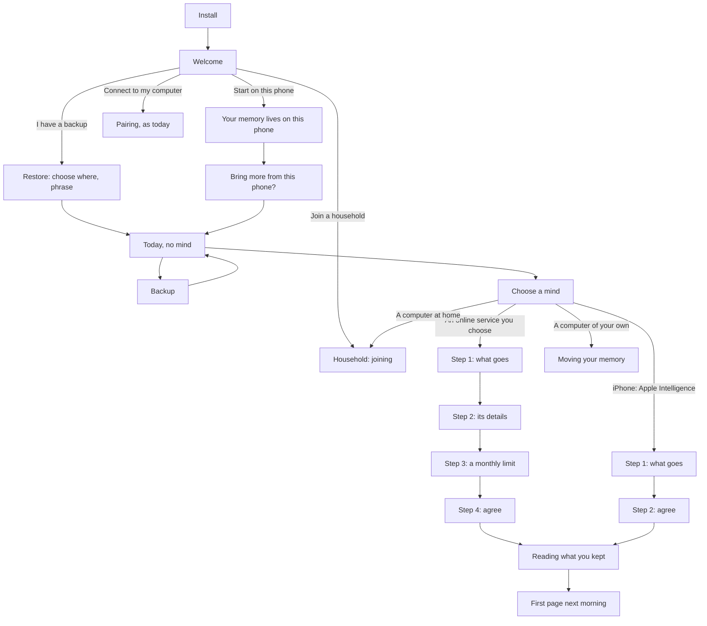
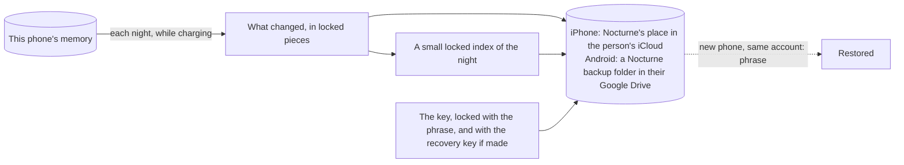

# Nocturne on a phone of its own

Part of [Phone and computer as equal starting points](phone-parity.md). This page covers a phone
with its own memory (step 1) and what it can turn on online (step 2): a mind, and a nightly backup.

Status: proposed, with the owner's decisions folded in. [The first
release](#the-first-release-a-phone-alone) is specified to build once approved; the online mind and
the locked copy follow it, in that order (owner, 2026-11-23). The online mind's record,
[0020](/adr/0020-an-online-mind-on-a-phone.md), is accepted and its clause is in invariant 2; [its
first release](#the-first-release-of-an-online-mind) is Android with the key route.

## Mockups

In `docs/design/mockups/phone-parity/`, Android and iPhone side by side.

| Screen | File and states | Renders |
|---|---|---|
| First run and Today with no mind | `first-run.html`: `welcome`, `start`, `today`, `ask` | `first-run-welcome-light.png`, `first-run-welcome-dark.png`, `first-run-start-light.png`, `first-run-today-light.png`, `first-run-today-dark.png`, `first-run-ask-light.png` |
| Backup | `copy-online.html`: `why`, `passphrase`, `on` | `copy-online-why-light.png`, `copy-online-why-dark.png`, `copy-online-passphrase-light.png`, `copy-online-on-light.png` |
| Choosing a mind | `mind.html`: `choose`, `service`, `consent`, `apple`, `first-page` | `mind-choose-light.png`, `mind-choose-dark.png`, `mind-service-light.png`, `mind-consent-light.png`, `mind-apple-light.png`, `mind-first-page-light.png` |
| This phone, a phone alone | `this-phone.html`: `alone` | `this-phone-alone-light.png`, `this-phone-alone-dark.png` |
| The first release | `first-release.html`: `welcome`, `start`, `today`, `reminder`, `full`, `ask`, `mind`, `backup`, `saved`, `restore`, `item`, `this-phone`, `calendar`, `health`, `delete`, `damaged` | `first-release-{state}-light.png` for every state; `first-release-welcome-dark.png`, `first-release-today-dark.png`, `first-release-mind-dark.png`, `first-release-backup-dark.png`, `first-release-this-phone-dark.png` |

## What a phone alone is

| Works from the first minute | Waits for a mind |
|---|---|
| Keep a note, a photo, a voice note, a shared page | Reading photos and documents |
| The journal: entries, good things, feelings, today's timeline | Reflections and recaps |
| Check-ins | The morning page |
| The calendar and health, on Today and beside the journal | Answers to questions |
| Finding what you kept by its words, with receipts | Noticing what changed, what needs you, what fades |
| Voice notes turned into words by the phone itself, where it can do that with no network ([decision 9](phone-parity.md#decisions)) | |

A phone alone is complete as it is, and so is a phone alone with an online mind: a person can use
either for good. Nothing on these screens suggests a computer or a household beyond listing them
where a mind is chosen.

Forgetting and fading run on the phone without a mind: they are clocks, not reading. The calendar
and health come from the phone itself, so the "goes only to your computer" lines of [Nocturne on
Android and iPhone](phone-apps.md) change to "stays on this phone" (below).

## The first release: a phone alone

Everything a person needs to start on a phone with no computer and no mind, and to move to a
computer if they ever want one. It is the whole of phase 1 on the [roadmap](phone-parity.md#phasing). Android ships
first; iPhone follows the same words once the engine is built and tried there.

### What ships, and what waits

| In the first release | Waits for a later phase |
|---|---|
| Welcome with "Start on this phone" and "Connect to my computer" | "Join a household" (phase 3) |
| Keeping a note, a photo, a voice note, a document, and from other apps' share menus | Reading photos and documents, which needs a mind |
| The journal: entries, good things, feelings, today's timeline | Reflections and recaps, which need a mind |
| Check-ins | |
| The phone's calendar and health readings on Today and in the journal | |
| Finding what was kept by its words, with receipts | Answers, which need a mind |
| Forgetting and fading, delete, Delete everything, export | |
| Backups to a file, and restoring one on a new phone | A nightly backup (phase 2b) |
| Moving the memory to a computer of one's own | An online mind (phase 2a), a household's mind (phase 3) |
| Voice notes turned into words by the phone, where it can with no network ([below](#voice-notes-in-words)) | |
| An item's own page on the phone, with marking it private ([below](#an-item-on-the-phone)) | |
| On the computer: "Already use Nocturne on your phone?" in first run, and receiving a phone's memory ([Moving](moving-memory.md#on-the-computer-a-phone-with-its-own-memory)) | Moving a memory from a computer to a phone, which waits for a phone that can hold one |

A screen whose choice belongs to a later phase does not show that choice until it ships: no
"coming soon", no greyed rows.

### Screens as they ship

The screens above, with these differences in the first release. Every other word is as written in
[Screens](#screens).

| Screen | In the first release |
|---|---|
| Store listing, growing | "When you want answers and a morning page, give it a mind: Nocturne on your own computer." |
| Welcome | Two buttons, "Start on this phone" and "Connect to my computer"; the link reads "I have a backup" |
| Your memory lives on this phone, waits hint | "A mind can come from Nocturne on your own computer. Your memory then moves there." |
| Your memory lives on this phone, lost phone | "If this phone is lost, what you kept goes with it. Save a backup now and then in {thisPhone}." |
| Today, lost phone reminder | After 30 days of keeping with no backup, once: "No backup yet. If this phone is lost, what you kept goes with it." with "Save a backup" and "Not now" |
| Today, no mind card | As written; "Choose a mind" opens [Giving it a mind](#giving-it-a-mind-in-the-first-release) |
| Ask | As written in [Ask with no mind](#7-ask-with-no-mind) |
| This phone, Your memory | "Where it is", "Its mind" ("None yet"); no backup row |
| This phone, This phone | "Version" / "Nocturne {version}". No "Name" row: a phone alone shows its name nowhere, and pairing asks for one if it is ever needed |
| This phone, Help | "Privacy policy" (opens the policy page in the phone's browser) · "What this phone can do" · "Your phone’s permissions" (the permissions help in the copy table, with "Open phone settings") |
| This phone, actions | "Move my memory…", "Save a backup…", "Restore a backup…", "Delete everything…". "Move my memory…" opens [Giving it a mind](#giving-it-a-mind-in-the-first-release), the one place a memory can move to in this release |
| This phone, can do | "Your memory is on this phone. It can keep, find, forget and delete, and save a backup to a file." |

### Giving it a mind, in the first release

With one way to give it a mind, the choice screen is one explanation.

| Part | Copy |
|---|---|
| Title | "Give Nocturne a mind" |
| Lead | "A mind reads what you keep, writes your page each morning and answers your questions. It can run on a computer of your own." |
| How | "1. Install Nocturne on your computer." / "2. Choose Add a phone there, and scan its code from this phone." / "3. Your memory moves to the computer, and this phone works with it." |
| Bar | "Scan the code" · "Not now" |

"Scan the code" opens the approved scan screen, then [Moving your
memory](moving-memory.md#from-a-phone-to-a-computer). When later phases ship, this becomes [Where
should Nocturne's mind be?](#where-should-nocturnes-mind-be) with this as its last choice.

### Backups to a file

0013's backup and restore, on the phone. The form, the passphrase rules and every message are
0013's ([Back up and restore](backup-and-restore.md)); only the places differ.

| Part | Copy |
|---|---|
| This phone row | "Save a backup…" / hint "Last backup {day}" or "No backup yet" |
| This phone row, restore | "Restore a backup…" / hint "What’s on this phone now is put aside first, never deleted." Opens Bring back your memory; after the checks, "Replace what’s on this phone?" always follows, since this phone holds a memory |
| Form title | "Save a backup" |
| Form lead | "One file with everything you kept, locked with a passphrase you choose. Keep it somewhere other than this phone." |
| Passphrase | 0013's fields, hint, note and tick. The note body is 0013's, word for word: "Nocturne doesn’t keep a copy. If the passphrase is lost, nobody can open this backup, not even Nocturne. Write it down and keep it somewhere safe, or save it in a password manager." |
| Button | "Save the backup…" / under it "Next, choose where to save it." |
| Saving | The phone's own save sheet, so the person chooses where: their files, a drive app, a computer |
| Making it | 0013's progress, on the phone: title "Making your backup", label "Saving" then "Checking the backup", a bar with "{done} of {total} · about {eta} left" (no estimate until it is known: "{done} of {total}"), body "You can keep using Nocturne. Anything you keep from now on goes in your next backup.", and "Stop" ("Stopped." / "Nothing was saved, and nothing in Nocturne changed.") |
| Done | "Your backup is saved." / "{size}, made {time}." / "OK" |
| Welcome link | "I have a backup" |
| Restore title | "Bring back your memory" |
| Restore lead | "Choose your backup file and type its passphrase." |
| Restore file card | The file's name and "{size}". No date: the backup's own date is locked until the passphrase opens it, and the file's date on the phone changes when it is copied, so it would mislead. 0013's checks show the backup's date once it opens |
| Restore button | "Choose the file" then "Bring it back" |
| Checking and restoring | The same bar: "Checking the backup", then "Restoring", each "{done} of {total} · about {eta} left"; body "Keep Nocturne open until this finishes. If it closes, nothing on this phone changes and you can start again."; "Stop" until the last step, then "Almost done. This last step can't be stopped." (0013) |
| Restore done | "Your memory is back on this phone." / "{count} things, every page and your journal." / "Continue" |

A restore runs 0013's checks before anything shows. On a phone that already holds a memory, 0013's
choice, worded for the phone:

| Part | Copy |
|---|---|
| Title | "Replace what’s on this phone?" |
| Body | "Restoring puts what’s on this phone now aside, then brings in the backup. Nothing is deleted. You can bring back what was here from {thisPhone}." |
| Column, the backup | "In the backup · Comes in" / "Made {day}" · "Things kept {count}" · "Journal entries {count}" · "Photos and recordings {count}" |
| Column, this phone | "On this phone now · Put aside, not deleted" / "Last kept {day}" · "Things kept {count}" · "Journal entries {count}" · "Photos and recordings {count}" · "Kept after the backup {count}", when above zero |
| Already put aside | "Something is already put aside from {day}. It stays, and this is put aside as well." (0013) |
| Buttons | "Keep what’s here" · "Replace with the backup"; neither is the default |

What was put aside shows in This phone under Your memory as "Put aside {day}…". When two were put
aside on the same day, each label adds its time: "Put aside {day}, {time}…".

| Screen | Part | Copy |
|---|---|---|
| Put aside | Title | "Put aside {day}" (or "Put aside {day}, {time}") |
| | Lead | "What was on this phone before a backup was brought back. {size}." |
| | Rows | "Bring it back…" · "Delete it…" (careful) |
| | Can't be opened | "Nocturne couldn’t open this, so it can’t be brought back." Only "Delete it…" shows |
| Bring it back | Title | "Bring back what was put aside {day}?" |
| | Body | "What’s on this phone now is put aside instead, so you can still change your mind." |
| | Buttons | "Bring it back" · "Cancel" |
| Delete it | Title | "Delete what was put aside {day}?" |
| | Body | "{things} things kept, {entries} journal entries and {media} photos and recordings from before {day}. This can’t be undone." (plural forms as usual) |
| | Can't be opened | "What was put aside {day} couldn’t be opened. Deleting it can’t be undone." |
| | Buttons | "Delete" (careful) · "Keep it" | When the nightly backup
ships, "I have a backup" offers "Your backup in iCloud" (or "in Google Drive") and "A backup file".

### Behaviour

**Back, on Android.** On Journal or Ask, Back goes to Today; on Today, Back leaves the app, as
Android does with bottom tabs. Inside a screen, Back goes to the screen it came from. iPhone has no
Back button; its screens go back with their own back control and swipe.

**What day it is.** As in the journal: a day runs from 4 in the morning to 4 the next morning, so a
note kept at half past midnight belongs to the evening it was written in, and the timeline says
"after midnight" ([What a day is](journaling.md#what-a-day-is)). A phone alone has no page time, so
the boundary is always 4 am; with a mind and a page, it follows the page time as on the computer.
Today, the journal and "In your calendar today" all use that day. Between midnight and 4 am, Today's
date line adds ", after midnight", so "Sunday 22 November, after midnight" is not read as a mistake.

**Times.** Every time follows the phone's own 12 or 24-hour setting, on every screen: the Keep
sheet, Today, the journal, items, backups. The am and pm in these pages are examples.

**A voice note's title.** Recorded in Nocturne: "Voice note" until the phone has heard its words,
then its first words, cut at a word before about 60 characters, as a note's title is. Shared from
another app: the file's name without its ending ("Interview 3"), since the person chose that file.
Never the file name Nocturne made, such as "Voice note.wav".

**The memory.** One store on the phone, the same as a computer's: what was kept and its originals,
the journal, check-ins, calendar and health readings, forgetting and fading. It
lives in the app's own space, which the phone locks while it is locked, and stays out of the phone's
own backup ([decision 5](phone-parity.md#decisions)). Uninstalling the app removes it, which the
phone does without asking Nocturne, so "What this phone can do" in This phone says so: "Removing
the app removes your memory from this phone. Save a backup first."

**Keeping.** Kept at once, on the phone, with no network. A kept thing is on today's journal
straight away. Photos, documents and recordings are kept as they are, marked "waiting to be read".
Notes and shared text are words already, so they are findable at once.

**The journal and check-ins.** As on the computer, from the phone's own memory. Journal entries and
good things are never marked private, by the journal's rule ([0015](/adr/0015-journal-privacy-class.md)).

**Calendar and health.** Read from the phone and kept in the phone's own memory, with the asks,
windows, receipts and rules of [Nocturne on Android and iPhone](phone-apps.md#behaviour) and
[Health from the phone](phone-health.md), except that nothing is sent anywhere. Every calendar the
phone has starts on, work-profile calendars included ([decision 20](phone-parity.md#decisions)).
They are read when Nocturne opens and each time it comes back to the front. Calendar entries become
appointments on Today and in the journal straight away, from their own fields; nothing needs a mind.
The receipt chip reads "Calendar · {calendar}" with no phone name, since there is one.

**Finding by words.** Ask searches the words of everything kept: notes, shared text, journal entries
and good things, voice notes in words, calendar titles and places. Things marked private are found
too, with their private mark: nothing leaves the phone. Check-ins are not searched, as on the
computer ([0015](/adr/0015-journal-privacy-class.md)). Results are newest first among equally good
matches, at most 30, each with its receipt.

**Forgetting.** Fading and letting go run on their clocks, as on the computer. Delete and forget use
the computer's previews and confirmations, with "this computer" read as "this phone". Delete
everything:

| Part | Copy |
|---|---|
| Title | "Delete everything on this phone?" |
| Body | "Everything you kept, your journal, check-ins, calendar and health readings in Nocturne go from this phone for good. Your calendar and Health themselves aren’t touched. A backup you saved elsewhere isn’t touched." |
| Typed check | The computer's: "Type “delete everything” to go ahead" |
| Buttons | "Delete everything" (careful) · "Keep everything" |

#### An item on the phone

Every receipt opens the item's own page, as the companion's does, from the phone's memory: the kept
thing (its words, photo, recording or document), when and how it was kept, and its versions.

| Part | Copy |
|---|---|
| Kept | "Kept" / "{how} · {day}, {time}", where {how} is "Typed on this phone", "Taken on this phone", "Chosen from your photos", "Recorded on this phone", "Shared from another app", "From your calendar" or "From Health". A thing restored from a backup or moved from a computer keeps its first {how}, or "Kept on {device}" when it was kept elsewhere and its device name travelled with it ([Moving](moving-memory.md#one-home-holds-the-pen)); with no name, the row shows "{day}, {time}" alone |
| Private | Switch "Private" / hint "Private things don’t come up on their own in notifications, reminders or updates. They still help answer what you ask. If your memory moves, it moves too, locked like the rest." (revised 2026-11-23, [What private means](only-marked-private.md)) |
| Journal entries and good things | No private switch, by the journal's rule: "Journal entries can’t be marked private." (0015) |
| Actions | "Delete…", with the computer's confirmation worded for this phone ("This will be deleted from this phone for good, along with anything Nocturne worked out from it."). "Forget…" shows only when Nocturne has worked something out from this thing, which on a phone alone happens only for a memory restored from a backup or moved from a computer; otherwise there is nothing to forget, and the row would always say "There is nothing left to delete here." |

**Activity.** The computer's activity list records what left it and what came in. A phone alone sends
nothing, so it has no activity list; the Sent online list arrives with the online mind, and
backups show their last time in This phone.

**Notifications.** None in the first release: there is no page to announce, and the journal's rule
keeps it off the lock screen.

#### Reused screens, worded for a phone alone

The companion's screens are reused on a phone alone, with these strings swapped. "Not shown" means
the line has no meaning when the phone is the home. Keys are the companion's.

| Screen | Key | Companion | A phone alone |
|---|---|---|---|
| Keep | `phone.keep.fromName` | "On your computer it will say “Kept from {name}”." | Not shown |
| Keep | `phone.keep.kept.body` | "Your computer has it. It reads it shortly, and the dates can turn up on tomorrow’s page." | A note: "It’s on today’s journal, and Ask can find it by its words." A photo, document or voice note: "It’s on today’s journal, waiting to be read." A voice note the phone turned into words: "It’s on today’s journal, in words this phone heard." |
| Keep | `phone.keep.kept.from` | "{kind} · {time} · kept from {name}" | "{kind} · {time}" |
| Keep | `phone.keep.undo` | "Changed your mind? Until {time}" | "Changed your mind?" with no time: a phone alone can take back a keep from its page at any time |
| Keep | `phone.keep.undo.late` | "It’s too late to take that back from the phone. Do it on your computer." | Not shown |
| Keep | `phone.keep.waiting`, `phone.keep.waiting.body`, `phone.keep.waiting.from` | "Waiting." / "It’s on this phone and goes across when your computer is back…" | Not shown: a phone alone keeps at once |
| Keep | `phone.keep.big.body` | "The limit is 50 MB. Keep it from your computer instead." | "Nocturne keeps files up to 50 MB." |
| Keep | `phone.keep.failed.title`, `phone.keep.failed.body` | "That didn’t go across." / "Nothing was kept. Try again in a moment." | "That wasn’t kept." / "Nothing was kept. Try again." (no room: the phone-full line above) |
| Keep | `phone.keep.micDenied` | "The microphone isn’t available. Allow it in your browser and try again." | "The microphone is off for Nocturne in your phone’s settings." with "Open phone settings" |
| Share sheet | `phone.journal.keep.body` (the kept line) | "It’s on today’s journal. Your computer reads it shortly." | "It’s on today’s journal." |
| Share sheet | Computer away | "Waiting." and the waiting words | Not shown |
| Item | `phone.original.loading` | "Opening it from your computer…" | "Opening it…" |
| Item | `phone.original.failed` | "That didn’t open. Your computer may be asleep. Try again in a moment." | "That didn’t open. Try again." |
| Item | `phone.original.private` | "That one stays on your computer." | Not shown: private things open on the phone that holds them. Removed for companions too since 2026-11-23 ([What private means](only-marked-private.md)) |
| Item | `phone.original.zoom` | "Pinch to zoom. Shown from your computer; nothing is saved on this phone." | "Pinch to zoom." |
| Item | `phone.original.text`, `phone.original.voice` | "Shown from your computer…" / "Played from your computer…" | Not shown |
| Item | `phone.original.cantShow` | "This one can’t be shown on the phone. Open it on your computer." | "This one can’t be shown here. Save a copy to open it in another app." |
| Item | `phone.original.cut` | "Only the start is shown here. Open it on your computer to read the rest." | "Only the start is shown here. Save a copy to read the rest in another app." |
| Item | `phone.original.download` | "Save a copy on this phone" | "Save a copy…", opening the phone's save sheet |
| Item | `phone.original.document.hint` | "It opens in your browser’s viewer. Viewing it saves nothing on this phone. Saving a copy does." | "It opens in your phone’s viewer." |
| Item | `phone.original.heard` | "What Nocturne heard" | "Heard by this phone" |
| Item | `phone.original.used` | "The highlighted part is what the answer used." | From Ask: "The highlighted words are what you looked for." Otherwise not shown |
| Health ask | `phone.health.why.title` | "Bring health readings to your computer?" | "Show health readings in Nocturne?" |
| Health ask | `phone.health.why.where` | "Only to your computer, in locked messages only your computer can open…" | "They stay on this phone, in Nocturne’s memory, and go wherever your memory goes: into a backup you save, a nightly backup or a mind, only if you turn those on." |
| Health ask | `phone.health.why.for` | "…and your page can show last night’s sleep." | "Your journal shows how you slept and moved beside what you wrote, and Today shows last night’s sleep." |
| Health ask | `phone.health.done.body` | "Readings show on your computer as they go across. The first 30 days can take a minute." | "Readings show in your journal and on Today. The first 30 days can take a minute." |
| Health ask | `phone.health.doneIos.body` | "Readings show on your computer as they go across." | "Readings show in your journal and on Today." |
| Health rationale | `phone.rationale.why` | "…on your morning page, on your own computer." | "To show your readings beside your journal and last night’s sleep on Today, on this phone." |
| Health rationale | `phone.rationale.where` | "Readings go only to the computer you paired…" | "Readings stay on this phone, in Nocturne’s memory, and in any backup you save. Nobody else receives them, including the people who make Nocturne. Nocturne has no account, no ads and no analytics." |
| Health rationale | `phone.rationale.keeping` | "Your computer keeps readings until you delete them there." | "Nocturne keeps readings on this phone until you delete them." |
| Health rationale | `phone.rationale.stopping` | "…To delete what went across, use {fromYourPhones} on your computer." | "Turn Health off in Nocturne’s {thisPhone}, or take the permission back in Health Connect. To delete readings already kept, use {deleteReadings} in {thisPhone}." |
| Calendar and Health screens, delete | (new) | | The delete screens in the copy table: "Delete what Nocturne kept from your calendar?" or "Delete the health readings Nocturne kept?", with an "Also stop…" tick, on by default as on the computer, and the line that the phone's own calendar or Health isn't touched |
| Calendar screen | Switch, note, last sent | "Bring my calendar" / "Every calendar starts on. Turn off any you don’t want on your page." / "Last sent {time} · {count} appointments" | "Show my calendar" / "Every calendar starts on. Turn off any you don’t want in Nocturne." / not shown |
| Health screen | Switch, last sent | "Bring health readings" / "Last sent {time} · {count} readings" | "Show health readings" / not shown |
| Calendar and Health screens | `phone.sources.already` | "What already went across stays on your computer. To delete it, use {fromYourPhones} there." | A quiet group above "Done", headed "Kept so far": "What Nocturne already kept stays until you delete it." and a small link in the careful colour, "Delete what was kept…", opening the delete screens. "Done", the main button, is the last thing on the screen |
| Calendar screen | `phone.calendar.stoppedOnComputer.*` | "Your computer isn’t taking your calendar from this phone." | Not shown |
| Journal | `phone.journal.empty.body` | "Anything you keep, here or on your computer, shows up here." | "Anything you keep shows up here." |
| Check-in saved | `phone.journal.checkin.from` | "Check-in · {time} · kept from {name}" | "Check-in · {time}" |
| Check-in saved | `phone.keep.undo` and the late line | "Changed your mind? Until {time}" / "It’s too late to take that back from the phone…" | "Changed your mind?" with no time; no late line |

The companion's other computer lines (pairing, Ask's answer marks, the journal's footers, "Please
update") belong to screens a phone alone does not show.

#### Voice notes in words

Where the phone can turn a recording into words with no network, it does, after the recording is
kept, and the voice note's words show and are found like typed ones ([decision
9](phone-parity.md#decisions)). Where it cannot (an older phone, a language it has no words for
offline), the voice note stays "waiting to be read". The phone's recogniser is never allowed to send
a recording online. A voice note's words show with "Heard by this phone" in the secondary ink, so a
later mind's reading can replace them. If the build check finds a platform cannot do this offline
from a recording, that platform ships with voice notes waiting, and nothing else changes.

Each phone asks once, with one plain line before its own prompt, and a "Continue" that opens it:

| Phone | When | Line before the prompt | The phone's own prompt |
|---|---|---|---|
| Android | The first time the microphone is needed while alone: the first "Record", or the first voice note shared from another app if the microphone was never allowed. Android's recogniser needs the microphone even for a recording it reads from a file | "Next, Android asks to let Nocturne use the microphone. Nocturne records only while you hold Record, and turns voice notes into words on this phone." | Android's microphone prompt |
| iPhone | Just after the first voice note is kept while alone, recorded or shared | "Next, iPhone asks to let Nocturne recognise speech. Nocturne asks for it on this iPhone only, so your voice notes become words without leaving it." | Apple's speech recognition prompt, with Nocturne's purpose: "Nocturne turns your voice notes into words on this iPhone so you can find them." |

"Not now" or a refusal leaves voice notes "waiting to be read". This phone then shows a row "Voice
notes in words" with "Off" and "Turn on", or, once the phone has refused it, "Off in your phone’s
settings" with "Open phone settings". The voice note itself is always kept first.

### Empty states

| Where | What shows |
|---|---|
| Today, first day | The date, the no-mind card, the check-in card, and "Nothing kept yet today. Tap {keep} to keep something." No calendar or Last night rows until they are brought and have something |
| Today, calendar on, nothing today | "Nothing in your calendar today." |
| Journal, a day with nothing | The approved empty day |
| Ask, before typing | The placeholder and "Find anything you kept by its words." Once something is typed, an x button with the accessible name "Clear" empties the box |
| Ask, nothing kept yet | "Nothing kept yet. What you keep can be found here by its words." |
| This phone, no backup | "Save a backup…" with "No backup yet" |

### States

| State | What shows |
|---|---|
| The phone is nearly full | A banner on Today and on Keep, and a line under "Where it is" in This phone: title "This phone is nearly full." and body "Free some room so Nocturne can keep more." Shown when less than 500 MB is free, gone when there is more |
| A keep that doesn't fit | On the Keep sheet, instead of "Kept.": "There wasn’t room to keep this. Free some room and try again." with "Try again". Nothing is half-kept |
| Start can't make the memory | On "Your memory lives on this phone", under the button: "Nocturne couldn’t make your memory on this phone. Free some room, then try again." with "Try again". Nothing is made until it works |
| The memory can’t be opened (damaged) | "Nocturne couldn’t open your memory on this phone." / "Nothing was deleted. Bring back a backup, or ask for help." with "I have a backup" and "Get help". "Get help" opens the help page for this case on Nocturne's site in the phone's browser; nothing is sent with it. The damaged store is put aside, never deleted |
| After Delete everything | Decided by the owner: the app goes back to Welcome as on a new phone, with one line above the buttons: "Everything was deleted from this phone.", and under it, only when the phone still grants something, "Your phone still lets Nocturne {what} until you take that back." with "How to take that back", which opens the permissions help below. {what} lists only what is still granted: "read your calendar", "read Health", "use the microphone", or two or three of them joined as a list ("read your calendar and Health", "read your calendar and Health, and use the microphone"). With nothing granted there is no line and no link. The phone's own permissions stay as the person set them |
| Calendar or health off in the phone's settings | As approved, worded "stays on this phone" |
| A backup from a newer Nocturne | 0013's words |

### When a computer joins later

A phone alone that pairs with a computer moves its memory there; one home at a time
([Moving your memory](moving-memory.md#from-a-phone-to-a-computer)).

| Moment | What happens |
|---|---|
| Pairing starts from the phone ("Scan the code") or the computer ("Already use Nocturne on your phone?") | Pairing as today. Once the three words match and the computer allows it, the phone offers the move |
| The person says "Not now" | Pairing is undone on both, and the phone stays a phone alone. A phone never becomes a companion while it holds its own memory |
| The move | The phone makes a last backup in 0013's format and sends it over the sealed channel; things kept meanwhile wait and go across at the end |
| The computer already holds a memory | The computer asks how the phone joins it, and the phone waits: "Bring the phone’s things in" adds the phone's kept things, journal and check-ins to the computer's memory, which reads them as new, and the phone sends its calendar and health again; "Use this computer’s memory" brings nothing. Either way the phone becomes a companion and its own memory is put aside on it ([Moving](moving-memory.md#when-the-computer-already-holds-a-memory)). The computer's memory is never put aside in a move |
| The computer is empty | The same bringing in, without the question: an empty computer has nothing to choose about. The phone's "Move my memory" starts it, both sides show the bringing-in stages, and Nocturne never restarts ([decision 31](phone-parity.md#decisions)) |
| It has arrived | Every count matches and the computer adds the things to its memory. Only when the computer says they were added is the phone's memory put aside, read only. The phone becomes a companion: Today, Journal and Ask come from the computer |
| Calendar and health | Carry on, now sent to the computer. The phone sends them again from its usual window, and what the computer already has counts as unchanged, so nothing is doubled |
| What was put aside on the phone | "Remove it from this phone" or "Keep it put aside for 30 days" |
| Later, the other way | Once it ships, the computer can move the memory back to this phone ([Back to the phone](moving-memory.md#back-to-the-phone)) |

### Phone parity

Everything a person can do with their memory on a computer works on a phone alone, except what
needs a mind (reading photos and documents, answers, the morning page, reflections and recaps,
noticing what changed), each of which comes with a mind. Two computer things have no phone form in
the first release, each with its reason: Print, because a phone prints through its own share sheet
and the printed page needs a mind's page; and models in advanced details, because a phone alone has
no model to show.

### Mockups for the first release

In `docs/design/mockups/phone-parity/first-release.html`, Android and iPhone side by side, with the
kit of the other mockups. Names and data are fictional.

| State | What it shows | Renders |
|---|---|---|
| `welcome` | Welcome with two buttons and "I have a backup" | `first-release-welcome-light.png`, `first-release-welcome-dark.png` |
| `start` | Your memory lives on this phone, with the first release's waits hint and lost-phone line | `first-release-start-light.png` |
| `today` | Today on the first day: nothing kept, nothing in the calendar | `first-release-today-light.png`, `first-release-today-dark.png` |
| `reminder` | Today after 30 days with no backup | `first-release-reminder-light.png` |
| `full` | Today when the phone is nearly full | `first-release-full-light.png` |
| `ask` | Ask with nothing kept yet | `first-release-ask-light.png` |
| `mind` | Give Nocturne a mind | `first-release-mind-light.png`, `first-release-mind-dark.png` |
| `backup` | Save a backup, the form | `first-release-backup-light.png`, `first-release-backup-dark.png` |
| `saved` | Your backup is saved | `first-release-saved-light.png` |
| `restore` | Bring back your memory from a file | `first-release-restore-light.png` |
| `item` | An item's page with its private switch | `first-release-item-light.png` |
| `this-phone` | This phone in the first release | `first-release-this-phone-light.png`, `first-release-this-phone-dark.png` |
| `calendar` | Your calendar on a phone alone: a second line for calendars that share a name, "Kept so far", then "Done" | `first-release-calendar-light.png`, `first-release-calendar-dark.png` |
| `health` | Health on a phone alone, with "Kept so far" and "Done" | `first-release-health-light.png` |
| `delete` | Delete everything on this phone | `first-release-delete-light.png` |
| `damaged` | The memory can't be opened | `first-release-damaged-light.png` |

### Checks before it ships

- A fresh phone with no network starts, keeps a note, a photo and a voice note, writes an entry,
  checks in, brings its calendar and health, and finds the note by a word from it.
- Nothing leaves the phone: the release's network check sees no traffic from a phone alone except
  consented app downloads.
- A backup saved on one phone restores on another, every count matching, receipts opening their
  originals.
- A phone alone moves its memory to a computer; the computer's page cites what the phone kept;
  calendar and health keep arriving with nothing sent twice; nothing on the phone is deleted until
  the person confirms.
- The store is absent from the phone's own backup.
- Light and dark, Android first, at the phone's text sizes up to 200 per cent.

## Journeys

## Screens

The copy in quotes is the proposed interface copy. Curly braces are values; `{thisPhone}` and
similar names are control chips ([Control chips](control-chips.md)). Strings reused from
[Nocturne on Android and iPhone](phone-apps.md) are marked "Phone apps".

### 1. The store listing

One app, `is.nocturne.phone`, published by Nocturne, for every mode.

| Part | Copy |
|---|---|
| Name | "Nocturne" |
| Short description (Google Play, 80 at most) | "Keep your day, your journal and your calendar in one place. Private by default." |
| Subtitle (App Store, 30 at most) | "Your day, remembered" |
| First lines | "Nocturne remembers your day: notes, photos, voice notes, your journal, your calendar and your health readings, side by side. It starts on your phone, with no account and no sign-in." |
| Growing | "When you want answers and a morning page, give it a mind: a computer at home that runs Nocturne, an online service you choose, or Nocturne on your own computer." Each way is named only once it ships |
| What it does not do | "No account. No ads. Nothing leaves your phone unless you turn it on, and every screen that turns something on says exactly what goes and to whom." |

### 2. Welcome

Replaces the approved "Nocturne lives on your computer" welcome. The way in from a computer is the
same pairing, one tap further in.

| Part | Copy |
|---|---|
| Mark and title | "Nocturne remembers your day" |
| Lead | "Keep notes, photos and voice notes, write your journal, and see your calendar beside your days." |
| Main button | "Start on this phone" |
| Second button | "Connect to my computer" |
| Third button | "Join a household" |
| Link | "I have a backup" |
| Foot | "No account and no sign-in." |

"Connect to my computer" opens the approved pairing ([Phone apps](phone-apps.md#3-pairing)), with
its title "Nocturne lives on your computer" kept on the scan screen's lead. "Join a household"
opens [Joining](household-server.md#joining).

### 3. Your memory lives on this phone

| Part | Copy |
|---|---|
| Title | "Your memory lives on this phone" |
| Works now heading | "Works now" |
| Works now | "Keep notes, photos and voice notes · Write your journal and check in · See your calendar and health beside your days · Find anything you kept by its words" |
| Waits heading | "Waits for a mind" |
| Waits | "Reading photos · Your morning page · Answers · Reflections and recaps" |
| Waits hint | "Choose a mind any time: a computer at home, an online service, or your own computer." |
| Lost phone | "If this phone is lost, what you kept goes with it, unless you back it up. You can turn that on later." |
| Main button | "Start" |

"Start" leads to the approved offer, "Bring more from this phone?", with its lead changed for a
phone alone (below), then to Today.

### 4. Calendar and health on a phone alone

The approved screens, asks and system prompts are reused. Only the lines about where things go
change.

| Screen | Phone apps | A phone alone |
|---|---|---|
| Offer, lead | "Your computer can show what’s in this phone’s calendar and health readings, on your page and beside your journal. Both are optional. You can change your mind any time in {thisPhone}." | "Nocturne can show what’s in this phone’s calendar and health readings beside your days. Both are optional. You can change your mind any time in {thisPhone}." |
| Calendar why, title | "Bring your calendar to your computer?" | "Show your calendar in Nocturne?" |
| Calendar why, goes | "It goes only to your computer, the same way as everything this phone keeps…" | "It stays on this phone, in Nocturne’s memory, and goes wherever your memory goes: into your backup or to a mind, only if you turn those on." |
| Calendar why, for | "Your page shows what’s on today and this week…" | "Today shows what’s on, and your journal shows each appointment at its time. Each line shows which calendar it came from." |
| Which calendars | Holidays and birthdays start off | Every calendar the phone has starts on, work-profile calendars included, each named as the phone names it ([decision 20](phone-parity.md#decisions)) |
| iPhone purpose, calendar | "Nocturne reads your calendar so your computer can show what’s on today on your morning page…" | "Nocturne reads your calendar so it can show what’s on today beside your days. It never changes your calendar." |

Health follows the same change in [Health from the phone](phone-health.md): "only to your
computer" becomes "stays on this phone".

### 5. Today with no mind

| Part | What shows |
|---|---|
| Top bar | The mark and "Today", and This phone at the right |
| Status | "Your memory is on this phone" |
| Date | "{weekday} {day} {month}" |
| The card, where the page would be | Title "Your page needs a mind to write it." Body "A mind reads what you keep, writes this page each morning and answers your questions." Button "Choose a mind" |
| Last night | As approved, when sleep is brought |
| In your calendar today | As approved, from this phone's calendar only. Receipt chip "Calendar · {calendar}" |
| Check-in | Today's check-in card, as on the phone's journal |
| Kept today | "Kept today · {count}", up to three rows, then "See today’s journal" |
| Lost phone reminder | After 30 days of keeping with no copy, once: "No backup yet. If this phone is lost, what you kept goes with it." with "Turn on backup" and "Not now" |
| Keep | The floating Keep button |

### 6. Journal with no mind

The approved journal, from the phone's own memory. Rows for photos and documents show their kind,
time and any note, with "waiting to be read" in the secondary ink. Voice notes show their words when
the phone heard them, else "waiting to be read". No reflection is offered; where it would be:
"Reflections need a mind." Recaps are not listed.

### 7. Ask with no mind

| Part | Copy |
|---|---|
| Box placeholder | "Find something you kept" |
| Above results | "Found by their words. Answers need a mind." |
| Each result | The kept thing's words with the match marked, its day, and its receipt chip |
| No result | "Nothing you kept has those words." |
| Foot | "Choose a mind" (quiet link) |

### 8. This phone

| Group | Row | Value or hint |
|---|---|---|
| Your memory | "Where it is" | "On this phone" · "{size}" |
| | "Its mind" | "None yet" or "{service}, online" or "Apple Intelligence" or "{household}, at home". Opens [Choosing a mind](#choosing-a-mind) |
| | "Backup" | "Off" or "Last backup {day}, {time}". Opens [Backup](#backup) |
| What this phone brings | "Your calendar", "Health" | As approved |
| When it sends | Not shown on a phone alone with no mind or copy | |
| This phone | "Name" | Not shown on a phone alone, which shows its name nowhere; pairing asks for a name when it is needed |
| | "Version" | "Nocturne {version}" |
| Help | "Privacy policy", "What this phone can do" | "What this phone can do" reads "Your memory is on this phone. It can keep, find, forget and delete. It can save a backup to a file." |
| Your memory | "Move my memory…" | Opens [Give Nocturne a mind](#giving-it-a-mind-in-the-first-release) directly, with a mind online or without, never the choice of a mind: moving to a computer is the one move. "Scan the code" there leads into [Moving your memory](moving-memory.md) |
| | "Save a backup…" | The 0013 backup, saved through the phone's save sheet ([Backups to a file](#backups-to-a-file)) |
| At the end | "Delete everything…" | The approved confirmation, worded for this phone |

A phone alone can delete, forget and export, which a companion cannot: it holds the memory.

## Backup

The owner's opt-in copy online, called "Backup" on screen and "the locked copy online" on the
roadmap ([decisions 1, 3 to 5, 19 and 38](phone-parity.md#decisions),
[0019](/adr/0019-a-locked-copy-online.md)). Like a messaging app's chat backup: each night, while
the phone charges, Nocturne backs up what changed, locked with a phrase only the person holds, to
their own account with the phone's company. There is no server of Nocturne's. The phone's own device
backup leaves the memory out, so this is the one copy online. It ships after the online mind (phase
2b). Saving one whole file, "Save a backup…", stays a separate action
([Backups to a file](#backups-to-a-file)).

| Part | Choice |
|---|---|
| Where, iPhone | The app's own iCloud container in the person's iCloud, which needs the iCloud capability on Nocturne's Apple developer account. It doesn't show among their files |
| Where, Android | A "Nocturne backup" folder in the person's Google Drive, reached through the phone's own Google account picker with the narrow scope for files the app creates. Nocturne can reach nothing else in their Drive. Needs an OAuth client registered for the app with Google Cloud. No password is typed into Nocturne |
| What goes each night | Each thing kept, its original and the journal, as locked pieces, each named by a hash of its locked contents; only pieces the account doesn't have yet go. Then a small locked index that lists the night's pieces |
| How many | Seven nightly indexes. A piece no kept index lists is removed |
| Forgetting for good | A new index without it is written at once, every older index that lists it is removed, and its pieces with them, so forgetting reaches the backup |
| When | At night while the phone charges, at a time the phone's system chooses. Over mobile data too, unless "Wi-Fi only" is on (off by default). "Back up now" runs one at once |
| The lock | 0013's sealing for the pieces and the index. One key locks them; that key is kept locked with the phrase, and with the recovery key if the person made one. The key itself stays in the phone's own safe place, so nightly backups need no phrase |
| Another phone | Each index names, unlocked, a random number for the phone that wrote it and a count. A phone that finds a newer index from another phone stops, so nothing is overwritten or merged |

### Step 1: why

Light first step, as Online answers step 1 ([Keeping the next step in view](step-flow-actions.md)).

| Part | Copy |
|---|---|
| Step label | "Backup · step 1 of 2" |
| Title | "Back up your memory every night, so a lost phone doesn’t lose it." |
| What goes | "Everything you kept, locked. Each night, while this phone charges, only what changed goes." |
| Who can open it | iPhone: "Only someone with your phrase. Apple keeps it in your iCloud but can’t open it, and neither can Nocturne’s makers." Android: "Only someone with your phrase. Google keeps it in your Drive but can’t open it, and neither can Nocturne’s makers." |
| You need | iPhone: "iCloud turned on, with room for about {size}." Android: "Your Google account on this phone, with room for about {size} in its Drive." |
| Expander, closed | "Everything about the backup" |
| Bar | "Continue" · "Not now" · "Nothing is turned on until the last step." |

Behind the expander, in this order:

| Part | Copy |
|---|---|
| Where | iPhone: "In your iCloud, in a place only Nocturne uses. It doesn’t show among your files." Android: "In your Google Drive, in a folder called Nocturne backup. Nocturne can reach only what it puts there, nothing else in your Drive." |
| What the company sees | "{company} can see that the backup is there, how big it is and when it changes. It can’t see what is in it." |
| When | "Each night while this phone charges, at a time your phone chooses. Over mobile data too, unless you choose Wi-Fi only." |
| How many | "You can go back up to seven nights. When you forget something for good, it goes from the backup at once." |
| Your phone’s own backup | "Your phone’s own backup leaves your memory out, so this is the one copy online." |
| A new phone | iPhone: "Sign in with the same Apple Account, install Nocturne, choose I have a backup, and type your phrase." Android: "Install Nocturne, choose I have a backup, choose the same Google account, and type your phrase." |
| One file | "To keep a copy somewhere else too, {saveBackup} in {thisPhone} saves everything as one file." |
| Turning it off | "Turn it off in {thisPhone}. You then choose whether to delete the backup." |

### Choosing the account (Android only)

"Continue" on Android opens the phone's own Google account picker, then Google's screen, which says
Nocturne may see only the files it makes. A refusal returns to step 1 with "Nothing was turned on.
Google didn’t allow it." and the bar unchanged. On iPhone there is no step: the backup goes to the
iCloud the iPhone is signed in to. With iCloud off, step 1's bar shows "Turn on iCloud in Settings
to back up." and Continue is not pressable.

### Step 2: the phrase

A phrase of six everyday words, made up by Nocturne, balances safety and ease: hard to guess, easy
to write down. The person may type their own; Nocturne warns only when it is easy to guess, and has
no rules about symbols, capitals or length.

| Part | Copy |
|---|---|
| Step label | "Backup · step 2 of 2" |
| Title | "Your phrase for the backup" |
| Lead | "It opens your backup on a new phone. Nocturne made this one up for you." |
| The phrase | Six words in large type, for example "harbour violet pencil maple drift oven", with "Another phrase" |
| Link | "Use my own phrase instead" |
| Own phrase | Field "Your phrase" / hint "A few words that don’t go together are strong and easy to remember." |
| Own phrase, easy to guess | "This phrase is easy to guess. Someone who finds your backup could try it. Nocturne’s own phrase is harder to guess." with "Use Nocturne’s phrase". Nothing is blocked |
| Note title | "Keep this phrase safe" |
| Note body | "Nocturne doesn’t keep it. Without it, nobody can open your backup, not even Nocturne. Write it down and keep it somewhere safe, or save it in a password manager." |
| Note tick | "I’ve written it down or saved it somewhere safe" (0013) |
| Bar | "Turn on" · "Back" · disabled reason "Tick the box to go on." |

"Easy to guess" is the strength estimate 0013 uses, below its lowest band; nothing else is checked.
The phrase locks one small key; the key itself is kept in the phone's own safe place.

### A recovery key, offered once

Straight after "Turn on", once, and never again unprompted:

| Part | Copy |
|---|---|
| Title | "A recovery key, if you want one" |
| Body | "If you ever lose your phrase, a recovery key opens your backup instead. Print it or save it, and keep it away from this phone." |
| Key | Six groups of four letters and numbers, in large type |
| Buttons | "Print or save…" (the phone's own print and share sheet) · "Not now" |
| Foot | "Nocturne shows this only once." |

The key is shown on screen only here and is not kept on the phone in a form that can be shown again.

### The first backup

| Part | Copy |
|---|---|
| Title | "Backing up for the first time" |
| Progress | "{done} of {size}" |
| Note | "You can use Nocturne while this runs. If it doesn’t finish now, it carries on tonight while this phone charges." |
| Done | "Your memory is backed up." / "{time}, in your iCloud." or "in your Google Drive." / "From now on, each night while this phone charges." / "OK" |

The first backup is read back and checked before the switch shows as on.

### Backup in This phone

| Part | Copy |
|---|---|
| Switch | "Back up every night" |
| Hint, on | "Last backup {day}, {time} · {size} in your iCloud" or "in your Google Drive" |
| Row | "Wi-Fi only" (switch, off) |
| Row | "Back up now" |
| Row | "Change the phrase…" ("Change the phrase?" / "Your old phrase stops opening the backup. A recovery key you saved still works." then step 2's phrase screen, with "Save" for "Turn on") |
| Row | "Turn off…" |
| About heading | "About the backup", then the expander's "Where", "What the company sees", "When", "How many", "Your phone’s own backup" and "A new phone", each under its label |
| Turn off dialog | "Turn off backup?" / "No new backups are made. The backup in your iCloud stays until you delete it." or "in your Google Drive" / tick, off: "Also delete the backup" / "Turn off" · "Keep it on" |

"Last backup" is the time the last one finished. The phone's system chooses when it runs, so This
phone shows when it last ran, never a promised time.

### Restoring on a new phone

From Welcome, "I have a backup", then "Your backup in iCloud" or "Your backup in Google Drive", or
"A backup file". On Android, the account picker first.

| Part | Copy |
|---|---|
| Title | "Bring back your memory" |
| Lead | "Type the phrase for your backup." |
| Found | "Backup from {day}, {time} · {size}" |
| Field | "Your phrase" |
| Link | "Use the recovery key instead" (field "Recovery key") |
| Button | "Bring it back" |
| Wrong | "That phrase doesn’t open this backup. Check each word, and try again." (0013, worded for the phrase) |
| None found | iPhone: "No backup found in this iCloud. Sign in with the Apple Account your old phone used." Android: "No backup found in this Google account’s Drive." with "Try another account" |
| Done | "Your memory is back on this phone." / "{count} things, every page and your journal." / "Continue" |

The 0013 checks run before anything shows. A restored phone backs up only after the person confirms
it is now the phone in use, so two phones never both back up: "This phone now makes the backups. If
your old phone turns up, it stops making them."

### A newer backup from another phone

In This phone, and nowhere else: "Another phone made a newer backup on {day}. This phone has stopped
backing up, so nothing is overwritten." with "Make this phone the one in use", which explains first:
"This phone’s next backup becomes the newest. The other phone stops when it next looks." / "Make
this phone the one in use" · "Cancel".

### When the memory moves to a computer

Decision 19: backup stops. The move's last screen asks, as in [Moving your
memory](moving-memory.md): "Your backup" / "Delete the backup in your iCloud" (or "in your Google
Drive") / "Keep it as it is". A kept backup can still be brought back on a phone, as the memory was
on the day of the move.

### States

| State | What shows in This phone |
|---|---|
| Up to date | "Last backup {day}, {time}" |
| Waiting | "Last backup {day}, {time} · the next one runs tonight while this phone charges" |
| Waiting for Wi-Fi | "Last backup {day}, {time} · waiting for Wi-Fi" |
| No room in the account | "There’s no room in your iCloud for tonight’s backup." or "in your Google Drive" / "Your last backup from {day} is still there." |
| iCloud off, or Google access taken back | "Nocturne can’t reach your iCloud. Turn iCloud on in Settings to keep backing up." / "Google no longer lets Nocturne back up. Choose the account again." with "Choose account" |
| Another phone made a newer backup | As [above](#a-newer-backup-from-another-phone) |
| A backup from a newer Nocturne | 0013's "This backup is from a newer Nocturne" words |
| No backup for 7 nights | The state's line, and once on Today: "Your last backup was {day}." / "Open backup" / "Not now" |

## Choosing a mind

Where Nocturne's mind comes from, for a phone alone. The phone's Claude, Gemini or ChatGPT app is
not a choice: one company forbids other apps from using a person's subscription, another offers no
way for an app to get an answer back, and the Android route where an assistant calls apps runs the
other way, sending memories to the assistant's company. Nothing is shown for what can't be done.

### Where should Nocturne's mind be?

| Part | Copy |
|---|---|
| Title | "Where should Nocturne’s mind be?" |
| Lead | "A mind reads what you keep, writes your page each morning and answers your questions. Your memory stays on this phone unless you move it to a computer of your own." |
| Choice, from phase 3 | "A computer at home" / "Someone in your household runs Nocturne on a computer that’s always on and shows you its code. It reads and answers for you, and keeps nothing of yours." |
| Choice | "An online service you choose" / "A company you have an account with reads what you keep. You’ll copy three details from its website." |
| Choice, iPhone, after the trial | "Apple Intelligence" / "Apple’s servers read what you keep. No account or key." |
| Choice | "A computer of your own" / "Install Nocturne on your computer and move your memory there. This phone then works with it." |
| Bar | "Continue" · "Not now" |

The memory-stays line is true of the first three: using a mind never moves a memory or leaves a
copy of it where the mind runs. The fourth moves the memory, by pairing, and says so in its own
line. "On this phone" joins the list only when the phone's own mind ships.

### The first release of an online mind

Phase 2a, Android first. It ships the key route alone, so the choice screen shows only what ships.

| Part | In the first release |
|---|---|
| Choices | "An online service you choose" and "A computer of your own", in that order. "A computer at home" comes with phase 3; "Apple Intelligence" is later, after its trial and its own clause in invariant 2, and is not shown, hinted or greyed |
| The form | Online answers' one form, on the phone: "API URL", "API key", "Model name", for one provider, with 0011's address rules (online over `https://`, or the person's own network over either) and its check. No list of providers and nothing specific to any one |
| The limit | Step 3, as Online answers: no limit by default, or a number of things read and answered, or an amount |
| Sent online | "See what was sent" in This phone opens the Sent online list on the phone: what went, to which host, when, for 90 days, removed with the key by Delete everything |
| When it reads | While the phone charges and the system allows a background task, a few things at a time, and at once for a question asked in Ask |
| The key | In Android's keystore-backed safe place, never in the memory or a backup |
| iPhone | The same screens and route once the engine and this mind are built and tried on iPhone |

The first release's "Give Nocturne a mind" becomes [Where should Nocturne's mind
be?](#where-should-nocturnes-mind-be) with these two choices. The `choose` mockup shows the list as it reads once every
phase has shipped.

### An online service you choose

Four steps, following Online answers' five less the step that chooses which questions go, because a
phone alone has only its own.

**Step 1: what goes.**

| Part | Copy |
|---|---|
| Step label | "Nocturne’s mind online · step 1 of 4" |
| Title | "Have Nocturne’s mind work online, with a service you choose." |
| Sent | "What you keep, so it can be read: your notes, photos and voice notes, your journal and check-ins. And your questions, with what answers them." |
| Private | "Marking something private keeps it from coming up on its own, in reminders and notifications. It still goes to be read and helps answer what you ask." |
| You need | "An account with that service. Most charge a little for what they read and write. Setting up means copying three details from its website." |
| Expander, closed | "Everything that is sent" |
| Bar | "Continue" · "Not now" · "Nothing is turned on until the last step." |

Behind the expander: step 4's sections, in the same order, with its example.

**Step 2: its details.** Online answers' Connect, on the phone: "API URL", "API key", "Model name",
the check, and "Continue works once the check passes." The key is kept in the phone's own safe
place.

| Part | Copy |
|---|---|
| Step label | "Nocturne’s mind online · step 2 of 4" |
| Title | "Your service’s details" |
| Lead | "Find these on your service’s website, often under developer settings or keys." |
| Fields | "API URL" · "API key" · "Model name" |
| Under the key | "The key is kept in this phone’s own safe place." |
| Check | "Check", then "Check again" / checking "Checking with {host}…" / passed "{host} answered. It works." |
| Bar | "Continue" · "Back" · disabled reason "Continue works once the check passes." |

**Step 3: a monthly limit.** Online answers' step 4, worded for reading too.

| Part | Copy |
|---|---|
| Title | "How much may go online each month?" |
| Choices | "No limit" (selected) · "A number of things read and answered" · "An amount" |
| Field, a number | "Things read and answered in a month" |
| Field, an amount | "Amount in US dollars, in a month" |
| Not valid | "Enter a whole number from 1 upwards, like 200." / "Enter an amount above zero, like 5.00." |
| Bar, disabled reason | "Continue works once the limit is a whole number, like 200." / "Continue works once the amount is above zero, like 5.00." |

**Step 4: agree.** Every fact on screen.

| Part | Copy |
|---|---|
| Step label | "Nocturne’s mind online · step 4 of 4" |
| Title | "Before you turn this on, here is exactly what happens." |
| Lead | "While this is on, what you keep and your questions go from this phone to {host}, so it can read them, write your page and answer." |
| What is sent | "Each thing you keep, so it can be read: its words, and the photo or recording itself when there is one. Your journal entries, good things and check-ins, so it can write your reflections and recaps. Each question, with the lines that answer it. Each night, the lines your page is written from. For example:" |
| Example | "Kept 7:40 am · Dentist moved to Thursday at 9, Bridge Street." |
| Where it goes | "This phone sends it straight to {host}, which reads it and writes back. Nocturne keeps what it learned on this phone, with its receipts, and checks every receipt before you see it. Nothing passes through Nocturne’s makers." |
| Who can see it | "{host} can see everything sent, when it is sent, and this phone’s internet address. What it uses, {used}, may be made by another company that the service passes things to." Before the details step names the model, and behind step 1's expander: "{host} can see everything sent, when it is sent, and this phone’s internet address. What it uses may be made by another company that the service passes things to." / "Nocturne can’t check what the service keeps, for how long, or whether it learns from what you send. Read its privacy page before you turn this on." (0011) |
| Private | "Marking something private keeps it from coming up on its own, in reminders and notifications. It still goes to be read and helps answer what you ask." / "Things you let go are never sent." |
| What changes | "{host} reads what you keep, writes your page each morning and answers your questions, on your account with them, so it may charge for each. Reading happens when this phone allows it, often while it charges. If it can’t be reached, what you keep waits to be read and Ask finds by words." |
| Changing your mind | "{limit line}" · "Turn it off at any time in {thisPhone}. What was already read stays in your memory on this phone." · "Every answer and every page says where it was written. {seeWhatWasSent} shows the exact words." |
| Bar | "Turn on" · "Not now" |

The limit lines are 0011's, worded for "things read and answered": "At most {count} things a month
are read and answered online; after that, what you keep waits to be read until the 1st.", "At most
{amount} a month goes to the service; after that, what you keep waits to be read until the 1st.",
and with no limit "There is no limit on how much is read and answered online."

### Apple Intelligence (iPhone, after the trial)

Two steps: step 1, then agreeing. No details and no limit step, because there is no account or
cost. Everything not listed is the online service's words with "{host}" as "Apple".

| Part | Copy |
|---|---|
| Step 1, label | "Apple Intelligence · step 1 of 2" |
| Step 1, title | "Have Nocturne’s mind work on Apple’s servers." |
| Step 1, you need | "Apple Intelligence turned on, on this iPhone. No account, key or cost." |
| Step 2, label | "Apple Intelligence · step 2 of 2" |
| Who can see it | "Apple’s servers read what is sent and write back. Apple says what is sent is used only to answer and is not kept. Nocturne can’t check that itself." |
| What changes | "Apple reads what you keep, writes your page each morning and answers your questions. Apple may limit how much it does each day; when it does, what you keep waits to be read." |
| Bar | "Turn on" · "Not now" |

To confirm in the trial: the daily limits, whether use is counted on the person's Apple Account, and
whether the terms for small publishers hold.

### Reading what you kept

After turning on, once.

| Part | Copy |
|---|---|
| Title | "Reading what you kept" |
| Body | "Nocturne is reading {count} things you kept, a few at a time. Your first page comes tomorrow morning." |
| Progress | "{done} of {count} read" |
| Note | "Reading carries on when this phone allows it, often while it charges." |
| Button | "OK" |

Next morning, Today shows the page as the companion's phone edition does, with the receipt chips,
and a line under the title: "Written by {host}" or "Written by Apple Intelligence". The page
carries its own date, so Today hides its own date label while the page shows, and shows it again
when there is no page.

Ask while a mind is on but not answering yet, such as while it reads or can't be reached: what is
found by its words shows under "Found by their words.", without "Answers need a mind.", which would
not be true.

### Answers on a phone alone

Ask on a phone alone answers as the companion's Ask does, with the lines that point at a computer
replaced, since there is none. Stop ends the question at once: the request to the service is
dropped, nothing of it is shown, and nothing is counted. A request that had already left is listed
in Sent online, as everything that leaves is.

| Part | Copy |
|---|---|
| Not sure, under the near matches | "Open each one to see which is right." (in place of the computer's "Choose which is right on your computer…") |
| After an answer | "Answered online by your provider ({host})", then "What was sent is listed in {thisPhone}. Choose {seeWhatWasSent}." with both as chips |
| Correcting | Not shown: a phone alone has no way yet to correct a memory, so "Something wrong? Correct it on your computer." is left out |
| No answer came | "No answer came this time. Ask again in a moment." (in place of "Nocturne is getting ready…") |
| Failed | "This couldn’t be answered just now. Ask again in a moment." (in place of the line about the computer) |

When the service stops answering, has refused the key, has no credit or the limit is reached, Ask
turns to finding by words with the [state](#states)'s own words instead.

### The mind in This phone

A group headed "Nocturne’s mind online" (or "Apple Intelligence"), under Your memory.

| Row | Value |
|---|---|
| "Its mind" | "{service}, online" |
| "What goes" | "What you keep, and questions" |
| "See what was sent" | Opens the Sent online list on the phone, 90 days, as 0011. Each row says what it was for: "Read a thing you kept", "Answered a question", "Wrote your page" or "Connection check", then "{time} · {host} · {size}". Tapping a row opens "Exactly what was sent": the words as they left, with "The photo itself" or "The recording itself" in place of a photo or a recording. A row with no words, such as the look at the service's list of models, doesn't open |
| Forgetting | When a thing kept, or a memory, that a row carried is forgotten (forget, take back a keep, or delete what a calendar or Health brought), that row's words are removed at once and the row stays, with "Removed when you forgot it" under it. "Delete everything" removes the whole list |
| "This month" | "{count} things read and answered · limit {limit}", or with no limit "{count} things read and answered · no limit" |
| "Change…" | Back to the choice |
| "Turn off…" | "Turn off Nocturne’s mind online?" / "What was read stays in your memory. What you keep from now waits to be read." / "Turn off" · "Keep it on" |

### States

| State | What shows |
|---|---|
| Reading | Nothing on Today; This phone: "Reading · {done} of {count}" |
| Service unreachable | Today keeps the last page with "Written {day}. {host} hasn’t answered since {time}." Ask finds by words with "Answers are back when {host} is." Meanwhile the phone looks again with one look at the service's list of models, listed in Sent online as a "Connection check": after 1, 5, 15 and 30 minutes, then every 30 minutes, never while paused by the limit. When one is answered, the state ends and Ask answers again |
| Key refused | On Today and Ask: "Your provider refused the key" / "{host} no longer accepts the key Nocturne has. Until you check it, Ask finds by words." with "Check the key…", which opens the details step |
| No credit | On Today and Ask: "Your provider says there’s no credit left" / "Add credit on your provider’s website, then check again. Until then, Ask finds by words." with "Check again", which opens the details step |
| Paused by the limit | On Today and Ask: "Paused by your limit" / "You’ve reached this month’s limit. Ask finds by words until {day}." with "Change limit", which opens the details step, then the limit |
| No connection | When this phone can’t reach the internet at all (the service’s name can’t be looked up, or there is no route), on Today and over what Ask finds by words: "This phone isn’t online. What you keep waits to be read." Nothing left the phone, so nothing is added to Sent online and nothing is counted. The phone looks again as for an unreachable service; a look that can’t leave the phone isn’t listed either |

### Checks before the online mind ships

Off means no traffic; on means only the one chosen host; nothing else. As
[0020](/adr/0020-an-online-mind-on-a-phone.md#checks-before-it-ships) states them, on an Android
emulator with every packet it sends captured and a stand-in provider at an address no one else uses.
No real provider, address or key is in a test, a fixture or this page.

| Check | Passes when |
|---|---|
| Off | A phone alone with the mind never turned on, and again after "Turn off", reaches nothing but consented app downloads |
| On, one host | Every connection goes to the one host entered: the check, one look at its list of models, reading, the page and answers. Nothing else, no redirect followed |
| Nothing else | No other host, nothing from another process of the app, and nothing while there is nothing to read or ask. What goes is not checked item by item: the person chose what the mind may read (owner, 2026-11-23) |
| The record | The Sent online list matches what the stand-in received, request for request |
| Turning off | Nothing goes after the off mark; the key is gone from the safe place |
| The limit | With a limit of 3 things, the fourth waits and the paused words show |
| No network | Keeping, finding by words and the journal work as a phone alone; what is kept waits to be read |

The network rule: neither phone lets an app name a host the person types in its built-in rules, and
the phone's core opens its own connections, so the one-host rule lives in the core's client and the
check above proves it. iPhone asks for local network access only when the host is on the person's
own network.

## Copy

New strings only. Strings from Online answers, backup and the phone apps are marked where used.

| Key | Copy |
|---|---|
| Listing, short | "Keep your day, your journal and your calendar in one place. Private by default." |
| Listing, subtitle | "Your day, remembered" |
| Listing, first lines | "Nocturne remembers your day: notes, photos, voice notes, your journal, your calendar and your health readings, side by side. It starts on your phone, with no account and no sign-in." |
| Listing, growing | "When you want answers and a morning page, give it a mind: a computer at home that runs Nocturne, an online service you choose, or Nocturne on your own computer." |
| Listing, does not | "No account. No ads. Nothing leaves your phone unless you turn it on, and every screen that turns something on says exactly what goes and to whom." |
| Welcome, title | "Nocturne remembers your day" |
| Welcome, lead | "Keep notes, photos and voice notes, write your journal, and see your calendar beside your days." |
| Welcome, buttons | "Start on this phone" / "Connect to my computer" / "Join a household" |
| Welcome, link | "I have a backup" |
| Welcome, foot | "No account and no sign-in." |
| Start, title | "Your memory lives on this phone" |
| Start, works | "Works now" / "Keep notes, photos and voice notes" / "Write your journal and check in" / "See your calendar and health beside your days" / "Find anything you kept by its words" |
| Start, waits | "Waits for a mind" / "Reading photos" / "Your morning page" / "Answers" / "Reflections and recaps" |
| Start, waits hint | "Choose a mind any time: a computer at home, an online service, or your own computer." |
| Start, lost phone | "If this phone is lost, what you kept goes with it, unless you back it up. You can turn that on later." |
| Start, button | "Start" |
| Offer, lead, alone | "Nocturne can show what’s in this phone’s calendar and health readings beside your days. Both are optional. You can change your mind any time in {thisPhone}." |
| Calendar why, alone | "Show your calendar in Nocturne?" / "It stays on this phone, in Nocturne’s memory, and goes wherever your memory goes: into your backup or to a mind, only if you turn those on." / "Today shows what’s on, and your journal shows each appointment at its time. Each line shows which calendar it came from." |
| iPhone purpose, calendar, alone | "Nocturne reads your calendar so it can show what’s on today beside your days. It never changes your calendar." |
| Today, status, alone | "Your memory is on this phone" |
| Kept today | "Kept today · {count}" / "See today’s journal" |
| No mind card | "Your page needs a mind to write it." / "A mind reads what you keep, writes this page each morning and answers your questions." / "Choose a mind" |
| No backup reminder | "No backup yet. If this phone is lost, what you kept goes with it." / "Turn on backup" / "Not now" |
| Waiting to be read | "waiting to be read" |
| No reflection | "Reflections need a mind." |
| Find, placeholder | "Find something you kept" |
| Find, above | "Found by their words. Answers need a mind." |
| Find, none | "Nothing you kept has those words." |
| This phone, memory | "Your memory" / "Where it is" / "On this phone" / "Its mind" / "None yet" / "{service}, online" / "Apple Intelligence" / "{household}, at home" |
| This phone, backup row | "Backup" / "Off" / "Last backup {day}, {time}" |
| This phone, can do, alone | "Your memory is on this phone. It can keep, find, forget and delete. It can save a backup to a file." |
| This phone, actions | "Move my memory…" / "Save a backup…" / "Restore a backup…" / "Delete everything…" |
| This phone, restore hint | "What’s on this phone now is put aside first, never deleted." |
| Delete everything, phone | "Delete everything on this phone?" / "Everything you kept, your journal, check-ins, calendar and health readings in Nocturne go from this phone for good. Your calendar and Health themselves aren’t touched. A backup you saved elsewhere isn’t touched." / "Type “delete everything” to go ahead" / "Delete everything" / "Keep everything" |
| Item, kept | "Kept" / "{how} · {day}, {time}" / "Typed on this phone" / "Taken on this phone" / "Chosen from your photos" / "Recorded on this phone" / "Shared from another app" / "From your calendar" / "From Health" / "Kept on {device}" |
| Item, private | "Private" / "Private things don’t come up on their own in notifications, reminders or updates. They still help answer what you ask. If your memory moves, it moves too, locked like the rest." / "Journal entries can’t be marked private." |
| Item, delete | "This will be deleted from this phone for good, along with anything Nocturne worked out from it." / "These will be deleted from this phone for good, along with anything Nocturne worked out from them." |
| Backup, step 1 | "Backup · step 1 of 2" / "Back up your memory every night, so a lost phone doesn’t lose it." |
| Backup, what goes | "Everything you kept, locked. Each night, while this phone charges, only what changed goes." |
| Backup, who opens | iPhone: "Only someone with your phrase. Apple keeps it in your iCloud but can’t open it, and neither can Nocturne’s makers." / Android: "Only someone with your phrase. Google keeps it in your Drive but can’t open it, and neither can Nocturne’s makers." |
| Backup, you need | iPhone: "iCloud turned on, with room for about {size}." / Android: "Your Google account on this phone, with room for about {size} in its Drive." |
| Backup, expander | "Everything about the backup" |
| Backup, where | iPhone: "In your iCloud, in a place only Nocturne uses. It doesn’t show among your files." / Android: "In your Google Drive, in a folder called Nocturne backup. Nocturne can reach only what it puts there, nothing else in your Drive." |
| Backup, company sees | "{company} can see that the backup is there, how big it is and when it changes. It can’t see what is in it." |
| Backup, when | "Each night while this phone charges, at a time your phone chooses. Over mobile data too, unless you choose Wi-Fi only." |
| Backup, how many | "You can go back up to seven nights. When you forget something for good, it goes from the backup at once." |
| Backup, device backup | "Your phone’s own backup leaves your memory out, so this is the one copy online." |
| Backup, new phone | iPhone: "Sign in with the same Apple Account, install Nocturne, choose I have a backup, and type your phrase." / Android: "Install Nocturne, choose I have a backup, choose the same Google account, and type your phrase." |
| Backup, one file | "To keep a copy somewhere else too, {saveBackup} in {thisPhone} saves everything as one file." |
| Backup, turning off | "Turn it off in {thisPhone}. You then choose whether to delete the backup." |
| Backup, labels | "Where" / "What the company sees" / "When" / "How many" / "Your phone’s own backup" / "A new phone" / "One file" / "Turning it off" / "About the backup" |
| Backup, Google refused | "Nothing was turned on. Google didn’t allow it." |
| Backup, iCloud off | "Turn on iCloud in Settings to back up." |
| Backup, step 2 | "Backup · step 2 of 2" / "Your phrase for the backup" / "It opens your backup on a new phone. Nocturne made this one up for you." / "Another phrase" / "Use my own phrase instead" |
| Backup, own phrase | "Your phrase" / "A few words that don’t go together are strong and easy to remember." / "This phrase is easy to guess. Someone who finds your backup could try it. Nocturne’s own phrase is harder to guess." / "Use Nocturne’s phrase" |
| Backup, keep safe | "Keep this phrase safe" / "Nocturne doesn’t keep it. Without it, nobody can open your backup, not even Nocturne. Write it down and keep it somewhere safe, or save it in a password manager." / "I’ve written it down or saved it somewhere safe" |
| Backup, bar | "Turn on" / "Back" / "Tick the box to go on." |
| Backup, recovery key | "A recovery key, if you want one" / "If you ever lose your phrase, a recovery key opens your backup instead. Print it or save it, and keep it away from this phone." / "Print or save…" / "Not now" / "Nocturne shows this only once." |
| Backup, first | "Backing up for the first time" / "{done} of {size}" / "You can use Nocturne while this runs. If it doesn’t finish now, it carries on tonight while this phone charges." |
| Backup, done | "Your memory is backed up." / "{time}, in your iCloud." / "{time}, in your Google Drive." / "From now on, each night while this phone charges." / "OK" |
| Backup, rows | "Back up every night" / "Last backup {day}, {time} · {size} in your iCloud" / "Last backup {day}, {time} · {size} in your Google Drive" / "Wi-Fi only" / "Back up now" / "Change the phrase…" / "Turn off…" |
| Backup, change phrase | "Change the phrase?" / "Your old phrase stops opening the backup. A recovery key you saved still works." / "Save" |
| Backup, turn off | "Turn off backup?" / "No new backups are made. The backup in your iCloud stays until you delete it." / "No new backups are made. The backup in your Google Drive stays until you delete it." / "Also delete the backup" / "Turn off" / "Keep it on" |
| Restore, backup | "Bring back your memory" / "Type the phrase for your backup." / "Backup from {day}, {time} · {size}" / "Your phrase" / "Use the recovery key instead" / "Recovery key" / "Bring it back" |
| Restore, wrong | "That phrase doesn’t open this backup. Check each word, and try again." |
| Restore, none | "No backup found in this iCloud. Sign in with the Apple Account your old phone used." / "No backup found in this Google account’s Drive." / "Try another account" |
| Restore, done | "Your memory is back on this phone." / "{count} things, every page and your journal." / "Continue" |
| Restore, in use | "This phone now makes the backups. If your old phone turns up, it stops making them." |
| Backup, states | "the next one runs tonight while this phone charges" / "waiting for Wi-Fi" / "There’s no room in your iCloud for tonight’s backup." / "There’s no room in your Google Drive for tonight’s backup." / "Your last backup from {day} is still there." / "Nocturne can’t reach your iCloud. Turn iCloud on in Settings to keep backing up." / "Google no longer lets Nocturne back up. Choose the account again." / "Choose account" |
| Backup, another phone | "Another phone made a newer backup on {day}. This phone has stopped backing up, so nothing is overwritten." / "Make this phone the one in use" / "This phone’s next backup becomes the newest. The other phone stops when it next looks." / "Cancel" |
| Backup, seven nights | "Your last backup was {day}." / "Open backup" / "Not now" |
| Mind, choose | "Where should Nocturne’s mind be?" / "A mind reads what you keep, writes your page each morning and answers your questions. Your memory stays on this phone unless you move it to a computer of your own." |
| Mind, home | "A computer at home" / "Someone in your household runs Nocturne on a computer that’s always on and shows you its code. It reads and answers for you, and keeps nothing of yours." |
| Mind, service | "An online service you choose" / "A company you have an account with reads what you keep. You’ll copy three details from its website." |
| Mind, Apple | "Apple Intelligence" / "Apple’s servers read what you keep. No account or key." |
| Mind, own computer | "A computer of your own" / "Install Nocturne on your computer and move your memory there. This phone then works with it." |
| Mind online, step 1 | "Nocturne’s mind online · step {n} of 4" / "Have Nocturne’s mind work online, with a service you choose." |
| Mind online, sent | "What you keep, so it can be read: your notes, photos and voice notes, your journal and check-ins. And your questions, with what answers them." |
| Mind online, private | "Marking something private keeps it from coming up on its own, in reminders and notifications. It still goes to be read and helps answer what you ask." |
| Mind online, need | "An account with that service. Most charge a little for what they read and write. Setting up means copying three details from its website." |
| Mind online, details | "Your service’s details" / "Find these on your service’s website, often under developer settings or keys." / "The key is kept in this phone’s own safe place." / "Check" / "Check again" / "Checking with {host}…" / "{host} answered. It works." |
| Mind online, limit | "How much may go online each month?" / "No limit" / "A number of things read and answered" / "An amount" / "Things read and answered in a month" / "Amount in US dollars, in a month" / "Enter a whole number from 1 upwards, like 200." / "Enter an amount above zero, like 5.00." / "Continue works once the limit is a whole number, like 200." / "Continue works once the amount is above zero, like 5.00." |
| Mind online, lead | "While this is on, what you keep and your questions go from this phone to {host}, so it can read them, write your page and answer." |
| Mind online, what is sent | "Each thing you keep, so it can be read: its words, and the photo or recording itself when there is one. Your journal entries, good things and check-ins, so it can write your reflections and recaps. Each question, with the lines that answer it. Each night, the lines your page is written from. For example:" |
| Mind online, where | "This phone sends it straight to {host}, which reads it and writes back. Nocturne keeps what it learned on this phone, with its receipts, and checks every receipt before you see it. Nothing passes through Nocturne’s makers." |
| Mind online, sees | "{host} can see everything sent, when it is sent, and this phone’s internet address. What it uses, {used}, may be made by another company that the service passes things to." |
| Mind online, private line | "Marking something private keeps it from coming up on its own, in reminders and notifications. It still goes to be read and helps answer what you ask." / "Things you let go are never sent." |
| Mind online, sees, no model yet | "{host} can see everything sent, when it is sent, and this phone’s internet address. What it uses may be made by another company that the service passes things to." |
| Mind online, limit lines | "At most {count} things a month are read and answered online; after that, what you keep waits to be read until the 1st." / "At most {amount} a month goes to the service; after that, what you keep waits to be read until the 1st." / "There is no limit on how much is read and answered online." |
| Mind, find above | "Found by their words." |
| Mind, sent rows | "Read a thing you kept" / "Answered a question" / "Wrote your page" / "Connection check" / "{time} · {host} · {size}" / "Exactly what was sent" / "The photo itself" / "The recording itself" / "Removed when you forgot it" |
| Mind online, changes | "{host} reads what you keep, writes your page each morning and answers your questions, on your account with them, so it may charge for each. Reading happens when this phone allows it, often while it charges. If it can’t be reached, what you keep waits to be read and Ask finds by words." |
| Mind online, changing | "Turn it off at any time in {thisPhone}. What was already read stays in your memory on this phone." / "Every answer and every page says where it was written. {seeWhatWasSent} shows the exact words." |
| Mind online, bar | "Turn on" / "Not now" |
| Apple, step 1 | "Apple Intelligence · step {n} of 2" / "Have Nocturne’s mind work on Apple’s servers." / "Apple Intelligence turned on, on this iPhone. No account, key or cost." |
| Apple, sees | "Apple’s servers read what is sent and write back. Apple says what is sent is used only to answer and is not kept. Nocturne can’t check that itself." |
| Apple, changes | "Apple reads what you keep, writes your page each morning and answers your questions. Apple may limit how much it does each day; when it does, what you keep waits to be read." |
| Reading | "Reading what you kept" / "Nocturne is reading {count} things you kept, a few at a time. Your first page comes tomorrow morning." / "{done} of {count} read" / "Reading carries on when this phone allows it, often while it charges." |
| Written by | "Written by {host}" / "Written by Apple Intelligence" |
| Mind group | "Nocturne’s mind online" |
| Mind rows | "What goes" / "What you keep, and questions" / "This month" / "{count} things read and answered · limit {limit}" / "{count} things read and answered · no limit" |
| Mind, turn off | "Turn off Nocturne’s mind online?" / "What was read stays in your memory. What you keep from now waits to be read." / "Turn off" / "Keep it on" |
| Mind, unreachable | "Written {day}. {host} hasn’t answered since {time}." / "Answers are back when {host} is." |
| Mind, key refused | "Your provider refused the key" / "{host} no longer accepts the key Nocturne has. Until you check it, Ask finds by words." / "Check the key…" |
| Mind, no credit | "Your provider says there’s no credit left" / "Add credit on your provider’s website, then check again. Until then, Ask finds by words." / "Check again" |
| Mind, paused | "Paused by your limit" / "You’ve reached this month’s limit. Ask finds by words until {day}." / "Change limit" |
| Mind, offline | "This phone isn’t online. What you keep waits to be read." |
| Mind, Ask | "Open each one to see which is right." / "What was sent is listed in {thisPhone}. Choose {seeWhatWasSent}." / "No answer came this time. Ask again in a moment." / "This couldn’t be answered just now. Ask again in a moment." |
| First release, listing growing | "When you want answers and a morning page, give it a mind: Nocturne on your own computer." |
| First release, Welcome link | "I have a backup" |
| First release, waits hint | "A mind can come from Nocturne on your own computer. Your memory then moves there." |
| First release, lost phone | "If this phone is lost, what you kept goes with it. Save a backup now and then in {thisPhone}." |
| First release, reminder | "No backup yet. If this phone is lost, what you kept goes with it." / "Save a backup" / "Not now" |
| First release, can do | "Your memory is on this phone. It can keep, find, forget and delete, and save a backup to a file." |
| Removing the app | "Removing the app removes your memory from this phone. Save a backup first." |
| Replace on this phone | "Replace what’s on this phone?" / "Restoring puts what’s on this phone now aside, then brings in the backup. Nothing is deleted. You can bring back what was here from {thisPhone}." / "In the backup · Comes in" / "On this phone now · Put aside, not deleted" / "Things kept {count}" / "Journal entries {count}" / "Photos and recordings {count}" / "Keep what’s here" / "Replace with the backup" |
| Put aside row | "Put aside {day}…" / "Put aside {day}, {time}…" |
| Put aside | "Put aside {day}" / "What was on this phone before a backup was brought back. {size}." / "Bring it back…" / "Delete it…" / "Nocturne couldn’t open this, so it can’t be brought back." |
| Bring it back | "Bring back what was put aside {day}?" / "What’s on this phone now is put aside instead, so you can still change your mind." / "Bring it back" / "Cancel" |
| Delete put aside | "Delete what was put aside {day}?" / "{things} things kept, {entries} journal entries and {media} photos and recordings from before {day}. This can’t be undone." / "What was put aside {day} couldn’t be opened. Deleting it can’t be undone." / "Delete" / "Keep it" |
| Delete what was kept, calendar | "Delete what Nocturne kept from your calendar?" / "It goes from this phone for good." / "{count} appointments from your calendar, and their earlier versions" / "Also stop showing your calendar in Nocturne" / "If you leave this off, the next two weeks come back the next time Nocturne opens." / "Your phone’s calendar isn’t touched, and nor is a backup you saved." / "Delete" / "Keep them" |
| Delete what was kept, Health | "Delete the health readings Nocturne kept?" / "They go from this phone for good." / "{count} health readings" / "Also stop bringing health readings into Nocturne" / "If you leave this off, new readings keep coming in. The ones you delete aren’t brought in again." / "Health on your phone isn’t touched, and nor is a backup you saved." / "Delete" / "Keep them" |
| Phone full banner | "This phone is nearly full." / "Free some room so Nocturne can keep more." |
| Permissions help | "Your phone’s permissions" / Android: "Nocturne reads your calendar and Health, and uses the microphone, only while your phone allows it. To take that back: your calendar and the microphone in Settings, then Apps, then Nocturne, then Permissions; Health in Health Connect, then App permissions, then Nocturne." / iPhone: "Nocturne reads your calendar and Health, and uses the microphone and speech recognition, only while your iPhone allows it. To take that back: your calendar, the microphone and speech recognition in Settings, then Nocturne; Health in the Health app, then Sharing, then Apps, then Nocturne." / "Open phone settings" |
| Deleted, Welcome link | "Your phone still lets Nocturne {what} until you take that back." / {what}: "read your calendar" / "read Health" / "use the microphone" / "read your calendar and Health" / "read your calendar and use the microphone" / "read Health and use the microphone" / "read your calendar and Health, and use the microphone" / "How to take that back". No line when nothing is granted |
| Keep, no room | "There wasn’t room to keep this. Free some room and try again." / "Try again" |
| Start failed | "Nocturne couldn’t make your memory on this phone. Free some room, then try again." / "Try again" |
| After Delete everything (pending) | "Everything was deleted from this phone." |
| Voice, Android line | "Next, Android asks to let Nocturne use the microphone. Nocturne records only while you hold Record, and turns voice notes into words on this phone." |
| Voice, iPhone line | "Next, iPhone asks to let Nocturne recognise speech. Nocturne asks for it on this iPhone only, so your voice notes become words without leaving it." |
| Voice, iPhone purpose | "Nocturne turns your voice notes into words on this iPhone so you can find them." |
| Voice, This phone row | "Voice notes in words" / "Off" / "Turn on" / "Off in your phone’s settings" / "Open phone settings" |
| Find, clear | "Clear" |
| Settings screens | "Done" / "Kept so far" / "What Nocturne already kept stays until you delete it." / "Delete what was kept…" |
| Calendar and Health switches | "Show my calendar" / "Show health readings" / "Every calendar starts on. Turn off any you don’t want in Nocturne." |
| Give it a mind | "Give Nocturne a mind" / "A mind reads what you keep, writes your page each morning and answers your questions. It can run on a computer of your own." / "1. Install Nocturne on your computer." / "2. Choose Add a phone there, and scan its code from this phone." / "3. Your memory moves to the computer, and this phone works with it." / "Scan the code" / "Not now" |
| Backup, row | "Save a backup…" / "Last backup {day}" / "No backup yet" |
| Backup, form | "Save a backup" / "One file with everything you kept, locked with a passphrase you choose. Keep it somewhere other than this phone." |
| Backup, save | "Save the backup…" / "Next, choose where to save it." |
| Backup, done | "Your backup is saved." / "{size}, made {time}." / "OK" |
| Restore, file | "Bring back your memory" / "Choose your backup file and type its passphrase." / "Choose the file" / "Bring it back" |
| Restore, choice | "Your backup in iCloud" / "Your backup in Google Drive" / "A backup file" |
| Heard by this phone | "Heard by this phone" |
| Empty, Today | "Nothing kept yet today. Tap {keep} to keep something." / "Nothing in your calendar today." |
| Empty, Ask | "Find anything you kept by its words." / "Nothing kept yet. What you keep can be found here by its words." |
| Phone full | "This phone is nearly full. Free some room so Nocturne can keep more." / "There wasn’t room to keep this. Free some room and try again." |
| Store damaged | "Nocturne couldn’t open your memory on this phone." / "Nothing was deleted. Bring back a backup, or ask for help." / "Get help" |

## Accessibility

- Every first step reads in order: label, title, the three lines, the expander, then the bar.
- The no-mind card on Today is one region with its title as the name; "Choose a mind" is a real
  button, not a link in a sentence.
- Find results read as "{words}, kept {day}, {kind}". The matched words are marked visually and not
  announced twice.
- The passphrase screens keep 0013's rules: no lockout, no red for a weak passphrase, text that
  follows the phone's size up to 200 per cent.
