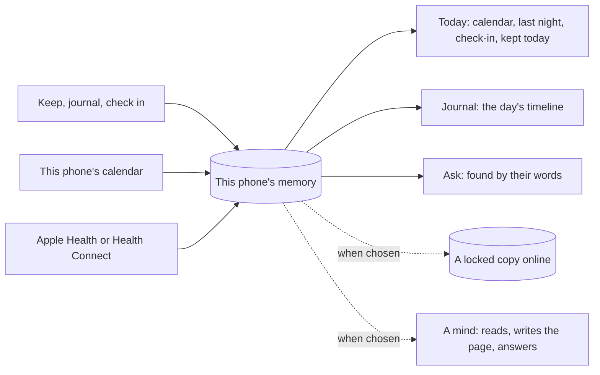
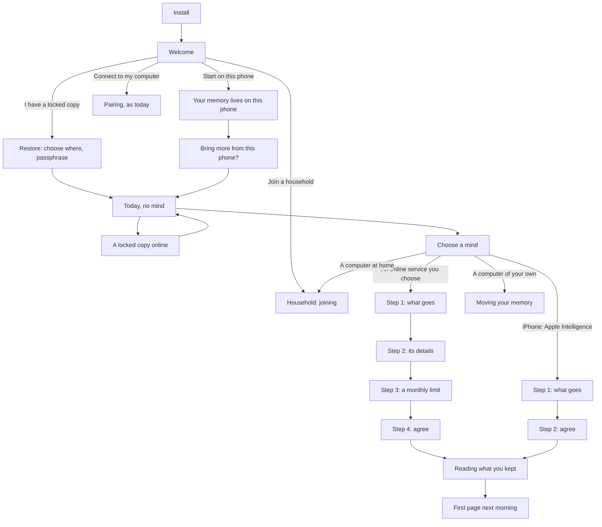
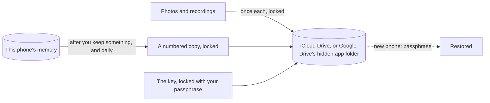

# Nocturne on a phone of its own

Part of [Phone and computer as equal starting points](phone-parity.md). This page covers a phone
with its own memory (step 1) and what it can turn on online (step 2): a locked copy, and a mind.

Status: proposed. Nothing here is built. The decisions it depends on are on the roadmap page.

## Mockups

In `docs/design/mockups/phone-parity/`, Android and iPhone side by side.

| Screen | File and states | Renders |
|---|---|---|
| First run and Today with no mind | `first-run.html`: `welcome`, `start`, `today`, `ask` | `first-run-welcome-light.png`, `first-run-welcome-dark.png`, `first-run-start-light.png`, `first-run-today-light.png`, `first-run-today-dark.png`, `first-run-ask-light.png` |
| A locked copy online | `copy-online.html`: `why`, `passphrase`, `on` | `copy-online-why-light.png`, `copy-online-why-dark.png`, `copy-online-passphrase-light.png`, `copy-online-on-light.png` |
| Choosing a mind | `mind.html`: `choose`, `service`, `consent`, `apple`, `first-page` | `mind-choose-light.png`, `mind-choose-dark.png`, `mind-service-light.png`, `mind-consent-light.png`, `mind-apple-light.png`, `mind-first-page-light.png` |
| This phone, a phone alone | `this-phone.html`: `alone` | `this-phone-alone-light.png`, `this-phone-alone-dark.png` |

## What a phone alone is

| Works from the first minute | Waits for a mind |
|---|---|
| Keep a note, a photo, a voice note, a shared page | Reading photos and documents |
| The journal: entries, good things, feelings, today's timeline | Reflections and recaps |
| Check-ins | The morning page |
| The calendar and health, on Today and beside the journal | Answers to questions |
| Finding what you kept by its words, with receipts | Noticing what changed, what needs you, what fades |
| Voice notes turned into words by the phone itself, where it can do that with no network ([decision 9](phone-parity.md#decisions)) | |

Forgetting and fading run on the phone without a mind: they are clocks, not reading. The calendar
and health come from the phone itself, so the "goes only to your computer" lines of [Nocturne on
Android and iPhone](phone-apps.md) change to "stays on this phone" (below).

## Journeys

## Screens

The copy in quotes is the proposed interface copy. Curly braces are values; `{thisPhone}` and
similar names are control chips ([Control chips](control-chips.md)). Strings reused from
[Nocturne on Android and iPhone](phone-apps.md) are marked "Phone apps".

### 1. The store listing

One app, `is.nocturne.phone`, published by Nocturne, for every mode.

| Part | Copy |
|---|---|
| Name | "Nocturne" |
| Short description (Google Play, 80 at most) | "Keep your day, your journal and your calendar in one place. Private by default." |
| Subtitle (App Store, 30 at most) | "Your day, remembered" |
| First lines | "Nocturne remembers your day: notes, photos, voice notes, your journal, your calendar and your health readings, side by side. It starts on your phone, with no account and no sign-in." |
| Growing | "When you want answers and a morning page, give it a mind: a computer at home that runs Nocturne, an online service you choose, or Nocturne on your own computer." |
| What it does not do | "No account. No ads. Nothing leaves your phone unless you turn it on, and every screen that turns something on says exactly what goes and to whom." |

### 2. Welcome

Replaces the approved "Nocturne lives on your computer" welcome. The way in from a computer is the
same pairing, one tap further in.

| Part | Copy |
|---|---|
| Mark and title | "Nocturne remembers your day" |
| Lead | "Keep notes, photos and voice notes, write your journal, and see your calendar beside your days." |
| Main button | "Start on this phone" |
| Second button | "Connect to my computer" |
| Third button | "Join a household" |
| Link | "I have a locked copy" |
| Foot | "No account and no sign-in." |

"Connect to my computer" opens the approved pairing ([Phone apps](phone-apps.md#3-pairing)), with
its title "Nocturne lives on your computer" kept on the scan screen's lead. "Join a household"
opens [Joining](household-server.md#joining).

### 3. Your memory lives on this phone

| Part | Copy |
|---|---|
| Title | "Your memory lives on this phone" |
| Works now heading | "Works now" |
| Works now | "Keep notes, photos and voice notes · Write your journal and check in · See your calendar and health beside your days · Find anything you kept by its words" |
| Waits heading | "Waits for a mind" |
| Waits | "Reading photos · Your morning page · Answers · Reflections and recaps" |
| Waits hint | "Choose a mind any time: a computer at home, an online service, or your own computer." |
| Lost phone | "If this phone is lost, what you kept goes with it, unless you keep a locked copy online. You can turn that on later." |
| Main button | "Start" |

"Start" leads to the approved offer, "Bring more from this phone?", with its lead changed for a
phone alone (below), then to Today.

### 4. Calendar and health on a phone alone

The approved screens, asks and system prompts are reused. Only the lines about where things go
change.

| Screen | Phone apps | A phone alone |
|---|---|---|
| Offer, lead | "Your computer can show what’s in this phone’s calendar and health readings, on your page and beside your journal. Both are optional. You can change your mind any time in {thisPhone}." | "Nocturne can show what’s in this phone’s calendar and health readings beside your days. Both are optional. You can change your mind any time in {thisPhone}." |
| Calendar why, title | "Bring your calendar to your computer?" | "Show your calendar in Nocturne?" |
| Calendar why, goes | "It goes only to your computer, the same way as everything this phone keeps…" | "It stays on this phone, in Nocturne’s memory, and goes wherever your memory goes: into a locked copy or to a mind, only if you turn those on." |
| Calendar why, for | "Your page shows what’s on today and this week…" | "Today shows what’s on, and your journal shows each appointment at its time. Each line shows which calendar it came from." |
| Which calendars | Holidays and birthdays start off | Every calendar the phone has starts on, work-profile calendars included, each named as the phone names it ([decision 20](phone-parity.md#decisions)) |
| iPhone purpose, calendar | "Nocturne reads your calendar so your computer can show what’s on today on your morning page…" | "Nocturne reads your calendar so it can show what’s on today beside your days. It never changes your calendar." |

Health follows the same change in [Health from the phone](phone-health.md): "only to your
computer" becomes "stays on this phone".

### 5. Today with no mind

| Part | What shows |
|---|---|
| Top bar | The mark and "Today", and This phone at the right |
| Status | "Your memory is on this phone" |
| Date | "{weekday} {day} {month}" |
| The card, where the page would be | Title "Your page needs a mind to write it." Body "A mind reads what you keep, writes this page each morning and answers your questions." Button "Choose a mind" |
| Last night | As approved, when sleep is brought |
| In your calendar today | As approved, from this phone's calendar only. Receipt chip "Calendar · {calendar}" |
| Check-in | Today's check-in card, as on the phone's journal |
| Kept today | "Kept today · {count}", up to three rows, then "See today’s journal" |
| Lost phone reminder | After 30 days of keeping with no copy, once: "No locked copy yet. If this phone is lost, what you kept goes with it." with "Keep a locked copy" and "Not now" |
| Keep | The floating Keep button |

### 6. Journal with no mind

The approved journal, from the phone's own memory. Rows for photos and documents show their kind,
time and any note, with "waiting to be read" in the secondary ink. Voice notes show their words when
the phone heard them, else "waiting to be read". No reflection is offered; where it would be:
"Reflections need a mind." Recaps are not listed.

### 7. Ask with no mind

| Part | Copy |
|---|---|
| Box placeholder | "Find something you kept" |
| Above results | "Found by their words. Answers need a mind." |
| Each result | The kept thing's words with the match marked, its day, and its receipt chip |
| No result | "Nothing you kept has those words." |
| Foot | "Choose a mind" (quiet link) |

### 8. This phone

| Group | Row | Value or hint |
|---|---|---|
| Your memory | "Where it is" | "On this phone" · "{size}" |
| | "Its mind" | "None yet" or "{service}, online" or "Apple Intelligence" or "{household}, at home". Opens [Choosing a mind](#choosing-a-mind) |
| | "A locked copy online" | "Off" or "Last copy {time}". Opens [A locked copy online](#a-locked-copy-online) |
| What this phone brings | "Your calendar", "Health" | As approved |
| When it sends | Not shown on a phone alone with no mind or copy | |
| This phone | "Name" | "{name}". Editable here, since there is no computer to rename it on |
| | "Version" | "Nocturne {version}" |
| Help | "Privacy policy", "What this phone can do" | "What this phone can do" reads "Your memory is on this phone. It can keep, find, forget and delete. It can export a backup to a file." |
| Your memory | "Move my memory…" | Opens [Moving your memory](moving-memory.md) |
| | "Export a backup…" | The 0013 backup, saved through the phone's share sheet |
| At the end | "Delete everything…" | The approved confirmation, worded for this phone |

A phone alone can delete, forget and export, which a companion cannot: it holds the memory.

## A locked copy online

The owner's opt-in copy online ([decisions 1 to 5](phone-parity.md#decisions)): one
locked copy of the one home, in the phone's own online storage, opened only with the person's
passphrase. The phone's own device backup leaves the memory out, so this is the one copy.

### Step 1: why

Light first step, as Online answers step 1 ([Keeping the next step in view](step-flow-actions.md)).

| Part | Copy |
|---|---|
| Step label | "A locked copy online · step 1 of 2" |
| Title | "Keep a locked copy of your memory online, so a lost phone doesn’t lose it." |
| What goes | "Everything you kept, in one locked copy, made again after you keep something. Photos and recordings go once each." |
| Who can open it | iPhone: "Only someone with your passphrase. Apple stores it but can’t open it, and neither can Nocturne’s makers." Android: "Only someone with your passphrase. Google stores it but can’t open it, and neither can Nocturne’s makers." |
| You need | iPhone: "iCloud Drive turned on, and room for about {size}." Android: "A Google account, and room for about {size} in its Drive." |
| Expander, closed | "Everything about the copy" |
| Bar | "Continue" · "Not now" · "Nothing is turned on until the last step." |

Behind the expander, in this order:

| Part | Copy |
|---|---|
| Where | iPhone: "In iCloud Drive, in a folder only Nocturne uses. It doesn’t show among your files." Android: "In your Google Drive, in a hidden folder only Nocturne can reach. Nocturne asks Google for that folder and nothing else in your Drive." |
| What the company sees | "{company} can see that the copy is there, how big it is and when it changes. It can’t see what is in it." |
| How many | "The last seven copies are kept. When you forget something for good, the older copies go at once, so it leaves the copy too." |
| Your phone’s own backup | "Your phone’s own backup leaves your memory out, so this is the one copy." |
| A new phone | "Install Nocturne, choose I have a locked copy, and type your passphrase." |
| Turning it off | "Turn it off in {thisPhone}. You then choose whether to delete the copy." |
| Advanced | "Use storage you run instead" opens a form for an address, a user name and a password |

### Choosing the account (Android only)

"Continue" on Android opens Google's own account screen, which names the hidden app folder. Nocturne
asks only for that. A refusal returns to step 1 with "Nothing was turned on. Google didn’t allow
the folder." and the bar unchanged.

### Step 2: the passphrase

The backup form's words ([Back up and restore](backup-and-restore.md#the-form)), on the phone.

| Part | Copy |
|---|---|
| Step label | "A locked copy online · step 2 of 2" |
| Title | "Choose a passphrase for the copy" |
| Field | "Choose a passphrase" / hint "At least 8 characters. A few words that don’t go together are strong and easy to remember." (0013) |
| Second field | "Type it again" (0013) |
| Show | "Show passphrases" (0013) |
| Note title | "Keep this passphrase safe" (0013) |
| Note body | "Nocturne doesn’t keep it anywhere you can read. If the passphrase is lost, nobody can open this copy, not even Nocturne. You need it only on a new phone. Write it down and keep it somewhere safe, or save it in a password manager." |
| Note tick | "I’ve written it down or saved it somewhere safe" (0013) |
| Bar | "Turn on" · "Back" · disabled reason "Choose a passphrase, type it again and tick the box to go on." (0013) |

The strength hint and validation are 0013's. The passphrase locks one small key; the key itself is
kept in the phone's own safe place, so later copies need no passphrase.

### Making the first copy

| Part | Copy |
|---|---|
| Title | "Making the first copy" |
| Progress | "{done} of {size}" |
| Note | "You can use Nocturne while this runs." |
| Done | "Your locked copy is online." / "Made {time}. It is made again after you keep something." / "OK" |

The first copy is read back and checked before the switch shows as on. If the phone leaves the app,
it carries on when the phone allows and the row in This phone says how far it got.

### The copy in This phone

| Part | Copy |
|---|---|
| Switch | "A locked copy online" |
| Hint, on | "Last copy {time} · {size} in iCloud Drive" or "in Google Drive" |
| Row | "Change the passphrase…" |
| Row | "Turn off…" |
| About heading | "About the copy", then the expander's "What the company sees", "How many", "Your phone’s own backup" and "A new phone", each under its label |
| Turn off dialog | "Turn off the locked copy?" / "No new copies are made. The copy that is there stays until you delete it." / tick, off: "Also delete the copy online" / "Turn off" · "Keep it on" |

### Restoring on a new phone

From Welcome, "I have a locked copy". On Android, Google's account screen first.

| Part | Copy |
|---|---|
| Title | "Bring back your memory" |
| Lead | "Type the passphrase you chose for your locked copy." |
| Found | "Copy from {time} · {size}" |
| Field | "Passphrase for this copy" |
| Button | "Bring it back" |
| Wrong | "That passphrase doesn’t open this copy. Check capital letters, and try again." (0013, worded for the copy) |
| None found | "No locked copy found in iCloud Drive." / "in this Google account’s Drive." with "Try another account" on Android |
| Done | "Your memory is back on this phone." / "{count} things, every page and your journal." / "Continue" |

The 0013 checks run before anything shows. A restored phone makes the next copy only after the
person confirms it is now the phone in use, so two phones never both make copies: "This phone now
makes the copies. If your old phone turns up, it stops making them."

### States

| State | What shows |
|---|---|
| Copy up to date | "Last copy {time}" |
| Waiting for a connection | "Last copy {time} · the next one waits for a connection" |
| Storage full | In This phone: "There’s no room for the next copy in iCloud Drive." or "in your Google Drive." / "Your last copy from {time} is still there." No alert elsewhere |
| Google access taken back | "Google no longer allows the folder. Choose the account again to keep making copies." with "Choose account" |
| Another phone made a newer copy | "Another phone made a newer copy on {day}. This phone has stopped making copies, so nothing is overwritten." with "Make this phone the one in use" (explained: the next copy from here is newer) |
| Copy from a newer Nocturne | 0013's "This backup is from a newer Nocturne" words, worded for the copy |

## Choosing a mind

Where Nocturne's mind comes from, for a phone alone. The phone's Claude, Gemini or ChatGPT app is
not a choice: one company forbids other apps from using a person's subscription, another offers no
way for an app to get an answer back, and the Android route where an assistant calls apps runs the
other way, sending memories to the assistant's company. Nothing is shown for what can't be done.

### Where should Nocturne's mind be?

| Part | Copy |
|---|---|
| Title | "Where should Nocturne’s mind be?" |
| Lead | "A mind reads what you keep, writes your page each morning and answers your questions. Your memory stays on this phone whichever you choose." |
| Choice | "A computer at home" / "Someone in your household runs Nocturne on a computer that’s always on and invites you. It reads and answers for you, and keeps nothing of yours." |
| Choice | "An online service you choose" / "A company you have an account with reads the words of what you keep. You’ll copy three details from its website." |
| Choice, iPhone, after the trial | "Apple Intelligence" / "Apple’s servers read the words of what you keep. No account or key." |
| Choice | "A computer of your own" / "Install Nocturne on your computer and move your memory there. This phone then works with it." |
| Bar | "Continue" · "Not now" |

The memory-stays line is true of the first three: using a mind never moves a memory or leaves a
copy of it where the mind runs. The fourth moves the memory, by pairing, and says so in its own
line. "On this phone" joins the list only when the phone's own mind ships.

### An online service you choose

Four steps, following Online answers' five less the step that chooses which questions go, because a
phone alone has only its own.

**Step 1: what goes.**

| Part | Copy |
|---|---|
| Step label | "Nocturne’s mind online · step 1 of 4" |
| Title | "Have Nocturne’s mind work online, with a service you choose." |
| Sent | "The words of what you keep, your journal entries and good things, and your questions. Only words: what you typed, and what this phone heard in your voice notes." |
| Never sent | "Your photos and recordings themselves, your check-ins, reflections and recaps, and anything you marked private." |
| You need | "An account with that service. Most charge a little for what they read and write. Setting up means copying three details from its website." |
| Expander, closed | "Everything that is sent, and what stays here" |
| Bar | "Continue" · "Not now" · "Nothing is turned on until the last step." |

Behind the expander: step 4's sections, in the same order, with its example.

**Step 2: its details.** Online answers' Connect, on the phone: "API URL", "API key", "Model name",
the check, and "Continue works once the check passes." The key is kept in the phone's own safe
place.

| Part | Copy |
|---|---|
| Step label | "Nocturne’s mind online · step 2 of 4" |
| Title | "Your service’s details" |
| Lead | "Find these on your service’s website, often under API or developer settings." |
| Fields | "API URL" · "API key" · "Model name" |
| Check | "Check" / checking "Checking with {host}…" / passed "{host} answered. It works." |
| Bar | "Continue" · "Back" · disabled reason "Continue works once the check passes." |

**Step 3: a monthly limit.** Online answers' step 4, worded for reading too: "How much may go online
each month?" with "No limit", "A number of things read and answered" and "An amount", and the same
disabled reasons.

**Step 4: agree.** Every fact on screen.

| Part | Copy |
|---|---|
| Step label | "Nocturne’s mind online · step 4 of 4" |
| Title | "Before you turn this on, here is exactly what happens." |
| Lead | "While this is on, the words of what you keep and your questions leave this phone. Your photos, recordings and check-ins stay here." |
| What is sent | "The words of each thing you keep: what you typed, what this phone heard in a voice note, the text of a page you shared. Your journal entries and good things. Each question, with the few lines that answer it. Each night, the lines your page is written from. For example:" |
| Example | "Kept 7:40 am · Dentist moved to Thursday at 9, Bridge Street." |
| Where it goes | "This phone sends it straight to {host}, which reads it and writes back. Nocturne keeps what it learned on this phone, with its receipts, and checks every receipt before you see it. Nothing passes through Nocturne’s makers." |
| Who can see it | "{host} can see everything sent, when it is sent, and this phone’s internet address. What it uses, {used}, may be made by another company that the service passes things to." / "Nocturne can’t check what the service keeps, for how long, or whether it learns from what you send. Read its privacy page before you turn this on." (0011) |
| Never sent | "Photos and recordings themselves" · "Your check-ins. Reflections and recaps wait until your memory has a mind at home." · "Things you marked private" |
| What changes | "{host} reads what you keep, writes your page each morning and answers your questions, on your account with them, so it may charge for each. Reading happens when this phone allows it, often while it charges. If it can’t be reached, what you keep waits to be read and Ask finds by words." |
| Changing your mind | "{limit line}" · "Turn it off at any time in {thisPhone}. What was already read stays in your memory on this phone." · "Every answer and every page says where it was written. {seeWhatWasSent} shows the exact words." |
| Bar | "Turn on" · "Not now" |

The limit lines are 0011's, worded for "things read and answered".

### Apple Intelligence (iPhone, after the trial)

Two steps: step 1, then agreeing. No details and no limit step, because there is no account or
cost. Everything not listed is the online service's words with "{host}" as "Apple".

| Part | Copy |
|---|---|
| Step 1, label | "Apple Intelligence · step 1 of 2" |
| Step 1, title | "Have Nocturne’s mind work on Apple’s servers." |
| Step 1, you need | "Apple Intelligence turned on, on this iPhone. No account, key or cost." |
| Step 2, label | "Apple Intelligence · step 2 of 2" |
| Who can see it | "Apple’s servers read what is sent and write back. Apple says what is sent is used only to answer and is not kept. Nocturne can’t check that itself." |
| What changes | "Apple reads what you keep, writes your page each morning and answers your questions. Apple may limit how much it does each day; when it does, what you keep waits to be read." |
| Bar | "Turn on" · "Not now" |

To confirm in the trial: the daily limits, whether use is counted on the person's Apple Account, and
whether the terms for small publishers hold.

### Reading what you kept

After turning on, once.

| Part | Copy |
|---|---|
| Title | "Reading what you kept" |
| Body | "Nocturne is reading {count} things you kept, a few at a time. Your first page comes tomorrow morning." |
| Progress | "{done} of {count} read" |
| Note | "Reading carries on when this phone allows it, often while it charges." |
| Button | "OK" |

Next morning, Today shows the page as the companion's phone edition does, with the receipt chips,
and a line under the title: "Written by {host}" or "Written by Apple Intelligence".

### The mind in This phone

A group headed "Nocturne’s mind online" (or "Apple Intelligence"), under Your memory.

| Row | Value |
|---|---|
| "Its mind" | "{service}, online" |
| "What goes" | "Words of what you keep, and questions" |
| "See what was sent" | Opens the Sent online list on the phone, 90 days, as 0011 |
| "This month" | "{count} things read and answered · limit {limit}" |
| "Change…" | Back to the choice |
| "Turn off…" | "Turn off Nocturne’s mind online?" / "What was read stays in your memory. What you keep from now waits to be read." / "Turn off" · "Keep it on" |

### States

| State | What shows |
|---|---|
| Reading | Nothing on Today; This phone: "Reading · {done} of {count}" |
| Service unreachable | Today keeps the last page with "Written {day}. {host} hasn’t answered since {time}." Ask finds by words with "Answers are back when {host} is." |
| Key refused, no credit | 0011's titles and bodies, with "this computer answers" replaced by "Ask finds by words" |
| Paused by the limit | 0011's words, "until {day}" |
| No connection | "This phone isn’t online. What you keep waits to be read." |

## Copy

New strings only. Strings from Online answers, backup and the phone apps are marked where used.

| Key | Copy |
|---|---|
| Listing, short | "Keep your day, your journal and your calendar in one place. Private by default." |
| Listing, subtitle | "Your day, remembered" |
| Listing, first lines | "Nocturne remembers your day: notes, photos, voice notes, your journal, your calendar and your health readings, side by side. It starts on your phone, with no account and no sign-in." |
| Listing, growing | "When you want answers and a morning page, give it a mind: a computer at home that runs Nocturne, an online service you choose, or Nocturne on your own computer." |
| Listing, does not | "No account. No ads. Nothing leaves your phone unless you turn it on, and every screen that turns something on says exactly what goes and to whom." |
| Welcome, title | "Nocturne remembers your day" |
| Welcome, lead | "Keep notes, photos and voice notes, write your journal, and see your calendar beside your days." |
| Welcome, buttons | "Start on this phone" / "Connect to my computer" / "Join a household" |
| Welcome, link | "I have a locked copy" |
| Welcome, foot | "No account and no sign-in." |
| Start, title | "Your memory lives on this phone" |
| Start, works | "Works now" / "Keep notes, photos and voice notes" / "Write your journal and check in" / "See your calendar and health beside your days" / "Find anything you kept by its words" |
| Start, waits | "Waits for a mind" / "Reading photos" / "Your morning page" / "Answers" / "Reflections and recaps" |
| Start, waits hint | "Choose a mind any time: a computer at home, an online service, or your own computer." |
| Start, lost phone | "If this phone is lost, what you kept goes with it, unless you keep a locked copy online. You can turn that on later." |
| Start, button | "Start" |
| Offer, lead, alone | "Nocturne can show what’s in this phone’s calendar and health readings beside your days. Both are optional. You can change your mind any time in {thisPhone}." |
| Calendar why, alone | "Show your calendar in Nocturne?" / "It stays on this phone, in Nocturne’s memory, and goes wherever your memory goes: into a locked copy or to a mind, only if you turn those on." / "Today shows what’s on, and your journal shows each appointment at its time. Each line shows which calendar it came from." |
| iPhone purpose, calendar, alone | "Nocturne reads your calendar so it can show what’s on today beside your days. It never changes your calendar." |
| Today, status, alone | "Your memory is on this phone" |
| Kept today | "Kept today · {count}" / "See today’s journal" |
| No mind card | "Your page needs a mind to write it." / "A mind reads what you keep, writes this page each morning and answers your questions." / "Choose a mind" |
| No copy reminder | "No locked copy yet. If this phone is lost, what you kept goes with it." / "Keep a locked copy" / "Not now" |
| Waiting to be read | "waiting to be read" |
| No reflection | "Reflections need a mind." |
| Find, placeholder | "Find something you kept" |
| Find, above | "Found by their words. Answers need a mind." |
| Find, none | "Nothing you kept has those words." |
| This phone, memory | "Your memory" / "Where it is" / "On this phone" / "Its mind" / "None yet" / "{service}, online" / "Apple Intelligence" / "{household}, at home" |
| This phone, copy row | "A locked copy online" / "Off" / "Last copy {time}" |
| This phone, can do, alone | "Your memory is on this phone. It can keep, find, forget and delete. It can export a backup to a file." |
| This phone, actions | "Move my memory…" / "Export a backup…" / "Delete everything…" |
| Copy, step 1 | "A locked copy online · step 1 of 2" / "Keep a locked copy of your memory online, so a lost phone doesn’t lose it." |
| Copy, what goes | "Everything you kept, in one locked copy, made again after you keep something. Photos and recordings go once each." |
| Copy, who opens | "Only someone with your passphrase. {company} stores it but can’t open it, and neither can Nocturne’s makers." |
| Copy, you need | iPhone: "iCloud Drive turned on, and room for about {size}." / Android: "A Google account, and room for about {size} in its Drive." |
| Copy, expander | "Everything about the copy" |
| Copy, where | iPhone: "In iCloud Drive, in a folder only Nocturne uses. It doesn’t show among your files." / Android: "In your Google Drive, in a hidden folder only Nocturne can reach. Nocturne asks Google for that folder and nothing else in your Drive." |
| Copy, company sees | "{company} can see that the copy is there, how big it is and when it changes. It can’t see what is in it." |
| Copy, how many | "The last seven copies are kept. When you forget something for good, the older copies go at once, so it leaves the copy too." |
| Copy, device backup | "Your phone’s own backup leaves your memory out, so this is the one copy." |
| Copy, new phone | "Install Nocturne, choose I have a locked copy, and type your passphrase." |
| Copy, labels | "What the company sees" / "How many" / "Your phone’s own backup" / "A new phone" / "About the copy" |
| Copy, turning off | "Turn it off in {thisPhone}. You then choose whether to delete the copy." |
| Copy, advanced | "Use storage you run instead" |
| Copy, Google refused | "Nothing was turned on. Google didn’t allow the folder." |
| Copy, step 2 | "A locked copy online · step 2 of 2" / "Choose a passphrase for the copy" |
| Copy, keep safe body | "Nocturne doesn’t keep it anywhere you can read. If the passphrase is lost, nobody can open this copy, not even Nocturne. You need it only on a new phone. Write it down and keep it somewhere safe, or save it in a password manager." |
| Copy, bar | "Turn on" / "Back" |
| Copy, making | "Making the first copy" / "{done} of {size}" / "You can use Nocturne while this runs." |
| Copy, made | "Your locked copy is online." / "Made {time}. It is made again after you keep something." / "OK" |
| Copy, row hint | "Last copy {time} · {size} in iCloud Drive" / "Last copy {time} · {size} in Google Drive" |
| Copy, rows | "Change the passphrase…" / "Turn off…" |
| Copy, turn off | "Turn off the locked copy?" / "No new copies are made. The copy that is there stays until you delete it." / "Also delete the copy online" / "Turn off" / "Keep it on" |
| Restore | "Bring back your memory" / "Type the passphrase you chose for your locked copy." / "Copy from {time} · {size}" / "Passphrase for this copy" / "Bring it back" |
| Restore, wrong | "That passphrase doesn’t open this copy. Check capital letters, and try again." |
| Restore, none | "No locked copy found in iCloud Drive." / "No locked copy found in this Google account’s Drive." / "Try another account" |
| Restore, done | "Your memory is back on this phone." / "{count} things, every page and your journal." / "Continue" |
| Restore, in use | "This phone now makes the copies. If your old phone turns up, it stops making them." |
| Copy, waiting | "Last copy {time} · the next one waits for a connection" |
| Copy, full | "There’s no room for the next copy in iCloud Drive." / "There’s no room for the next copy in your Google Drive." / "Your last copy from {time} is still there." |
| Copy, access gone | "Google no longer allows the folder. Choose the account again to keep making copies." / "Choose account" |
| Copy, another phone | "Another phone made a newer copy on {day}. This phone has stopped making copies, so nothing is overwritten." / "Make this phone the one in use" |
| Mind, choose | "Where should Nocturne’s mind be?" / "A mind reads what you keep, writes your page each morning and answers your questions. Your memory stays on this phone whichever you choose." |
| Mind, home | "A computer at home" / "Someone in your household runs Nocturne on a computer that’s always on and invites you. It reads and answers for you, and keeps nothing of yours." |
| Mind, service | "An online service you choose" / "A company you have an account with reads the words of what you keep. You’ll copy three details from its website." |
| Mind, Apple | "Apple Intelligence" / "Apple’s servers read the words of what you keep. No account or key." |
| Mind, own computer | "A computer of your own" / "Install Nocturne on your computer and move your memory there. This phone then works with it." |
| Mind online, step 1 | "Nocturne’s mind online · step {n} of 4" / "Have Nocturne’s mind work online, with a service you choose." |
| Mind online, sent | "The words of what you keep, your journal entries and good things, and your questions. Only words: what you typed, and what this phone heard in your voice notes." |
| Mind online, never | "Your photos and recordings themselves, your check-ins, reflections and recaps, and anything you marked private." |
| Mind online, need | "An account with that service. Most charge a little for what they read and write. Setting up means copying three details from its website." |
| Mind online, details | "Your service’s details" / "Find these on your service’s website, often under API or developer settings." / "Checking with {host}…" / "{host} answered. It works." |
| Mind online, limit | "How much may go online each month?" / "A number of things read and answered" |
| Mind online, lead | "While this is on, the words of what you keep and your questions leave this phone. Your photos, recordings and check-ins stay here." |
| Mind online, what is sent | "The words of each thing you keep: what you typed, what this phone heard in a voice note, the text of a page you shared. Your journal entries and good things. Each question, with the few lines that answer it. Each night, the lines your page is written from. For example:" |
| Mind online, where | "This phone sends it straight to {host}, which reads it and writes back. Nocturne keeps what it learned on this phone, with its receipts, and checks every receipt before you see it. Nothing passes through Nocturne’s makers." |
| Mind online, sees | "{host} can see everything sent, when it is sent, and this phone’s internet address. What it uses, {used}, may be made by another company that the service passes things to." |
| Mind online, never list | "Photos and recordings themselves" / "Your check-ins. Reflections and recaps wait until your memory has a mind at home." / "Things you marked private" |
| Mind online, changes | "{host} reads what you keep, writes your page each morning and answers your questions, on your account with them, so it may charge for each. Reading happens when this phone allows it, often while it charges. If it can’t be reached, what you keep waits to be read and Ask finds by words." |
| Mind online, changing | "Turn it off at any time in {thisPhone}. What was already read stays in your memory on this phone." / "Every answer and every page says where it was written. {seeWhatWasSent} shows the exact words." |
| Mind online, bar | "Turn on" / "Not now" |
| Apple, step 1 | "Apple Intelligence · step {n} of 2" / "Have Nocturne’s mind work on Apple’s servers." / "Apple Intelligence turned on, on this iPhone. No account, key or cost." |
| Apple, sees | "Apple’s servers read what is sent and write back. Apple says what is sent is used only to answer and is not kept. Nocturne can’t check that itself." |
| Apple, changes | "Apple reads what you keep, writes your page each morning and answers your questions. Apple may limit how much it does each day; when it does, what you keep waits to be read." |
| Reading | "Reading what you kept" / "Nocturne is reading {count} things you kept, a few at a time. Your first page comes tomorrow morning." / "{done} of {count} read" / "Reading carries on when this phone allows it, often while it charges." |
| Written by | "Written by {host}" / "Written by Apple Intelligence" |
| Mind group | "Nocturne’s mind online" |
| Mind rows | "What goes" / "Words of what you keep, and questions" / "This month" / "{count} things read and answered · limit {limit}" |
| Mind, turn off | "Turn off Nocturne’s mind online?" / "What was read stays in your memory. What you keep from now waits to be read." / "Turn off" / "Keep it on" |
| Mind, unreachable | "Written {day}. {host} hasn’t answered since {time}." / "Answers are back when {host} is." |
| Mind, offline | "This phone isn’t online. What you keep waits to be read." |

## Accessibility

- Every first step reads in order: label, title, the three lines, the expander, then the bar.
- The no-mind card on Today is one region with its title as the name; "Choose a mind" is a real
  button, not a link in a sentence.
- Find results read as "{words}, kept {day}, {kind}". The matched words are marked visually and not
  announced twice.
- The passphrase screens keep 0013's rules: no lockout, no red for a weak passphrase, text that
  follows the phone's size up to 200 per cent.
