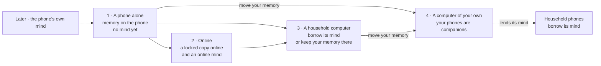
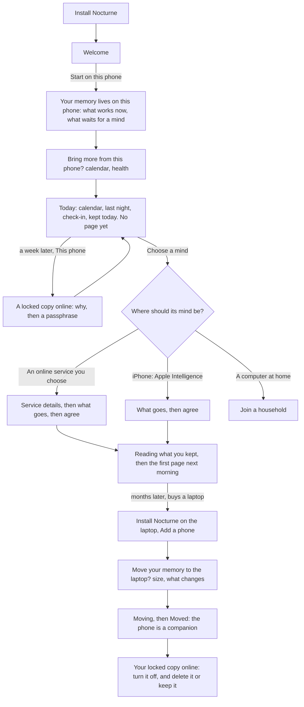
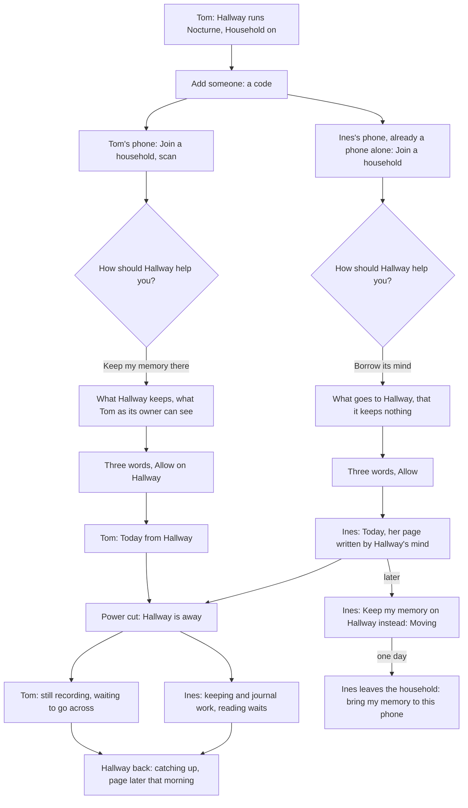
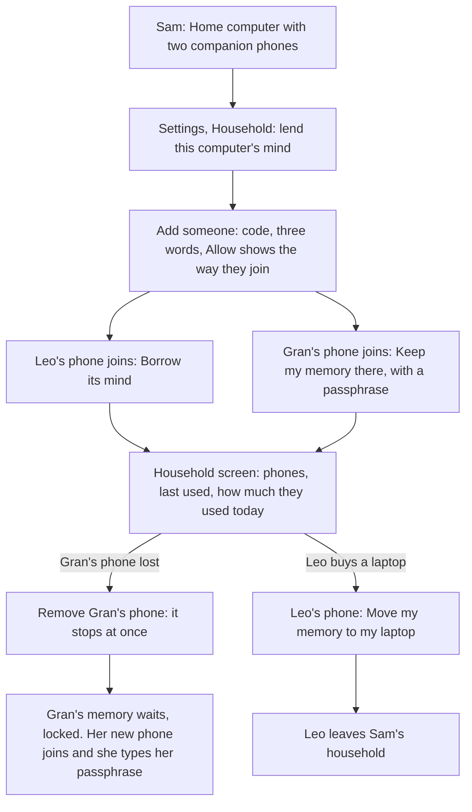
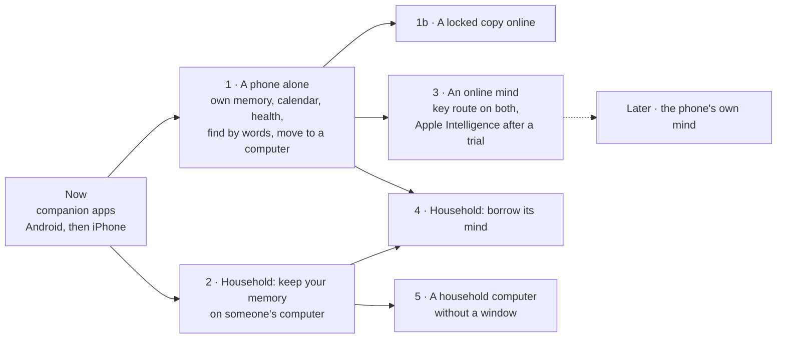

# Phone and computer as equal starting points

Today Nocturne starts on a computer. A phone is a companion: it keeps, asks and reads the page
while the computer holds the memory and does the thinking ([Nocturne on Android and
iPhone](phone-apps.md)). That leaves out people who have no computer, or none that is on at night,
and it makes a household with one computer choose whose memory it keeps.

This page proposes the way there: a person can start on either, and grow from there. It is a
roadmap, not one build. Each step is a design of its own, on the pages below, and each needs the
owner's decisions before it is built.

Status: proposed. Nothing here is built. The design for today's companion apps is unchanged and
ships first.

| Page | What it covers |
|---|---|
| This page | The ladder, personas, journeys, what each mode shows, who sees what, rule changes, phasing, risks, decisions |
| [Nocturne on a phone of its own](phone-first.md) | Step 1 and step 2: first run without a computer, Today with no mind, a locked copy online, choosing an online mind, their consent screens and copy |
| [A household computer](household-server.md) | Step 3 and hosting in step 4: joining a household, the two ways to join, what the person who runs it can and cannot see, the mind being away, leaving, removing, the household screen on a computer, copy |
| [Moving your memory](moving-memory.md) | One home at a time: moving a memory from a phone to a computer or a household, and back, with what happens to copies and the phone afterwards |

## Mockups

In `docs/design/mockups/phone-parity/`, with the kit and rules of the [phone app
mockups](phone-apps.md#mockups): serve the repository root over HTTP after `make ui/install`, add
`?state=` and `&theme=light` or `&theme=dark`. `index.html` links every view. Phone screens show
Android (412 by 892) and iPhone (393 by 852) side by side, rendered 920 by 1000. Computer screens
are 1280 wide, full length. A dashed outline marks what is new on an existing screen; it is not part
of the design. All names and data are fictional.

| Screen | File and states | Page |
|---|---|---|
| First run on a phone, and Today with no mind | `first-run.html`: `welcome`, `start`, `today`, `ask` | [Phone first](phone-first.md#screens) |
| A locked copy online | `copy-online.html`: `why`, `passphrase`, `on` | [Phone first](phone-first.md#a-locked-copy-online) |
| Choosing a mind | `mind.html`: `choose`, `service`, `consent`, `apple`, `first-page` | [Phone first](phone-first.md#choosing-a-mind) |
| Joining a household | `household.html`: `found`, `choose`, `see`, `passphrase`, `words`, `joined` | [Household](household-server.md#joining) |
| The mind is away | `away.html`: `today`, `journal`, `back`, `removed` | [Household](household-server.md#states) |
| This phone in each mode | `this-phone.html`: `alone`, `guest`, `member` | [Phone first](phone-first.md#8-this-phone), [Household](household-server.md#this-phone) |
| The household on a computer | `desktop-household.html`: `household`, `add`, `allow`, `remove`, `off` | [Household](household-server.md#on-the-computer-that-runs-it) |
| Moving your memory | `move.html`: `found`, `size`, `moving`, `moved`; `desktop-move.html`: `receive`, `done` | [Moving](moving-memory.md#screens) |

## Goals

1. **Start anywhere.** A person can install Nocturne on a phone with no computer and use it from the
   first minute: keep, write the journal, check in, and see their calendar and health beside their
   days.
2. **Grow without starting over.** Adding a mind, a household computer or a computer of one's own
   keeps everything kept so far, with its receipts.
3. **One memory, one person, one home.** A memory belongs to one person and lives in one place at a
   time. A copy is a locked copy of that home, never a second home that must be merged.
4. **Exact about who sees what.** Every step that lets something leave the phone says what goes,
   to whom, what they can see, and how to stop, before anything is turned on.
5. **The same Nocturne in every mode.** Today, Journal and Ask keep their place and words; a mode
   changes what fills them, not where they are.

## Not goals

- Two-way sync, or the same memory edited in two places.
- A Nocturne account, a hosted service, or anything run by the project that holds people's data.
- Using a person's Claude, Gemini or ChatGPT subscription as Nocturne's mind (see
  [Choosing a mind](phone-first.md#choosing-a-mind) for why).
- Nocturne as a tool inside another assistant. Parked for a separate design.
- A shared household memory. A household shares a computer's mind, never a memory.
- The phone's own mind, beyond a placeholder: it is the moonshot below.

## The ladder

| Step | Where the memory lives | Where the mind is | What leaves the phone | Today |
|---|---|---|---|---|
| 1 · A phone alone | On the phone | None yet: nothing is read, no page | Nothing | New |
| 2 · Online | On the phone, with a locked copy online if chosen | An online service the person chose, or Apple Intelligence on iPhone | The locked copy, to the person's own online storage. Words to be read and questions, to the mind they chose | New |
| 3 · Borrow a household's mind | On the phone | A household computer | Words, photos and recordings to be read, and questions, sealed, to that computer, which keeps nothing | New |
| 3 · Keep your memory in a household | On the household computer, locked apart | That computer | Everything kept, sealed, to that computer | New |
| 4 · A computer of your own | On the computer | The computer | What phones keep and bring, sealed, to the person's own computer | Today's build |
| Later · the phone's own mind | On the phone | On the phone | Nothing | Placeholder |

Steps are not a ladder a person must climb in order. A person can go from 1 straight to 4, join a
household from 2, or come back down from 4 to 1 by [moving their memory](moving-memory.md). The
interface never numbers them. It shows two plain facts in This phone: where your memory is, and
where its mind is.

### The phone's own mind, later

A placeholder only, so nothing here blocks it. When phones can read and tidy on their own at a
quality and battery cost the owner accepts, a phone alone gains a mind that never leaves it. The
owner has chosen the shape for when that comes: the same engine as the computer's smallest mind,
inside the app, with the phone's built-in minds as a quicker way to answer later; phones with 8 GB
of memory or more, Android 12 or later, iOS 17 or later. It would appear as one more choice in
[Choosing a mind](phone-first.md#choosing-a-mind), "On this phone", and changes nothing else on
these pages.

## Personas

Fictional people, each standing for a group the ladder serves.

| Persona | Who | Devices | Where they start | Where they go |
|---|---|---|---|---|
| **Maya** | Nurse on shifts, keeps a journal, no computer at home | An Android phone | Step 1, a phone alone | A locked copy online, an online mind, later a laptop of her own |
| **Tom and Ines** | A couple. Tom set up a small computer in the hall that is always on; Ines is careful about who holds her things | Tom: iPhone. Ines: Android. The hall computer, called Hallway | Tom keeps his memory on Hallway. Ines keeps hers on her phone and borrows Hallway's mind | Ines later moves her memory to Hallway; one day she moves out and takes it with her |
| **Sam** | Parent with a desktop, uses today's build. Hosts the household | A desktop called Home computer, two companion phones | Step 4 | Lends Home computer's mind to Leo (their son), and keeps Gran's memory for her, since she has no computer. Leo later buys a laptop and moves his memory there |

## Journeys

Each journey is the path through the screens on the sub-pages. Words in quotes are interface copy.

### Maya: a phone alone, then online, then a laptop

1. **Welcome.** Three ways in: "Start on this phone", "Connect to my computer", "Join a household".
   Maya has no computer, so she starts on the phone.
2. **What works now.** One screen says her memory lives on this phone, what works from the first
   minute (keep, the journal, check-ins, calendar and health), and what waits for a mind (reading
   photos and voice notes, answers, the morning page). It says plainly that if the phone is lost,
   so is the memory, unless she keeps a locked copy online.
3. **Today with no mind.** The date, her calendar today, last night's sleep, today's check-in and
   what she kept, with one quiet card: "Your page needs a mind to write it."
4. **A locked copy online.** From that card or This phone: what goes (one locked file), where (her
   own Google Drive), who can open it (only someone with her passphrase), then the passphrase.
5. **Choosing a mind.** She chooses an online service with her own key. The steps follow Online
   answers: the details, then what goes, then agreeing. Nocturne reads what she kept, in turn, and
   her first page comes the next morning.
6. **A laptop of her own.** She installs Nocturne on a laptop, which offers "Already use Nocturne on
   your phone?". Pairing as today, then "Move your memory to this computer?" with its size. When
   it has moved, her phone is a companion, as in today's build, and she chooses what happens to her
   locked copy online and her online mind.

### Tom and Ines: one household computer, two ways to join

1. **Tom sets up Hallway.** A computer that is always on, running Nocturne, with Household turned on
   ([Household](household-server.md#on-the-computer-that-runs-it)). It shows a code to add someone.
2. **Two ways to join.** Each phone scans the code and chooses: "Borrow its mind" (your memory stays
   on this phone; Hallway reads and answers for you and keeps nothing) or "Keep my memory there"
   (Hallway keeps your memory, locked apart, and reads it overnight; this phone keeps things until
   it can reach Hallway).
3. **What the person who runs it can see.** Before the three words, one screen says exactly what
   Tom, as the person who runs Hallway, can and cannot see, including the limit of what Nocturne
   can promise on a computer someone else controls.
4. **The mind is away.** During a power cut Tom's phone keeps recording and shows "waiting to go
   across"; Ines's phone keeps working as a phone alone, and reading waits. When Hallway is back,
   both catch up on their own.
5. **Changing the way you joined.** Ines later moves her memory onto Hallway. Changing the way one
   joined is moving a memory, so it follows [Moving your memory](moving-memory.md).
6. **Leaving.** When Ines moves out, "Leave this household" offers to bring her memory to her phone,
   then deletes it from Hallway only when she confirms.

### Sam: a computer of their own that hosts the household

1. **Lending the mind.** Sam turns on Household in Settings. Home computer keeps Sam's memory and
   companion phones as today, and lends its mind to household phones. Leo's memory stays on his
   phone; Gran's is kept on Home computer, locked apart from Sam's.
2. **Allowing a phone.** The Allow screen on the computer shows the phone's name and the way it
   wants to join, so Sam is never surprised later.
3. **The household screen.** Sam sees each phone's name, the way it joined, when it was last used and
   how much of the mind it used today: counts and time, never what was read or asked.
4. **Removing.** Gran's phone is lost; Sam removes it and it stops at once. Gran's memory stays on
   Home computer, locked with her key. Her new phone joins again, she types the passphrase she
   chose when she joined, and her page is back.
5. **Moving on.** Leo buys a laptop, moves his memory there from his phone, and leaves Sam's
   household.

### Moving up and back down

| From | To | What the person does | What moves | Page |
|---|---|---|---|---|
| A phone alone | A computer of their own | Installs Nocturne on the computer, pairs the phone, agrees to move | The phone's memory, to the computer. The phone becomes a companion | [Moving](moving-memory.md#from-a-phone-to-a-computer) |
| A phone alone | A household, borrowing its mind | Joins, chooses "Borrow its mind" | Nothing moves | [Household](household-server.md#joining) |
| A phone alone | A household, keeping memory there | Joins, chooses "Keep my memory there" | The phone's memory, to the household computer | [Moving](moving-memory.md#from-a-phone-to-a-household) |
| A household | A computer of their own | "Move my memory" on the phone | From the household computer to their own, through the phone or directly | [Moving](moving-memory.md#from-a-household-to-a-computer) |
| A household | A phone alone | "Leave this household", "Bring my memory to this phone" | From the household computer to the phone | [Moving](moving-memory.md#back-to-the-phone) |
| A computer of their own | A phone alone | On the computer, "Move my memory to a phone" | From the computer to one paired phone, after a size check | [Moving](moving-memory.md#back-to-the-phone) |
| Any step | Online | Turns on a locked copy online, or chooses an online mind | The locked copy, or the words to read and the questions | [Phone first](phone-first.md) |

## What each mode shows

The tabs, their order and their names never change. What fills them does.

| Place | Companion (today) | A phone alone, no mind | A phone alone, online mind | Borrowing a household's mind | Memory kept in a household |
|---|---|---|---|---|---|
| **Today** | The computer's page, phone edition; calendar and sleep as designed | The date, "In your calendar today", "Last night", today's check-in, "Kept today", and the card "Your page needs a mind to write it." | The page, written by the online mind overnight from what it read; each line cites the original | The page, written by the household's mind when the phone could reach it, from this phone's memory | The page from the household computer, as a companion's page |
| **Journal** | The computer's journal | Today's timeline from the phone's own memory: entries, keeps, check-ins, calendar rows, health. Photos and voice notes show as kept, "waiting to be read". No reflection | As the computer's journal; reflections and recaps wait for a home mind (see [decision 10](#decisions-for-the-owner)) | As the computer's journal, reflections written by the household's mind | As the companion's journal, from the household computer |
| **Ask** | Asks the computer | Finds by words in what was kept, with receipts: "Found by their words. Answers need a mind." | Answers from the online mind, citing this phone's memory; every answer says where it was written | Answers from the household's mind, citing this phone's memory | Answers from the household computer |
| **Keep** | Waits on the phone when the computer is away | Kept on the phone at once | Kept on the phone at once, read when the mind next runs | Kept on the phone at once, read when the household is reachable | Waits on the phone until the household is reachable: "waiting to go across" |
| **This phone** | Connected to; what this phone brings; when it sends; this phone; help | Where your memory is: "On this phone". Its mind: "None yet". A locked copy online. What this phone brings | Adds its mind: "{service}, online", what goes, the Sent online list | Its mind: "Hallway, at home". Household; what Hallway can see; leave | Where your memory is: "On Hallway". What Hallway's owner can see; move my memory; leave |

Rules that hold in every mode:

- Receipts: every line, answer and journal row cites an original in the person's own memory.
  A thing still waiting to go across has a receipt on the phone that becomes the home's receipt
  when it arrives.
- Things marked private never go to an online mind and never reach a phone that is a companion, as
  today. Where a household computer is the person's home, it is their own Nocturne and reads
  everything, private things included. A household mind that is only borrowed never receives
  private things ([decision 15](#decisions-for-the-owner)).
- Notifications, the lock screen, reading aloud and the tray follow today's rules in every mode.

## Who sees what

Stated plainly, for each person and company that can be involved.

| Who | A phone alone | Online: a locked copy | Online: a mind | Borrowing a household's mind | Memory kept in a household |
|---|---|---|---|---|---|
| **The person** | Everything | Everything | Everything, and a list of what was sent | Everything | Everything |
| **Google or Apple, storing the copy** | Nothing | One locked file, its size and when it changes. Without the passphrase it can't be opened | Nothing | Nothing | Nothing |
| **The online service, or Apple** | Nothing | Nothing | Each question with the few lines that answer it, and the words of each thing it reads. Never photos, recordings themselves, check-ins, reflections or things marked private | Nothing | Nothing |
| **The person who runs the household computer** | Nothing | Nothing | Nothing | In Nocturne: the phone's name, the way it joined, when it was used, and counts and time of what it used. Never what was read or asked | In Nocturne: the same, and how much space the memory takes. Never its contents. Someone with full control of that computer could still get at it while it is being read or tidied |
| **Others in the household** | Nothing | Nothing | Nothing | Nothing: no one in a household sees another's phone, memory or use | Nothing |
| **The connection's company (Cloudflare or Tailscale)** | Nothing | Nothing | Nothing | As Away from home: when the phone connects, from where, sizes and timing. Never content | As Away from home |
| **The Nocturne project** | Nothing | Nothing | Nothing | Nothing | Nothing |

The household line is the one most easily over-promised, so the joining screens use exactly these
words ([What the person who runs it can see](household-server.md#what-the-person-who-runs-it-can-see)).
Nocturne on the household computer works on a borrowed thing only in its memory while it reads or
answers, and keeps nothing. A memory kept there is locked with a key this phone holds, so it can't
be browsed, copied or backed up readable. While it is read or tidied it is open in that computer's
memory, and someone with full control of that computer could change Nocturne or read that memory.
Nocturne can't prevent that, and says so.

## Consent and disclosure

Each new way out follows the Online answers pattern ([Keeping the next step in
view](step-flow-actions.md)): a light first step with three short true lines and one expander, the
main button kept in a bar with "Nothing is turned on until the last step.", and a last step that
shows every fact in full before the person agrees.

| What turns on | First step's three lines | Last step | Page |
|---|---|---|---|
| A locked copy online | What goes · Who can open it · You need | The passphrase, with what is lost without it | [Phone first](phone-first.md#a-locked-copy-online) |
| An online mind | Sent · Never sent · You need | Everything sent, an example, who sees it, what changes, changing your mind | [Phone first](phone-first.md#choosing-a-mind) |
| Joining a household | How it helps · What it keeps · Who runs it | What the person who runs it can and cannot see, then three words | [Household](household-server.md#joining) |
| Lending a computer's mind | What they get · What you see · What it costs this computer | Allow, per phone, with the way it joins | [Household](household-server.md#on-the-computer-that-runs-it) |
| Moving a memory | Where it goes · How big it is · What happens here after | Confirm after it has arrived, before anything is deleted | [Moving](moving-memory.md) |

## Rule changes this needs

Proposed wording, flagged for the owner. None is made by this page; each goes into its own decision
record with the build.

### The contract

| Where | Today | Proposed |
|---|---|---|
| `AGENTS.md`, first line | "Nocturne is a private desktop app that remembers your day…" | "Nocturne is a private app for the computer and the phone that remembers your day…", and "It is a Tauri 2 app (Rust core, web-view interface); on a computer it ships and supervises a private, embedded Lemonade server." |
| Invariant 2, Local only | Allows consented downloads, Away from home traffic and Online answers | Adds, each only while the person has it on: "a copy of their memory locked with a key only they hold, to the one place they chose for it, plus the sign-in and listing that place needs; while a phone alone has an online mind, the words of what it reads and its questions, to the one service they chose, never photos, recordings themselves, check-ins, reflections or anything marked private; and, while they have joined a household, sealed traffic between their phone and that household's computer through the connection its owner chose." Also: "The phone app is held to the same rule." |
| Invariant 4, Receipts | Every answer and page line cites the original | Adds: "A thing waiting to go across has a receipt on the phone until its home has it." |
| Invariant 5, Forgetting | Never silently delete | Adds: "A memory that moves is deleted from where it was only after it has arrived and the person confirms. No one deletes another person's memory without that person being told first." |
| New invariant | | "**One memory, one person, one home.** A memory belongs to one person and lives in one place at a time. A copy is a locked copy of that home, never a second home." |
| Experience principles, no jargon | Lists for Away from home and Online answers | Adds for these screens: cloud, sync, server (except "Apple’s servers"), host, client, guest, tenant, admin, role, upload, encrypt. "Online", "locked", "household", "copy", "Google Drive" and "iCloud Drive" are allowed. "Borrow its mind" is the interface for a guest |
| New experience principle | | From the owner's direction: "**Never judge a person's data.** Offer every source the device has, and let the person choose. No labels like work or private on their behalf, and no filtering before they choose." |

### Decision records

| Record | Change |
|---|---|
| New: a phone as a home | The phone app keeps its own memory with the engine's store, no mind on the phone in the first release, moving between homes by the backup format over the sealed channel, one home at a time enforced at pairing. Reverses "a phone that works without a computer" in [Nocturne on Android and iPhone](phone-apps.md#goals) |
| New: a locked copy online | The phone writes numbered copies, never overwritten, sealed with a key that is itself locked with the person's passphrase (the [0013](/adr/0013-passphrase-backup.md) format), to iCloud Drive on iPhone or the app's hidden Google Drive folder on Android, or a storage address the person runs. Originals go once each. The last seven copies are kept, and forgetting for good prunes older ones at once, so forgetting reaches the copy. The phone's device backup leaves the memory out. Triggers 0013's "revisit when kept somewhere other than a file they chose" |
| [0011 Online answers](/adr/0011-online-answers.md), amended | On a phone alone the phone's own core calls the service, not `lemond`. The service also reads the words of what is kept and writes the page. A named second route on iPhone, Apple Intelligence on Apple's servers, with no key, against "one generic form" and "no provider-specific code" |
| New: households | A role per paired phone (companion, borrows the mind, keeps its memory here), a separate typed set of calls for borrowing with no handle on the owner's store, one store and key per person kept here, a scheduler, counts without content for the owner |
| [0010 Away from home](/adr/0010-away-from-home.md), amended | Household phones connect through Simple. Most private keeps admitting only the owner's own devices; named other people later, as an advanced choice |
| [0012 Run as a server](/adr/0012-server-mode.md), amended | "One server is one person" becomes one owner and the people who keep their memory there; Away from home is made to run without a window so the server can host phones |
| 0017 Native phone apps, on the phone app branches today | The app is one app, `is.nocturne.phone`, published by Nocturne, for every mode; the store listing loses "needs a computer" |

## Phasing

| Phase | Ships | Depends on | Why this order |
|---|---|---|---|
| Now | Today's companion apps, as designed | Nothing new | Approved and being built |
| 1 | A phone alone: its own memory, keep, journal, check-ins, calendar and health on the phone, find by words, and moving that memory to a computer | The native app; the engine's store built for the phone; the backup format | The owner's first step: a satellite with its own data and connections. Moving to a computer must ship with it, so no one is stuck |
| 1b | A locked copy online | Phase 1; the storage research; an invariant 2 change | A lost phone must not lose a memory once people rely on it |
| 2 | Keeping your memory on someone else's computer (the desktop app, over today's connections) | Roles, one store per person, the scheduler | The research's first slice: no new phone memory needed, since the phone is a companion of that store |
| 3 | An online mind for a phone alone | Phase 1; 0011 amended | Reuses the Online answers route; Apple Intelligence after a trial on iOS 27 |
| 4 | Borrowing a household's mind | Phase 1 (the phone must keep its own memory), phase 2 (roles, scheduler) | The phone drives its own reading and tidy and only borrows the mind |
| 5 | A household computer with no window (the server image) | Phase 2; 0012's blockers closed; Away from home without a window | Most households have no spare computer with a screen on all night |
| Later | The phone's own mind | Quality and battery the owner accepts | The moonshot |

## Risks

| Risk | Likelihood | Impact | What this design does |
|---|---|---|---|
| A lost phone loses a memory | Medium | High | Says so on the first screen of a phone alone; offers a locked copy online from day one; reminds once after 30 days of keeping with no copy |
| A lost phone takes the key to a memory kept in a household | Medium | High | The key is also locked with a passphrase chosen when joining; a new phone joins and types it |
| "The person who runs it can't see your memory" is heard as a promise it isn't | Medium | High | The exact words on the joining screen include what Nocturne can't prevent; no softer wording anywhere |
| An online mind for a phone alone sends far more than Online answers does | High | High | Its own consent with every fact; never photos, recordings themselves, check-ins, reflections or private things; the Sent online list on the phone |
| A household phone's reading slows the owner's own answers | High without a scheduler | High | The owner's asks first, then household asks, then everyone's reading in turn; a daily limit per phone the owner can set |
| Two homes by accident (a phone alone pairs with a computer and both keep going) | Medium | High | One home enforced at pairing: pairing a computer always ends in moving the memory, or in the phone joining as a borrower, never both homes |
| Moving a large memory to a phone that lacks space | Medium | Medium | Size check before anything moves; nothing deleted until it arrives |
| Store review of a phone that works alone and talks to online services | Low | Medium | Listing and privacy policy rewritten for each mode; every online step behind its own consent |
| Platform background limits make overnight reading on a phone unreliable | High | Medium | Reading happens when the phone allows; the page is written from what finished and says so |
| Policy drift at assistant companies | High | Low | Nothing is built on a person's assistant subscription |
| Scope creep into sync | High | High | Not a goal; the locked copy is a copy of one home, restored, never edited |

## Research that informs this page

| Question | Conclusion used here | Confidence |
|---|---|---|
| Can the phone's Claude or Gemini app be Nocturne's mind? | No. One company forbids other apps from using a person's subscription, another offers no way for an app to get an answer back, and Android's app-to-assistant calls run the other way. On iPhone, Apple Intelligence on Apple's servers can answer for an app with no key or account (iOS 27), counted on the person's iCloud. Everywhere, a service with the person's own key works | Settled for the design; Apple's route needs a trial |
| Can a household computer lend its mind without seeing what it reads? | No. It sees what it reads in its memory while it works. It can keep nothing, and its owner's view can show counts only | Settled |
| Can the owner be kept out of a memory kept on their computer? | Against a curious owner, yes: a store locked with a key the phone holds can't be browsed or copied readable. Against an owner with full control of the computer, no, while it is read or tidied | Settled; the wording is in [Household](household-server.md#what-the-person-who-runs-it-can-see) |
| How do household phones reach the computer? | Simple works as it is. Most private admits only the owner's own devices. A home network alone does not work for the phone page and needs a listener the rules forbid | Settled |
| Where does a locked copy online go? | iCloud Drive on iPhone needs no sign-in; on Android the app's hidden folder in Google Drive needs one account screen and only the narrowest access. Copies are numbered and never overwritten, so a second writer is caught, not merged. The phone's own device backup should leave the memory out | Settled; iPhone storage not yet built or tried |
| Does the computer's store run on a phone? | It builds for Android unchanged; iPhone not yet built | Android settled; iPhone to confirm |

## Decisions for the owner

Answered already, and used as given: full parity is the ideal and a long way off, so step 1 is a
phone satellite with its own data and connections; the phone's own mind later uses the computer's
engine in the app with the phone's built-in minds as a quicker path; phones with 8 GB, Android 12,
iOS 17; an opt-in copy online (met by the locked copy, [decision 5](#decisions-for-the-owner)); one home at a time, pairing a computer moves the memory and the
phone becomes a companion again, with no two-way sync; the app is `is.nocturne.phone`, published by
Nocturne; never judge a person's data.

| # | Question | Options | Trade-offs | Recommendation |
|---|---|---|---|---|
| 1 | What a copy online is, given one home at a time | A: a locked copy of the one home, for restoring on a new phone and nothing else. B: a copy another device can open and edit | A keeps one home and needs no merging. B is two-way sync by another name, which the owner ruled out | **A** |
| 2 | Where the locked copy goes first | A: each phone's own place, with no new account: iCloud Drive on iPhone, the app's hidden folder in Google Drive on Android; a storage address the person runs, as an advanced choice. B: Google Drive on both. C: only storage the person runs | A asks nothing on iPhone and one account screen on Android, at the cost of two ways to build. B is one way to build but asks iPhone people for a Google account. C has no large company in it but leaves out almost everyone Nocturne is for | **A**, with the advanced choice |
| 3 | Photos and recordings in the copy | A: all of them, each sent once, locked. B: words only. C: the person chooses | A restores everything, receipts included, and uses their storage. B is small, but after a restore receipts lose their originals. C is one more choice | **A**, with a plain size line |
| 4 | The copy's passphrase | A: asked once when the copy is turned on, its key then kept in the phone's own safe place, so copies are made quietly. B: asked for every copy. C: no passphrase; the storage company's account holds the key | A matches backups on the computer ([0013](/adr/0013-passphrase-backup.md)) and needs the passphrase only on a new phone. B stops copies being automatic. C lets the company open it and breaks Local only | **A** |
| 5 | The phone's own device backup (iCloud Backup, Android's backup) | A: leave Nocturne's memory out of it; the locked copy is the one copy. B: let it in | A avoids a half-written memory coming back after a restore, and Android's backup stops past 25 MB anyway. B is a free extra, but iCloud Backup is not locked against Apple unless the person turned that on | **A**. This is how the owner's opt-in copy online is met: the locked copy, not the device backup |
| 6 | The online mind on Android, where no key-free route exists | A: an online service with the person's own key only. B: wait for the phone's own mind. C: A now, the phone's own mind as the default once it ships | A works today for anyone with an account. B leaves Android people without a page for a long time. C gives both, later | **C** |
| 7 | Apple Intelligence on Apple's servers as a named choice on iPhone | A: add it, amending 0011. B: key route only. C: a trial on iOS 27 first, then decide | A is the only choice with no key, account or cost, but it is one company's route in a design that names none. B is simplest. C checks quality, limits and terms before promising it | **C**, then **A** |
| 8 | What an online mind does for a phone alone | A: answers only, as Online answers. B: reads the words of what is kept, writes the page and answers; photos and recordings themselves never go, only words the phone heard or the person typed. C: B plus photos | A gives no page, so little reason to choose it. B gives the page and keeps photos home. C sends pictures of people's lives to a company | **B** |
| 9 | Voice notes on a phone alone | A: kept as recordings, waiting to be read. B: the phone's own speech recogniser turns them into words on the phone, only where it works without a network, so they can be found and read | A is simplest. B makes voice notes findable from day one and gives an online mind words, not recordings, without anything leaving the phone | **B**, on-phone only |
| 10 | Check-ins, reflections and recaps with an online mind | A: keep the rule: check-ins never go online, so reflections and recaps wait for a home mind. B: let them go, so the online mind writes reflections | A keeps today's agreed rule ([0015](/adr/0015-journal-privacy-class.md)). B gives a fuller journal but changes it | **A** |
| 11 | Which household way ships first | A: keeping your memory on someone's computer. B: borrowing its mind. C: both together | A needs no phone memory, so it can ship before the phone alone. B needs the phone alone first. C doubles the work at once | **A** (the research's first slice) |
| 12 | What runs a household | A: the desktop app with Household turned on. B: the server image, many people. C: A first, B when 0012's blockers close | A reuses what exists. B suits an always-on box. C ships sooner | **C** |
| 13 | What "the person who runs it can't see it" means for a memory kept there | A: separate files, not locked, and say the owner could read them. B: locked with a key the phone holds; read and tidied only while the phone is reachable. C: B, and the phone leaves the key in that computer's memory for one night so the tidy runs overnight | A is honest and simple. B is strongest, but no overnight tidy when the phone is away. C keeps overnight and stays honest with the plain caveat | **C** |
| 14 | How household phones reach the computer | A: through Simple, as today. B: also named other people on Most private. C: the home network with a local certificate | A needs nothing new. B needs a relaxed rule and accounts for each person. C needs a listener the rules forbid and certificate setup | **A**, B later as an advanced choice |
| 15 | Do things marked private reach a household mind? | A: never, as with online answers. B: yes. C: B for a memory kept there, A for a borrowed mind | A means private things are never read or tidied, even at home. B treats someone else's computer as one's own. C follows where the home is | **C** |
| 16 | Sharing the mind fairly | A: the owner always first. B: equal shares. C: the owner's asks, then household asks, then everyone's reading in turn, with a daily limit per phone the owner can set, off by default | A can starve household phones overnight. B slows the owner's own answers. C keeps answers quick for everyone | **C** |
| 17 | A phone whose memory is kept elsewhere, while that computer is away | A: keeps no copy, as companions today. B: keeps the last page, the last week of pages it opened and its own entries, readable, marked with when | A is consistent with today. B gives the person something to read on a train | **B** for a memory kept in a household; companions stay **A** |
| 18 | When the person who runs a household removes someone whose memory is kept there | A: the memory stays, locked, until that person brings it home or deletes it; the owner can delete it only after 30 days' notice shown on that person's phone. B: the owner chooses keep or delete at once | A follows "no one deletes another's memory without them being told". B frees space at once but can delete a person's memory with no warning | **A** |
| 19 | The locked copy online after the memory moves to a computer | A: turned off, with a choice to delete it or keep it as it was. B: carries on from the computer | A keeps one home with one copy, and the computer has its own backup. B needs a copy online on the computer, a new design | **A** |
| 20 | The owner's new rule against judging data, against two earlier defaults | Holidays and birthday calendars start off ([phone apps decision 6](phone-apps.md#decisions-for-the-owner)). Lines that look like health, money or ID are kept back from online answers ([0011](/adr/0011-online-answers.md)). A: change both, so every calendar starts on and nothing is kept back unless marked private. B: change the calendars, keep the 0011 check as a disclosed default the person can turn off. C: keep both | A follows the rule fully but removes a safety net people agreed to in setup. B follows the rule for sources and keeps a choice people can turn off. C ignores the rule | **B**, and offer work-profile calendars like any other |
| 21 | The phone's assistant, later | A: park "Nocturne inside Gemini, Siri or Claude" for a separate design. B: design it now. C: rule it out | A keeps the option without sending memories to an assistant company now. B is a different promise. C closes a door people may want | **A** |
