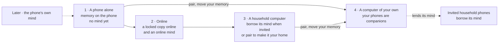
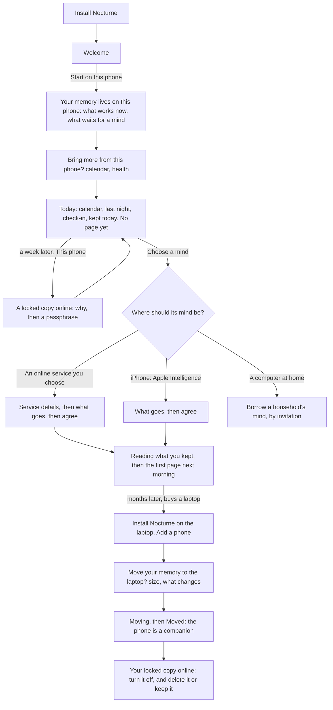
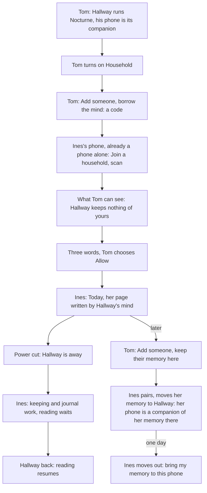
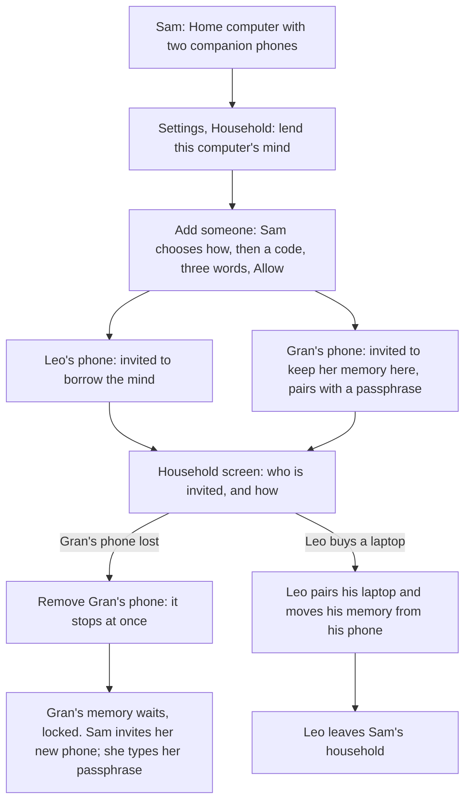
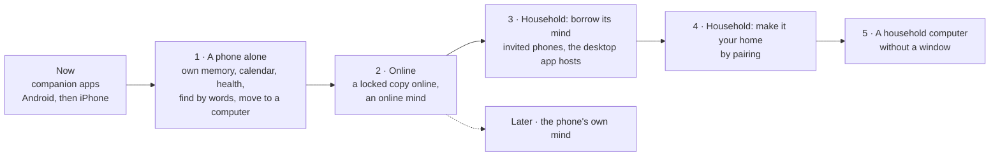

# Phone and computer as equal starting points

Today Nocturne starts on a computer. A phone is a companion: it keeps, asks and reads the page
while the computer holds the memory and does the thinking ([Nocturne on Android and
iPhone](phone-apps.md)). That leaves out people who have no computer, or none that is on at night,
and it makes a household with one computer choose whose memory it keeps.

This page proposes the way there: a person can start on either, and grow from there. It is a
roadmap, not one build. Each step is a design of its own, on the pages below, and each needs the
owner's decisions before it is built.

Status: proposed, with the owner's decisions folded in ([Decisions](#decisions)). Nothing here is
built. The design for today's companion apps is unchanged and ships first.

| Page | What it covers |
|---|---|
| This page | The ladder, personas, journeys, what each mode shows, who sees what, rule changes, phasing, risks, decisions |
| [Nocturne on a phone of its own](phone-first.md) | Step 1 and step 2: first run without a computer, Today with no mind, a locked copy online, choosing an online mind, their consent screens and copy |
| [A household computer](household-server.md) | Step 3 and hosting in step 4: being invited to borrow a household's mind, what the person who runs it can and cannot see, making a household computer your home by pairing, the mind being away, leaving, removing, the household screen on a computer, copy |
| [Moving your memory](moving-memory.md) | One home at a time: moving a memory from a phone to a computer or a household computer, and back, always by pairing, with what happens to copies and the phone afterwards |

## Mockups

In `docs/design/mockups/phone-parity/`, with the kit and rules of the [phone app
mockups](phone-apps.md#mockups): serve the repository root over HTTP after `make ui/install`, add
`?state=` and `&theme=light` or `&theme=dark`. `index.html` links every view. Phone screens show
Android (412 by 892) and iPhone (393 by 852) side by side, rendered 920 by 1000. Computer screens
are 1280 wide, full length. A dashed outline marks what is new on an existing screen; it is not part
of the design. All names and data are fictional.

## Goals

1. **Start anywhere.** A person can install Nocturne on a phone with no computer and use it from the
   first minute: keep, write the journal, check in, and see their calendar and health beside their
   days.
2. **Grow without starting over.** Adding a mind, a household computer or a computer of one's own
   keeps everything kept so far, with its receipts.
3. **One memory, one person, one home.** A memory belongs to one person and lives in one place at a
   time. A copy is a locked copy of that home, never a second home that must be merged.
4. **Exact about who sees what.** Every step that lets something leave the phone says what goes,
   to whom, what they can see, and how to stop, before anything is turned on.
5. **The same Nocturne in every mode.** Today, Journal and Ask keep their place and words; a mode
   changes what fills them, not where they are.

## Not goals

- Two-way sync, or the same memory edited in two places.
- A Nocturne account, a hosted service, or anything run by the project that holds people's data.
- Using a person's Claude, Gemini or ChatGPT subscription as Nocturne's mind (see
  [Choosing a mind](phone-first.md#choosing-a-mind) for why).
- Nocturne as a tool inside another assistant. Parked for a separate design.
- A shared household memory. A household shares a computer's mind, never a memory.
- Anything that copies a memory to the computer whose mind it uses. Using a mind never puts the
  memory there; only pairing to make that computer its home does.
- The phone's own mind, beyond a placeholder: it is the moonshot below.

## The ladder

| Step | Where the memory lives | Where the mind is | What leaves the phone | Today |
|---|---|---|---|---|
| 1 · A phone alone | On the phone | None yet: nothing is read, no page | Nothing | New |
| 2 · Online | On the phone, with a locked copy online if chosen | An online service the person chose, or Apple Intelligence on iPhone | The locked copy, to the person's own online storage. Words to be read and questions, to the mind they chose | New |
| 3 · Borrow a household's mind | On the phone | A household computer whose owner invited this phone | What each request in flight needs (a thing to read, a question with its few lines), sealed, to that computer, which keeps nothing of it | New |
| 3 · A household computer as your home | On the household computer, locked apart | That computer | Everything kept, sealed, to that computer, only because the person paired and moved their memory there | New |
| 4 · A computer of your own | On the computer | The computer | What phones keep and bring, sealed, to the person's own computer | Today's build |
| Later · the phone's own mind | On the phone | On the phone | Nothing | Placeholder |

The steps are built in this order: a phone alone, then online (the locked copy and an online mind),
then the household. A person need not climb them in order once they exist: they can go from 1
straight to 4, borrow a household's mind from 2, or come back down from 4 to 1 by [moving their
memory](moving-memory.md). The interface never numbers them. It shows two plain facts in This
phone: where your memory is, and where its mind is.

Two rules hold on every step:

- **Using a mind never moves a memory.** An online mind, Apple's servers and a household's mind each
  read what a request needs and keep nothing of it. A household computer that lends its mind keeps no
  memory, file, copy or history of a phone that only borrows it.
- **A memory moves only by pairing.** The one way a memory comes to be held by another machine is its
  person pairing with that machine to make it their home: their own computer, or a household computer
  they choose. The locked copy online is a locked copy of that one home, never a second home.

### The phone's own mind, later

A placeholder only, so nothing here blocks it. When phones can read and tidy on their own at a
quality and battery cost the owner accepts, a phone alone gains a mind that never leaves it. The
owner has chosen the shape for when that comes: the same engine as the computer's smallest mind,
inside the app, with the phone's built-in minds as a quicker way to answer later; phones with 8 GB
of memory or more, Android 12 or later, iOS 17 or later. It would appear as one more choice in
[Choosing a mind](phone-first.md#choosing-a-mind), "On this phone", and changes nothing else on
these pages.

## Personas

Fictional people, each standing for a group the ladder serves.

| Persona | Who | Devices | Where they start | Where they go |
|---|---|---|---|---|
| **Maya** | Nurse on shifts, keeps a journal, no computer at home | An Android phone | Step 1, a phone alone | A locked copy online, an online mind, later a laptop of her own |
| **Tom and Ines** | A couple. Tom set up a small computer in the hall that is always on; Ines is careful about who holds her things | Tom: iPhone. Ines: Android. The hall computer, called Hallway | Hallway is Tom's own Nocturne; his phone is its companion. Ines keeps her memory on her phone, and Tom invites her to borrow Hallway's mind | Ines later pairs to make Hallway her home; one day she moves out and takes her memory with her |
| **Sam** | Parent with a desktop, uses today's build. Hosts the household | A desktop called Home computer, two companion phones | Step 4 | Invites Leo (their son) to borrow Home computer's mind. Invites Gran, who has no computer, to make it her home. Leo later buys a laptop and moves his memory there |

## Journeys

Each journey is the path through the screens on the sub-pages. Words in quotes are interface copy.

### Maya: a phone alone, then online, then a laptop

1. **Welcome.** Three ways in: "Start on this phone", "Connect to my computer", "Join a household".
   Maya has no computer, so she starts on the phone.
2. **What works now.** One screen says her memory lives on this phone, what works from the first
   minute (keep, the journal, check-ins, calendar and health), and what waits for a mind (reading
   photos and voice notes, answers, the morning page). It says plainly that if the phone is lost,
   so is the memory, unless she keeps a locked copy online.
3. **Today with no mind.** The date, her calendar today, last night's sleep, today's check-in and
   what she kept, with one quiet card: "Your page needs a mind to write it."
4. **A locked copy online.** From that card or This phone: what goes (one locked file), where (her
   own Google Drive), who can open it (only someone with her passphrase), then the passphrase.
5. **Choosing a mind.** She chooses an online service with her own key. The steps follow Online
   answers: the details, then what goes, then agreeing. Nocturne reads what she kept, in turn, and
   her first page comes the next morning.
6. **A laptop of her own.** She installs Nocturne on a laptop, which offers "Already use Nocturne on
   your phone?". Pairing as today, then "Move your memory to this computer?" with its size. When
   it has moved, her phone is a companion, as in today's build, and she chooses what happens to her
   locked copy online and her online mind.

### Tom and Ines: one household computer, invited to borrow its mind

1. **Tom sets up Hallway.** A computer that is always on, running Nocturne as his own home, with his
   phone as its companion, as today. He turns on Household
   ([Household](household-server.md#on-the-computer-that-runs-it)).
2. **Tom invites Ines.** "Add someone" shows a code for borrowing the mind. Only a phone with that
   code can ask, and Tom still chooses Allow. No phone can find a household or ask to join without
   an invitation.
3. **What the person who runs it can see.** Before the three words, one screen says exactly what Tom
   can and cannot see: Hallway keeps nothing of Ines's, not even a record of when she used it, and
   the limit of what Nocturne can promise on a computer someone else controls.
4. **The mind is away.** During a power cut Ines's phone keeps working as a phone alone, and reading
   waits. When Hallway is back, reading carries on by itself.
5. **Making Hallway her home.** Ines later wants Hallway to keep her memory. That is not a setting of
   borrowing: Tom invites her to keep her memory there, she pairs, and her memory moves, following
   [Moving your memory](moving-memory.md#to-a-household-computer). Her phone then works as a companion
   of her memory on Hallway, locked apart from Tom's.
6. **Leaving.** When Ines moves out, "Leave this household" offers to bring her memory to her phone,
   then deletes it from Hallway only when she confirms.

### Sam: a computer of their own that hosts the household

1. **Lending the mind.** Sam turns on Household in Settings. Home computer keeps Sam's memory and
   companion phones as today, and lends its mind to the phones Sam invites.
2. **Inviting.** "Add someone" asks Sam first how the computer should help: borrow its mind, or keep
   their memory here. The code carries that choice, and the Allow screen repeats it, so Sam is never
   surprised later.
3. **Leo borrows the mind.** His memory stays on his phone. Home computer keeps nothing of his: no
   files, no copy, no record of what or when.
4. **Gran's home.** Gran has no computer, so Sam invites her to keep her memory on Home computer. She
   pairs, chooses a passphrase, and her memory lives there, locked apart from Sam's.
5. **The household screen.** Sam sees who is invited and how. For Gran, how much room her memory
   takes and when her phone last connected. For Leo, his phone's name, and whether it is using the
   mind right now. Never what was read or asked.
6. **Removing.** Gran's phone is lost; Sam removes it and it stops at once. Gran's memory stays on
   Home computer, locked with her key. Sam invites her new phone, she types the passphrase she chose,
   and her page is back.
7. **Moving on.** Leo buys a laptop, pairs it, moves his memory there from his phone, and leaves
   Sam's household.

### Moving up and back down

| From | To | What the person does | What moves | Page |
|---|---|---|---|---|
| A phone alone | A computer of their own | Installs Nocturne on the computer, pairs the phone, agrees to move | The phone's memory, to the computer. The phone becomes a companion | [Moving](moving-memory.md#from-a-phone-to-a-computer) |
| A phone alone | A household, borrowing its mind | Invited, joins | Nothing moves, and nothing is kept there | [Household](household-server.md#joining) |
| A phone alone, or borrowing | A household computer as home | Invited to keep their memory there, pairs, agrees to move | The phone's memory, to the household computer | [Moving](moving-memory.md#to-a-household-computer) |
| A household computer as home | A computer of their own | "Move my memory" on the phone, pairs the new computer | From the household computer to their own, through the phone | [Moving](moving-memory.md#from-a-household-computer-to-a-computer) |
| A household computer as home | A phone alone | "Leave this household", "Bring my memory to this phone" | From the household computer to the phone | [Moving](moving-memory.md#back-to-the-phone) |
| A computer of their own | A phone alone | On the computer, "Move my memory to a phone" | From the computer to one paired phone, after a size check | [Moving](moving-memory.md#back-to-the-phone) |
| Any step | Online | Turns on a locked copy online, or chooses an online mind | The locked copy, or the words to read and the questions | [Phone first](phone-first.md) |

## What each mode shows

The tabs, their order and their names never change. What fills them does.

| Place | Companion (today) | A phone alone, no mind | A phone alone, online mind | Borrowing a household's mind | A household computer as home |
|---|---|---|---|---|---|
| **Today** | The computer's page, phone edition; calendar and sleep as designed | The date, "In your calendar today", "Last night", today's check-in, "Kept today", and the card "Your page needs a mind to write it." | The page, written by the online mind overnight from what it read; each line cites the original | The page, written by the household's mind when the phone could reach it, from this phone's memory | The page from the household computer, as a companion's page |
| **Journal** | The computer's journal | Today's timeline from the phone's own memory: entries, keeps, check-ins, calendar rows, health. Photos and voice notes show as kept, "waiting to be read". No reflection | As the computer's journal; reflections and recaps wait for a home mind (see [decision 10](#decisions)) | As the computer's journal, reflections written by the household's mind | As the companion's journal, from the household computer |
| **Ask** | Asks the computer | Finds by words in what was kept, with receipts: "Found by their words. Answers need a mind." | Answers from the online mind, citing this phone's memory; every answer says where it was written | Answers from the household's mind, citing this phone's memory | Answers from the household computer |
| **Keep** | Waits on the phone when the computer is away | Kept on the phone at once | Kept on the phone at once, read when the mind next runs | Kept on the phone at once, read when the household is reachable | Waits on the phone until the household is reachable: "waiting to go across" |
| **This phone** | Connected to; what this phone brings; when it sends; this phone; help | Where your memory is: "On this phone". Its mind: "None yet". A locked copy online. What this phone brings | Adds its mind: "{service}, online", what goes, the Sent online list | Its mind: "Hallway, at home". Household; what Tom can see; leave | Where your memory is: "On Hallway". What Hallway's owner can see; move my memory; leave |

Rules that hold in every mode:

- Receipts: every line, answer and journal row cites an original in the person's own memory.
  A thing still waiting to go across has a receipt on the phone that becomes the home's receipt
  when it arrives.
- Things marked private never go to an online mind and never reach a phone that is a companion, as
  today. Where a household computer is the person's home, it is their own Nocturne and reads
  everything, private things included. A household mind that is only borrowed never receives
  private things ([decision 15](#decisions)).
- Nothing is held back by what it seems to be about. Only what the person marked private is held
  back from an online or borrowed mind, and check-ins stay home by the journal's agreed rule
  ([decision 10](#decisions), [decision 20](#decisions)).
- Notifications, the lock screen, reading aloud and the tray follow today's rules in every mode.

## Who sees what

Stated plainly, for each person and company that can be involved.

| Who | A phone alone | Online: a locked copy | Online: a mind | Borrowing a household's mind | A household computer as home |
|---|---|---|---|---|---|
| **The person** | Everything | Everything | Everything, and a list of what was sent | Everything | Everything |
| **Google or Apple, storing the copy** | Nothing | One locked file, its size and when it changes. Without the passphrase it can't be opened | Nothing | Nothing | Nothing |
| **The online service, or Apple** | Nothing | Nothing | Each question with the few lines that answer it, and the words of each thing it reads. Never photos, recordings themselves, check-ins, reflections or things marked private | Nothing | Nothing |
| **The person who runs the household computer** | Nothing | Nothing | Nothing | In Nocturne: the phone's name, that it borrows the mind, and whether it is using it right now. No record of when or how much, and never what was read or asked | In Nocturne: the phone's name, that the memory is kept there, how much room it takes and when the phone last connected. Never its contents. Someone with full control of that computer could still get at it while it is being read or tidied |
| **Others in the household** | Nothing | Nothing | Nothing | Nothing: no one in a household sees another's phone, memory or use | Nothing |
| **The connection's company (Cloudflare or Tailscale)** | Nothing | Nothing | Nothing | As Away from home: when the phone connects, from where, sizes and timing. Never content | As Away from home |
| **The Nocturne project** | Nothing | Nothing | Nothing | Nothing | Nothing |

The household line is the one most easily over-promised, so the joining screens use exactly these
words ([What the person who runs it can see](household-server.md#what-the-person-who-runs-it-can-see)).
Nocturne on the household computer works on a borrowed thing only in its memory while it reads or
answers, and keeps nothing: no memory, no file, no copy and no history of that phone beyond the
name and key it was invited with. A memory whose person made that computer their home is locked with a key this phone holds, so it can't
be browsed, copied or backed up readable. While it is read or tidied it is open in that computer's
memory, and someone with full control of that computer could change Nocturne or read that memory.
Nocturne can't prevent that, and says so.

## Consent and disclosure

Each new way out follows the Online answers pattern ([Keeping the next step in
view](step-flow-actions.md)): a light first step with three short true lines and one expander, the
main button kept in a bar with "Nothing is turned on until the last step.", and a last step that
shows every fact in full before the person agrees.

| What turns on | First step's three lines | Last step | Page |
|---|---|---|---|
| A locked copy online | What goes · Who can open it · You need | The passphrase, with what is lost without it | [Phone first](phone-first.md#a-locked-copy-online) |
| An online mind | Sent · Never sent · You need | Everything sent, an example, who sees it, what changes, changing your mind | [Phone first](phone-first.md#choosing-a-mind) |
| Joining a household, invited | What goes · What it keeps · Who runs it | What the person who runs it can and cannot see, then three words | [Household](household-server.md#joining) |
| Lending a computer's mind | What they get · What you see · What it costs this computer | Inviting, per person, with how it helps them; then Allow | [Household](household-server.md#on-the-computer-that-runs-it) |
| Moving a memory, to any home | Where it goes · How big it is · What happens here after | Confirm after it has arrived, before anything is deleted | [Moving](moving-memory.md) |

## Rule changes this needs

Proposed wording, flagged for the owner. None is made by this page. The exact wording is in
[0018 A phone as its own home](/adr/0018-a-phone-as-its-own-home.md#proposed-contract-changes), and
each clause takes effect only with the record it names.

### The contract

| Where | Today | Proposed |
|---|---|---|
| `AGENTS.md`, first line | "Nocturne is a private desktop app that remembers your day…" | "Nocturne is a private app for the computer and the phone that remembers your day…", and "It is a Tauri 2 app (Rust core, web-view interface); on a computer it ships and supervises a private, embedded Lemonade server." |
| Invariant 2, Local only | Allows consented downloads, Away from home traffic and Online answers | Adds a locked copy online, an online mind on a phone that is its own home, and a household's mind for invited phones, used for the request in flight and keeping nothing. Exact wording in [0018](/adr/0018-a-phone-as-its-own-home.md#proposed-contract-changes). Also: "The phone app is held to the same rule." |
| Invariant 4, Receipts | Every answer and page line cites the original | Adds: "A thing waiting to go across has a receipt on the phone until its home has it." |
| Invariant 5, Forgetting | Never silently delete | Adds: "A memory that moves is deleted from where it was only after it has arrived and the person confirms. No one deletes another person's memory without that person being told first." |
| New invariant | | "**One memory, one person, one home.** A memory belongs to one person and lives in one place at a time. It moves only when its person pairs with a new home. Using a mind never moves it. A copy is a locked copy of that home, never a second home." |
| Experience principles, no jargon | Lists for Away from home and Online answers | Adds for these screens: cloud, sync, server (except "Apple’s servers"), host, client, guest, tenant, admin, role, upload, encrypt. "Online", "locked", "household", "copy", "Google Drive" and "iCloud Drive" are allowed. "Borrow its mind" is the interface for a guest |
| New experience principle | | From the owner's direction: "**Never judge a person's data.** Offer every source the device has, and let the person choose. No labels like work or private on their behalf, and no filtering before they choose." |

### Decision records

| Record | Change |
|---|---|
| [0018 A phone as its own home](/adr/0018-a-phone-as-its-own-home.md), proposed | The phone app keeps its own memory with the engine's store, no mind on the phone in the first release, moving between homes by the backup format over the sealed channel, only by pairing, one home at a time enforced at pairing. Reverses "a phone that works without a computer" in [Nocturne on Android and iPhone](phone-apps.md#goals) |
| [0019 A locked copy online](/adr/0019-a-locked-copy-online.md), proposed | The phone writes numbered copies, never overwritten, sealed with a key that is itself locked with the person's passphrase (the [0013](/adr/0013-passphrase-backup.md) format), to iCloud Drive on iPhone or the app's hidden Google Drive folder on Android, or a storage address the person runs. Originals go once each. The last seven copies are kept, and forgetting for good prunes older ones at once, so forgetting reaches the copy. This is the online backup; the phone's own device backup is out of scope, and the memory stays out of it. Triggers 0013's "revisit when kept somewhere other than a file they chose" |
| [0020 An online mind on a phone](/adr/0020-an-online-mind-on-a-phone.md), proposed, amending [0011 Online answers](/adr/0011-online-answers.md) | On a phone alone the phone's own core calls the service, not `lemond`. The service also reads the words of what is kept and writes the page. A named second route on iPhone, Apple Intelligence on Apple's servers, with no key, against "one generic form" and "no provider-specific code". The health, money and ID check stops holding things back, on the computer too: only things marked private are held back ([decision 20](#decisions)) |
| [0021 A household mind for invited phones](/adr/0021-a-household-mind-for-invited-phones.md), proposed; a later record for a household computer as someone's home | A role per paired phone, fixed by the owner's invitation: companion, borrows the mind (keeps nothing: only its name and key, to let it in), or keeps its memory here (one store and key per person, entered by pairing). A separate typed set of calls for borrowing with no handle on any store, a scheduler that takes turns without counting per phone |
| [0010 Away from home](/adr/0010-away-from-home.md), amended | Household phones connect through Simple. Most private keeps admitting only the owner's own devices; named other people later, as an advanced choice |
| [0012 Run as a server](/adr/0012-server-mode.md), amended | "One server is one person" becomes one owner and the people who keep their memory there; Away from home is made to run without a window so the server can host phones |
| 0017 Native phone apps, on the phone app branches today | The app is one app, `is.nocturne.phone`, published by Nocturne, for every mode; the store listing loses "needs a computer" |

## Phasing

The owner's order: a phone alone, then online, then the household.

| Phase | Ships | Depends on | Why this order |
|---|---|---|---|
| Now | Today's companion apps, as designed | Nothing new | Approved and being built |
| 1 | A phone alone: its own memory, keep, journal, check-ins, calendar and health on the phone, find by words, backups to a file, and moving that memory to a computer | The native app; the engine's store built for the phone; the backup format | The owner's first step: a satellite with its own data and connections. Moving to a computer ships with it, so no one is stuck |
| 2a | A locked copy online, and restoring it on a new phone | Phase 1; the invariant 2 change | A lost phone must not lose a memory once people rely on it |
| 2b | An online mind for a phone alone: the key route on both, Apple Intelligence after a trial | Phase 1; 0011 amended; the invariant 2 change | The first way a phone alone gets a page and answers |
| 3 | Borrowing a household's mind, for invited phones, hosted by the desktop app | Phase 1 (the phone keeps its own memory and drives its own reading); the guest calls and turn-taking on the computer | Needs nothing kept on the host, so it is the smaller household promise |
| 4 | A household computer as someone's home, by pairing | Phase 3 (invitations, roles); one store and key per person; moving a memory | The larger promise: another person's memory on a computer someone else runs |
| 5 | A household computer with no window (the server image) | Phase 4; 0012's blockers closed; Away from home without a window | Most households have no spare computer with a screen on all night |
| Later | The phone's own mind | Quality and battery the owner accepts | The moonshot |
| Alongside | Decision models that label what is kept, holding nothing back | [0016](/adr/0016-decision-models-shadow-first.md)'s shadow results; a mind | Labels help finding; they never decide what goes where |

## Roadmap items

Each item with its final decisions, what is still open (options and a recommendation), and what it
depends on. Every person-facing part works from the phone unless a reason is written here.

### A phone alone

- **Decided.** The phone keeps its own memory with the computer's engine, no mind yet, one home at a
  time, moved only by pairing ([0018](/adr/0018-a-phone-as-its-own-home.md)); voice notes in words
  only by the phone's own offline recogniser (decision 9). Specified to build in [The first
  release](phone-first.md#the-first-release-a-phone-alone).
- **Depends on.** The native app; the engine built for the phone; the backup format.

| Open | Options | Recommendation |
|---|---|---|
| Voice notes in words where a platform can't do it offline from a recording | A: that platform ships with voice notes waiting. B: hold the release for it | **A**, as the spec allows |

### A locked copy online

- **Decided.** Decisions 1 to 5 and 19: a locked copy of the one home, in iCloud Drive or Google
  Drive's hidden app folder, or storage the person runs; photos and recordings once each; a
  passphrase once; the online backup, with the device backup out of scope; no sync of any kind
  ([0019](/adr/0019-a-locked-copy-online.md)).
- **Depends on.** A phone alone; 0019 and the invariant 2 change; an Apple developer account with
  iCloud; Google's sign-in limited to the app folder.

| Open | Options | Recommendation |
|---|---|---|
| How often a copy is made | A: after each keep. B: at most once an hour after keeping, and daily. C: daily only | **B**: little is lost, and the phone is not woken for every note |
| Storage the person runs | A: one kind of address (WebDAV) first. B: WebDAV and S3 | **A**; S3 when someone asks |

### An online mind, and the phone's assistant

- **Decided.** The phone's Claude, Gemini or ChatGPT app is not a route, and Nocturne inside an
  assistant is parked (decision 21). A service with the person's own key on both phones, Android's
  default moving to the phone's own mind once it ships (decision 6). Apple Intelligence after a trial
  on iOS 27 (decision 7). It reads words, writes the page and answers, never photos or recordings
  (decision 8); check-ins stay home (decision 10); nothing else is held back unless marked private
  (decision 20) ([0020](/adr/0020-an-online-mind-on-a-phone.md)).
- **Depends on.** A phone alone; 0020 and the invariant 2 change; for Apple, the trial.

| Open | Options | Recommendation |
|---|---|---|
| What makes the Apple trial pass | A: a typical day's reading (about 50 things) and its page fit inside one day's limit, at a quality the owner signs off on a fixed set. B: answers only | **A**; if only answers fit, offer it later as answers only, with its own consent |
| Reading on mobile data | A: allowed. B: only on Wi-Fi. C: the person chooses | **A**: what goes is words, which are small; photos never go |

### Household: borrowing its mind

- **Decided.** By the owner's invitation only, a mind only, nothing kept of a borrowing phone beyond
  its name and key, private things never sent, in turn with no daily share per phone, through Simple
  (decisions 11, 14, 15, 16 and correction 1; [0021](/adr/0021-a-household-mind-for-invited-phones.md)).
  Specified in [A household computer](household-server.md).
- **Depends on.** A phone alone (the phone drives its own reading); online first, by the owner's
  order; the guest calls and turn-taking on the computer.

| Open | Options | Recommendation |
|---|---|---|
| A daily share per phone, without keeping counts | A: none; the owner pauses a phone. B: a count kept only in memory, gone at midnight or a restart. C: a stored count | **A**: B is still a record of use, and C breaks correction 1 |
| The live "Using the mind now" mark on the owner's screen | A: show it, from requests in flight only. B: show nothing | **A**: it tells the owner why their own answer is slow, and nothing is kept |

### Household: hosting on a computer of one's own

- **Decided.** The desktop app hosts first; the server image follows 0012's blockers (decision 12).
  A Household page in Settings: invite with a chosen way, Allow, pause, remove.
- **Depends on.** Borrowing its mind; Away from home in Simple.

| Open | Options | Recommendation |
|---|---|---|
| Which computers may host | A: any. B: only computers where the mind fits with room to spare, saying why otherwise | **B**, from the existing fit check, so hosting never slows the owner's own Nocturne into uselessness |
| Managing the household from the owner's phone (phone parity) | A: the computer only. B: the owner's companion phone can see who is invited, pause and remove; inviting shows the code on the phone too | **B**, shipped after the computer page; no reason to keep it off the phone |

### Household: a household computer as someone's home

- **Decided.** Only by a separate invitation and the person's own pairing, then a move (correction
  2). One store per person, locked with a key their phone holds and their passphrase; the key left
  for one night so the tidy runs (decision 13); private things read like everything else, since it
  is their home (decision 15); the phone keeps its recent pages to read while away (decision 17);
  removal keeps the memory locked, deleted only after 30 days' notice (decision 18). Needs its own
  decision record.
- **Depends on.** Borrowing its mind (invitations, roles); moving a memory; a per-person store.

| Open | Options | Recommendation |
|---|---|---|
| Whose computer can be someone's home | A: a desktop with its own owner, and a household computer kept for the purpose. B: only one kept for the purpose | **A**: Gran's case is a desktop |
| How the per-person store is locked at rest | A: the store file itself encrypted with the phone's key. B: a sealed file opened into memory only while read or tidied | **A**, settled in its decision record after a measured trial; B reads a whole store into memory each night |

### Moving a memory between homes

- **Decided.** One home holds the pen; a memory moves only by pairing; the backup format over the
  sealed channel; nothing deleted until it has arrived and the person confirms; the locked copy stops
  and the person chooses to delete or keep it (decision 19). Specified in [Moving your
  memory](moving-memory.md).
- **Depends on.** A phone alone for the first move (phone to computer); the household home for the
  rest.

| Open | Options | Recommendation |
|---|---|---|
| The computer restarts Nocturne to finish a restore today | A: reopen the memory in place, so the move shows no restart. B: say "Nocturne restarts to finish" on the computer during a move | **A** if the build finds it small; otherwise **B**, with its words agreed here first |
| A household home to a computer of one's own | A: through the phone, as designed. B: the two computers pair directly | **A**: no new pairing between machines; revisit if large memories make it slow |

### The phone's own mind

- **Decided.** The same engine as the computer's smallest mind, inside the app, with the phone's
  built-in minds as a quicker way later; phones with 8 GB, Android 12, iOS 17; one more choice, "On
  this phone", in Choosing a mind; nothing leaves the phone.
- **Depends on.** An online mind (it fixes the phone's typed mind calls); quality and battery the
  owner accepts.

| Open | Options | Recommendation |
|---|---|---|
| When to try it | A: a trial now. B: after the online mind ships | **B**: the same calls, so the trial measures only the mind |
| When it reads | A: only while charging. B: any time | **A**: battery is the risk people notice first |

### Labels from decision models

Decision models answer typed questions about a kept thing ([0016](/adr/0016-decision-models-shadow-first.md)).
Here they label what a thing is, to help finding and grouping.

- **Decided.** Labelling never holds anything back and never changes where anything goes: only what
  the person marked private is held back. Labels say what a thing is (an appointment, a purchase, a
  trip, a recipe, a person or place it names), never how sensitive it is or which part of life it
  belongs to: no work, private, health or sensitive labels. 0016's question about health, money or ID
  details may never add a mark that holds anything back. Shadow first, as 0016; anything a person sees
  comes through design first. On a phone it runs wherever its mind runs.
- **Depends on.** 0016's shadow results beating the rules; a mind (a phone alone has no labels).

| Open | Options | Recommendation |
|---|---|---|
| What labels are for | A: finding and grouping only (an Ask filter, "show only" in the journal). B: A, and shown on each item. C: a hidden signal for ranking | **A**, then **B** with "Remove this label" |
| Can the person change labels | A: remove only. B: remove and add their own | **A** first; B is a different feature (the person's own tags) |

## Risks

| Risk | Likelihood | Impact | What this design does |
|---|---|---|---|
| A lost phone loses a memory | Medium | High | Says so on the first screen of a phone alone; offers a locked copy online from day one; reminds once after 30 days of keeping with no copy |
| A lost phone takes the key to a memory kept in a household | Medium | High | The key is also locked with a passphrase chosen when joining; a new phone joins and types it |
| "The person who runs it can't see your memory" is heard as a promise it isn't | Medium | High | The exact words on the joining screen include what Nocturne can't prevent; no softer wording anywhere |
| An online mind for a phone alone sends far more than Online answers does | High | High | Its own consent with every fact; never photos, recordings themselves, check-ins, reflections or private things; the Sent online list on the phone |
| A household phone's reading slows the owner's own answers | High without a scheduler | High | The owner's asks first, then household asks, then everyone's reading in turn, one thing at a time per phone; the owner can pause a phone |
| Something of a borrowing phone lingers on the household computer | Medium | High | Recordings and photos are read from memory, never written to disk; no logs, caches or counts per phone; a test proves the host's store and data folder are unchanged after a borrowing phone's requests |
| Two homes by accident (a phone alone pairs with a computer and both keep going) | Medium | High | One home enforced at pairing: pairing a computer always ends in moving the memory, or in the phone borrowing its mind when invited to, never both homes |
| Moving a large memory to a phone that lacks space | Medium | Medium | Size check before anything moves; nothing deleted until it arrives |
| Store review of a phone that works alone and talks to online services | Low | Medium | Listing and privacy policy rewritten for each mode; every online step behind its own consent |
| Platform background limits make overnight reading on a phone unreliable | High | Medium | Reading happens when the phone allows; the page is written from what finished and says so |
| Policy drift at assistant companies | High | Low | Nothing is built on a person's assistant subscription |
| Scope creep into sync | High | High | Not a goal; the locked copy is a copy of one home, restored, never edited |

## Research that informs this page

| Question | Conclusion used here | Confidence |
|---|---|---|
| Can the phone's Claude or Gemini app be Nocturne's mind? | No. One company forbids other apps from using a person's subscription, another offers no way for an app to get an answer back, and Android's app-to-assistant calls run the other way. On iPhone, Apple Intelligence on Apple's servers can answer for an app with no key or account (iOS 27), counted on the person's iCloud. Everywhere, a service with the person's own key works | Settled for the design; Apple's route needs a trial |
| Can a household computer lend its mind without seeing what it reads? | No. It sees what it reads in its memory while it works. It can keep nothing, and its owner's view need show nothing beyond who is invited | Settled |
| Can the owner be kept out of a memory whose person made their computer its home? | Against a curious owner, yes: a store locked with a key the phone holds can't be browsed or copied readable. Against an owner with full control of the computer, no, while it is read or tidied | Settled; the wording is in [Household](household-server.md#what-the-person-who-runs-it-can-see) |
| How do household phones reach the computer? | Simple works as it is. Most private admits only the owner's own devices. A home network alone does not work for the phone page and needs a listener the rules forbid | Settled |
| Where does a locked copy online go? | iCloud Drive on iPhone needs no sign-in; on Android the app's hidden folder in Google Drive needs one account screen and only the narrowest access. Copies are numbered and never overwritten, so a second writer is caught, not merged. The phone's own device backup should leave the memory out | Settled; iPhone storage not yet built or tried |
| Does the computer's store run on a phone? | It builds for Android unchanged; iPhone not yet built | Android settled; iPhone to confirm |

## Decisions

The owner accepted every recommendation, with five corrections that override the earlier text
where they differ:

1. **A household's mind is only a mind for the phones its owner invites.** A phone that only borrows
   it is never stored there: no memory, no files, no copy, and no history of it beyond what answering
   the request in flight needs. A phone joins only when the household's owner invites it, by a code
   or a QR code.
2. **A memory moves only by pairing.** Using a mind never puts a memory on the mind's machine. The
   only time another machine holds a memory is when its person pairs with it to make it their home:
   their own computer, or a household computer they choose.
3. **The ladder's order.** A phone alone first, then the locked copy online and an online mind, then
   the household.
4. **The online backup is the locked copy** of the one home. The phone's own device backup is out of
   scope.
5. **Decision 20 is A.** Every calendar starts on, and nothing is held back unless the person marked
   it private.

Answered earlier, and used as given: full parity is the ideal and a long way off, so step 1 is a
phone satellite with its own data and connections; the phone's own mind later uses the computer's
engine in the app with the phone's built-in minds as a quicker path; phones with 8 GB, Android 12,
iOS 17; one home at a time, pairing a computer moves the memory and the phone becomes a companion
again, with no two-way sync; the app is `is.nocturne.phone`, published by Nocturne; never judge a
person's data.

"Changed" marks a row where a correction moved the decision away from the earlier recommendation.

| # | Question | Options | Decided |
|---|---|---|---|
| 1 | What a copy online is, given one home at a time | A: a locked copy of the one home, for restoring on a new phone and nothing else. B: a copy another device can open and edit | **A** |
| 2 | Where the locked copy goes first | A: each phone's own place, with no new account: iCloud Drive on iPhone, the app's hidden folder in Google Drive on Android; a storage address the person runs, as an advanced choice. B: Google Drive on both. C: only storage the person runs | **A**, with the advanced choice |
| 3 | Photos and recordings in the copy | A: all of them, each sent once, locked. B: words only. C: the person chooses | **A**, with a plain size line |
| 4 | The copy's passphrase | A: asked once when the copy is turned on, its key then kept in the phone's own safe place. B: asked for every copy. C: no passphrase; the storage company's account holds the key | **A** |
| 5 | The phone's own device backup (iCloud Backup, Android's backup) | A: leave Nocturne's memory out of it; the locked copy is the one copy. B: let it in | **A**. The locked copy is the online backup; the device backup is out of scope and the memory stays out of it |
| 6 | The online mind on Android, where no key-free route exists | A: an online service with the person's own key only. B: wait for the phone's own mind. C: A now, the phone's own mind as the default once it ships | **C** |
| 7 | Apple Intelligence on Apple's servers as a named choice on iPhone | A: add it, amending 0011. B: key route only. C: a trial on iOS 27 first, then decide | **C**, then **A** |
| 8 | What an online mind does for a phone alone | A: answers only. B: reads the words of what is kept, writes the page and answers; photos and recordings themselves never go. C: B plus photos | **B** |
| 9 | Voice notes on a phone alone | A: kept as recordings, waiting to be read. B: the phone's own speech recogniser turns them into words on the phone, only where it works without a network | **B**, on-phone only |
| 10 | Check-ins, reflections and recaps with an online mind | A: keep the rule: check-ins never go online, so reflections and recaps wait for a home mind. B: let them go | **A**, the journal's agreed rule ([0015](/adr/0015-journal-privacy-class.md)) |
| 11 | Which household way ships first | A: a memory kept on someone's computer. B: borrowing its mind. C: both together | **B**, after a phone alone and online. Changed by corrections 2 and 3: a memory reaches a household computer only by pairing, which follows |
| 12 | What runs a household | A: the desktop app with Household turned on. B: the server image. C: A first, B when 0012's blockers close | **C** |
| 13 | What "the person who runs it can't see it" means for a memory kept there | A: separate files, not locked, and say the owner could read them. B: locked with a key the phone holds; read and tidied only while the phone is reachable. C: B, and the phone leaves the key in that computer's memory for one night so the tidy runs overnight | **C**, for a memory whose person paired to make that computer their home. A phone that only borrows the mind has no memory there to lock |
| 14 | How household phones reach the computer | A: through Simple, as today. B: also named other people on Most private. C: the home network with a local certificate | **A**, B later as an advanced choice |
| 15 | Do things marked private reach a household mind? | A: never. B: yes. C: B for a memory whose home is there, A for a borrowed mind | **C** |
| 16 | Sharing the mind fairly | A: the owner always first. B: equal shares. C: the owner's asks, then household asks, then everyone's reading in turn, with a daily limit per phone | **C, in turn, with no daily limit per borrowing phone.** Changed by correction 1: a daily limit needs a count kept per phone. The owner can pause a phone instead |
| 17 | A phone whose memory is kept elsewhere, while that computer is away | A: keeps no copy, as companions today. B: keeps the last page, the last week of pages it opened and its own entries, readable, marked with when | **B** for a memory whose home is a household computer; companions stay **A** |
| 18 | When the person who runs a household removes someone whose memory is kept there | A: the memory stays, locked, until that person brings it home or deletes it; the owner can delete it only after 30 days' notice shown on that person's phone. B: the owner chooses keep or delete at once | **A** |
| 19 | The locked copy online after the memory moves to a computer | A: turned off, with a choice to delete it or keep it as it was. B: carries on from the computer | **A** |
| 20 | The rule against judging data, against two earlier defaults | Holidays and birthday calendars start off. Lines that look like health, money or ID are kept back from online answers ([0011](/adr/0011-online-answers.md)). A: change both, so every calendar starts on and nothing is kept back unless marked private. B: change the calendars, keep the 0011 check as a default the person can turn off. C: keep both | **A**. Changed by correction 5. Work-profile calendars are offered like any other |
| 21 | The phone's assistant, later | A: park "Nocturne inside Gemini, Siri or Claude" for a separate design. B: design it now. C: rule it out | **A** |
