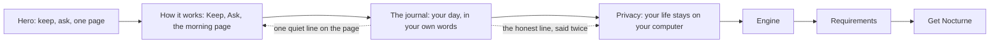

# The journal and the other capabilities on the site

The landing page was written for three things: keep anything, ask about it, and read one page each
morning. Since then Away from home, Online answers, back up and restore, help from the guide and
the journal have been designed. This page decides which of them the site should show, where, and
in which words, so the site keeps its calm and its one promise: one page a morning, on your own
computer.

Status: approved by the owner on 2026-11-19, with the answers under [Decisions](#decisions), and
built in the same pull request (see [Built](#built)).

**It depends on the journal shipping first.** The journal's design is `docs/design/journaling.md`
on the `design/journaling` branch (pull request #107), built on `feat/journaling` (#108), with the
follow-ups that put recaps on every computer. The site must not describe the journal before the
release that carries it. The site deploys from `main`, so this page and its implementation, built
in the same pull request at the owner's choice, merge only with the release that ships the journal.

## Mockups

In `docs/design/mockups/site-capabilities/`. `landing.html` is the English landing page as proposed:
it is the built page with the journal band and the privacy changes, and it loads the site's own
stylesheet, fonts and pictures from `site/assets/`. Serve the repository root over HTTP and open it
there; the theme switch in the header works. `site-capabilities.css` holds the few rules the band
adds. The pictures in `img/` stand in for screenshots the build recaptures from the app (see
[Pictures](#pictures)): they are rendered from the journal's own mockups and still show Thursday 19
November.

Renders are 1440 pixels wide at 1x and 390 wide at 2x, in both themes. Each "before" is the site as
built from `main`; each "after" is `landing.html`.

| What | Before | After |
|---|---|---|
| The whole page, bands marked | `overview-1440-light.png` and `overview-390-light.png` show both side by side | |
| From the end of How it works to the top of Privacy | `before-journal-1440-light.png`, `before-journal-1440-dark.png`, `before-journal-390-light.png`, `before-journal-390-dark.png` | `after-journal-1440-light.png`, `after-journal-1440-dark.png`, `after-journal-390-light.png`, `after-journal-390-dark.png` |
| Privacy | `before-privacy-1440-light.png`, `before-privacy-1440-dark.png`, `before-privacy-390-light.png`, `before-privacy-390-dark.png` | `after-privacy-1440-light.png`, `after-privacy-1440-dark.png`, `after-privacy-390-light.png`, `after-privacy-390-dark.png` |
| The German header at 1024 px with a fifth section link (not chosen, see [decision 1](#decisions)) | | `nav-de-1024-with-journal.png` |

The demo household is the one the app, the guide and the other designs use: Gran, Leo, Sam and
Priya. No real names or data.

## What the site says today

| Band | What it sells | The promise in it |
|---|---|---|
| Hero | "Keep everything. Nocturne remembers it for you." Keep without sorting, ask later, one page each morning | All on your own computer. Offline after setup. Free and open source |
| How it works: Keep | One box, any time, no folders to keep up | It tells you when it cannot read something |
| How it works: Ask | Answers with receipts | Only from what it can show you; says when it does not know |
| How it works: The morning page | Wake to what needs you, at your time | A short list to read, hear or print; asks instead of guessing |
| Privacy | Your life stays on your computer | Six promises: no account, checked offline before release, never edits what you kept, forgets on purpose, one quiet note a day, two extras off until you ask |
| Engine | Built on Lemonade | Its own private copy, only this computer can reach it |
| Requirements | Will it run on my computer? | 8 GB is enough; four sizes |
| Get Nocturne | Download | Free, no account |

The voice is plain, warm and exact: short headings in the serif, a grey eyebrow, one paragraph, and
a list of promises where a doubt needs answering. The pictures are the app itself, on a mat, with
demo data. There is one daily ritual, and the page is it.

## What the capabilities do to it

### Which capabilities belong on the site

| Capability | Status | On the site today | Proposal |
|---|---|---|---|
| Keep, Ask, the morning page | Built | How it works | Unchanged |
| Forgetting and keeping | Built | A promise | Unchanged |
| Away from home | Built | Half a promise and the phone picture | One clause: the phone reads the journal too. New phone picture |
| Online answers | Built | Half a promise | The honest line about journal sentences |
| Back up and restore | Built | Not at all | One sentence in "Nothing to sign in to", where "no cloud copy" raises the doubt it answers |
| The journal | Designed and built, not merged (#107, #108) | Not at all | One new band, after How it works and before Privacy |
| Help from the guide in the ask box | Built | Not at all | Not added: a convenience, not a promise |
| The AI chip doing more of the work | Decided | One requirements row | Unchanged |
| Run as a server | Experimental | Not at all | Not added: a different reader, and experimental |

### The promises the journal strengthens

| Promise | Why the journal makes it stronger |
|---|---|
| Keep everything | Writing the day is one more way to keep. What was kept through the day is already on the journal's timeline |
| Receipts or it did not happen | Every line of a reflection or recap opens what it came from. A feeling is quoted, never guessed |
| Offline after setup | Reflections and recaps are written on the computer. Reflections and recaps never go online, even with Online answers on; a check-in can go with a question it helps answer |
| One quiet note a day, never what you kept | Nothing from the journal is ever in a notification, the tray, on a lock screen or read aloud |
| Calm presence | The journal has no streaks, no counts, no daily prompt and no reminder unless the person turns one on |
| It never edits what you kept | A changed entry keeps its earlier version |

### The promises it strains

| Promise | The strain | The answer |
|---|---|---|
| One page each morning | A journal app usually adds a second daily ritual, and a site that sells two rituals stops being calm | The journal is the evening side of the same day, "when you want to". The page stays the one page. It gains a quiet line when a reflection or recap is new, and at most once a week its one question may come from the journal (`journaling.md` §10). The band names the quiet line, leaves the question to the app and "one page" to the hero |
| Two extras, off until you ask | "Online answers sends ... Never anything marked private" reads as if a journal were safe from it. Journal entries and good things cannot be marked private, so with Online answers on, a line from one can go with a question | Say it on the site in as many words, in the privacy promise and in the journal band. This is the honest line |
| No cloud copy | A journal raises the cost of a lost computer. A reader who writes their life into one laptop will ask what happens if it dies | One sentence: back it all up to one file, locked with a passphrase you choose |
| Clearer answers on bigger computers | A size of computer that fails the reflection gate lists the day rather than writing about it | Settled after the gate runs (see [decision 4](#decisions)) |
| AI that writes your diary for you | The fear a non-technical reader brings to "a journal in an AI app" | The heading is about the person's own words, and the first promise says a reflection quotes, never guesses, scores or advises |

### What is not added

Restraint is part of the design. Each of these was considered and left out.

- **No journal in the hero, the title or the link preview.** The hero promises keep, ask and one
  page a morning. A second promise there would make the journal the product.
- **No fourth step in the tour.** "Keep it now. Read it once." is one loop: keep, ask, read. The
  journal is a different act, writing at length and looking back, and it needs its own words.
- **No feature tour of the journal.** The feelings field, the recap charts, "what tended to go
  together", the people cards, the day picker and the phone check-in stay in the app. On a landing
  page, charts of feelings read as tracking.
- **No second phone picture.** The one phone in Privacy gains the Journal tile.
- **No evening reminder as a feature.** It is named only as something that is off.
- **No server mode, help from the guide or AI chip story.** Each is in the docs for the reader who
  needs it.
- **No numbers of features, no "AI-powered", no superlatives.**

## Proposal

### Information architecture

```text
BEFORE                                    AFTER
------                                    -----
Hero         keep, ask, one page          Hero         unchanged
How it works Keep · Ask · The page        How it works unchanged
                                          The journal  NEW: the evening side of the same day
Privacy      6 promises, phone            Privacy      6 promises, 2 reworded, new phone picture
Engine       Built on Lemonade            Engine       unchanged
Requirements 8 GB, four sizes             Requirements unchanged (decision 4)
Get Nocturne                              Get Nocturne unchanged
```



The order tells one day. The tour ends on the morning page; the journal band is the evening that
page looks back on; Privacy follows straight after, so the reader who just met a journal meets the
rules that keep it quiet before anything else.

| Band | What changes | What it sells |
|---|---|---|
| Hero | Nothing | Keep everything; one page each morning; on your own computer |
| How it works | Nothing | Keep, Ask, the morning page |
| The journal | New | Writing the day in your own words, looking back on it with receipts, and a journal that never nags and stays quiet |
| Privacy | Two promise details reworded; the phone picture and its alt text | The same six promises, now true of the journal too, with the Online answers line said honestly |
| Engine, Requirements, Get Nocturne | Nothing | As today |

### The journal band

`<section id="journal" class="band split">`, between `#how` and `#privacy`, built from the parts
the site already has: the band's intro, a list of promises like Privacy's, and an app picture on a
mat like the tour's.

- **Wide screens (824 px and up).** Two columns. The words and the promises on the left, the
  picture on the right, the reverse of Privacy below it, so the two bands alternate.
- **The picture.** The journal day on a mat: today's entry with its voice note, and how today
  felt beside it, the window cut on a blank line below the check-ins. Over its lower left corner
  sits a card of the day looked back on, a short paragraph with its receipt chips. The card
  overlaps only the window's blank foot, so no words show half hidden behind it. It is the move
  the hero already makes with the keep box over the morning page: what goes in, beside what comes
  of it.
- **Narrow screens.** One column: the words, then the picture (the phone-width window, cut on the
  blank line below the entry's words, with the card over its foot), then the promises.
- **No motion.** The band is still. It is not part of the tour.

**Copy.** Every string is new.

| Id | English |
|---|---|
| `journal.eyebrow` | The journal · when you want to |
| `journal.title` | Your day, in your own words. |
| `journal.body` | Everything you keep during the day is already in your journal, so it starts half written. Add a few lines, a voice note or a photo, and say how you felt. Nocturne looks back on each day, and on each week, month and year in a recap. Every line points to what it came from. |
| `journal.felt.term` | How you felt, never guessed |
| `journal.felt.detail` | Check in as Wound up, Lit up, Low or Settled, and choose the words that fit. A reflection quotes what you said you felt, and never scores the day or gives advice. |
| `journal.good.term` | Good things |
| `journal.good.detail` | Up to three a day, with a photo if you like. Your recaps bring them back. |
| `journal.calm.term` | No streaks, no nagging |
| `journal.calm.detail` | Nothing counts the days you write or says you missed one. A reminder comes only if you turn one on. When a reflection or recap is new, the morning page says so in one line. |
| `journal.quiet.term` | It stays quiet |
| `journal.quiet.detail` | Nothing from your journal is read aloud or shown in a notification or on a lock screen. If you turn on Online answers, a line from your journal can go with a question it helps answer. Your check-ins, reflections and recaps never do. |
| `journal.day.alt` | Today in the journal, Thursday 12 November: an entry about lunch with Priya, with a voice note and a photo. Beside it, how today felt, with three check-ins (tired, pleased, relieved and content). |
| `journal.look.alt` | The day, looked back on: a short paragraph about Leo forgetting his PE kit, a tired morning and lunch with Priya at last, with the notes, check-ins, document and entry it came from listed underneath. |
| `journal.caption` | Today’s journal, and the day looked back on. From the app, with demo data. |

Why these words:

- **"When you want to"** sits where the tour's eyebrows say "any time" and "at your time". It says
  the journal is optional before a word of the body is read.
- **"Your day, in your own words."** answers the fear of an AI that writes a diary for you. The
  reflection is written mainly from the person's own words, and the heading says so.
- **"Half written"** is the journal's own first-use line, and it is true: the timeline fills itself
  from what was kept.
- **The four names** are the app's own words for the parts of the check-in, so a reader meets them
  once before the app.
- **"It stays quiet"** carries the one fixed rule without the word "rule". The tray is left out:
  "notification or lock screen" names what a reader pictures, and the tray, which shows the same
  things, is covered by the app's rule regardless.
- **The honest line is in the band and in Privacy.** It is the one named exception to saying each
  promise once. People look for it where the journal is described, so a reader of the band should
  not have to reach Privacy to learn that a line from their journal can leave with Online answers
  on.

### Privacy

The heading, the body, the order and the count of promises stay. Two details are reworded and the
phone picture changes.

| Id | Now | Proposed |
|---|---|---|
| `promise.signin.detail` | No account, no analytics, no crash reports, no cloud copy. | No account, no analytics, no crash reports, no cloud copy. To keep a copy somewhere safe, back everything up to one file, locked with a passphrase you choose. |
| `promise.extras.detail` | Away from home lets your own phone ask, keep and read your page, sealed so the company in between cannot read it. Online answers sends a question, and the few remembered sentences it needs, to one service you choose. Never anything marked private. | Away from home lets your own phone ask, keep and read your page and journal, sealed so the company in between cannot read it. Online answers sends a question, and the few remembered sentences it needs, to one service you choose. They can include lines from your journal, but never your check-ins, reflections or recaps. Never anything marked private. |
| `phone.alt` | Nocturne on a paired phone: connected to the home computer, with Ask, Keep and today’s page, and a note that things marked private stay on the computer. | Nocturne on a paired phone: connected to the home computer, with Ask, Keep, today’s page and the journal, and a note that things marked private stay on the computer. |

**The honest line about Online answers.** Today the promise ends "Never anything marked private."
That was complete when everything could be marked private. Journal entries and good things cannot
be, by design, so the sentence would now let a reader believe their journal never leaves. The new
words say what goes (lines from the journal, when a question needs them), what never goes
(anything marked private; check-ins, reflections and recaps), and keep the frame that it is one of
two extras, off until asked. They match the Online answers setup and settings words in the
journal design ("Journal entries and good things can’t be marked private, so while this is on, a
line from one can go with a question it helps answer.") without its length.

Revised 2026-11-25: the promise no longer says "Never anything marked private". A private mark keeps
nothing out of an answer ([What private means](only-marked-private.md)), so the sentence says that
private things can go and what private does keep out: notifications, reminders and the lock screen.
The site's five translations follow it.

**Unchanged on purpose.** "One quiet note a day" stays as it is. The evening reminder is off unless
the person turns it on, and the journal band already says "A reminder comes only if you turn one
on", so the promise is true of every Nocturne as it ships. "It forgets on purpose" stays: entries
do not fade, the memories read from them do, and looking back does not count as use, all of which
the promise already allows.

### What stays as it is

| Band | Why it is not touched |
|---|---|
| Hero | Its promise is the product. The journal is a second act, met on the first scroll |
| How it works | The tour is one loop and its pictures are the app as it is. The morning page step already says it asks instead of guessing; the quiet journal line on the page is too small to show |
| Engine | Unaffected |
| Requirements | Unaffected until the reflection gate's evaluation runs ([decision 4](#decisions)) |
| Get Nocturne, footer, install page | Unaffected |

### Pictures

| Picture | Files on the site | Change | Captured from |
|---|---|---|---|
| The journal day | `journal-{light,dark}-{768,1536}.webp`, `journal-narrow-{light,dark}-{390,780}.webp` | New | The journal at a 768 px content width, as `recent` and `ask` are, and at 390 px for the narrow window |
| The day looked back on | `look-{light,dark}-{560,1120}.webp` | New | The reflection's "The day" section alone, about 548 px wide, on the sheet colour |
| The paired phone | `phone-{light,dark}-{390,780}.webp` | Recaptured | The phone's home with the Journal tile, at 390 by 704 so the note about things marked private stays in the picture |
| Morning page, keep box, recently kept, ask, today | as today | Unchanged | |
| Link preview card (`og.png`) | as today | Unchanged | |

- **One day across the site.** The hero's page is Friday 13 November. The journal day is recaptured
  as **Thursday 12 November**, the evening that page looks back on, so the site tells one day. The
  stand-ins in the mockup still say 19 November, from the journal's own mockups; the site's pictures
  are the app's own.
- **Demo data only.** The same household as every other picture.
- `site/scripts/shots.mjs` gains the three captures, from the mock interface with the journal's demo
  day. The "new" outlines in the journal mockups are never in a site picture.

### Building it

For the implementation, in the same pull request as this design:

- `site/index.html`: the band between `#how` and `#privacy`, the reworded strings, the new phone
  picture. `landing.html` in the mockup shows the exact markup with the strings filled in.
- `site/assets/css/site.css`: the rules in `site-capabilities.css` under "The journal", without the
  mockup's font paths. They reuse `.band.split`, `.intro`, `.promises` and `.feature-shot`.
- `site/i18n/*.json` and `docs/design/site-copy/*.md`: the keys below, in all six languages, in the
  same commit. `make -C site strings` fails until every language has them.
- `site/scripts/check.mjs`: no change to the pages it visits; axe and the 360 px sideways check
  already cover the band. For this proposal the band was checked for sideways scrolling at 320,
  360, 390 and 1440 px.

## Translations

The English above is final. The five languages are translated from it, through the
copy pages in [site copy](site-copy/index.md), as the [site in five languages](site-localisation.md)
sets out. The words are in each copy page under The journal and What it promises.

| | Keys | Count |
|---|---|---|
| New | `journal.eyebrow`, `journal.title`, `journal.body`, `journal.felt.term`, `journal.felt.detail`, `journal.good.term`, `journal.good.detail`, `journal.calm.term`, `journal.calm.detail`, `journal.quiet.term`, `journal.quiet.detail`, `journal.day.alt`, `journal.look.alt`, `journal.caption` | 14 |
| Changed | `promise.signin.detail`, `promise.extras.detail`, `phone.alt`, `head.description` ([decision 2](#decisions)) | 4 |
| **Each language** | | **18** |
| **All five** | | **90 strings** |
| Later, once the reflection gate has run | `tier.*.text` ([decision 4](#decisions)) | up to 4 more |

For the translators:

- **App words in brackets.** The app is English, so the rule for running text applies: the four
  parts are written in the language with the English after them, for example „Angespannt“ (Wound
  up), as Online answers and Away from home already are. Each glossary decides the four words once.
- **New glossary rows** in each copy page: journal, entry, check in, the four parts, good thing,
  reflection, recap, streak. "Reflection" and "recap" must stay apart from the morning page's own
  words; "check in" must not read as a hotel or an airport.
- **Alt text** describes the picture in the reader's language, as for the other pictures.
- **No English left over.** The English-only `{{en_mark}}` applies to docs links only; the band has
  none.

## Considered and not chosen

| Option | Why not |
|---|---|
| A fourth tour step, "Journal · in the evening" | Turns How it works into a feature list and breaks "Keep it now. Read it once." The tour's still frame would also have to carry a picture of a different kind |
| A journal page of its own on the site | A second landing page for a second product. The site is one page by design |
| The journal in the hero lede | Two daily rituals in the first sentence a reader sees |
| A promise row in Privacy for the journal's rule | Repeats the band a scroll away. The honest Online answers line is the one thing worth saying twice |
| A recap picture with the week's feelings | Charts of feelings on a landing page read as tracking, against "no streaks, no scores" |

## Decisions

The owner answered the questions this design raised on 2026-11-19.

| # | Question | Answer |
|---|---|---|
| 1 | A Journal link in the header? | **No link.** The band sits right after How it works, so "See how it works" leads into it, and the header is unchanged in every language. `nav-de-1024-with-journal.png` shows why a fifth link was not chosen |
| 2 | Name the journal in the meta description? | **Yes.** `head.description` ends "Keep a journal too, if you like." The title and the link preview card stay |
| 3 | One promise row for the two extras, or two? | **One row**, "Two extras, off until you ask". "Two" is itself a promise: there are only two ways anything leaves |
| 4 | Say on Requirements which sizes list the day rather than write about it? | **Not yet.** Nothing changes on Requirements until the reflection gate's evaluation runs. Then a size that fails it gains "Lists each day rather than writing about it." on its line, translated in all five languages. A noted follow-up |

## Built

The site carries the band, the two reworded Privacy details, the new phone picture and the longer
meta description in all six languages. Where the build differs from the mockup:

| What | Mockup | Built | Why |
|---|---|---|---|
| The journal pictures | Stand-ins of 19 November, cropped in the page with `object-fit` | The app in mock mode on Thursday 12 November, cut in the file on the blank line (1536 by 1404, and 780 by 950 for the narrow window) | Files hold only what shows, and the card covers no words |
| `journal.day.alt` | Named the tomatoes, the good things and the people and places | Only what the wide picture shows | The good things and the names are below the cut. One alt serves both windows, and the narrow one shows only the entry's words |
| `journal.look.alt` | A slow start, lunch with Priya, a call from Gran | Leo's PE kit, a tired morning, lunch with Priya | The mock interface's own reflection of the day says that |
| `phone.alt` | Keep, Ask, today's page and the journal | Ask, Keep, today's page and the journal | The order of the tiles in the app |
| The phone picture | 390 by 620 | 390 by 704 | At 620 the Journal tile pushes the note about things marked private out of the picture |
| The card from 641 to 823 px | Hangs 28 px left of the mat, at the screen's edge | Sits 12 px inside the mat, as on narrow screens | One column leaves no gap for it to hang into |

The built renders are in `built/`, each a pair from the site as built from `main` and from this
branch, in both themes: `before-journal-*` and `after-journal-*` from the end of How it works to
the top of Privacy, `before-privacy-*` and `after-privacy-*` for Privacy, at 1440 px wide at 1x
and 390 px wide at 2x, and `after-journal-de-1440-light.png` for the German band. The band was
checked in all six languages at 320, 360, 390, 500, 640, 641, 700, 823, 824, 900, 1024, 1119,
1280 and 1440 px, in both themes: no sideways scrolling, no console errors, and the header's
markup and layout unchanged at 320, 390, 640, 1024 and 1440 px.

## Approval

The owner approved this design on 2026-11-19, with the answers under [Decisions](#decisions).
