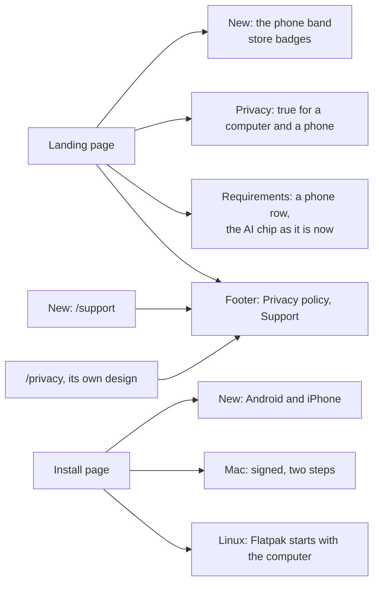

# The site before the store launch

The site was last reviewed with the journal ([The journal and the other capabilities on the
site](site-capabilities.md), approved 2026-11-19). Since then Nocturne has phone apps that work
with a computer or on their own ([Nocturne on Android and iPhone](phone-apps.md), [Nocturne on a
phone of its own](phone-first.md)), an online mind on a phone alone
([0020](/adr/0020-an-online-mind-on-a-phone.md)), a new rule for what private means ([What private
means](only-marked-private.md)), moving a memory between homes ([Moving your
memory](moving-memory.md)) and a designed nightly backup for a phone ([Backup on a phone of its
own](phone-backup.md)). Google Play and the App Store need a privacy policy address and a support
contact before a listing goes live, and the Mac download is about to be signed and notarised.

This page decides what the site says at the store launch and after it, in which words, and when
each part may go live. It carries forward what still holds of an unpublished draft of 17 November
("Site and app, saying the same true thing"), each fact checked again against `main`. The Now stage
is built; the rest waits for its event.

**Not on this page: the privacy policy's text.** It has its own design,
`docs/design/privacy-policy.md`, written separately with its own review. This page only decides
where the site links to it and at which address.

## At a glance

| Page | Sections that change | New |
|---|---|---|
| Landing `/` | Meta, hero, journal, Privacy, Engine, Requirements, Get Nocturne, footer | The phone band |
| Install `/install` | Meta, top, Mac, Linux, What your computer needs, After you install, footer, the visitor message | Android and iPhone |
| Support `/support` | | The whole page |
| Privacy policy `/privacy` | | Linked only; text in `docs/design/privacy-policy.md` |
| Not found | None | |

## Mockups

In `docs/design/mockups/site-refresh/`. `landing.html` and `install.html` are the built English
pages from `main` with the proposed words and sections; `support.html` is the new page. Each loads
the site's own stylesheet, fonts and pictures from `site/`, so serve the repository root over HTTP
and open them there. `site-refresh.css` holds the few rules the new parts add.

A yellow marker shows the words that change, to make them easy to find; it is not part of the
design. New sections carry no marker. The store badges are stand-ins of the official badges' size
and shape: the build uses the official artwork. The phone picture in `img/` is cut from the
approved phone mockup of Welcome (`mockups/phone-parity/first-release-welcome-*.png`); the build
captures the real app instead.

Renders are 1440 pixels wide at 1x and 390 wide at 2x, light. Each "before" is the site built from
`main`; each "after" is the mockup.

| Section | Before | After |
|---|---|---|
| Hero | `before-hero-1440.png`, `before-hero-390.png` | `after-hero-1440.png`, `after-hero-390.png` |
| The phone band (new) | | `after-phone-1440.png`, `after-phone-390.png`, `after-phone-1440-dark.png`, `after-phone-390-dark.png` |
| The journal's promises | `before-journal-1440.png`, `before-journal-390.png` | `after-journal-1440.png`, `after-journal-390.png` |
| Privacy | `before-privacy-1440.png`, `before-privacy-390.png` | `after-privacy-1440.png`, `after-privacy-390.png` |
| Engine | `before-engine-1440.png`, `before-engine-390.png` | `after-engine-1440.png`, `after-engine-390.png` |
| Requirements | `before-requirements-1440.png`, `before-requirements-390.png` | `after-requirements-1440.png`, `after-requirements-390.png` |
| Get Nocturne | `before-download-1440.png`, `before-download-390.png` | `after-download-1440.png`, `after-download-390.png` |
| Landing footer | `before-footer-1440.png`, `before-footer-390.png` | `after-footer-1440.png`, `after-footer-390.png` |
| Install, top | `before-install-top-1440.png`, `before-install-top-390.png` | `after-install-top-1440.png`, `after-install-top-390.png` |
| Install, opened on an Android phone | `before-install-phone-visitor-390.png` | `after-install-android-visitor-390.png` |
| Install, Mac | `before-install-mac-1440.png`, `before-install-mac-390.png` | `after-install-mac-1440.png`, `after-install-mac-390.png` |
| Install, Linux | `before-install-linux-1440.png`, `before-install-linux-390.png` | `after-install-linux-1440.png`, `after-install-linux-390.png` |
| Install, Android (new) | | `after-install-android-1440.png`, `after-install-android-390.png` |
| Install, iPhone (new) | | `after-install-iphone-1440.png`, `after-install-iphone-390.png` |
| Install, After you install | `before-install-after-1440.png`, `before-install-after-390.png` | `after-install-after-1440.png`, `after-install-after-390.png` |
| Install footer | `before-install-footer-1440.png`, `before-install-footer-390.png` | `after-install-footer-1440.png`, `after-install-footer-390.png` |
| Support (new) | | `support-1440-light.png`, `support-390-light.png`, `support-1440-dark.png`, `support-390-dark.png` |

The demo household is the one the app and the other designs use. No real names or data.

## What is true today

Every claim below was read from the code or an approved record on `main`. Where a claim depends on
something not built yet, its row says so and the copy waits for it ([When each part goes
live](#when-each-part-goes-live)).

| Fact | Evidence |
|---|---|
| The phone app is one app, `is.nocturne.phone`, published as Nocturne, for Android 8 or later and iOS 17 or later, iPhone only | `phone/src-tauri/tauri.conf.json:5`, `:21`; `phone/src-tauri/gen/android/app/build.gradle.kts:23`; `docs/contribution/building.md:531-533` |
| A phone can start on its own, with "Start on this phone", "Connect to my computer" and "I have a backup" | `ui/src/copy/en-GB/phone-alone.json:4-6`; `phone-first.md`, The first release |
| On its own, a phone keeps and finds by words from the first minute; answers and a page need a mind | `phone-first.md`, What a phone alone is |
| A phone alone can choose an online service with the person's own key, or move its memory to a computer. Apple Intelligence and a household's mind are not built | `phone-first.md:603`; `phone/src-tauri/src/mind/`; `move.rs` in the phone's `home` module; ADR 0020 |
| The online mind sends what each reading, page and answer needs, private things and check-ins included; what is let go or being forgotten never goes | `crates/engine/src/online.rs:455-471`; `phone/src-tauri/src/mind/ask.rs:100-115`; `phone-first.md`, step 4 |
| Online answers on a computer sends the question and at most 12 remembered sentences; today it still holds back things marked private, until the 2026-11-23 revision is built | `crates/engine/src/online.rs:189-205`; `docs/architecture/online.md`; `only-marked-private.md:11-30` |
| Both keep a list of what was sent, for 90 days | `docs/architecture/online.md`, The sent log; `phone/src-tauri/src/mind/sent.rs` |
| Calendar and health are read only and go only to the person's own computer over the sealed channel; no health reading goes to an online service | `phone/src-tauri/src/sync/mod.rs:1-8`; `phone-health.md:412`, `:415` |
| The phone has no notifications, ads, analytics or crash reporting | `phone-apps.md`, What changes and what stays; a search of the app's code for analytics, crash and push services found none |
| The nightly backup to iCloud or Google Drive is designed, not built. Raw health readings are left out of it (owner, 2026-11-24); pages, reflections and day lines are in | `phone-backup.md`; ADR 0019 (proposed); no iCloud or Drive code under `phone/` |
| The app links the privacy policy at `https://nocturne.is/privacy`, from This phone and the calendar and health screens | `ui/src/phone/native/screens/parts.tsx:8`; `ui/src/phone/alone/screens/ThisPhone.tsx:350-352` |
| The phone's "Get help", on a memory it can't open, opens the landing page | `ui/src/phone/native/NativeRoot.tsx:26`, `:53`, `:255` |
| Out of the box, a computer goes online only inside a download window the person agreed to; the engine runs offline otherwise, with its telemetry and model update checks off | `crates/lemonade/src/config.rs:61-67`, `:83-89`, `:108`; `crates/lemonade/src/supervisor.rs:214-221` |
| There is no app update check or download in the app. The ledger's update kinds are never written | `src-tauri/src/lib.rs:253-265`; `crates/contract/src/system.rs:267-269` |
| The network check runs before a release, on a computer only, by hand | `Makefile:109-116`; `scripts/e2e-real.sh:205-224`; `docs/contribution/release.md:205`, `:236`, `:267`. No phone check found |
| The Flatpak starts with the computer through the Background portal | `src-tauri/src/os/mod.rs:229-231`, `:289-300`; CHANGELOG 0.3.0 "start at login through the portal" |
| A signed Mac release drops the first-open steps once `MACOS_SIGNING` is on | `docs/contribution/release.md:116-122`; macOS 26 minimum, `src-tauri/bundle/macos.json:25` |
| No signed release APK is built yet; CI builds a debug APK only | `.github/workflows/ci.yml:698-751` |
| The AI chip reads voice notes from 16 GB, reads what is kept on many computers with 32 GB or more, and also answers on some; its mind is a 9.1 GB download | `crates/lemonade/src/npu.rs:31-42`, `:56`, `:154-236`, tests `:621-686`; [0014](/adr/0014-npu-mind.md) |
| The first page is due at the page time the person chooses, any quarter hour | `crates/intelligence/src/schedule.rs:10-13`, `:36-59`; `crates/intelligence/src/scheduler.rs:34` |
| The site sets no cookie, loads nothing from elsewhere and sends nothing | `site/_headers:5`; `site/assets/js/install.js:1-2`; `site/assets/js/lang.js` |

Two things could not be confirmed in code, so the site makes no claim about them:

- Where the engine downloads models from. The pinned engine fetches them; the host is not named in
  this repository.
- Whether Android's fallback speech reader, used when the phone has no on-device reader for a
  language, ever reaches a server. The app asks for offline reading only
  (`phone/plugins/speech/android/src/main/java/app/nocturne/speech/SpeechReader.kt:100-130`). On
  iPhone, reading is on the device by rule (`phone/plugins/speech/ios/Sources/SpeechPlugin.swift:43-49`).
  The site does not say voice notes stay on an Android phone.

## The landing page

Strings in `site/i18n/en.json`, shown by `site/index.html`. Line numbers are in `en.json`.

### Meta and hero

| Key | Now | Proposed | Why, with evidence |
|---|---|---|---|
| `head.description` (:3) | Nocturne is a free, private app for your computer. … | Nocturne is a free, private app for your computer and your phone. … (the rest unchanged) | The phone app is the same Nocturne (`phone-apps.md`, Goals) |
| `head.og.description` (:4) | … get one page of what needs you, all on your own computer. | … get one page of what needs you, kept on your own computer or phone. | A phone alone holds its own memory ([0018](/adr/0018-a-phone-as-its-own-home.md)); "all on" is untrue once an online mind writes the page |
| `hero.lede` (:20) | … each morning get one page of what needs you, all on your own computer. | … each morning get one page of what needs you, kept on your own computer or phone. | As above |
| `hero.fact.platforms` (:24) | Mac, Windows, Linux | Mac, Windows, Linux, Android, iPhone | Each name joins when its listing is live |
| `hero.fact.offline` | Offline after setup | Unchanged | Still true on a computer; a phone alone needs no setup download (question 10) |

The headline, the download button and its address are unchanged: `/install` now lists phones too.

### The phone band (new)

After the journal, before Privacy. The phone picture moves here from Privacy (question 1), and
shows the app's Welcome instead of the retired phone page in a browser.

| Key | Words |
|---|---|
| `phone.eyebrow` | On your phone · Android and iPhone |
| `phone.title` | With your computer, or on its own. |
| `phone.body` | Nocturne on your phone keeps notes, photos and voice notes, your journal and check-ins, and can show your calendar and health readings beside your days. No account and no sign-in. |
| `phone.stores.aria` | Get the phone app |
| (badges) | The official "Get it on Google Play" and "Download on the App Store" badges, in the page's language, self-hosted (question 3) |
| `phone.needs` | Android 8 or later. An iPhone with iOS 17 or later. How the phone app treats your data (a link to `/privacy`). |
| `phone.with.term` | With your computer |
| `phone.with.detail` | Pair it with Nocturne on your computer, and your phone can keep, ask and read your page and journal while you are out. Your memory stays on your computer, and the connection is sealed so the company in between cannot read it. |
| `phone.alone.term` | On its own |
| `phone.alone.detail` | Start on the phone, with no computer. From the first minute it keeps, and finds what you kept by its words. For answers and a morning page, give it a mind: a service you choose online, or Nocturne on your own computer, which your memory then moves to. |
| `phone.backup.term` | Backed up each night |
| `phone.backup.detail` | Turn on a nightly backup to your own iCloud or Google Drive, locked with a phrase only you hold. Apple and Google keep it but cannot open it, and neither can Nocturne’s makers. |
| `phone.health.term` | Calendar and health, if you want them |
| `phone.health.detail` | Read only, from your phone’s calendar and from Apple Health or Health Connect. Shown beside your journal and on your page, never as medical advice. |
| `phone.alt` (replaces :74) | Nocturne on a phone the first time it opens: Nocturne remembers your day, with Start on this phone, Connect to my computer and I have a backup. |
| `phone.caption` (replaces :75) | Nocturne on Android, the first time it opens. From the app, with demo data. |

Evidence: pairing and what a phone can do, `docs/architecture/remote.md`, What a phone can do;
sealed, `crates/channel/src/crypto.rs`; on its own and its mind, `phone-first.md:603`; calendar
and health read only, `phone/src-tauri/src/sync/mod.rs:1-8` and `phone-health.md`; no medical
claims, `phone-health.md`, Goals. The backup row waits for the backup to ship. The band says
nothing about health in the backup: that detail is the policy's.

No header link for the band: the header keeps its four section links in every language
([site capabilities, decision 1](site-capabilities.md#decisions)).

### The journal

| Key | Now | Proposed | Why |
|---|---|---|---|
| `journal.quiet.detail` (:55) | … If you turn on Online answers, a line from your journal can go with a question it helps answer. Your check-ins, reflections and recaps never do. | … If you choose an online service for answers, your journal can go to it when it helps, and the screen that turns it on says exactly what. | A phone's online mind gets the journal and check-ins (`phone-first.md`, step 1; ADR 0020). The new words are true on both |

### Privacy

The approved band ([trust copy](landing-trust-copy.md), [site
capabilities](site-capabilities.md)) promised one computer. It now has to hold for a phone too,
without inventing a rule the owner did not make.

| Key | Now | Proposed | Why |
|---|---|---|---|
| `privacy.title` (:60) | Your life stays on your computer. | Your life stays on your own computer or phone. | A phone alone is a home of its own (question 2) |
| `privacy.body` (:61) | Out of the box, Nocturne goes online only for downloads you agree to: its mind at setup and any update you allow. Privacy in the app lists each one with the day and the size. | Out of the box, Nocturne on a computer goes online only for downloads you agree to: its mind at setup, and a new one only if you choose it. Privacy in the app lists each one with the day and the size. Nocturne on a phone sends nothing until you turn something on. | There is no app update in the app (`src-tauri/src/lib.rs:253-265`; `system.rs:267-269`); a new mind downloads only after a yes (`config.rs:61-67`). The phone's mind, connection and calendar sending are all off until turned on (`phone-first.md`; `phone/src-tauri/src/mind/mod.rs:1-9`). Store updates are the store's, not Nocturne's (`phone-apps.md`, Privacy and the rules that apply) |
| `promise.signin.detail` (:63) | No account, no analytics, no crash reports, no cloud copy. To keep a copy … | No account, no analytics, no crash reports, and nothing is ever sent to Nocturne’s makers. To keep a copy somewhere safe, back everything up to one file, locked with a passphrase you choose. | "No cloud copy" stops being true when the phone's nightly backup ships; the new words stay true after it. With the backup, one sentence is added: "On a phone, a nightly backup to your own iCloud or Google Drive is locked the same way." |
| `promise.checked.detail` (:65) | Before a release, Nocturne is run with its network cut off from everything but this computer, … | Before a release, Nocturne on a computer is run with its network cut off from everything but that computer, and any attempt to reach further fails the check. | The check covers the computer only (question 11) |
| `promise.extras.term` (:72) | Two extras, off until you ask | Online only when you ask | There are now more than two ways out. "Two" was a promise ([site capabilities, decision 3](site-capabilities.md#decisions)) that no longer holds |
| `promise.extras.detail` (:73) | … Online answers sends a question, and the few remembered sentences it needs, to one service you choose. They can include lines from your journal, but never your check-ins, reflections or recaps. Never anything marked private. | Away from home lets your own phone ask, keep and read your page and journal, sealed so the company in between cannot read it. Online answers on a computer sends a question and the lines that answer it. An online mind on a phone also sends what you keep, so it can read it and write your page. Each goes to one service you choose, the screen that turns it on says exactly what goes, and Nocturne lists everything it sent. | "Never anything marked private" is untrue for a phone's online mind today and for Online answers once the 2026-11-23 revision is built (`only-marked-private.md`); "never your check-ins" is untrue on a phone. The new words make no claim about private at all (question 4) |
| `promise.note.*` | One quiet note a day | Unchanged | The phone shows no notifications (`phone-apps.md`) |
| `promise.edit.*`, `promise.forget.*` | | Unchanged | True on both |

The phone figure leaves this band (see the phone band), so the promises sit beside the intro.

### Engine

| Key | Now | Proposed | Why |
|---|---|---|---|
| `engine.body1` (:78) | Nocturne’s thinking runs on Embeddable Lemonade … that only this computer can reach. | On a computer, Nocturne’s thinking runs on Embeddable Lemonade … that only this computer can reach. | A phone has no engine; its mind is a computer or a chosen service |

### Requirements

| Key | Now | Proposed | Why |
|---|---|---|---|
| `req.chip.detail` (:88) | Helpful, never needed. On some AMD computers with an AI chip and 16 GB or more, the AI chip reads your voice notes, so answers and the daily tidy do not wait for them. | Helpful, never needed. On AMD Ryzen AI 300 series computers and newer, with 16 GB or more, the AI chip reads your voice notes. On many with 32 GB or more it also reads what you keep, and on some it answers your questions too, so the rest of the computer has less to do. | From the 17 November draft, checked again: `npu.rs:31-42`, `:154-236`, tests `:621-686`; `docs/guide/npu.md`, Which computers. "Many" because 64 GB keeps the graphics; "some" because only "NPU only" answers |
| `req.phone.term` (new) | | A phone | |
| `req.phone.detail` (new) | | Android 8 or later, or an iPhone with iOS 17 or later. The phone app works on its own, or with Nocturne on your computer. | `build.gradle.kts:23`; `tauri.conf.json:21` |
| `req.downloads` (:103) | Downloads at setup are between about 3 GB and 26 GB, depending on the setup. After that, … | Downloads at setup are between about 3 GB and 26 GB, depending on the setup, and about 9 GB more where the AI chip reads what you keep. After that, Nocturne works with no internet at all. | 9.1 GB mind, 0.62 GB speech, 41 MB runtime (`npu.rs:31-42`, `:56`); the site's figures are GiB rounded (`crates/lemonade/src/tier.rs:113-120`) |

`req.title` stays "Will it run on my computer?": the phone row answers the phone without a second
heading. The four setups' figures are unchanged (checked against `tier.rs:66-140`).

### Get Nocturne

| Key | Now | Proposed | Why |
|---|---|---|---|
| `get.body` (:105) | Free and open source, for Mac, Windows and Linux. Download it, … | Free and open source, for Mac, Windows, Linux, Android and iPhone. Download it, open it, and it sets itself up for the computer it is on. | As the hero facts |
| (actions) | Download · Build it from source | Download · Build it from source · the two store badges | One click to a store from the end of the page |

The 17 November draft proposed a sentence here about asking Nocturne for help. The owner chose on
2026-11-19 not to put help on the landing page ([site capabilities](site-capabilities.md), "Help
from the guide in the ask box"); it is on the support page instead.

### Footer

| Key | Proposed | Address |
|---|---|---|
| `foot.privacy` (new) | Privacy policy | `/privacy` |
| `foot.support` (new) | Support | `/support` |

Order: Docs, Your data, Privacy policy, Support, Download, Font licence. The install page's footer
gains the same two links after Install guide. On a translated page both links point at the
English pages with the EN mark, unless the page is translated (question 7).

## The install page

Strings in `site/i18n/en.json`, shown by `site/install.html`; the visitor messages are in
`site/assets/js/install.js:6-16` and, on translated pages, in `data-msg-*` attributes.

### Meta and top

| Key | Now | Proposed |
|---|---|---|
| `install.title` (:114) | Get Nocturne · Download for Mac, Windows and Linux | Get Nocturne · Download for Mac, Windows, Linux, Android and iPhone |
| `install.description` (:115) | Download Nocturne for a Mac with an Apple chip, a Windows 10 or 11 computer, or a Linux desktop. … | Download Nocturne for a Mac with an Apple chip, a Windows 10 or 11 computer, a Linux desktop, an Android phone or an iPhone. Free and open source, with no account. |
| `install.og.description` (:116) | Free and open source, with no account. The first time it opens, Nocturne sets itself up for the computer it is on. | Free and open source, with no account, for your computer and your phone. |
| `install.lede` (:118) | Free and open source, for Mac, Windows and Linux. No account, nothing to sign in to. | Free and open source, for Mac, Windows, Linux, Android and iPhone. No account, nothing to sign in to. |
| `install.here` (:119) | Choose your computer below. Each link gives the latest version. | Choose your computer or phone below. Each link gives the latest version. |
| `install.others` (:155) | Other computers | Other computers and phones |

### The visitor message

`install.js` sends every phone to "other" today (`install.js:23`), which tells a phone visitor
that Nocturne is a desktop app. It becomes:

| Message | Now | Proposed |
|---|---|---|
| `js.android` (new) | | This looks like an Android phone, so its app comes first. |
| `js.iphone` (new) | | This looks like an iPhone, so its app comes first. |
| `js.other` (:188) | Nocturne is a desktop app, for Mac, Windows and Linux computers. Open this page on the computer you want to use it on, or choose one below. | Nocturne is for Mac, Windows and Linux computers, and for Android phones and iPhones. Choose one below. |

An iPad and a Chromebook stay "other". Until the App Store listing is live, an iPhone is "other"
too, and the iPhone section is not on the page: no "coming soon".

### Android and iPhone (new sections)

After Linux, in the same platform card. Each moves to the top for its own phone.

| Part | Android | iPhone |
|---|---|---|
| Heading, spec line | Android · Android 8 or later | iPhone · iOS 17 or later |
| Here tag | For this phone | For this phone |
| Download | The Google Play badge | The App Store badge |
| File line | Nocturne, by Nocturne | Nocturne, by Nocturne |
| Note | Works on its own, or with Nocturne on your computer. No Google Play on your phone? [Download the app file] instead; your phone asks once to allow installs from your browser. | For iPhone. Works on its own, or with Nocturne on your computer. |
| The first time you open it, 1 | Choose **Start on this phone**, or **Connect to my computer** if Nocturne is on your computer. | The same |
| The first time you open it, 2 | Nocturne asks before it uses your microphone, calendar or health readings. **Not now** always works, and you can change it later in **This phone**. | Nocturne asks before it uses your microphone, calendar or Apple Health. **Not now** always works, and you can change it later in **This phone**. |
| Why line | Google Play keeps it up to date. Privacy policy (a link to `/privacy`) | The App Store keeps it up to date. Privacy policy (a link to `/privacy`) |

The app file sentence waits for a signed release APK in `SHA256SUMS` (question 5). Evidence:
Welcome buttons, `phone-alone.json:4-6`; the working no, `phone-apps.md`, goal 5; This phone,
`ThisPhone.tsx:350-352`.

### Mac, once signed

Live only when the release is signed and notarised (`MACOS_SIGNING`, `release.md:116-122`). The
release notes and `docs/guide/install.md`, "The first time you open it", change with it.

| Key | Now | Proposed |
|---|---|---|
| `mac.step2` (:126) | Open Nocturne from Applications. Your Mac says “Nocturne” Not Opened, because it could not check the app. Click **Done**. | Open Nocturne from Applications. The first time, your Mac asks whether you want to open an app downloaded from the internet. Click **Open**. |
| `mac.step3`, `mac.step4` (:127-128) | Privacy & Security, Open Anyway, password | Removed |
| `mac.why` (:129) | You only do this once. Apple charges a yearly fee … this release is not signed yet. | Nocturne for Mac is signed and checked by Apple, so it opens like any other app. |

macOS's own words in its prompt are checked on the first signed build before the step ships.
Windows stays as it is: it is not signed.

### Linux

| Key | Now | Proposed | Why |
|---|---|---|---|
| `linux.flatpak.text` (:139) | The choice for most people, on any Linux desktop. Your software centre keeps Nocturne up to date. Starting with the computer is not available this way yet. | The choice for most people, on any Linux desktop. Your software centre keeps Nocturne up to date. | Untrue since 0.3.0: the Flatpak starts with the computer through the Background portal (`src-tauri/src/os/mod.rs:229-231`, `:289-300`). Fix now |

### What your computer needs, and After you install

| Key | Now | Proposed | Why |
|---|---|---|---|
| `req.chip.detail`, `req.downloads`, `req.phone.*` | | As on the landing page | Shared strings |
| `after.body` (:159) | Nocturne opens a short setup. You can keep things straight away. | On a computer, Nocturne opens a short setup. You can keep things straight away. | The steps are the computer's; a phone's first steps are in its own section |
| `after.2.text` (:165) | It asks first, then downloads what this computer can run: between about 3 GB and 26 GB. This is the only time … | It asks first, then downloads what this computer can run: between about 3 GB and 26 GB, and about 9 GB more where the AI chip reads what you keep. This is the only time Nocturne needs the internet, and it carries on by itself if the connection drops. | As `req.downloads` |
| `after.3.when` (:166) | The next morning | At the time you choose | The first page is due at the page time, any hour (`schedule.rs:36-59`) |
| `install.checks` (:156) | To make sure a download is the one we published, compare it with the fingerprints in SHA256SUMS. … | Unchanged; the app file joins `SHA256SUMS` when it is offered | |

## The support page (new)

Address `/support`, the file `site/support.html`, in the site's layout and voice. It is what the
App Store's support address and Google Play's contact point to. Its last section holds the one
contact the stores require.

| Part | Words |
|---|---|
| `<title>` | Support · Nocturne |
| Description | Help with Nocturne on a computer or a phone: answers from its own guide, what to try first, and how to reach the people who make it. |
| Heading | Help with Nocturne. |
| Lede | Nocturne keeps everything on your own computer or phone, so no help desk can see your memory. Help starts with Nocturne itself and its guide, and the people who make it are a message away. |
| Band | Start here. |
| Card, Ask Nocturne | On a computer, type your question in the ask box, like “how do I add a phone”. Nocturne answers from the guide that comes with it and shows the part it used. |
| Card, On your phone | Open **This phone**, then **Help**: what this phone can do, its permissions with a way to change them, and the privacy policy. |
| Card, Read the guide | [Installing], [your computer’s desktop], [Away from home], [Online answers] and [your data]. (`/docs/guide/install.html`, `desktops.html`, `away-from-home.html`, `online-answers.html`, `your-data.html`) |
| Band | Common questions. |
| My page didn’t come | Nocturne writes it in the hours before your page time, while the computer is on, plugged in and not in use. If it was off or asleep, Nocturne catches up when it wakes. [The guide] explains each desktop. |
| I lost my phone | If it was paired with your computer, your memory is on the computer: open **Away from home** there, choose **See phones**, then **Remove** beside it. If the phone kept your memory on its own, install Nocturne on the new phone and choose **I have a backup**. |
| I forgot my passphrase | No one can open a locked backup without its passphrase or recovery key, not even the people who make Nocturne. Make a new backup with a passphrase you can keep. |
| How do I delete everything? | Choose **Delete everything…** in **Privacy** on a computer, or in **This phone** on a phone that keeps your memory itself. Nocturne’s makers hold nothing of yours, so there is nothing else to ask for. A service you chose for answers keeps what it received under its own rules. |
| What does Nocturne collect? | Nothing. No account, no analytics, no crash reports. The [privacy policy] says exactly what can leave your computer or phone, and only when you turn it on. |
| Band | Write to us. |
| Email | Something not working, or a word that reads wrong? Email `hello@nocturne.is`. A person reads every message. Say which computer or phone you use and what you saw; never send what you kept, your passphrase or your online service key. |
| GitHub | Or open an issue on [GitHub]. Issues are public, so leave out anything personal. |
| Security | To report a security problem, use [GitHub’s private reporting], not a public issue. |

Evidence: help from the guide with its receipts, `src-tauri/src/help.rs:1-6`, `:20-35` and
[Help with Nocturne](in-app-help.md); This phone's Help group, `ThisPhone.tsx:350-357`; the page
time and catching up, `scheduler.rs:1-9`, `:34`, `schedule.rs:10-13` and `docs/guide/desktops.md`;
removing a phone, `docs/guide/away-from-home.md:131-135`; the passphrase,
`docs/guide/your-data.md:51-57`; Delete everything, `docs/guide/your-data.md:107-109` and
`phone-alone.json:61`; private reporting, `SECURITY.md:3-6`.

The address is `hello@nocturne.is` (question 8, settled). "I have a backup"
restores a backup file today and the nightly backup once it ships, so the answer holds for both.

### Linked from

| Where | Link |
|---|---|
| Every page's footer | Support |
| The App Store listing's support address and Google Play's contact | `https://nocturne.is/support` |
| The phone's "Get help" on a memory it can't open | Today the landing page; proposed `/support` (question 12) |

## The privacy policy page

Its words, structure and review are in `docs/design/privacy-policy.md`, a separate design. This page
fixes only the address and the links to it.

| Where | Link |
|---|---|
| Every page's footer | Privacy policy, `/privacy` |
| The phone band | "How the phone app treats your data", under the badges |
| The install page's Android and iPhone sections | "Privacy policy", in the why line |
| The support page | "What does Nocturne collect?" |
| The app (already built) | `https://nocturne.is/privacy` (`parts.tsx:8`) |
| The store listings, Google's consent screen for Drive, Health Connect's and HealthKit's declarations | `https://nocturne.is/privacy` |

The address is `/privacy`, built from `privacy.html` like `/install`, because the app already opens
that address. The static assets answer `/privacy/` with a redirect to it, so a link written either
way works (question 6). It and `/support` must be live before the first store submission.

## When each part goes live

The site deploys from `main` and may only claim what has shipped ([The
website](../contribution/website.md#what-the-page-may-say)). So the build is staged, each stage
merged with the thing it describes.

| Stage | What goes live | Waits for |
|---|---|---|
| Now | `linux.flatpak.text`; `after.3.when`; `req.chip.detail`, `req.downloads`, `after.2.text` | Nothing: each corrects an untrue line |
| Before the first store submission | `/privacy` and `/support`, and their footer links | The policy's own design and approval; the support address |
| Google Play listing live | The phone band without the backup row and without iPhone; Android on the install page; `js.android`; the hero facts, `get.body`, meta and `install.*` naming Android; the Privacy band, journal and Engine changes; `req.phone.*` | The listing; the phone release that ships the online mind on Android |
| App Store listing live | "and iPhone" and "iPhone" wherever the table above names it; the App Store badge; the iPhone section; `js.iphone` | The listing |
| Mac signed and notarised | `mac.step2`, `mac.why`; `mac.step3` and `mac.step4` removed | A release with `MACOS_SIGNING` on |
| A signed release APK | The app file sentence on Android | The release pipeline and `SHA256SUMS` carrying it |
| The phone's nightly backup ships | `phone.backup.*`; the backup sentence in `promise.signin.detail` | ADR 0019 accepted and built |

Each stage before its event keeps the words it has: the Privacy and journal rows, for example,
stay as they are on `main` until the phone release, because they are true for a computer today.

## Pictures

| Picture | Change |
|---|---|
| `site/assets/img/phone-*` | Recaptured from the native app's Welcome on demo data, replacing the browser phone page with its private note (`ui/src/copy/en-GB/phone.json:98`) |
| Store badges | The official artwork from Apple and Google in each of the six languages, self-hosted under `site/assets/img/` so the content security policy stays `img-src 'self'`, used as each company's guidelines say: unaltered, at their minimum size or larger, with clear space |
| `page-*`, `today-*`, `og.png` | The demo page subtitle reads "Overnight Nocturne read 14 things you kept…" (`ui/src/engine/mock/seed/pages.ts:19`, `ui/src/phone/mock.ts:241`) beside the site's "by night or by day". Recaptured once the demo data loses "Overnight" (question 15) |
| `recent-*` | Shows "Nocturne reads it tonight, or sooner if the computer is free." (`ui/src/copy/en-GB/recent.json:4`). Recaptured once the app's words change (question 15) |

## Translations

The five languages translate every new or changed key below, each with the new English in `from`;
`make site/strings` refuses anything older. The rows in `site-copy/de.md`, `es.md`, `fr.md`,
`it.md` and `nl.md` change with them, following each language's glossary ("AI chip", "keep" and
"Online answers" as each glossary sets). Nothing here is translated yet: the built stage's keys show as stale or missing until it is.

| Group | Keys |
|---|---|
| Changed, landing | `head.description`, `head.og.description`, `hero.lede`, `hero.fact.platforms`, `journal.quiet.detail`, `privacy.title`, `privacy.body`, `promise.signin.detail`, `promise.checked.detail`, `promise.extras.term`, `promise.extras.detail`, `phone.alt`, `phone.caption`, `engine.body1`, `req.chip.detail`, `req.downloads`, `get.body` |
| New, landing | `phone.eyebrow`, `phone.title`, `phone.body`, `phone.stores.aria`, `phone.needs`, `phone.with.term`, `phone.with.detail`, `phone.alone.term`, `phone.alone.detail`, `phone.backup.term`, `phone.backup.detail`, `phone.health.term`, `phone.health.detail`, `req.phone.term`, `req.phone.detail`, `foot.privacy`, `foot.support` |
| Changed, install | `install.title`, `install.description`, `install.og.description`, `install.lede`, `install.here`, `install.others`, `mac.step2`, `mac.why`, `linux.flatpak.text`, `after.body`, `after.2.text`, `after.3.when`, `js.other` |
| New, install | `install.hereTagPhone`, `android.spec`, `android.note`, `android.step1` (shared by both phones), `android.step2`, `android.why`, `iphone.spec`, `iphone.note`, `iphone.step2`, `iphone.why`, `js.android`, `js.iphone` |
| Removed | `mac.step3`, `mac.step4` |
| Support page | Every string, if question 7 chooses it |

Notes for the translators:

- Names stay as they are: Google Play, App Store, iCloud, Google Drive, Apple Health, Health
  Connect, Android, iPhone, iOS.
- Words a person sees in the app keep the English after them in brackets while the app is in
  English ([the site in five languages](site-localisation.md#what-stays-english)): Start on this
  phone, Connect to my computer, This phone, Not now.
- The badge alt texts are each company's own words in that language, from its badge kit.

## Considered and not shown

| Capability | Why not on the site |
|---|---|
| Decision models in shadow ([0016](/adr/0016-decision-models-shadow-first.md)) | Nothing a person sees changes; the words are jargon |
| A household's mind | Not built; designed only |
| Apple Intelligence on iPhone | Not built; after a trial |
| Moving a memory back from a computer to a phone | Not built. Moving from a phone to a computer is, and the phone band says so |
| Help from the guide on the landing page | The owner chose against it on 2026-11-19; it is on the support page |
| A header link for the phone band | The header keeps four section links in every language |

## Changes to other pages

Made with the build, not by this proposal.

| Page | Change |
|---|---|
| [Phone backup](phone-backup.md), What goes each night, and its copy | Raw health readings are left out of the backup and read again from Apple Health or Health Connect after a restore (owner, 2026-11-24). The page still lists them |
| `docs/guide/install.md`, The first time you open it | The Mac steps, once signed |
| [The website](../contribution/website.md) | The support and privacy pages in the page table; the store badges and where they come from |
| [Site copy](site-copy/index.md) and each language | The new and changed rows |
| [Nocturne on Android and iPhone](phone-apps.md), The stores | The policy and support addresses |

## Questions for the owner

Owner, 2026-11-24: all recommended. Each row's recommendation is the decision, and where a row
says "settled" it already was.

| # | Question | Options | Trade-offs | Recommendation |
|---|---|---|---|---|
| 1 | Where do phones go on the landing page? | A: a phone band after the journal, the phone picture moved into it. B: the band, and Privacy keeps its Away from home picture too. C: no band, only lines in Privacy and Requirements | A gives phones one clear place and keeps Privacy about promises. B shows two phones on one page. C hides the biggest change since launch in small print | **A** |
| 2 | Privacy's title | A: "Your life stays on your own computer or phone." B: keep "Your life stays on your computer." C: "Your life stays with you." | A is true for both homes and keeps the approved voice. B is untrue for a phone alone. C is vaguer and claims less | **A** |
| 3 | Store badges | A: the official badges, self-hosted, in each language. B: the site's own buttons, "Get it on Google Play" in text | A is what people recognise and trust, and what the stores' guidelines expect of a badge. B matches the page's calm better but reads like a link to anywhere | **A** |
| 4 | What the site says about things marked private | A: nothing; each screen that turns a service on says what goes (proposed). B: add "Marking something private keeps it from coming up on its own." C: keep "Never anything marked private" | A promises nothing beyond the owner's rule. B is true and may reassure, but explains a setting on a marketing page. C is untrue on a phone today and on a computer once the revision is built | **A** |
| 5 | Android without Google Play | A: link a signed app file from launch. B: Google Play only at launch, the file once the release pipeline signs and lists it | A keeps the approved decision 5 from day one but needs a signing pipeline that does not exist. B ships on time and adds the file later | **B** |
| 6 | The policy's and support's addresses | A: `/privacy` and `/support`, like `/install`, with the trailing slash redirecting. B: `/privacy/` and `/support/` | A matches the link already in the app and the site's other pages. B needs an app change or a redirect the other way | **A** |
| 7 | Languages for the new pages | A: both in English, linked with the EN mark. B: support translated, the policy in English. C: both translated | A is fastest. B helps the people most likely to need help, and keeps the policy's exact words in one language until a reviewed translation exists. C is most welcoming and needs each translation reviewed like the English | **B** |
| 8 | The support address | A: a mailbox at the site's domain, like `support@` there, forwarded. B: GitHub issues only | A is what both stores ask for and what a non-technical person can use. B needs a GitHub account and is public | **A**, settled: `hello@nocturne.is` |
| 9 | A reply time on the support page | A: none, "A person reads every message." B: "We answer within a week." | A promises only what is true. B sets an expectation the project must keep | **A** |
| 10 | "Offline after setup" in the hero | A: keep. B: "Works offline" | A stays true on a computer, and a phone alone needs no setup download. B claims more of a phone with an online mind | **A** |
| 11 | "Checked, not just claimed" and the phone | A: scope it to the computer (proposed). B: add a network check of the phone app to each release, then drop "on a computer" | A is true now. B is the stronger promise and needs a phone check that does not exist yet | **A** now, **B** as a follow-up |
| 12 | The phone's "Get help" on a memory it can't open | A: open `/support`. B: keep opening the landing page | A lands a person in trouble where help is. B shows a sales page at a bad moment. A is an app change to one address | **A** |
| 13 | Android and iPhone at once? | A: one launch with both. B: each joins the site when its listing is live | A is one announcement but waits for the iPhone's signing and review. B follows the approved Android-first order | **B** |
| 14 | "Kept on your own computer or phone" in the lede and meta | A: as proposed. B: keep "all on your own computer" until the phone release | A is true from the phone release on. B is true until then, so it stays until the Google Play stage either way | **A**, at the Google Play stage |
| 15 | "Overnight" in the site's pictures | A: change the demo data and the app's waiting line first (from the 17 November draft), then recapture. B: recapture as they are | A keeps the pictures true beside "by night or by day". B is faster but keeps a line the app no longer means | **A** |

## Approval

The owner approved this design on 2026-11-24 with every recommended answer under [Questions for the
owner](#questions-for-the-owner). The staged build follows [When each part goes
live](#when-each-part-goes-live).

| Stage | State |
|---|---|
| Now | Built: the five corrected lines and the support page with its footer link |
| Before the first store submission | `/support` is built; `/privacy` and its footer link wait for the policy's review |
| The other stages | Wait for what each names |

Two choices made while building the support page, to settle with the stage that follows them:

- The answer to "What does Nocturne collect?" does not name the privacy policy or link to it while
  `/privacy` does not exist. It reads "Nothing. No account, no analytics, no crash reports. Only
  what you turn on can leave your computer or phone." The words in [The support page
  (new)](#the-support-page-new) return with the policy.
- Question 7 chose a translated support page, so each language needs the new strings and the
  five corrected lines. Until those are written, `make site/strings` fails by design, and the
  strings list each language shows as missing or stale.
